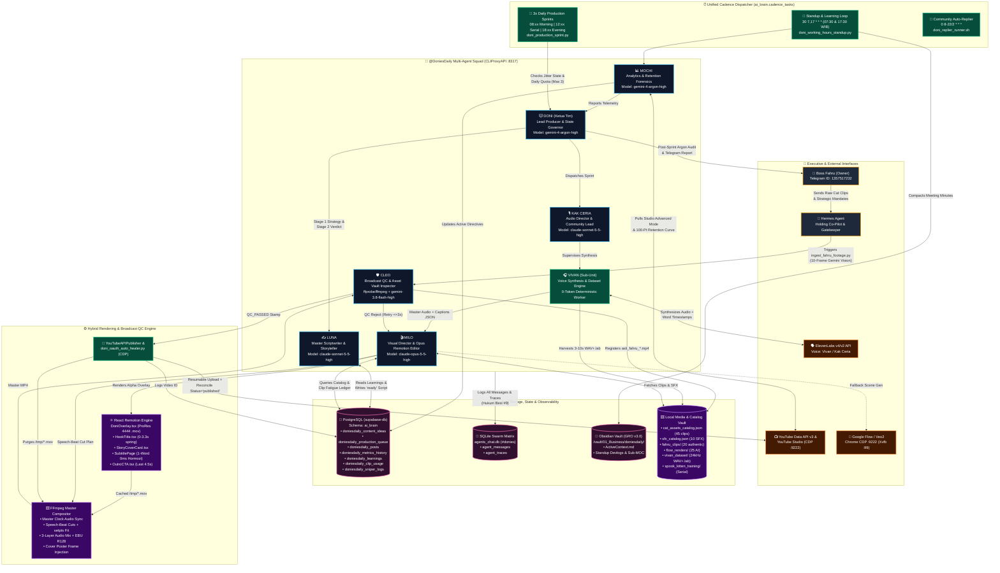

# DELIVERABLE 01: MASTER SYSTEM AUDIT — PHASE 1
## COMPLETE SYSTEM INVENTORY & HIGH-LEVEL ARCHITECTURE OVERVIEW

**Audit Target:** `@DoniesDaily` Autonomous Multi-Agent YouTube Shorts Production Ecosystem  
**Canonical Workspace:** `/home/ubuntu/apps/ugc-lemonaru/` & `/home/ubuntu/tools/`  
**Obsidian Knowledge Base:** `/home/ubuntu/vault/01_Business/doniesdaily/`  
**Audit Status:** READ-ONLY VERIFIED AGAINST PRODUCTION SOURCE & SCHEMAS  

---

## 1. Executive System Summary

### 1.1 Official Channel Identity & Mission
* **Official Channel Name:** DoniesDaily (`@DoniesDaily`)
* **YouTube Channel ID:** `UCNPtjF2aB0wvWHI0q7hhcCg`
* **Primary Format:** 9:16 Vertical YouTube Shorts (`1080x1920`, H.264 MP4, 30 FPS)
* **Core Mission:** Autonomous production and publication of broadcast-quality feline education, psychology, and humor YouTube Shorts designed for the Indonesian "pawrents" demographic (ages 15–35), targeting a rapid sprint to 100+ subscribers and high organic retention without external content scraping, duplicate topics, or audio-visual desynchronization.

### 1.2 Vision & Architectural Evolution
Evidence within the codebase and React component tree reveals that the `@DoniesDaily` engine evolved directly out of an e-commerce/TikTok affiliate User-Generated Content (UGC) automation platform (`ugc-lemonaru`):
* **Legacy Affiliate Roots:** The root directory `/home/ubuntu/apps/ugc-lemonaru/` and default props inside Remotion components—such as `badgeText = "🔥 RACUN TIKTOK OOTD"` in `HookTitle.tsx` and `headline = "CHECKOUT SEKARANG!"` / `buttonText = "KLIK KERANJANG KUNING"` in `OutroCTA.tsx`—confirm its origin as a TikTok Shop affiliate video factory.
* **Pivot to Broadcast Media Squad:** The infrastructure was refactored into a specialized, self-improving autonomous broadcast studio governed by 15 strict invariant rules ("Hukum Besi"). Rather than relying on generic FFmpeg text filters or scraped stock video, the system combines authentic owner-supplied cat footage (`fahru_clips`), AI-generated cinematic b-roll (Google Flow / Veo2 via Chrome CDP), expressive ElevenLabs v4/v2 voice synthesis, React Remotion kinetic typography, and a closed-loop YouTube Studio analytics feedback engine.

---

## 2. High-Level Architectural Paradigm

### 2.1 Database-First "AI Brain" Architecture
The system operates on a **Database-First State & Memory Architecture** hosted locally on the VPS via a containerized Supabase PostgreSQL instance (`docker exec -i supabase-db psql -U postgres -d postgres`), isolated under the `ai_brain` schema:
* **Note on Dual-Brain Context:** While the broader holding environment references a "Dual-Brain Architecture" (Cloud Toko vs. VPS `ai_brain`), the verified raw evidence for `@DoniesDaily` demonstrates that 100% of its operational state, content deduplication, clip fatigue tracking, telemetry snapshots, and learned directives reside in the local VPS PostgreSQL `ai_brain` schema (`ai_brain.doniesdaily_*` and `ai_brain.cadence_tasks`), paired with a local SQLite database (`agents_chat.db`) for multi-agent swarm observability and an Obsidian Vault (`/home/ubuntu/vault/01_Business/doniesdaily/`) for markdown knowledge compaction. *(Cloud Toko connectivity is unverified in the provided DoniesDaily files and is outside the immediate execution path of this pipeline).*

### 2.2 Multi-Agent Hierarchy & RACI Structure
The production line is structured as a disciplined hierarchical squad with explicit LLM model assignments and deterministic boundaries:

1. **Fahru (`@user` / `fahru` — Owner & Chief Executive):**
   * Sets strategic mandates, supplies authentic cat footage (`fahru_clips`), and receives automated Telegram executive briefings (`OWNER_CHAT_ID = "1357517232"`).
2. **Hermes Agent (`@hermes` — Co-Pilot & Holding Orchestrator):**
   * Bridges owner directives, triggers ad-hoc ingestion (`ingest_fahru_footage.py`), and oversees cross-business cadence.
3. **Doni (`@doni` — Lead Producer, Squad Chairman & State Governor):**
   * **Engine:** `gemini-4-argon-high` (via local proxy `http://127.0.0.1:8317/v1/chat/completions`).
   * **Role:** Conducts mandatory twice-daily leadership standups (Stage 1 pre-sprint strategy & autopsy; Stage 2 editorial verdict) and post-production broadcast evaluations. Enforces state machine discipline and YouTube API quota safety.
4. **Mochi (`@mochi` — Head of Analytics, Retention Forensics & DB Strategist):**
   * **Engine:** `gemini-4-argon-high`.
   * **Role:** Extracts YouTube Studio Advanced Mode telemetry via Chrome CDP (`:9222`) + 100-point retention curves via YouTube Analytics API v2 (`audienceWatchRatio`). Populates `ai_brain.doniesdaily_learnings` with high-confidence (`0.80–1.0`) active directives to prevent repeating failed content patterns.
5. **Luna (`@luna` — Master Cat Copywriter & Storyteller):**
   * **Engine:** `claude-sonnet-5-5-high`.
   * **Role:** Queries `ai_brain.doniesdaily_learnings` and `ai_brain.doniesdaily_posts` to write 100% novel scripts incorporating ElevenLabs v4 emotional audio tags (`[curious]`, `[gasps]`, `[laughs]`, `[excited]`, `[sighs]`), phonetic pronunciation fixes (`PHONETIC_DICTIONARY`), 5-second open-loop re-hooks, and mandatory subscribe CTAs.
6. **Kak Ceria (`@ceria` — Senior Voice Director & Community Lead):**
   * **Engine:** `claude-sonnet-5-5-high` (for community replies) & Audio Supervision.
   * **Role:** Directs vocal pacing, validates emotional tag diversity (enforcing Zero Whisper Monotony), and leads human-like audience comment engagement.
7. **Vivan (`@vivan` — Sub-Unit Voice Synthesis & Dataset Harvester):**
   * **Engine:** Deterministic Python Worker (**0 LLM Tokens**).
   * **Role:** Interfaces with ElevenLabs (`ZowYWFat3iypr7PwKMPb` / `d15jrIAARvF899pDoC6T`, stability `0.40`, similarity boost `0.75`, speed `1.08x`) to synthesize narration (`master.mp3`), extract word-level character alignments into Remotion caption JSONs, and automatically harvest clean 3–10s 24kHz mono WAV + `.lab` slices into `assets/audio/vivan_dataset/` for future voice cloning independence.
8. **Milo (`@milo` — Visual Director, AI Cinematographer & Opus Remotion Editor):**
   * **Engine:** `claude-opus-5-5-high` (Mandatory for Remotion scene cut planning).
   * **Role:** Executes speech-beat-synced video editing (`select_footage_by_speech_beats`), interleaving authentic `fahru_sent` clips (+12 priority weight) with AI `google_flow_render` clips (-10 penalty), enforcing zero in-video clip repetition (Hukum Besi #13), injecting viral SFX (`sfx_catalog.json`), and rendering React Remotion overlays (`DoniOverlay.tsx`).
9. **Cleo (`@cleo` — Automated Broadcast QC Gatekeeper & Asset Vault Inspector):**
   * **Engine:** Deterministic `ffprobe` / `ffmpeg` inspector (`src/doni_qc_gate.py`) + `gemini-3.8-flash-high` (for 10-frame asset ingestion).
   * **Role:** Audits every rendered master MP4 prior to upload. Enforces 1080x1920 resolution, duration limits (`10.0s–59.9s`), audio-video drift tolerance (`<= 1.5s` in code / `<= 0.5s` in Soul spec), zero black frames (`blackdetect=d=0.5:pix_th=0.10`), EBU R128 loudness (`ebur128`), zero duplicate clips, and mandatory verbal CTA presence.

### 2.3 Communication & Observability Backbone
To comply with **Hukum Besi #9 (Full Transparency & Auditability — Zero Dark Execution)**, all agent reasoning, standup dialogues, scene-cut rationales, and QC stamps are persisted across three layers:
1. **Swarm Matrix SQLite DB:** `/home/ubuntu/vps-control-center/backend/data/agents_chat.db`
   * Tables: `agent_messages` (stores sender metadata, channel `#donies` / `all` / `doniesdaily`, message content, delivery status) and `agent_traces` (stores structured tool/reasoning traces linked via `message_id`).
2. **PostgreSQL State Ledgers:** `ai_brain.doniesdaily_content_ideas`, `ai_brain.doniesdaily_production_queue`, `ai_brain.doniesdaily_posts`, `ai_brain.doniesdaily_clip_usage`, `ai_brain.doniesdaily_learnings`, and `ai_brain.doniesdaily_metrics_history`.
3. **Obsidian Vault Compaction (GRO v3.0):** `/home/ubuntu/vault/01_Business/doniesdaily/`
   * Automatically writes timestamped markdown meeting minutes (`YYYY-MM-DD - HH.MM - Rapat Standup & Kurasi Editorial Squad DoniesDaily.md`), updates the Sub-MOC index (`Index - doniesdaily.md`), and maintains `ActiveContext.md`.

### 2.4 Rendering & Media Composite Engine
The video assembly pipeline uses a hybrid **React Remotion + FFmpeg ProRes 4444** architecture:
* **Audio Master Clock:** Narration synthesized by Vivan is mixed in FFmpeg with `assets/audio/cat_playful_bgm.mp3` (`[0:a]volume=1.25,highpass=f=80,dynaudnorm[voice];[1:a]volume=0.08[bgm];[voice][bgm]amix=inputs=2:duration=first[aout]`). The exact `ffprobe` duration of this audio stem becomes the immutable Master Clock.
* **Remotion Kinetic Overlay (`DoniOverlay.tsx`):** Rendered as a transparent alpha-channel Apple ProRes 4444 `.mov` (`/tmp/{topic}_remotion_overlay.mov`, ~100–250MB) containing:
  * **Watermark:** Top-right glassmorphism pill (`🐾 @DoniesDaily`).
  * **HookTitle (`HookTitle.tsx`):** Spring-animated top card (`0s–3.3s`) with category badge (`🐱 FAKTA ANABUL VIRAL`), uppercase bold title, and subtitle.
  * **StoryCoverCard (`StoryCoverCard.tsx`):** Optional solid white rounded box (`bottom: 430px`) used in repurposed videos to 100% occlude foreign-language burned-in text.
  * **Single-Word Kinetic Subtitles (`SubtitlePage.tsx`):** Powered by `@remotion/captions` (`createTikTokStyleCaptions` with `SWITCH_CAPTIONS_EVERY_MS = 0`), rendering strict 1-word-per-pop-up Hormozi-style captions (`#FFE600` neon yellow active word highlight, 20px black stroke).
  * **OutroCTA (`OutroCTA.tsx`):** Triggered during the final 4.5 seconds (`totalFrames - 4.5 * fps`).
* **Caching & Ephemeral Purge:** The heavy ProRes 4444 `.mov` overlay is cached in `/tmp/` during in-place QC revision retries (saving 2–4 minutes per retry) and automatically unlinked once the final MP4 is confirmed live on YouTube.

### 2.5 Publishing & Self-Healing OAuth Infrastructure
* **Direct API Upload:** Handled by `src/youtube_api_publisher.py` using Google YouTube Data API v3 (`videos().insert` with 2MB resumable chunks, `categoryId = "15"` Pets & Animals, `selfDeclaredMadeForKids = False`, and automatic `#Shorts` title suffixing).
* **Self-Healing OAuth Guard:** Credentials live at `/home/ubuntu/.config/youtube/doniesdaily_oauth.json`. If standard `creds.refresh(Request())` fails due to token revocation or expiration, `YouTubeAPIPublisher._ensure_valid_token()` automatically invokes `/home/ubuntu/tools/doni_oauth_auto_healer.py`, which attaches to the persistent headless Chrome session (`:99` Xvfb, CDP port `9222`, profile `/home/ubuntu/apps/ugc-lemonaru/data/chrome_persistent`) to re-authenticate and Mint a fresh token autonomously.

---

## 3. System Inventory Summary Table

| Component Name | Type | Verified File Path / Identifier | Purpose & Core Responsibility | Dependencies | Inputs | Outputs | Reusability Category |
| :--- | :--- | :--- | :--- | :--- | :--- | :--- | :--- |
| **`doni_production_sprint.py`** | Orchestrator Script | `/home/ubuntu/tools/doni_production_sprint.py` | Main autonomous daily sprint runner. Manages randomized jitter windows, 3x/day slot gating, 3x in-place QC retry loop, upload, and post-sprint Argon evaluation. | `psql` (Docker), `doni_scriptwriter.py`, `doni_qc_gate.py`, CLIProxyAPI (`:8317`) | CLI args (`--jitter-window`, `--slot`), `doni_daily_jitter.json`, `doniesdaily_content_ideas` | Public YouTube Short, updated DB ledgers, Swarm Matrix logs, Owner Telegram alert | **Domain-Customizable** (Slot/jitter logic is generic; prompts/DB tables are Donies-specific) |
| **`doni_working_hours_standup.py`** | Multi-Agent Standup Engine | `/home/ubuntu/tools/doni_working_hours_standup.py` | Runs 2x daily editorial standups (07:30 & 17:30 WIB). Coordinates Mochi, Doni, Luna, Kak Ceria, Milo, and Cleo; writes devlogs to Obsidian Vault and `agents_chat.db`. | `sqlite3`, CLIProxyAPI (`gemini-4-argon-high`), Obsidian Vault FS | `doniesdaily_posts`, `doniesdaily_learnings` | New `ready` script in DB, `agents_chat.db` records, Obsidian devlog `.md` | **Domain-Customizable** (Multi-agent standup + Vault archivist pattern is highly reusable) |
| **`doni_scriptwriter.py`** | Agent Module (Luna ✍️) | `/home/ubuntu/tools/doni_scriptwriter.py` | Generates novel cat topics and 108–124 word Long-Form Shorts scripts using active learned rules, ElevenLabs v4 tags, and phonetic regex replacements. | `requests`, `sqlite3`, `psql`, `LUNA_SOUL.md`, CLIProxyAPI (`claude-sonnet-5-5-high`) | `doniesdaily_learnings`, `doniesdaily_posts`, `doniesdaily_content_ideas` | Structured JSON topic + script inserted into `doniesdaily_content_ideas`, Swarm traces | **Domain-Specific** (Feline copywriting rules & Indonesian phonetic dictionary) |
| **`doni_evaluator.py`** *(Referenced)* | Agent Module (Mochi 📊) | `/home/ubuntu/tools/doni_evaluator.py` | Hybrid telemetry extractor pulling YouTube Studio Advanced Mode tables via Chrome CDP (`:9222`) + 100-point retention curves via YouTube Analytics API v2. | Chrome CDP `:9222`, `youtubeAnalytics` v2, `psql`, `gemini-4-argon-high` | YouTube Studio DOM & Analytics API, `doniesdaily_posts` | Updated `doniesdaily_posts`, `doniesdaily_metrics_history`, `doniesdaily_learnings` | **Core Reusable** (YouTube Shorts retention forensics & learning loop) |
| **`ingest_fahru_footage.py`** *(Spec Verified)* | Asset Ingestion Engine | `/home/ubuntu/tools/ingest_fahru_footage.py` | Implements Hukum Besi #14: extracts 10 chronological frames (9%–91% duration) via `ffmpeg`, analyzes behavior via `gemini-3.8-flash-high`, renames to `asli_fahru_{slug}.mp4`, and updates catalog. | `ffmpeg`, `ffprobe`, `sqlite3`, CLIProxyAPI (`gemini-3.8-flash-high`) | Raw `.mp4`/`.mov` from Telegram or `/fahru_clips/` | Renamed `.mp4`, updated `cat_assets_catalog.json`, `#donies` chat log | **Core Reusable** (10-frame multi-vision video cataloging engine) |
| **`doni_oauth_auto_healer.py`** *(Referenced)* | Infrastructure Utility | `/home/ubuntu/tools/doni_oauth_auto_healer.py` | Self-heals expired or revoked Google OAuth refresh tokens using headless Chrome CDP (`:9222`). | Chrome CDP `:9222`, `/home/ubuntu/.config/youtube/doniesdaily_oauth.json` | Expired OAuth state, persistent Google session in Chrome | Fresh OAuth token JSON written to disk | **Core Reusable** (Zero-downtime Google OAuth self-healer) |
| **`doni_remotion_flow_pipeline.py`** | Master Media Pipeline | `/home/ubuntu/apps/ugc-lemonaru/src/doni_remotion_flow_pipeline.py` | End-to-end SSOT pipeline: fetches `ready` topic, synthesizes Vivan TTS + captions, generates/fetches Flow scenes, renders Remotion composition, uploads, and reconciles DB. | `elevenlabs_tts.py`, `youtube_api_publisher.py`, `flow_cdp_operator.py`, `ffmpeg`, `npx remotion` | `doniesdaily_content_ideas` (`status='ready'`) | Final `.mp4` in `output/`, YouTube upload, DB status `'published'` | **Domain-Customizable** |
| **`doni_hybrid_renderer.py`** *(Referenced)* | Agent Module (Milo 🎬) | `/home/ubuntu/apps/ugc-lemonaru/src/doni_hybrid_renderer.py` | Speech-beats scene director (`select_footage_by_speech_beats`). Uses `claude-opus-5-5-high` to cut & interleave authentic and AI clips per sentence beat with ProRes overlay caching. | `claude-opus-5-5-high`, `cat_assets_catalog.json`, `doniesdaily_clip_usage`, `ffmpeg` | Script sentences, word timestamps, asset catalog, SFX catalog | Composite master MP4 (`output/`), clip usage logs, `#donies` edit rationale | **Core Reusable** (LLM-driven speech-beat video editor) |
| **`doni_qc_gate.py`** | Agent Module (Cleo 🔍) | `/home/ubuntu/apps/ugc-lemonaru/src/doni_qc_gate.py` | Deterministic broadcast QC inspector verifying file size, streams, 9:16 resolution, duration (<59.9s), audio drift, black frames, EBU R128 LUFS, clip uniqueness, and CTA text. | `ffprobe`, `ffmpeg` (`blackdetect`, `ebur128`) | Rendered master `.mp4`, raw TTS `.mp3`, script text, clip list | Structured QC report dict (`passed: bool`, `errors`, `warnings`, `metrics`) | **Core Reusable** (Universal broadcast Shorts QC gatekeeper) |
| **`youtube_api_publisher.py`** | Publishing Client | `/home/ubuntu/apps/ugc-lemonaru/src/youtube_api_publisher.py` | Official Google YouTube Data API v3 uploader with resumable 2MB chunking, custom thumbnail setter, and automatic CDP OAuth healing fallback. | `google-api-python-client`, `google-auth`, `doni_oauth_auto_healer.py` | Video path, title, description, tags, privacy status, thumbnail path | YouTube `video_id`, `short_url`, API response JSON | **Core Reusable** (Production-grade YouTube API v3 client) |
| **`elevenlabs_tts.py` & `vivan_dataset_harvester.py`** *(Referenced)* | Audio & Dataset Workers (Vivan 🎧) | `/home/ubuntu/apps/ugc-lemonaru/src/elevenlabs_tts.py` & `src/vivan_dataset_harvester.py` | Synthesizes ElevenLabs v4 speech with character alignment, converts to Remotion word tokens, and slices 24kHz mono WAV + `.lab` files for local TTS fine-tuning. | ElevenLabs API, `ffmpeg` | Script text with emotional tags (`[curious]`, etc.) | `{topic}_vivan.mp3`, `doni-{topic}-captions.json`, dataset slices in `vivan_dataset/` | **Core Reusable** (TTS forced alignment + dataset harvester) |
| **`DoniOverlay.tsx`** | Remotion Composition | `/home/ubuntu/apps/ugc-lemonaru/remotion/src/DoniOverlay.tsx` | Master React overlay layer combining watermark, `HookTitle`, `StoryCoverCard`, single-word `SubtitlePage` (`SWITCH_CAPTIONS_EVERY_MS = 0`), and `OutroCTA`. | `remotion`, `@remotion/captions`, `zod`, `HookTitle.tsx`, `OutroCTA.tsx`, `StoryCoverCard.tsx` | Zod props (`hookTitle`, `captionsFile`, `durationInSeconds`, etc.) | Transparent ProRes 4444 overlay `.mov` or composite `.mp4` | **Domain-Customizable** |
| **`HookTitle.tsx`, `OutroCTA.tsx`, `StoryCoverCard.tsx`** | Remotion UI Components | `/home/ubuntu/apps/ugc-lemonaru/remotion/src/components/*.tsx` | Spring-animated hook banner (0–3.3s), end-screen call-to-action card (last 4.5s), and solid white cover card for foreign text occlusion. | `remotion`, `load-font.ts` (`TheBoldFont`) | Component props (`title`, `badgeText`, `text`, `bottom`, etc.) | Rendered React visual frames | **Core Reusable** |
| **`cat_assets_catalog.json` & `sfx_catalog.json`** | Asset Registries | `/home/ubuntu/apps/ugc-lemonaru/data/cat_assets_catalog.json` & `sfx_catalog.json` | Semantic metadata catalogs for 45 verified cat video clips (20 authentic `fahru_sent`, 25 AI renders) and 10 viral sound effects. | Populated by `ingest_fahru_footage.py` & `doni_sfx_helper.py` | Video/audio files in `assets/` | Structured JSON metadata (`id`, `tags`, `duration`, `emotion`, `action`) | **Domain-Specific** |
| **PostgreSQL `ai_brain` Schema** | Relational State & Memory DB | Container `supabase-db` (`ai_brain.doniesdaily_*`, `ai_brain.cadence_tasks`) | Stores content ideas, state machine queue, published post telemetry, historical metric snapshots, clip usage fatigue ledger, active learned rules, and cron cadences. | PostgreSQL 15+ (Supabase Docker) | SQL queries from Python orchestrators | ACID-compliant state rows and JSON aggregations | **Core Reusable** (Schema design is a blueprint for autonomous media agents) |
| **SQLite `agents_chat.db`** | Swarm Observability DB | `/home/ubuntu/vps-control-center/backend/data/agents_chat.db` | Multi-agent communication matrix (`agent_messages` & `agent_traces`) powering the VPS Control Center UI and enforcing Hukum Besi #9. | `sqlite3` | `post_swarm_chat()` calls across all agents | Real-time chat feed (`#donies`, `#all`) and execution trace logs | **Core Reusable** |

---

## 4. Master Architectural Block Diagram

---

## 5. Operating Rules & The 15 Iron Laws ("Hukum Besi" #1 to #15)

The entire DoniesDaily ecosystem is bound by 15 explicit invariant rules documented in `PRD_DONIESDAILY_MASTER_SPEC.md` and `ActiveContext.md`. Below is the forensic mapping of each rule to its concrete technical implementation:

| Law # | Invariant Name | Mandate Summary | Concrete Technical Implementation & Enforcement |
| :--- | :--- | :--- | :--- |
| **#1** | **Zero External Scraping** | Only consume authentic clips sent by Boss Fahru (`/fahru_clips/`) or official Google Flow AI renders (`/flow_renders/`). | Enforced via `cat_assets_catalog.json` (45 total clips: 20 `fahru_sent`, 25 `google_flow_render`) and isolated series directories (`content_series/spook_kitten_training/`). No external YT/TikTok scraper exists in the automated B-roll selector. |
| **#2** | **Semantic Asset Naming** | All footage must be named descriptively in `snake_case` based on actual behavior/emotion so Milo can select semantically without manual inspection. | Enforced by `tools/ingest_fahru_footage.py`, which renames files to `asli_fahru_{6_to_12_word_slug}.mp4` or `ai_gen_{cluster}_{slug}.mp4` alongside 12–18 bilingual semantic tags in `cat_assets_catalog.json`. |
| **#3** | **Master Clock Audio Paling Utama** | Final MP4 duration must 100% follow the vocal audio stem duration (`ffprobe`). Video must never cut off before narration finishes. | In `doni_remotion_flow_pipeline.py`, `ffprobe` extracts exact `master_audio_path` duration, passing it to `DoniOverlay` (`durationInSeconds`) and FFmpeg compositor. `doni_qc_gate.py` enforces audio-video delta checks (`delta <= 1.5s`), and an emergency `setpts` stretch guard prevents short-clip cutoffs. |
| **#4** | **Zero Whisper Monoton** | Strictly forbid spamming `[whispers]`. Must use varied ElevenLabs v4 emotional tags (`[curious]`, `[gasps]`, `[laughs]`, `[excited]`, `[sighs]`). | Enforced in `LUNA_SOUL.md`, `KAK_CERIA_SOUL.md`, and `doni_scriptwriter.py` system prompts. Emotional tags are stripped from visual caption tokens during forced alignment so `[tag]` text never appears on screen. |
| **#5** | **Disk Hygiene (Ephemeral Purge)** | Massive ProRes 4444 overlay files (`.mov`, ~100–250MB) in `/tmp/` must be unlinked after final composite MP4 is complete. | Evolved on `2026-11-06`: `/tmp/{topic}_remotion_overlay.mov` is cached across up to 3 in-place QC retries to save 2–4 mins per retry, then purged immediately once the video is confirmed live on YouTube Data API. |
| **#6** | **Pre-Production Deduplication Gate** | Must query `ai_brain.doniesdaily_posts` and `doniesdaily_content_ideas` before drafting any new topic or script. | Implemented in `doni_scriptwriter.py` (`fetch_existing_topics()`), which executes a `SELECT DISTINCT title ... UNION SELECT DISTINCT title` across both tables and injects the full list into Luna's prompt as a hard ban list. |
| **#7** | **Post-Publishing Ledger Reconcile** | Immediately upon YouTube upload, update `doniesdaily_content_ideas.status = 'published'` and record the YouTube `video_id` in `doniesdaily_posts`. | Executed atomically at the end of the publishing step in `doni_remotion_flow_pipeline.py` and `doni_production_sprint.py`. |
| **#8** | **Word-by-Word Subtitle Kinetic Standard (Hormozi Pop)** | Subtitles must pop up 1 word at a time (`SWITCH_CAPTIONS_EVERY_MS = 0`) with `#FFE600` neon yellow highlight and 20px black stroke, stripped of commas. | Hardcoded in `/home/ubuntu/apps/ugc-lemonaru/remotion/src/DoniOverlay.tsx` (`const SWITCH_CAPTIONS_EVERY_MS = 0;`) using `createTikTokStyleCaptions` from `@remotion/captions`. |
| **#9** | **Full Transparency & Auditability (Grup & DB-First)** | Zero "dark execution". Every standup, delegation, edit rationale, and QC stamp must be logged in `agents_chat.db` (`agent_messages` & `agent_traces`). | Implemented via `post_swarm_chat()` in `doni_working_hours_standup.py`, `doni_scriptwriter.py`, `doni_hybrid_renderer.py`, and `doni_production_sprint.py` writing to `/home/ubuntu/vps-control-center/backend/data/agents_chat.db`. |
| **#10** | **Remotion High-CTR Thumbnail & Universal Semantic Matching** | Forbid plain FFmpeg screenshot thumbnails; use Remotion `<Still id="DoniThumbnail" />` and inject as a 0.08s opening cover poster frame. Use NLP keyword matching + `doniesdaily_clip_usage` anti-fatigue scoring. | Implemented via Remotion Still rendering, 0.08s FFmpeg poster frame injection, and Two-Pass Gated Category Bias allocation (`fahru_sent` +12 bonus if relevant; `google_flow_render` -10 penalty) querying `ai_brain.doniesdaily_clip_usage`. |
| **#11** | **Continuous Learning & Evolution Feedback Loop** | Mochi audits YouTube telemetry daily and updates `ai_brain.doniesdaily_learnings`. Luna and Milo dynamically read active rules. Enforce release spacing. | `doni_evaluator.py` updates `ai_brain.doniesdaily_learnings` (13 active rules verified in DB with confidence `0.80–1.0`). `doni_scriptwriter.py` calls `fetch_active_learned_rules()` on every run and injects them into the system prompt. |
| **#12** | **Evaluasi Mandatori Ketua Doni (Leadership Verdict)** | Doni must actively critique Mochi's telemetry, issue format bans, approve scripts pre-sprint, and evaluate broadcast compliance post-production. | Implemented in `doni_working_hours_standup.py` (`doni_eval_1` & `doni_eval_2`) and `doni_production_sprint.py` (`evaluate_post_sprint_argon()`) using `gemini-4-argon-high`, archived to `agents_chat.db` and Obsidian Vault. |
| **#13** | **Zero In-Video Footage Repetition & High-Retention Pacing** | Zero `-stream_loop` video looping and zero duplicate clips or same-cluster AI scenes within 1 video. Cut pacing must follow speech beats / 3.2s–4.0s cuts, interleaving authentic and AI clips. | Enforced by Milo (`claude-opus-5-5-high`) in `select_footage_by_speech_beats()` and audited deterministically by Cleo in `doni_qc_gate.py` (`audit_footage_assembly()`), which fails QC if `len(clip_strs) != len(unique_clips)`. |
| **#14** | **10-Frame Multi-Vision Footage Ingestion** | Never evaluate or name a video from 1 static frame. Extract 10 chronological frames (`9%` to `91%` duration) and analyze temporal behavior via Gemini Vision. | Locked in `tools/ingest_fahru_footage.py` (`ts = duration * ((i + 1) / 11)` for $i=0..9$), analyzed in parallel by `gemini-3.8-flash-high` to produce `slug`, `title`, 2-sentence `description`, 12–18 `tags`, `emotion`, and `action`. |
| **#15** | **Milo Remotion Mandate & Outro CTA Closure** | Forbid bypassing Remotion with raw FFmpeg/ASS subtitles. Every video must include both a verbal and visual CTA to Follow & Subscribe to DoniesDaily. | Verbal CTA is auto-appended in `doni_remotion_flow_pipeline.py` if missing and verified by `doni_qc_gate.py` (`audit_script_and_outro()`). Visual CTA is rendered via `OutroCTA.tsx` inside `DoniOverlay.tsx`. |

---

## 6. Production Cadence Evolution & Scheduling Architecture

A critical architectural finding from the audit is the **three-phase evolution of the release cadence**, showing how operational mandates in `ActiveContext.md` and `ai_brain.cadence_tasks` supersede older static rules in `ai_brain.doniesdaily_learnings`:

### 6.1 Phase 1: Legacy Burst Autopilot (Paused)
* **Database Record:** `business.doni_youtube_autopost` (`*/30 7-22 * * *` -> `/home/ubuntu/tools/doni_runner.sh`) — **Status: `paused`**.
* **Context:** Originally designed to post 4–5 videos/day (`DONI_SOUL.md`). Paused to prevent YouTube spam throttling and template fatigue.

### 6.2 Phase 2: Curated 1x–2x Daily Sprint (Transitional)
* **Database Rule #3 (`cadence_interval_gate`):** Placed a 20–24h gate in `doniesdaily_learnings` (1 video/day), which was subsequently upgraded to a **2x Daily Randomized Jitter Sprint** (Morning `08:04–08:56 WIB` and Evening `18:04–18:56 WIB`) alongside 2x Daily Editorial Standups (`07:30` & `17:30 WIB`).

### 6.3 Phase 3: Current Live Architecture — 3x Daily Multi-Track Cadence (Established `2026-11-06 22:30 WIB`)
Per Owner Fahru's mandate, serialized content (such as *Spook the Kitten Training Part 1–4*) was decoupled from the general daily fact slots, establishing a **3 Shorts/Day quota (`MAX_DAILY_POSTS = 3` in `doni_production_sprint.py`)** managed by `/home/ubuntu/apps/ugc-lemonaru/data/doni_daily_jitter.json`:

| Track / Slot Key | Active Cron Expression (`ai_brain.cadence_tasks`) | Target Jitter Window (WIB) | Content Track & Pipeline Behavior |
| :--- | :--- | :--- | :--- |
| **Standup #1 & #2** (`business.doni_morning_standup`) | `30 7,17 * * *` | `07:30` & `17:30 WIB` (Fixed) | Runs `doni_working_hours_standup.py`: Mochi telemetry audit, Doni Argon evaluation, Luna script drafting, and Obsidian Vault compaction. |
| **Slot 1: Morning Daily** (`business.doni_morning_production`) | `*/5 8 * * *` | `08:04:07` – `08:55:49 WIB` (Randomized daily + micro-jitter sleep) | Runs `doni_production_sprint.py --jitter-window --slot morning`. Publishes General Feline Fact / Psychology Short #1. |
| **Slot 2: Midday Serial** (`business.doni_midday_serial`) | `*/5 12 * * *` | `12:04:07` – `12:25:49 WIB` (Randomized daily + micro-jitter sleep) | Runs `doni_production_sprint.py --slot midday_serial`. Dedicated to multi-part series (e.g., *Spook the Kitten Training Part 1–4* from `content_series/spook_kitten_training/`). Automatically transitions to the next thematic series upon completion. |
| **Slot 3: Evening Daily** (`business.doni_afternoon_production`) | `*/5 18 * * *` | `18:04:07` – `18:55:49 WIB` (Randomized daily + micro-jitter sleep) | Runs `doni_production_sprint.py --jitter-window --slot evening`. Publishes General Feline Fact / Repurposed Story Short #2 (e.g., *Kucing Membeku Melihat Kembaran Mendiang Majikan* using `StoryCoverCard.tsx`). |
| **Community Engagement** (`business.doni_community_replier`) | `0 8-22/2 * * *` | Every 2 hours (`08:00` – `22:00 WIB`) | Runs `doni_replier_runner.sh` supervised by Kak Ceria (`claude-sonnet-5-5-high`) to reply to viewer comments on published Shorts. |

---

## 7. Scope Boundaries: What `@DoniesDaily` Is vs. What It Is Not

### 7.1 What `@DoniesDaily` IS:
1. **A Closed-Loop Self-Improving Media System:** It actively ingests its own YouTube Studio retention curves (`audienceWatchRatio`) and `Stayed to watch %` metrics via CDP + Analytics API to rewrite its own scriptwriting and editing rules (`ai_brain.doniesdaily_learnings`).
2. **A Hybrid Authentic + AI Broadcast Studio:** It prioritizes authentic owner-provided feline footage (`fahru_sent`, 20 clips) analyzed via 10-frame multi-vision (`gemini-3.8-flash-high`), supplemented by AI-generated scenes (`google_flow_render`, 25 clips) and specialized narrative adaptations (`StoryCoverCard.tsx`).
3. **A Multi-Model Orchestrated Swarm:** It assigns specialized frontier models via CLIProxyAPI (`http://127.0.0.1:8317/v1/chat/completions`) based on cognitive task:
   * `gemini-4-argon-high` for executive leadership (Doni) and retention forensics (Mochi).
   * `claude-sonnet-5-5-high` for Indonesian copywriting (Luna) and community interaction (Kak Ceria).
   * `claude-opus-5-5-high` for precision frame/sentence-boundary Remotion video editing (Milo).
   * `gemini-3.8-flash-high` for 10-frame temporal computer vision ingestion (Cleo/Ingestion).
4. **A Voice-Cloning Dataset Incubator:** Through sub-unit Vivan (`vivan_dataset_harvester.py`), every paid ElevenLabs synthesis call simultaneously builds a local 24kHz mono WAV + `.lab` training corpus (`assets/audio/vivan_dataset/`) toward a 150–200 clip (~20 minute) self-hosted fine-tuning target.

### 7.2 What `@DoniesDaily` IS NOT:
1. **Not a Mass-Scraping Repost Bot:** It does not blindly scrape, watermark-strip, and re-upload random TikTok/YouTube videos. Even when adapting specific owner-requested stories (such as the Spook series or the late owner's twin story), it writes original Indonesian scripts, synthesizes custom Vivan voiceovers, re-engineers the visual layout in React Remotion (`StoryCoverCard`), mixes multi-layer audio to `-14..-16 LUFS`, and enforces strict broadcast QC.
2. **Not an E-Commerce Affiliate Funnel (Currently):** Despite residing in `/home/ubuntu/apps/ugc-lemonaru/` and retaining legacy default prop strings (`"KLIK KERANJANG KUNING"`) in `OutroCTA.tsx` and `HookTitle.tsx`, its active production overrides those props to operate exclusively as an entertainment and educational pet media brand (`@DoniesDaily`).
3. **Not a "Fire-and-Forget" Dark Cron Script:** Unlike opaque shell scripts that fail silently or publish corrupted renders, every stage is gated by deterministic `ffprobe`/`ffmpeg` assertions (`doni_qc_gate.py`), self-healing CDP OAuth recovery (`doni_oauth_auto_healer.py`), 3x in-place revision loops, and mandatory multi-agent audit trails in SQLite (`agents_chat.db`) and Obsidian.