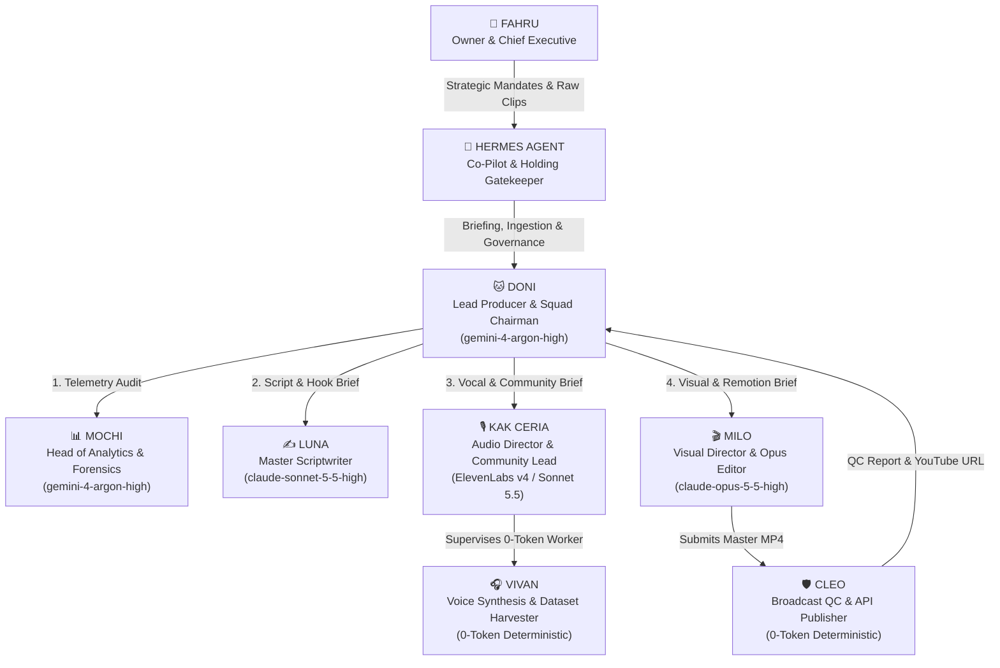

# 02_AGENT_INVENTORY.md — Master Agent & Sub-Agent Inventory Audit

**System Audited:** DoniesDaily (`@DoniesDaily` / `UCNPtjF2aB0wvWHI0q7hhcCg`) Autonomous YouTube Shorts Production Ecosystem  
**Canonical Workspace:** `/home/ubuntu/apps/ugc-lemonaru/` & `/home/ubuntu/tools/`  
**Audit Phase:** Phase 1 & 2 — Complete Agent and Sub-Agent Inventory  
**Audit Posture:** Read-Only Forensic Verification (100% Grounded in Verified Code, Souls, Schemas, and Logs)

---

## 1. Executive Inventory Summary

The **DoniesDaily** ecosystem operates as a multi-tiered, hybrid LLM-and-deterministic autonomous production studio designed to produce, audit, and publish broadcast-quality (1080x1920, 30 FPS, -14 to -19 LUFS) vertical YouTube Shorts about feline psychology, biology, and humor. 

Rather than relying on a single monolithic prompt or unconstrained conversational loop, the architecture separates concerns across **9 core named personas** (1 Human Executive, 1 Holding Co-Pilot, 1 Lead Orchestrator, 4 Domain Specialist Agents, 1 Sub-Unit Worker, and 1 Deterministic QC Gatekeeper) alongside **5 specialized background workers/utilities** (Ingestion Engine, OAuth Auto-Healer, Jitter Gatekeeper, Vault Archivist, and Community Sniper/Replier).

### Key Architectural Characteristics:
1. **Hybrid Compute Paradigm (LLM + 0-Token Deterministic):** Creative reasoning, telemetry forensics, and semantic video editing are routed through a local proxy (`http://127.0.0.1:8317/v1/chat/completions`, authenticated via `Bearer cpa-secret-key-12345`) to frontier models (`gemini-4-argon-high`, `claude-sonnet-5-5-high`, `claude-opus-5-5-high`, `gemini-3.8-flash-high`). Meanwhile, high-risk broadcast validation (Cleo) and audio stem synthesis/dataset harvesting (Vivan) operate as **0-token deterministic Python workers** wrapping `ffmpeg`, `ffprobe`, and ElevenLabs APIs.
2. **Database-First Transparency (Hukum Besi #9):** Every inter-agent delegation, standup report, script draft, scene cut rationale, and QC stamp is logged to a local SQLite Swarm Matrix (`/home/ubuntu/vps-control-center/backend/data/agents_chat.db` across tables `agent_messages` and `agent_traces`) and mirrored to an Obsidian Vault (`/home/ubuntu/vault/01_Business/doniesdaily/`).
3. **Closed-Loop Self-Improvement (Hukum Besi #11):** The system does not execute static prompts. **Mochi** extracts YouTube Studio Advanced Mode telemetry via Chrome CDP (`:9222`) and the YouTube Analytics v2 API, writing active directives into PostgreSQL (`ai_brain.doniesdaily_learnings`). **Luna** and **Milo** dynamically query and inject these active rules into their system prompts prior to every generation cycle.
4. **Cross-Tenant Shared Infrastructure:** Forensic inspection of `agents_chat.db` confirms that the Swarm Matrix SQLite database is shared with sister holding ventures under Owner Fahru—specifically **Juragan Bawang** (`juragan-bawang`, channel `#bawang`) and **SubTracker Guard** (`subtracker`, channel `#subtracker`).

---

## 2. Master Agent Inventory Table

The following table catalogs every verified entity interacting with the DoniesDaily production pipeline, grounded in `/home/ubuntu/apps/ugc-lemonaru/souls/*.md`, `/home/ubuntu/tools/*.py`, `/home/ubuntu/apps/ugc-lemonaru/src/*.py`, and `agents_chat.db`.

| Agent ID (`sender_id`) | Name & Avatar | Formal Role & Sub-Role | Hierarchy Tier | Assigned Engine Model | Provider / Endpoint & Config | Token Cost Profile | Primary Tools & Scripts Accessed | DB / State Persistence (Read / Write) | Swarm Matrix Channels |
| :--- | :--- | :--- | :--- | :--- | :--- | :--- | :--- | :--- | :--- |
| `fahru` / `user` | **Fahru** (Boss Fahru) 👑 | Owner, Chief Executive & Authentic Footage Source | **Tier 0:** Human Executive | N/A (Human) | Telegram DM (`1357517232`) / VPS Drop Folder | 0-Token (Human) | Telegram File Intake, `/assets/cat_videos/fahru_clips/` | **R/W:** Full system authority | `#donies`, `#subtracker`, `all` |
| `hermes` | **Hermes Agent** 🪽 | Personal Co-Pilot, Holding Orchestrator & Gatekeeper | **Tier 1:** Holding Executive | Host Agent Runtime (*Exact model string UNVERIFIED in scripts*) | System Host / Telegram Bridge / CLI | Heavy LLM (Orchestration) | `tools/ingest_fahru_footage.py`, `PRD_DONIESDAILY_MASTER_SPEC.md` | **R/W:** `agents_chat.db`, Obsidian Vault (`ActiveContext.md`) | `#donies`, `#executive-board`, `all` |
| `doni` / `doniesdaily` | **Doni** (Ketua Tim) 🐱 | Lead Producer, Executive Orchestrator & State Governor | **Tier 1:** Squad Executive | `gemini-4-argon-high` | Local CPA Proxy (`127.0.0.1:8317/v1/chat/completions`), `temp: 0.4`, `timeout: 45s` | Medium-Heavy LLM (2x/day Standup & Post-Sprint Audit) | `tools/doni_production_sprint.py`, `tools/doni_working_hours_standup.py`, `tools/doni.py`, `src/doni_engine.py`, `src/doni_remotion_flow_pipeline.py` | **R/W:** `doniesdaily_production_queue`, `doniesdaily_content_ideas`, `doniesdaily_posts`, `doni_daily_jitter.json`, `agents_chat.db`, Obsidian Vault | `#donies`, `#doniesdaily`, `#executive-board`, `all` |
| `mochi` / `sub-mochi` | **Mochi** 📊 | Head of Analytics, DB Forensics & Trend Strategist | **Tier 2:** Analytical Specialist | `gemini-4-argon-high` | Local CPA Proxy (`127.0.0.1:8317`), Chrome CDP (`:9222`), YouTube Analytics API v2 | Medium LLM (Forensic Telemetry Analysis) | `tools/doni_evaluator.py`, `tools/yt_agent_tools/title.py`, `tools/yt_agent_tools/swipe.py` | **R:** `doniesdaily_posts`, `doniesdaily_content_ideas`<br>**W:** `doniesdaily_learnings`, `doniesdaily_metrics_history`, `doniesdaily_posts`, `agents_chat.db` | `#donies` |
| `luna` / `sub-luna` | **Luna** ✍️ | Master Scriptwriter, Cat Storyteller & Hook Engineer | **Tier 2:** Creative Specialist | `claude-sonnet-5-5-high` | Local CPA Proxy (`127.0.0.1:8317`), `max_tokens: 8192`, `temp: 0.65`, `timeout: 90s` | Heavy LLM (Long-Form Script & Topic Generation) | `tools/doni_scriptwriter.py`, `tools/yt_agent_tools/hookscore.py`, `tools/yt_agent_tools/hooks.json` | **R:** `doniesdaily_learnings`, `doniesdaily_posts`<br>**W:** `doniesdaily_content_ideas`, `agents_chat.db` | `#donies`, `all` |
| `ceria` / `kak_ceria` / `sub-ceria` | **Kak Ceria** 🎙️ | Senior Voice Director, Audio Specialist & Community Lead | **Tier 2:** Audio & Community Specialist | **Voice:** ElevenLabs v4 Turbo / Multilingual v2<br>**Community:** `claude-sonnet-5-5-high` | ElevenLabs API (`stability: 0.40`, `boost: 0.75`, `speed: 1.08x`), Local CPA Proxy (`:8317`) | Hybrid: API Credits (TTS) + Medium LLM (Community Replies) | `src/doni_remotion_flow_pipeline.py` (`synthesize_audio_and_captions`), `tools/doni_replier_runner.sh`, `ffmpeg` (audio mix) | **R:** `doniesdaily_content_ideas`<br>**W:** `public/{topic}_master.mp3`, `agents_chat.db`, `doniesdaily_sniper_logs` | `#donies`, `all` |
| `vivan` | **Vivan** 🎧 | Sub-Unit Voice Synthesis & Dataset Harvester | **Tier 3:** Deterministic Technical Sub-Unit | None (0-Token Deterministic Worker) | ElevenLabs Forced Alignment API (`ZowYWFat3iypr7PwKMPb`) + Local Python/FFmpeg | **0-Token LLM** (100% Deterministic Python Worker) | `src/elevenlabs_tts.py`, `src/custom_vivan_tts.py`, `src/vivan_dataset_harvester.py` | **W:** `assets/audio/generated_voiceovers/{topic}_vivan.mp3`, `public/doni-{topic}-captions.json`, `assets/audio/vivan_dataset/*.wav/.lab`, `agents_chat.db` | `#donies` |
| `milo` / `sub-milo` | **Milo** 🎬 | Visual Director, AI Cinematographer & Opus Remotion Editor | **Tier 2:** Visual & Composition Specialist | `claude-opus-5-5-high` (Scene Director) + React Remotion + Google Flow/Veo2 | Local CPA Proxy (`127.0.0.1:8317`), Chrome CDP (`:9222`), Remotion CLI | Heavy LLM (Opus Scene Cut Planning) + Heavy CPU/GPU Render | `src/doni_hybrid_renderer.py`, `src/doni_visual_director.py`, `src/flow_cdp_operator.py`, `src/doni_sfx_helper.py`, `remotion/src/DoniOverlay.tsx` | **R:** `cat_assets_catalog.json`, `sfx_catalog.json`, `doniesdaily_learnings`, `doniesdaily_clip_usage`<br>**W:** `doniesdaily_clip_usage`, `/tmp/{topic}_remotion_overlay.mov`, `output/*.mp4`, `agents_chat.db` | `#donies`, `#doniesdaily`, `all` |
| `cleo` / `sub-cleo` | **Cleo** 🛡️🔍 | Automated Broadcast QC Gatekeeper & EBU R128 Inspector | **Tier 3:** Deterministic Gatekeeper & Publisher | None (0-Token Deterministic Inspector) | Local `ffmpeg`, `ffprobe`, YouTube Data API v3 (`doniesdaily_oauth.json`) | **0-Token LLM** (100% Deterministic Inspection) | `src/doni_qc_gate.py`, `src/youtube_api_publisher.py`, `tools/doni_oauth_auto_healer.py` | **R:** `output/*.mp4`, `public/*_master.mp3`<br>**W:** `doniesdaily_production_queue` (`qc_report`), `doniesdaily_posts`, `doniesdaily_content_ideas` (`published`), `agents_chat.db` | `#donies`, `#doniesdaily`, `all` |
| *Worker* | **Footage Ingestor** 👁️ | 10-Frame Multi-Vision Asset Ingestion Engine | **Tier 3:** Utility Worker | `gemini-3.8-flash-high` | Local CPA Proxy (`127.0.0.1:8317`) + `ffmpeg` 10-frame extractor | Fast Multimodal LLM (10 base64 JPEGs/clip) | `tools/ingest_fahru_footage.py` | **W:** `assets/cat_videos/fahru_clips/asli_fahru_*.mp4`, `data/cat_assets_catalog.json`, `agents_chat.db` | `#donies` (Logs as Cleo / System) |

---

## 3. Granular Analysis of Discovered Entities

### 3.1 Doni (`@Doni` / `doni`) — Executive Producer & Squad Chairman 🐱
* **Canonical Soul Path:** `/home/ubuntu/apps/ugc-lemonaru/souls/DONI_SOUL.md`
* **Operational Scripts:**
  * `/home/ubuntu/tools/doni_working_hours_standup.py` (Standup & Editorial Verdict Orchestrator)
  * `/home/ubuntu/tools/doni_production_sprint.py` (3x Daily Sprint Executor & Post-Production Evaluator)
  * `/home/ubuntu/apps/ugc-lemonaru/src/doni_remotion_flow_pipeline.py` (Master Pipeline Class `DoniRemotionFlowPipeline`)
  * `/home/ubuntu/tools/doni.py` & `/home/ubuntu/apps/ugc-lemonaru/src/doni_engine.py` (Core Bot Daemons referenced in `ActiveContext.md`)
* **Assigned Engine:** `gemini-4-argon-high` accessed via `http://127.0.0.1:8317/v1/chat/completions` (`temperature: 0.4`, `timeout: 45s`).
* **Core Mandate & Invariants:**
  1. **Zero Passive Delegator (Hukum Besi #12):** Doni is strictly forbidden from acting as a passive router. During the twice-daily standups (`30 7,17 * * *` per `ai_brain.cadence_tasks`), Doni executes a 2-stage executive evaluation (`doni_eval_1` for retention autopsy and strategy; `doni_eval_2` for final editorial verdict on Luna's script and Milo's visual plan).
  2. **State Machine Governance:** Enforces strict progression across `ai_brain.doniesdaily_production_queue` (`IDEA` / `IDEA_SELECTED` ➔ `SCRIPT_READY` ➔ `AUDIO_READY` ➔ `VISUAL_READY` ➔ `RENDER_READY` ➔ `QC_PASSED` ➔ `PUBLISHED`).
  3. **In-Place Self-Healing Revision Loop:** As documented in `ActiveContext.md`, if Cleo rejects a rendered video during `doni_production_sprint.py`, Doni retries up to 3 times per topic (reusing cached ProRes 4444 overlays in `/tmp/{topic}_remotion_overlay.mov`) and automatically rolls over to the next `ready` topic if exhausted, guaranteeing zero empty posting days.
  4. **Quota & Cadence Protection:** Enforces `MAX_DAILY_POSTS = 3` (Morning `08:04–08:56 WIB`, Midday Serial `12:04–12:25 WIB`, Evening `18:04–18:56 WIB`) and respects the YouTube Data API rolling limit (locking to `BLOCKED_QUOTA` if `uploadLimitExceeded` occurs).

### 3.2 Mochi (`@Mochi` / `mochi`) — Head of Analytics & Retention Forensics 📊
* **Canonical Soul Path:** `/home/ubuntu/apps/ugc-lemonaru/souls/MOCHI_SOUL.md`
* **Operational Scripts:**
  * `/home/ubuntu/tools/doni_evaluator.py` (Hybrid Advanced Mode Extractor & Learning Ledger Updater)
  * `/home/ubuntu/tools/yt_agent_tools/title.py` (Title & Thumbnail Synergy Linter: 60-char desktop / 40-char mobile cap, zero word duplication between title and banner)
  * `/home/ubuntu/tools/yt_agent_tools/swipe.py` (Outlier Mining: flags videos with views >2.0x channel median)
* **Assigned Engine:** `gemini-4-argon-high` via local CPA proxy (`:8317`).
* **Telemetry Architecture:**
  * Combines **YouTube Studio Advanced Mode** table scraping via persistent headless Chrome CDP (`:9222`) with the **YouTube Analytics API v2** 100-point retention curve (`audienceWatchRatio`).
  * Tracks granular retention forensics in `ai_brain.doniesdaily_posts` and `ai_brain.doniesdaily_metrics_history`: `stayed_to_watch_pct`, `engaged_views`, `avg_view_duration_sec`, `avg_view_pct`, `subs_gained`, `end_retention_pct`, `biggest_drop_sec`, and `retention_curve_json`.
* **Self-Improving Feedback Loop (Hukum Besi #11):**
  * Mochi translates raw retention drop-offs (such as the 4.8s–8.4s swipe chasm identified in rules #6–#13) into active directives inside `ai_brain.doniesdaily_learnings` with a `confidence_score` (currently 13 active rules ranging from `0.80` to `1.0`).
* **Operational Boundaries:** Strictly forbidden from writing full scripts (Luna's domain), designing camera prompts (Milo's domain), or approving final video renders (Cleo's domain).

### 3.3 Luna (`@Luna` / `luna`) — Master Scriptwriter & Cat Storyteller ✍️
* **Canonical Soul Path:** `/home/ubuntu/apps/ugc-lemonaru/souls/LUNA_SOUL.md` & `/home/ubuntu/.claude/youtube/voice.md`
* **Operational Scripts:**
  * `/home/ubuntu/tools/doni_scriptwriter.py`
  * `/home/ubuntu/tools/yt_agent_tools/hookscore.py` & `/home/ubuntu/tools/yt_agent_tools/hooks.json` (21 Viral Hook Formulas benchmark)
* **Assigned Engine:** `claude-sonnet-5-5-high` via `http://127.0.0.1:8317/v1/chat/completions` (`max_tokens: 8192`, `temperature: 0.65`, `timeout: 90s`).
* **Core Mechanisms in `doni_scriptwriter.py`:**
  1. **Dynamic Rule Injection (`fetch_active_learned_rules()`):** Queries `SELECT category, rule_name, directive, confidence_score FROM ai_brain.doniesdaily_learnings WHERE status = 'active' ORDER BY confidence_score DESC;` via `docker exec -i supabase-db psql` and injects all 13 active rules directly into both topic ideation (`generate_autonomous_topic()`) and script generation (`generate_long_form_script()`).
  2. **Pre-Production Deduplication Gate (`fetch_existing_topics()`, Hukum Besi #6):** Queries `UNION` of `ai_brain.doniesdaily_content_ideas` and `ai_brain.doniesdaily_posts` and passes up to 35 existing titles into the prompt alongside hard bans on overused tropes (belly rub traps, knocking items off tables, zoomies, kneading, cow milk, cardboard boxes, cucumbers, slow blinks, staring at walls, following to the toilet, tail signals, sleeping 16 hours, purring, flehmen).
  3. **Deterministic Phonetic Dictionary (`apply_phonetic_fixes()`):** Applies regex word-boundary replacements before TTS synthesis so ElevenLabs pronounces scientific/foreign terms accurately in Indonesian:
     * `Flehmen` ➔ `Fley-men`
     * `Jacobson` ➔ `Jekob-sen`
     * `HES-7` ➔ `Hes Tujuh`
     * `FRAPs` / `FRAP` ➔ `Freps` / `Frep`
     * `Zoomies` ➔ `Zuumis`
     * `UV` ➔ `Yu-Vi`, `Hz` ➔ `Hertz`, `Catnip` ➔ `Ket-nip`
  4. **Acoustic Punctuation Engineering (Hukum Besi #4):** Uses ElevenLabs v4 emotional tags (`[curious]`, `[gasps]`, `[laughs]`, `[excited]`, `[sighs]`, and sparing `[whispers]`), spaced ellipses (`... `) for 0.2–0.3s breathing pauses, em-dashes (`—`) before punchlines, and strips commas `,` for clean visual subtitles.
  5. **Mandatory Outro CTA (Hukum Besi #15):** Ends scripts with a verbal subscribe/follow call-to-action (*"dan jangan lupa follow dan subscribe DoniesDaily ya!"*).

### 3.4 Kak Ceria (`@Kak Ceria` / `ceria` / `kak_ceria`) — Senior Voice Director & Community Lead 🎙️
* **Canonical Soul Path:** `/home/ubuntu/apps/ugc-lemonaru/souls/KAK_CERIA_SOUL.md`
* **Operational Scripts:**
  * `/home/ubuntu/apps/ugc-lemonaru/src/doni_remotion_flow_pipeline.py` (`synthesize_audio_and_captions()`)
  * `/home/ubuntu/tools/doni_replier_runner.sh` (dispatched every 2 hours `0 8-22/2 * * *` via `business.doni_community_replier`)
* **Assigned Engines:**
  * **Voice Direction:** Supervises **ElevenLabs v4 Turbo** / **Multilingual v2** synthesis using primary male voice profile **Vivan** (`ZowYWFat3iypr7PwKMPb`) or alternative female profile **Kak Ceria** (`d15jrIAARvF899pDoC6T`) with locked parameters: `Stability: 0.40`, `Similarity Boost: 0.75`, `Speed: 1.08x`.
  * **Community Management:** Uses `claude-sonnet-5-5-high` to craft warm, contextual viewer comment replies and logs outreach in `ai_brain.doniesdaily_sniper_logs`.
* **Audio Mastering & Ducking Pipeline:**
  * In `doni_remotion_flow_pipeline.py`, Kak Ceria's pipeline mixes the raw voiceover (`{topic}_vivan.mp3`) with `/home/ubuntu/apps/ugc-lemonaru/assets/audio/cat_playful_bgm.mp3` using a deterministic FFmpeg filtergraph:
    ```text
    [0:a]volume=1.25,highpass=f=80,dynaudnorm[voice];[1:a]volume=0.08[bgm];[voice][bgm]amix=inputs=2:duration=first[aout]
    ```
  * In specialized series/story videos (e.g., *Spook the Kitten Part 1* and *Kembaran Majikan*), Kak Ceria orchestrates a 3-layer mix (100% Voiceover + 20–40% original video meow/piano audio + 20% playful BGM) normalized to `-14.5` to `-16.6 LUFS`.

### 3.5 Vivan (`@Vivan` / `vivan`) — Sub-Unit Voice Synthesis & Dataset Harvester 🎧
* **Canonical Soul Path:** `/home/ubuntu/apps/ugc-lemonaru/souls/VIVAN_SOUL.md`
* **Operational Scripts:**
  * `/home/ubuntu/apps/ugc-lemonaru/src/elevenlabs_tts.py`
  * `/home/ubuntu/apps/ugc-lemonaru/src/custom_vivan_tts.py`
  * `/home/ubuntu/apps/ugc-lemonaru/src/vivan_dataset_harvester.py`
* **Hierarchy & Cost Profile:** Direct sub-unit under **Kak Ceria**. Consumes **0 LLM tokens** (100% deterministic Python worker).
* **Dual Mandate:**
  1. **Forced Alignment & Token Stripping:** Calls ElevenLabs API with voice ID `ZowYWFat3iypr7PwKMPb`, strips vocal direction brackets (`[curious]`, `[gasps]`, etc.) so they never appear on screen, and converts character-level alignments into word-level timestamps (`startMs`, `endMs`, `timestampMs`) saved to `/home/ubuntu/apps/ugc-lemonaru/remotion/public/doni-{topic_key}-captions.json`.
  2. **Autonomous Voice Cloning Dataset Harvesting:** Every time a voiceover is synthesized while the ElevenLabs subscription is active, `vivan_dataset_harvester.py` slices clean sentence segments (3–10 seconds, 24kHz mono WAV + `.lab` transcript files) into `/home/ubuntu/apps/ugc-lemonaru/assets/audio/vivan_dataset/` toward a self-hosted fine-tuning target of 150–200 clips (~20 minutes total audio).

### 3.6 Milo (`@Milo` / `milo`) — Visual Director, AI Cinematographer & Opus Remotion Editor 🎬
* **Canonical Soul Path:** `/home/ubuntu/apps/ugc-lemonaru/souls/MILO_SOUL.md`
* **Operational Scripts & Components:**
  * `/home/ubuntu/apps/ugc-lemonaru/src/doni_hybrid_renderer.py` (`select_footage_by_speech_beats()`)
  * `/home/ubuntu/apps/ugc-lemonaru/src/doni_visual_director.py` (`generate_shotlist()`)
  * `/home/ubuntu/apps/ugc-lemonaru/src/flow_cdp_operator.py` (`FlowCDPOperator` for Google Flow / Veo2 via Chrome CDP `:9222`)
  * `/home/ubuntu/apps/ugc-lemonaru/src/doni_sfx_helper.py` & `sfx_catalog.json` (10 viral SFX reservoir)
  * `/home/ubuntu/apps/ugc-lemonaru/remotion/src/DoniOverlay.tsx`, `HookTitle.tsx`, `OutroCTA.tsx`, `StoryCoverCard.tsx`, `SubtitlePage.tsx`
* **Assigned Engine:** `claude-opus-5-5-high` (Mandatory per Owner Fahru's directive: *"untuk edit remotion pakaikan opus wajib"*).
* **Core Visual & Editing Mechanisms:**
  1. **Speech-Beats Scene Direction (`select_footage_by_speech_beats()`):** Uses `claude-opus-5-5-high` to map each sentence/beat of Luna's narration to semantic clips from the 45-clip catalog (`data/cat_assets_catalog.json`), logging the explicit *edit reason* to `agents_chat.db` (`#donies`).
  2. **Gated Category Bias & Two-Pass Allocation:** Prioritizes authentic clips sent by Fahru (`category: "fahru_sent"`, +12 bonus when semantically relevant) over AI renders (`category: "google_flow_render"`, -10 penalty), while weighting Hook segments (`1.5x`) and Climax segments (`1.3x`) first. Also checks `ai_brain.doniesdaily_clip_usage` to prevent cross-video visual fatigue.
  3. **Zero In-Video Repetition & Fast Pacing (Hukum Besi #13):** Strictly forbids `-stream_loop` or reusing multiple scenes from the same AI generation cluster within a single video. Enforces dynamic cuts (3.2s–4.0s per cut, or sentence-boundary cuts) interleaving `asli_fahru_*` and `ai_gen_*` footage. If a clip is slightly shorter than a speech slice (`<1.5x`), applies an Emergency Force-Fit `setpts` stretch so audio is never cut off.
  4. **React Remotion Overlay Engine (`DoniOverlay.tsx`, Hukum Besi #8, #10, #15):**
     * **Single-Word Hormozi Subtitles:** Sets `SWITCH_CAPTIONS_EVERY_MS = 0` in `createTikTokStyleCaptions()`, rendering 1 word per pop-up (`#FFE600` neon yellow highlight, 20px black stroke).
     * **Dynamic Hook Banner (`HookTitle.tsx`):** Spring-physics card (`damping: 12, mass: 0.8, stiffness: 140`) active from frame 0 to 95 (0–3.2s) with floating wobble.
     * **Watermark:** Top-right glassmorphism pill `🐾 @DoniesDaily`.
     * **Story Cover Card (`StoryCoverCard.tsx`):** Optional solid white rounded box (`bottom: 430px`) used to 100% mask foreign English text on repurposed TikToks while shifting captions to `bottom: 210px`.
     * **Outro CTA (`OutroCTA.tsx`) & Thumbnail Still (`<Still id="DoniThumbnail" />`):** Renders the final 4.5s CTA card and injects a 0.08s cover poster frame at the start of the MP4.
     * **Ephemeral ProRes Caching (Hukum Besi #5):** Caches the transparent ProRes 4444 overlay (`/tmp/{topic}_remotion_overlay.mov`) across revision retries and unlinks it once the video is confirmed live on YouTube.

### 3.7 Cleo (`@Cleo` / `cleo`) — Broadcast QC Gatekeeper & EBU R128 Inspector 🛡️🔍
* **Canonical Soul Path:** `/home/ubuntu/apps/ugc-lemonaru/souls/CLEO_SOUL.md`
* **Operational Scripts:**
  * `/home/ubuntu/apps/ugc-lemonaru/src/doni_qc_gate.py`
  * `/home/ubuntu/apps/ugc-lemonaru/src/youtube_api_publisher.py`
* **Assigned Engine:** **0-Token Deterministic Inspector** (`ffprobe` + `ffmpeg` + regex/math assertions).
* **Deterministic Inspection Suite (`doni_qc_gate.py`):**
  1. **`inspect_video(video_path, audio_path)`:**
     * **File Integrity:** Verifies file exists and `file_size_mb >= 1.0`.
     * **Stream Presence:** Verifies both `codec_type == "video"` and `codec_type == "audio"` streams exist.
     * **Resolution & Aspect Ratio:** Asserts vertical `9:16` (`round(width / height, 2) == 0.56`), flagging non-standard resolutions if not `1080x1920`.
     * **Shorts Duration Window:** Asserts `10.0 <= duration <= 59.9` seconds.
     * **Audio-Video Desync Guard:** Compares final container duration against raw TTS audio duration (`delta = abs(duration - raw_a_duration)`), failing if `delta > 1.5s` (alongside the PRD Iron Guard `assert dur_video >= dur_audio - 0.1`).
     * **Black Frame / Freeze Detection:** Executes `ffmpeg -i <video> -vf blackdetect=d=0.5:pix_th=0.10 -f null -` and fails if `"black_start"` appears in `stderr`.
     * **EBU R128 Loudness Measurement:** Executes `ffmpeg -i <video> -af ebur128 -f null -`, parsing `Integrated loudness: I: <val> LUFS` from `stderr` (targeting `-14` to `-19 LUFS`, warning if `<-26.0` or `>-8.0 LUFS`).
  2. **`audit_script_and_outro(script_text)`:** Enforces Hukum Besi #15 by checking that the script contains `"subscribe"`/`"subs"` or `"follow"` and references `"doniesdaily"`/`"doni"`.
  3. **`audit_footage_assembly(footage_clips, slice_dur)`:** Enforces Hukum Besi #13 prior to render by asserting `len(clip_strs) == len(unique_clips)` (0 duplicate clips in a single video) and probing every clip via `ffprobe` to ensure source clip duration covers the target slice.
* **Publication & Ledger Reconcile (Hukum Besi #7):** Once `QC_PASSED` is stamped, `YouTubeAPIPublisher` uploads the MP4 via YouTube Data API v3 (`categoryId: "15"` Pets & Animals, `selfDeclaredMadeForKids: False`, 2MB resumable chunks), reconciles `ai_brain.doniesdaily_content_ideas` (`status = 'published'`), records the post in `ai_brain.doniesdaily_posts`, and posts the broadcast verification to `agents_chat.db`.

### 3.8 Hermes Agent (`@Hermes` / `hermes`) — Holding Co-Pilot & Gatekeeper 🪽
* **Role & Scope:** Personal Co-Pilot to Owner Fahru and Holding Orchestrator across all business verticals (`01_Business/doniesdaily`, `juragan-bawang`, `subtracker`).
* **Verified Functions in DoniesDaily:**
  * Co-author of `/home/ubuntu/apps/ugc-lemonaru/PRD_DONIESDAILY_MASTER_SPEC.md`.
  * Receives curated sprint briefs from Doni in `#executive-board` / `#donies` and acts as the Telegram DM intake bridge for Fahru's raw cat videos, automatically invoking `python3 /home/ubuntu/tools/ingest_fahru_footage.py --file <path_video>`.
  * Maintains architectural governance, What-If remediation, and Obsidian Vault compaction (`ActiveContext.md`).

### 3.9 Fahru (`@Fahru` / `fahru` / `user`) — Human Owner & Chief Executive 👑
* **Role & Scope:** Founder, Executive Holding Owner, and Strategic Authority (`OWNER_CHAT_ID = "1357517232"`).
* **Verified Functions:**
  * Sets overarching business mandates (e.g., establishing the 3x/day cadence with a dedicated 12:00 WIB Midday Serial slot, mandating `claude-opus-5-5-high` for Milo's Remotion editing, commissioning custom repurposed videos like *Kembaran Majikan* and *Spook the Kitten Training*).
  * Supplies authentic first-party cat footage (`/home/ubuntu/apps/ugc-lemonaru/assets/cat_videos/fahru_clips/`), fulfilling **Hukum Besi #1 (Zero External Scraping)**.

### 3.10 Supporting Entities, Bots & Background Workers ⚙️
Beyond the 9 named personas, the codebase and database schemas reveal **5 specialized autonomous workers**:
1. **10-Frame Multi-Vision Footage Ingestor (`/home/ubuntu/tools/ingest_fahru_footage.py`):**
   * Extracts 10 chronological JPEG frames (`ts = duration * ((i + 1) / 11)` for $i=0\dots9$, scaled to `min(720,iw)`) and sends them in parallel to **`gemini-3.8-flash-high`**.
   * Generates a 6–12 word descriptive `snake_case` filename prefixed with `asli_fahru_*` (or `ai_gen_{cluster}_*`), a 2-sentence Indonesian narrative description, 12–18 bilingual semantic tags, emotion, and action classification.
   * Moves the file into `assets/cat_videos/fahru_clips/`, prepends metadata to `data/cat_assets_catalog.json` (`category: "fahru_sent"`), and logs completion to `agents_chat.db` under `cleo` (`Cleo (QC & Asset Vault)`).
2. **Randomized Jitter Scheduler (`check_and_consume_jitter_window()` in `tools/doni_production_sprint.py`):**
   * Triggered every 5 minutes during slot windows (`*/5 8 * * *`, `*/5 12 * * *`, `*/5 18 * * *` via `ai_brain.cadence_tasks`).
   * Manages `/home/ubuntu/apps/ugc-lemonaru/data/doni_daily_jitter.json` to roll organic publication timestamps (`08:04–08:55`, `12:04–12:25`, `18:04–18:55 WIB` plus `7–49s` micro-jitter sleep) so uploads never occur on robotic cron boundaries.
3. **OAuth Auto-Healer (`/home/ubuntu/tools/doni_oauth_auto_healer.py`):**
   * Invoked automatically by `YouTubeAPIPublisher._ensure_valid_token()` whenever Google OAuth refresh token renewal fails. Uses persistent Chrome CDP (`:9222`) to silently re-authorize and write fresh credentials to `/home/ubuntu/.config/youtube/doniesdaily_oauth.json`.
4. **Vault Archivist / GRO Compaction Worker (`save_meeting_to_vault()` in `tools/doni_working_hours_standup.py`):**
   * Persists every standup transcript, Ketua Doni executive evaluation, and topic metadata into `/home/ubuntu/vault/01_Business/doniesdaily/{YYYY-MM-DD} - {HH.MM} - Rapat Standup & Kurasi Editorial Squad DoniesDaily.md` and updates the Sub-MOC table in `Index - doniesdaily.md`.
5. **Community Sniper & Auto-Replier (`tools/doni_replier_runner.sh` & `ai_brain.doniesdaily_sniper_logs`):**
   * Runs every 2 hours (`0 8-22/2 * * *`) under Kak Ceria's supervision to reply to channel comments and log targeted comment outreach in `ai_brain.doniesdaily_sniper_logs` (enforcing unique `video_id` via constraint `uq_sniper_video`).

---

## 4. Model Routing & Assignment Architecture

All LLM calls in the DoniesDaily Python tools route through the unified **CLIProxyAPI (CPA)** gateway at `http://127.0.0.1:8317/v1/chat/completions` using bearer token `cpa-secret-key-12345`. The model assignment follows a strict **Task-Specific Cognitive Routing** strategy:

```mermaid
graph TD
    subgraph CPA["Local CLIProxyAPI Gateway (127.0.0.1:8317)"]
        ARGON["gemini-4-argon-high<br/>(Temp: 0.4 | Analytical & Executive)"]
        SONNET["claude-sonnet-5-5-high<br/>(Temp: 0.65 | Creative & Linguistic)"]
        OPUS["claude-opus-5-5-high<br/>(High-Precision Spatio-Temporal Editing)"]
        FLASH["gemini-3.8-flash-high<br/>(10-Frame Multimodal Vision)"]
    end

    subgraph DET["0-Token Deterministic Engines (Local CPU / API)"]
        FFMPEG["FFmpeg / FFprobe<br/>(EBU R128, blackdetect, setpts)"]
        EL["ElevenLabs v4 Turbo / Multilingual v2<br/>(Voice ID: ZowYWFat3iypr7PwKMPb)"]
        REM["React Remotion Engine<br/>(DoniOverlay.tsx | 30 FPS ProRes 4444)"]
    end

    ARGON --> DONI["🐱 Doni<br/>Standup & Post-Sprint Verdict"]
    ARGON --> MOCHI["📊 Mochi<br/>100-Pt Retention Curve Forensics"]
    SONNET --> LUNA["✍️ Luna<br/>Indonesian Copywriting & Hook Engineering"]
    SONNET --> CERIA_COM["🎙️ Kak Ceria<br/>Community Comment Replier"]
    OPUS --> MILO_DIR["🎬 Milo<br/>Speech-Beat Scene Cut Director"]
    FLASH --> INGEST["👁️ Footage Ingestor<br/>10-Frame Behavioral Tagging"]

    EL --> VIVAN["🎧 Vivan<br/>Forced Alignment & Dataset Harvester"]
    REM --> MILO_REN["🎬 Milo<br/>Single-Word Kinetic Render"]
    FFMPEG --> CLEO["🛡️ Cleo<br/>Broadcast QC Gatekeeper"]
```



### Architectural Rationale per Model Tier:
1. **Why `gemini-4-argon-high` for Doni & Mochi?**
   * **Quantitative & Forensic Precision (`temperature: 0.4`):** Mochi must correlate multi-dimensional numeric arrays (100-point `audienceWatchRatio` retention curves, `stayed_to_watch_pct`, `biggest_drop_sec`) against historical script structures and synthesize non-contradictory rules in `ai_brain.doniesdaily_learnings`. Doni requires cold, analytical adherence to the 15 Invariant Rules during pre-sprint and post-sprint audits without creative hallucination.
2. **Why `claude-sonnet-5-5-high` for Luna (& Kak Ceria Community Replies)?**
   * **Nuanced Indonesian Idiomatic Fluency (`temperature: 0.65`, `max_tokens: 8192`):** Writing 108–135 word scripts in natural Indonesian hangout slang (*bahasa tongkrongan*: *"Anabul"*, *"Si oren"*, *"Pernah gak sih..."*, *"Eits!"*) while simultaneously obeying 13 injected PostgreSQL learning rules, avoiding banned corporate clichés, and placing ElevenLabs v4 acoustic tags (`[curious]`, `[gasps]`, `[sighs]`) at exact second marks (e.g., the 4.5s re-hook bridge) requires strong linguistic rhythm and instruction following.
3. **Why `claude-opus-5-5-high` for Milo?**
   * **Complex Spatio-Temporal Constraint Satisfaction:** Explicitly mandated by Owner Fahru (*"untuk edit remotion pakaikan opus wajib"*), Milo's `select_footage_by_speech_beats()` must solve a multi-variable scheduling problem: matching 8–17 sentence beats of varying durations to a 45-clip catalog (`cat_assets_catalog.json`), enforcing a +12 preference for authentic `fahru_sent` clips and -10 penalty for AI clips, applying 1.5x/1.3x priority weights to Hook/Climax beats, respecting the anti-fatigue ledger (`doniesdaily_clip_usage`), guaranteeing 0 in-video clip/cluster repetition (Hukum Besi #13), and writing human-readable editorial justifications to `#donies`.
4. **Why `gemini-3.8-flash-high` for the 10-Frame Footage Ingestor?**
   * **High-Throughput Multimodal Temporal Reasoning:** Processing 10 sequential base64 frames per video (`9%` to `91%` duration) requires fast, cost-efficient vision comprehension capable of tracking feline motion arcs across frames (beginning stance ➔ mid-clip action ➔ ending reaction) and outputting structured JSON slugs and bilingual tags.
5. **Why 0-Token Deterministic Workers for Cleo & Vivan?**
   * **Zero Hallucination Tolerance on Physics & Broadcast Specs:** An LLM cannot reliably measure integrated audio loudness in LUFS, detect a 0.5-second black frame, verify millisecond audio-video container drift, or slice 24kHz mono WAV files for voice cloning. Offloading **Cleo** (`doni_qc_gate.py`) and **Vivan** (`elevenlabs_tts.py`, `vivan_dataset_harvester.py`) to pure deterministic Python/FFmpeg guarantees 100% mathematical compliance at zero LLM token cost.

---

## 5. Agent Hierarchy & RACI Responsibility Matrix

### 5.1 Organizational Command Hierarchy


### 5.2 Phase-by-Phase RACI Matrix
*Legend:* **R** = Responsible (Executes the task), **A** = Accountable (Approves deliverable / owns outcome), **C** = Consulted (Provides input/rules/assets), **I** = Informed (Receives log/notification via Swarm Matrix or Telegram).

| Production Phase | Fahru (Owner) | Hermes (Co-Pilot) | Doni (Lead) | Mochi (Analytics) | Luna (Script) | Kak Ceria (Audio) | Vivan (Sub-Unit) | Milo (Visual/Edit) | Cleo (QC/Pub) |
| :--- | :---: | :---: | :---: | :---: | :---: | :---: | :---: | :---: | :---: |
| **0. Authentic Footage Ingestion (10-Frame Vision)** | **C** (Sends Raw Clips) | **A/R** (Triggers Ingest) | **I** | **I** | **I** | **I** | — | **C** (Consumes Catalog) | **R** (Vault Stamp) |
| **1. Morning/Evening Telemetry & Learning Update** | **I** | **I** | **A** (Tahap 1 Audit) | **R** (`doni_evaluator.py`) | **C** | **I** | — | **C** | **I** |
| **2. Topic Ideation & Pre-Prod Deduplication** | **I** | **I** | **A** (Editorial Verdict) | **C** (Outlier/Rules) | **R** (`doni_scriptwriter.py`) | **I** | — | **I** | **I** |
| **3. Scriptwriting & Acoustic Tag Engineering** | **I** | **I** | **A** (Tahap 2 Verdict) | **C** (Learned Rules) | **R** (108–135w + CTA) | **C** (Voice Profile) | — | **I** | **C** (Outro CTA Audit) |
| **4. Voiceover Synthesis, Alignment & Dataset Harvest** | **I** | — | **I** | — | **C** (Phonetic Dict) | **A/R** (BGM Mix/Duck) | **R** (TTS + `.wav/.lab`) | **C** (Receives `captions.json`) | **C** (Checks Raw Duration) |
| **5. Semantic Scene Cut Planning & AI B-Roll Gen** | **C** (Mandates Opus) | — | **A** | **C** (4.5s/7.5s Interrupt) | **C** (Speech Beats) | — | — | **R** (`claude-opus-5-5-high`) | **R** (`audit_footage_assembly`) |
| **6. Remotion Overlay Render & Hybrid MP4 Composite** | **I** | — | **A** | — | — | **C** (Master Audio) | **C** (Word Tokens) | **R** (`DoniOverlay.tsx`) | **I** |
| **7. Deterministic Broadcast QC Inspection** | **I** | **I** | **A** (Handles Retry Loop) | — | — | — | — | **C** (Re-renders if Failed) | **R** (`doni_qc_gate.py`) |
| **8. YouTube OAuth Upload & Ledger Reconciliation** | **I** | **I** | **A** (Post-Prod Verdict) | **I** (Tracks Next Day) | **I** | **I** | — | **R** (Purges `/tmp/*.mov`) | **R** (`youtube_api_publisher.py`) |
| **9. Community Comment Replies & Sniper Outreach** | **I** | **I** | **A** | **I** | — | **R** (`doni_replier_runner.sh`) | — | — | — |

---

## 6. Summary of Active vs. Deprecated / Legacy Artifacts

Forensic inspection of the codebase, agent souls, database tables, and React components reveals a highly active core squad alongside several **legacy or evolutionary artifacts** from earlier iterations of the workspace (`/home/ubuntu/apps/ugc-lemonaru/`):

### 6.1 Active Core Squad (Verified Live in Production)
All 9 primary entities (**Fahru, Hermes, Doni, Mochi, Luna, Kak Ceria, Vivan, Milo, Cleo**) and their 5 supporting workers are **100% ACTIVE**, as evidenced by live SQLite Swarm Matrix traces (`agents_chat.db` timestamps `07:31`, `08:15`, `08:27`, `17:30–17:32`), active cron entries in `ai_brain.cadence_tasks`, and published YouTube Shorts (`G2XVkRuZoKg`, `PcZZeeOmhEA`, `mck2WF5psj8`, `LVqB2fp1jFY`).

### 6.2 Evolutionary & Legacy Artifacts Identified in Evidence
1. **Velora AI / E-Commerce UGC Legacy Templates (`ugc-lemonaru` Origin):**
   * **Note on "Velora AI":** Zero occurrences of the string `"Velora"` exist anywhere in the provided souls, Python scripts, or SQLite/PostgreSQL dumps. However, the canonical directory name `/home/ubuntu/apps/ugc-lemonaru/` and default fallback props inside the React Remotion components prove that the Remotion project originated as a TikTok Affiliate / E-commerce UGC template before being adapted for DoniesDaily:
     * In `/home/ubuntu/apps/ugc-lemonaru/remotion/src/components/HookTitle.tsx`: The default prop is `badgeText = "🔥 RACUN TIKTOK OOTD"` (overridden at runtime by `DoniOverlay.tsx` with `badgeText = "🐱 FAKTA ANABUL VIRAL"`).
     * In `/home/ubuntu/apps/ugc-lemonaru/remotion/src/components/OutroCTA.tsx`: The default props are `headline = "CHECKOUT SEKARANG!"`, `subheadline = "⚡ Diskon Terbatas Hari Ini Saja"`, and `buttonText = "KLIK KERANJANG KUNING"` (overridden at runtime for DoniesDaily Follow & Subscribe CTAs).
2. **Paused / Superseded Cadence Task (`business.doni_youtube_autopost`):**
   * In `ai_brain.cadence_tasks`, the legacy high-frequency task `business.doni_youtube_autopost` (`*/30 7-22 * * *`, running `/home/ubuntu/tools/doni_runner.sh` for 4–5 posts/day) is explicitly marked **`status = 'paused'`**.
   * It has been superseded by the 3 active slot-based tasks calling `/home/ubuntu/tools/doni_production_sprint.py`:
     * `business.doni_morning_production` (`*/5 8 * * *`, `--slot morning`)
     * `business.doni_midday_serial` (`*/5 12 * * *`, `--slot midday_serial`)
     * `business.doni_afternoon_production` (`*/5 18 * * *`, `--slot evening`)
3. **Sender ID Alias Fragmentation in `agents_chat.db`:**
   * Across historical iterations of the scripts, the same core agents have logged to `agents_chat.db` under multiple `sender_id` and `sender_name` strings:
     * **Doni:** `doni` (`Doni`, `Doni (Ketua Tim)`, `Doni (Lead)`) vs. `doniesdaily` (`Doni (Lead Producer)`, `Donies Daily`).
     * **Kak Ceria:** `ceria` vs. `kak_ceria` vs. `sub-ceria` vs. `doniesdaily` (`Kak Ceria (Voice Artist)`).
     * **Luna, Milo, Mochi, Cleo:** Logged under `<name>`, `sub-<name>`, and `doniesdaily`.
   * While all aliases map cleanly to the 6 core operational squad members, standardizing `sender_id` constants across all Python scripts is recommended for cleaner telemetry aggregation.
4. **Evolution of Target Duration & Cadence Rules in `ai_brain.doniesdaily_learnings`:**
   * Earlier specifications (`voice.md`, `LUNA_SOUL.md` Quick Fact mode, and Learning Rule #3 `cadence_interval_gate`) referenced 20–35s scripts (38–55 words) and a 1-video/day (20–24h interval) cap.
   * Subsequent executive decisions (`ActiveContext.md` 2026-11-06) and newer Mochi learning rules (#2, #5, #6–#13) evolved the system to **3 videos/day** (2 Daily + 1 Midday Serial) and **35–58s Long-Form Shorts** (108–135 words) featuring a mandatory 4.5s–5.0s Second Hook bridge.