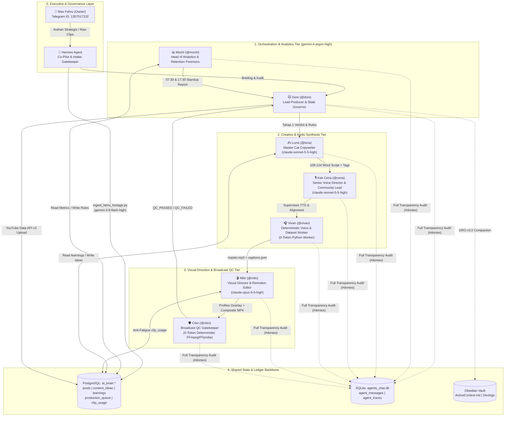

# DELIVERABLE 03: `03_AGENT_REVERSE_ENGINEERING.md`
## PHASE 2: AGENT-BY-AGENT REVERSE ENGINEERING (DEEP AUDIT)

**Audit Target:** DoniesDaily (`@DoniesDaily` / `UCNPtjF2aB0wvWHI0q7hhcCg`) Autonomous Multi-Agent Production Ecosystem  
**Canonical Workspace:** `/home/ubuntu/apps/ugc-lemonaru/`  
**Orchestration & Tooling Layer:** `/home/ubuntu/tools/`  
**Persistence & State Layer:** PostgreSQL (`supabase-db` container, schema `ai_brain`), SQLite Swarm Matrix (`/home/ubuntu/vps-control-center/backend/data/agents_chat.db`), Obsidian Vault (`/home/ubuntu/vault/01_Business/doniesdaily/`)  

---

## 1. Architectural Overview & Agent Topology

Before decomposing each agent across the 6 mandatory dimensions, the following Mermaid topology illustrates the runtime interaction, model routing via `CLIProxyAPI` (`127.0.0.1:8317`), database state synchronization, and deterministic vs. probabilistic boundaries verified in the codebase.



---

## 2. Deep-Dive Reverse Engineering: Agent 1 — DONI (`@doni`)

### A. Identity
* **Canonical Name:** Doni 🐱
* **Swarm Matrix Handles & Aliases:**
  * `sender_id`: `"doni"` (`sender_name`: `"Doni"`, `"Doni (Ketua Tim)"`, `"Doni (Lead)"`)
  * `sender_id`: `"doniesdaily"` (`sender_name`: `"Doni (Lead Producer)"`, `"Donies Daily"`)
* **Primary Role:** Master Orchestrator, Lead Producer & State Governor (`@DoniesDaily`).
* **Secondary Duties:**
  * Daily Randomized Jitter Gatekeeper (managing organic upload windows across 3 daily slots: Morning `08:04–08:56 WIB`, Midday Serial `12:04–12:25 WIB`, Evening `18:04–18:56 WIB`).
  * Executive Leadership Reviewer (conducting Tahap 1 Pre-Sprint Autopsy and Tahap 2 Post-Production Verdict during 07:30 & 17:30 WIB standups).
  * YouTube Data API v3 Quota Governor (protecting the 9-upload/24h rolling window hard limit).
  * Obsidian Vault Archivist (executing GRO Triad Compaction into Devlogs, `ActiveContext.md`, and `Index - doniesdaily.md`).
* **Hierarchy Tier:** Tier 1 — Squad Lead / Orchestrator (Reports to Mas Fahru & Hermes Agent; directly commands Mochi, Luna, Kak Ceria, Milo, and Cleo).
* **Model Assignment & Configuration:**
  * **Primary Reasoning Engine:** `gemini-4-argon-high`
  * **Gateway Endpoint:** `http://127.0.0.1:8317/v1/chat/completions` (`CLIProxyAPI`)
  * **Auth Header:** `Bearer cpa-secret-key-12345`
  * **Inference Parameters:** `temperature: 0.4`, `timeout: 45s` (with deterministic fallback string injection if the local proxy times out).

### B. Intelligence
* **System Prompt Architecture (`DONI_SOUL.md` & Runtime Prompt Injection):**
  * Doni's persona is grounded in `DONI_SOUL.md` (*"Gue yang megang kendali palu produksi. Semua kru harus setor kerjaan tepat waktu, teratur, dan patuh state machine!"*) and reinforced by **Hukum Besi #12 (Evaluasi Mandatori Ketua Doni)** in `PRD_DONIESDAILY_MASTER_SPEC.md`.
* **Core Philosophies & Behavioral Directives:**
  1. **Zero Passive Delegator (Hukum Besi #12):** Doni is explicitly forbidden from acting as a passive message router. In every standup (`doni_working_hours_standup.py`) and post-sprint review (`doni_production_sprint.py`), Doni must dissect retention drop-offs, enforce format bans, critique Luna's draft, and issue numerical 24-hour performance targets.
  2. **Idempotency & State Machine Discipline:** Every production item must traverse `IDEA` (`IDEA_SELECTED`) ➔ `SCRIPT_READY` ➔ `AUDIO_READY` ➔ `VISUAL_READY` ➔ `RENDER_READY` ➔ `QC_PASSED` ➔ `PUBLISHED`. Retries must reuse already-synthesized assets (e.g., cached ElevenLabs audio or cached `/tmp/{topic}_remotion_overlay.mov` ProRes 4444 overlays) rather than burning API credits.
  3. **What-If Quota Invariant:** Recognizes the YouTube Data API v3 rolling 24-hour limit (9 uploads). Caps daily autonomous output to `MAX_DAILY_POSTS = 3` (2 Daily + 1 Midday Serial, or up to 4–5 in burst config). If `uploadLimitExceeded` is encountered, transitions state to `BLOCKED_QUOTA` rather than marking the asset failed.
* **Task Boundaries:**
  * ❌ **FORBIDDEN:** Publishing any video without a verified `QC_PASSED` stamp from Cleo.
  * ❌ **FORBIDDEN:** Deleting permanent voiceover stems stored in `assets/audio/generated_voiceovers/`.
  * ❌ **FORBIDDEN:** Allowing dark execution (every decision and subagent handoff must be written to `agents_chat.db` and Obsidian Vault).
* **Personality & Communication Style:** Authoritative, data-obsessed, decisive Indonesian studio boss (`"Tim @DoniesDaily, perhatikan baik-baik! Angka tidak pernah bohong..."`). Uses structured markdown headers (`👑 **[VERDIKT & EVALUASI AKHIR KETUA DONI (ARGON-HIGH)]**`).

### C. Operational Logic
* **Task Reception Mechanism:**
  * Triggered autonomously by the Unified Cadence Dispatcher (`ai_brain.cadence_tasks`):
    * Standups: `30 7,17 * * *` ➔ `/home/ubuntu/tools/doni_working_hours_standup.py`
    * Morning Sprint: `*/5 8 * * *` ➔ `/home/ubuntu/tools/doni_production_sprint.py --jitter-window --slot morning`
    * Midday Serial: `*/5 12 * * *` ➔ `/home/ubuntu/tools/doni_production_sprint.py --slot midday_serial`
    * Evening Sprint: `*/5 18 * * *` ➔ `/home/ubuntu/tools/doni_production_sprint.py --jitter-window --slot evening`
* **Decision Trees & Algorithmic Flow:**
  1. **Jitter Gatekeeper (`check_and_consume_jitter_window`):**
     * Reads `/home/ubuntu/apps/ugc-lemonaru/data/doni_daily_jitter.json`.
     * If `state["date"] != today_str`, rolls randomized target minutes (`random.randint(4, 55)` for morning/evening, `random.randint(4, 25)` for midday) and seconds (`random.randint(7, 49)`).
     * Queries `count_today_public_posts()` from `ai_brain.doniesdaily_posts`. If `today_posts >= MAX_DAILY_POSTS` (3), aborts immediately.
     * Checks if current WIB time matches or exceeds `target_hour:target_min`. If matched and `fired == False`, immediately locks `fired = True` in JSON (preventing race conditions on the next 5-minute cron tick), sleeps `target_sec` for organic micro-jitter, and initiates the sprint.
  2. **Queue Verification (`check_ready_topic`):**
     * Queries `SELECT count(*) FROM ai_brain.doniesdaily_content_ideas WHERE status = 'ready';`.
     * If `0`, dynamically invokes Luna (`doni_scriptwriter.py`) to synthesize a fresh topic and script on the fly.
  3. **Self-Healing Revision Loop (`ActiveContext.md` Architecture):**
     * Executes up to 3 in-place retries per topic if Cleo QC rejects a render, caching the Remotion ProRes 4444 overlay (`/tmp/{topic}_remotion_overlay.mov`) across retries and automatically failing over to the next `ready` topic to guarantee **Zero Empty-Day**.
* **Completion Definition:**
  * Video is live on YouTube (`privacyStatus = 'public'`), `ai_brain.doniesdaily_content_ideas.status` is updated to `'published'`, `ai_brain.doniesdaily_posts` has the new row, `/tmp/*.mov` ephemeral files are purged, Swarm Matrix `#donies` has the post-sprint evaluation, and Obsidian Vault is updated.

### D. Dependencies
* **Upstream Agents:** Mas Fahru (Owner), Hermes Agent, Mochi (supplies telemetry & active rules).
* **Downstream Agents:** Luna, Kak Ceria, Vivan, Milo, Cleo.
* **Scripts & Modules Called:**
  * `/home/ubuntu/tools/doni_production_sprint.py`
  * `/home/ubuntu/tools/doni_working_hours_standup.py`
  * `/home/ubuntu/apps/ugc-lemonaru/src/doni_remotion_flow_pipeline.py`
  * `/home/ubuntu/apps/ugc-lemonaru/src/youtube_api_publisher.py`
  * `/home/ubuntu/tools/doni_oauth_auto_healer.py` (invoked automatically on OAuth refresh failure)
* **Database Tables Read/Written:**
  * `ai_brain.doniesdaily_posts` (READ count of today's posts; WRITE new published video record)
  * `ai_brain.doniesdaily_content_ideas` (READ `status = 'ready'`; WRITE `status = 'published'`)
  * `ai_brain.doniesdaily_production_queue` (READ/WRITE stage transitions)
  * `ai_brain.cadence_tasks` (READ cron scheduling config)
  * SQLite `agents_chat.db` ➔ `agent_messages`, `agent_traces` (WRITE standup & sprint logs)
* **Configuration & State Files:**
  * `/home/ubuntu/apps/ugc-lemonaru/data/doni_daily_jitter.json`
  * `/home/ubuntu/.config/youtube/doniesdaily_oauth.json`

### E. Output
* **Concrete Outputs:**
  1. **Jitter State JSON (`doni_daily_jitter.json`):**
     ```json
     {
       "date": "2026-11-06",
       "max_daily_posts": 3,
       "slots": {
         "morning": {"target_hour": 8, "target_minute": 27, "target_second": 14, "fired": true, "fired_at": "2026-11-06 08:27:00"},
         "midday_serial": {"target_hour": 12, "target_minute": 15, "target_second": 33, "fired": true, "fired_at": "2026-11-06 12:15:00"},
         "evening": {"target_hour": 18, "target_minute": 42, "target_second": 19, "fired": false, "fired_at": null}
       }
     }
     ```
  2. **Obsidian Vault Devlog Markdown:** `/home/ubuntu/vault/01_Business/doniesdaily/YYYY-MM-DD - HH.MM - Rapat Standup & Kurasi Editorial Squad DoniesDaily.md` with YAML frontmatter (`type/ai-log`, `type/standup-meet`, `topic_key`) and Sub-MOC table injection into `Index - doniesdaily.md`.
  3. **Executive Leadership Verdicts (Tahap 1 & Tahap 2):** Posted to `#donies` in `agents_chat.db`.

### F. Reusability Assessment
* **Classification:** **CONFIGURABLE** (Orchestration & Jitter Engine) / **DONIES-SPECIFIC** (Hardcoded Paths & Prompts)
* **Technical Justification:**
  * The randomized jitter state machine (`ensure_daily_jitter_state`, `check_and_consume_jitter_window`), the PostgreSQL production queue state pattern, the self-healing OAuth publisher (`YouTubeAPIPublisher`), and the Obsidian GRO Triad archiver (`save_meeting_to_vault`) represent a **UNIVERSAL CORE / CONFIGURABLE** autonomous publishing pattern applicable to any YouTube Shorts channel.
  * However, `doni_working_hours_standup.py` and `doni_production_sprint.py` contain hardcoded references to `ai_brain.doniesdaily_*` table names, `OWNER_CHAT_ID = "1357517232"`, and cat-niche fallback strings. Extracting table names and niche personas into an environment/YAML config makes Doni 100% reusable across multi-channel holdings.

---

## 3. Deep-Dive Reverse Engineering: Agent 2 — MOCHI (`@mochi`)

### A. Identity
* **Canonical Name:** Mochi 📊
* **Swarm Matrix Handles & Aliases:**
  * `sender_id`: `"mochi"` (`sender_name`: `"Mochi"`, `"Mochi (Argon-High Analytics)"`)
  * `sender_id`: `"sub-mochi"` (`sender_name`: `"Mochi"`)
* **Primary Role:** Head of Analytics, Retention Forensics & Trend Strategist (`@DoniesDaily`).
* **Secondary Duties:**
  * Autonomous YouTube Studio Advanced Mode Scraper (via Chrome CDP `:9222`) & YouTube Analytics API v2 100-Point Retention Curve Extractor (`audienceWatchRatio`).
  * PostgreSQL Learning Ledger Governor (formulating, confidence-scoring, and activating rules in `ai_brain.doniesdaily_learnings`).
  * Packaging Linter (validating Title & Thumbnail Banner synergy via `title.py` and mining channel outliers via `swipe.py`).
* **Hierarchy Tier:** Tier 2 — Intelligence & Strategy Specialist (Reports directly to Doni; feeds learned rules into Luna, Kak Ceria, and Milo).
* **Model Assignment & Configuration:**
  * **Primary Reasoning Engine:** `gemini-4-argon-high` (via `CLIProxyAPI` `http://127.0.0.1:8317/v1/chat/completions`).

### B. Intelligence
* **System Prompt Architecture (`MOCHI_SOUL.md`):**
  * Anchored by the motto: *"Gue ga peduli lu suka topiknya atau nggak; data YouTube nunjukin penonton doyan ini."*
* **Core Philosophies & Behavioral Directives:**
  1. **Curiosity Gap is King:** Content fails not because the cat is unattractive, but because seconds `0–3` fail to trigger an open question in the viewer's mind.
  2. **Cold-Blooded Data First:** Zero tolerance for personal assumptions. Dissects outperformers (e.g., *Ngadon Roti*, *Jago Lompat*, *Bawa Bangkai* hitting >1,500–5,029 views) vs. underperformers by Pinpointing exact drop-off timestamps (`biggest_drop_sec`, notably the `4.8s–8.4s` chasm).
  3. **Absolute Anti-Duplication (Hukum Besi #6):** Never proposes a topic already present in `ai_brain.doniesdaily_posts` or queued in `ai_brain.doniesdaily_content_ideas`.
  4. **Complementary Packaging Synergy:** Enforces desktop (`<=60` chars) and mobile (`<=40` chars) title limits and ensures `hook_banner` complements rather than repeats the video title.
* **Task Boundaries:**
  * ❌ **FORBIDDEN:** Writing full voiceover scripts (strictly Luna's domain).
  * ❌ **FORBIDDEN:** Designing camera prompts or selecting video cuts (strictly Milo's domain).
  * ❌ **FORBIDDEN:** Approving or rejecting rendered master MP4s (strictly Cleo's domain).

### C. Operational Logic
* **Task Reception Mechanism:**
  * Invoked as Step 1 of `doni_working_hours_standup.py` (07:30 & 17:30 WIB) via `/home/ubuntu/tools/doni_evaluator.py`.
* **Decision Trees & Forensic Logic:**
  1. **Hybrid Telemetry Extraction (`tools/doni_evaluator.py`):**
     * Connects to persistent Google Chrome on Xvfb (`:99`) via CDP port `9222` (`/home/ubuntu/apps/ugc-lemonaru/data/chrome_persistent`) to extract YouTube Studio Advanced Mode table metrics: `stayed_to_watch_pct`, `engaged_views`, `avg_view_duration_sec`, `avg_view_pct`.
     * Queries `youtubeAnalytics` API v2 for the 100-point `audienceWatchRatio` curve to compute `Hold 3s %`, `Midpoint 50%`, `end_retention_pct`, `biggest_drop_sec`, and `subs_gained`.
  2. **Outlier & Chasm Classification:**
     * Compares video performance against channel medians (`swipe.py` logic: `>2.0x` median views = outperformer).
     * Identifies structural retention leaks (e.g., discovering viewers swipe away between `4.8s` and `8.4s` after the initial hook banner disappears, or drop off when hearing a slow outro tone after `40s`).
  3. **Rule Synthesis & Injection:**
     * Synthesizes actionable cross-agent directives (specifying exact instructions for Luna, Kak Ceria, and Milo) and upserts them into `ai_brain.doniesdaily_learnings` with `status = 'active'` and a `confidence_score` (`0.80` to `1.0`).

### D. Dependencies
* **Upstream Agents:** Doni (triggers standup audit).
* **Downstream Agents:** Doni (receives forensic report), Luna, Kak Ceria, Milo (all dynamically ingest `ai_brain.doniesdaily_learnings`).
* **Scripts & Tools Accessed:**
  * `/home/ubuntu/tools/doni_evaluator.py`
  * `/home/ubuntu/tools/yt_agent_tools/title.py` (`--title "<title>" --thumb "<hook_banner>"`)
  * `/home/ubuntu/tools/yt_agent_tools/swipe.py`
* **Database Tables Read/Written:**
  * `ai_brain.doniesdaily_posts` (READ/WRITE telemetry columns: `views_count`, `likes_count`, `stayed_to_watch_pct`, `engaged_views`, `avg_view_duration_sec`, `avg_view_pct`, `subs_gained`, `end_retention_pct`, `biggest_drop_sec`, `retention_curve_json`)
  * `ai_brain.doniesdaily_metrics_history` (WRITE time-series snapshots by `snapshot_hours`)
  * `ai_brain.doniesdaily_learnings` (READ/WRITE active rules)
  * `ai_brain.doniesdaily_content_ideas` (READ for deduplication verification)
  * SQLite `agents_chat.db` (WRITE forensic report to `#donies`)
* **External APIs & Browser Sessions:**
  * YouTube Data API v3 & YouTube Analytics API v2
  * Chrome CDP (`127.0.0.1:9222`) authenticated into YouTube Studio.

### E. Output
* **Concrete Outputs:**
  1. **Topic Proposal Schema (`MOCHI_SOUL.md` Strict JSON):**
     ```json
     {
       "topic_key": "cat_example_slug",
       "title": "JUDUL VIRAL HURUF KAPITAL DENGAN EMOJI #Shorts",
       "hook_banner": "TEKS BANNER ATAS 0-3 DETIK",
       "hook_hypothesis": "Mengapa topik ini memicu curiosity gap dan retensi tinggi",
       "target_angle": "mitos_vs_fakta | perilaku_aneh | biologi_rahasia | ikatan_emosional",
       "estimated_retention_score": 85
     }
     ```
  2. **Active Learned Directives in `ai_brain.doniesdaily_learnings`:**
     Currently **13 active rules** verified in production (IDs `1` through `13`), such as:
     * `id=1` (`banned_hook_prefix_kenapa`, confidence `1.0`): Bans `"Kenapa Kucing..."` hooks.
     * `id=5` (`imperative_prohibition_hook_60s_lock`, confidence `0.98`): Mandates imperative prohibition hooks (`'JANGAN...'`, `'RAHASIA/BAHAYA...'`).
     * `id=6..13` (`sec_5_to_8_rehook_and_49s_sub_magnet_protocol`, confidence `0.97`): Directs Luna to plant a `4.5s–5.0s` Second Hook/Twist, Kak Ceria to accelerate vocal tempo between `4s–8s`, and Milo to fire a hard visual cut + zoom + SFX at `4.5s` and `7.5s`.

### F. Reusability Assessment
* **Classification:** **UNIVERSAL CORE** (Telemetry & Self-Improving Ledger Architecture) / **CHANNEL-SPECIFIC** (Target Angles & Learned Rules Content)
* **Technical Justification:**
  * Mochi's hybrid telemetry pipeline (combining YouTube Analytics API v2 100-point retention curves with CDP scraping of YouTube Studio's `Stayed to watch %`) and the PostgreSQL `doniesdaily_learnings` dynamic prompt-injection pattern are **UNIVERSAL CORE** innovations for any autonomous YouTube channel.
  * Only the `target_angle` enum values (`perilaku_aneh`, `biologi_rahasia`) and the specific cat behavioral examples inside the learned rules are **CHANNEL-SPECIFIC**.

---

## 4. Deep-Dive Reverse Engineering: Agent 3 — LUNA (`@luna`)

### A. Identity
* **Canonical Name:** Luna ✍️
* **Swarm Matrix Handles & Aliases:**
  * `sender_id`: `"luna"` (`sender_name`: `"Luna"`, `"Luna (Sonnet Scriptwriter)"`)
  * `sender_id`: `"doniesdaily"` (`sender_name`: `"Luna (Copywriter)"`)
  * `sender_id`: `"sub-luna"` (`sender_name`: `"Luna"`)
* **Primary Role:** Master Scriptwriter, Cat Storyteller & Acoustic Punctuation Engineer (`@DoniesDaily`).
* **Secondary Duties:**
  * Autonomous Topic Ideation (generating 100% novel feline psychology/biology topics when `ai_brain.doniesdaily_content_ideas` has 0 `ready` items).
  * Phonetic Dictionary Normalizer (translating scientific/English terms into Indonesian phonetic equivalents for accurate TTS synthesis).
  * Hook Benchmark Scorer (validating opening hooks against 21 viral formulas via `hookscore.py`).
* **Hierarchy Tier:** Tier 2 — Creative Synthesis Specialist (Receives directives from Doni & Mochi; hands off completed scripts to Kak Ceria/Vivan and Milo).
* **Model Assignment & Configuration:**
  * **Primary Reasoning Engine:** `claude-sonnet-5-5-high`
  * **Gateway Endpoint:** `http://127.0.0.1:8317/v1/chat/completions` (`CLIProxyAPI`)
  * **Inference Parameters (`doni_scriptwriter.py`):** `max_tokens: 8192`, `temperature: 0.65`, `timeout: 90s`.

### B. Intelligence
* **System Prompt Architecture (`LUNA_SOUL.md`, `voice.md`, and `doni_scriptwriter.py`):**
  * Core creed: *"Tiga detik pertama lu bikin bosen, penonton langsung swipe. Naskah gue harus nagih dari napas pertama!"*
* **Core Philosophies & Internal Rules:**
  1. **Dynamic Rule Injection (Hukum Besi #11):** Before generating a single word, `doni_scriptwriter.py` calls `fetch_active_learned_rules()` and injects all 13 active directives from `ai_brain.doniesdaily_learnings` directly into the `system_prompt` and `user_prompt`.
  2. **Strict Word-Count & Multi-Act Pacing:**
     * While `LUNA_SOUL.md` documents both Quick Fact Mode (`35–45` words / `18–22s`) and Long-Form Mode (`110–135` words / `50–60s`), the live production code in `doni_scriptwriter.py` (`generate_long_form_script`) locks the target to **108 to 124 words** (`~49–56s` vocal duration) structured across 4 acts:
       * **0–3s (Act 1 — The Shock/Prohibition Hook):** Contradictory question or imperative prohibition (`"JANGAN..."`).
       * **4.5s (The 5-Second Chasm Bridge):** Mini-cliffhanger / Second Hook before the `4.8s–8.4s` swipe zone.
       * **5–45s (Acts 2 & 3 — Feline Science & Plot Twist):** Relatable "bahasa tongkrongan" explanation of feline biology without robotic jargon.
       * **45–56s (Act 4 — Debate Question & Mandatory CTA):** Viewer debate prompt + mandatory **Hukum Besi #15** closure (*"dan jangan lupa follow dan subscribe DoniesDaily ya!"*).
  3. **Acoustic Punctuation Engineering & ElevenLabs v4 Emotional Tags (Hukum Besi #4):**
     * Explicitly forbids monotonous `[whispers]` spamming.
     * Enforces contextual emotional tags: `[curious]`, `[gasps]`, `[laughs]`, `[excited]`, `[sighs]`, and sparing `[whispers]`.
     * Uses spaced ellipses (`... `) for natural `0.2–0.3s` breathing pauses, em-dashes (`—`) before punchlines, and strips commas (`,`) where required for clean visual captions.
  4. **Forbidden Corporate Clichés (`voice.md`):**
     * Strictly bans: *"Tahukah kamu?"*, *"Pada dasarnya"*, *"Sebagai kesimpulan"*, *"Tentunya"*, *"Menarik untuk disimak"*, *"Sahabat sekalian"*.
     * Mandates warm pawrent slang: *"Anabul"*, *"Si oren"*, *"Pawrents"*, *"Babu kucing"*, *"Ngadon roti"*, *"Eits!"*.
  5. **Deterministic Phonetic Dictionary (`PHONETIC_DICTIONARY` in `doni_scriptwriter.py`):**
     ```python
     PHONETIC_DICTIONARY = {
         r"\bFlehmen\b": "Fley-men", r"\bflehmen\b": "fley-men",
         r"\bJacobson\b": "Jekob-sen", r"\bjacobson\b": "jekob-sen",
         r"\bHES-7\b": "Hes Tujuh", r"\bhes-7\b": "hes tujuh",
         r"\bFRAPs\b": "Freps", r"\bfraps\b": "freps", r"\bFRAP\b": "Frep",
         r"\bzoomies\b": "zuumis", r"\bZoomies\b": "Zuumis",
         r"\bUV\b": "Yu-Vi", r"\bHz\b": "Hertz",
         r"\bCatnip\b": "Ket-nip", r"\bcatnip\b": "ket-nip",
     }
     ```
* **Task Boundaries:**
  * ❌ **FORBIDDEN:** Designing camera angles or visual prompts (Milo's domain).
  * ❌ **FORBIDDEN:** Duplicating any topic returned by `fetch_existing_topics()` (plus an explicit hardcoded blacklist in `generate_autonomous_topic()` banning overused tropes like *elus perut, jatuhkan barang, zoomies, ngadon roti, susu sapi, kardus, timun, kedip pelan, tatap tembok, ikut ke toilet, tidur 16 jam, dengkuran, flehmen*).

### C. Operational Logic
* **Task Reception Mechanism:**
  * Called by `doni_working_hours_standup.py` during twice-daily editorial curation or by `doni_production_sprint.py` if `check_ready_topic()` returns `False`.
* **Execution Pipeline (`doni_scriptwriter.py`):**
  1. Calls `fetch_active_learned_rules()` via `docker exec -i supabase-db psql` from `ai_brain.doniesdaily_learnings`.
  2. Calls `fetch_existing_topics()` via `UNION` across `ai_brain.doniesdaily_content_ideas` and `ai_brain.doniesdaily_posts`.
  3. Invokes `claude-sonnet-5-5-high` in `generate_autonomous_topic()` to produce a JSON topic package (`topic_key`, `title`, `hook_banner`, `hook_subtitle`, `concept_why`).
  4. Invokes `claude-sonnet-5-5-high` in `generate_long_form_script()` to write the full voiceover script with ElevenLabs tags.
  5. Runs `apply_phonetic_fixes(text)` regex substitutions across the generated script.
  6. Persists the completed idea and script into `ai_brain.doniesdaily_content_ideas` with `status = 'ready'` and posts reasoning traces to `agents_chat.db` (`#donies`).

### D. Dependencies
* **Upstream Agents:** Doni, Mochi (`ai_brain.doniesdaily_learnings`).
* **Downstream Agents:** Kak Ceria & Vivan (consume `full_script`), Milo (consumes `hook_banner`, `hook_subtitle`, and sentence beats), Cleo (audits `full_script` via `audit_script_and_outro()`).
* **Scripts & Tools Accessed:**
  * `/home/ubuntu/tools/doni_scriptwriter.py`
  * `/home/ubuntu/tools/yt_agent_tools/hooks.json`
  * `/home/ubuntu/tools/yt_agent_tools/hookscore.py`
  * `/home/ubuntu/.claude/youtube/voice.md` & `/home/ubuntu/apps/ugc-lemonaru/souls/LUNA_SOUL.md`
* **Database Tables Read/Written:**
  * `ai_brain.doniesdaily_learnings` (READ active rules)
  * `ai_brain.doniesdaily_posts` (READ existing titles)
  * `ai_brain.doniesdaily_content_ideas` (READ existing topics; WRITE new `ready` script record)
  * SQLite `agents_chat.db` (WRITE script completion log & traces)

### E. Output
* **Concrete Outputs:**
  1. **Database Record in `ai_brain.doniesdaily_content_ideas`:**
     Populates `topic_key` (unique text), `title`, `hook_banner`, `hook_subtitle`, `hook_vocal`, `full_script`, and `status = 'ready'`.
  2. **Validation Gate:** Cleo's `audit_script_and_outro(script_text)` verifies that `"subscribe"`/`"subs"` or `"follow"` and `"doniesdaily"` appear in the closing text (and `DoniRemotionFlowPipeline.synthesize_audio_and_captions` includes a regex self-healing fallback: `if not re.search(r'(follow|subscribe)', script, re.IGNORECASE): script = f"{script} Jangan lupa follow dan subscribe DoniesDaily ya!"`).

### F. Reusability Assessment
* **Classification:** **CONFIGURABLE** (Scriptwriting Engine & Dynamic Rule Injector) / **CHANNEL-SPECIFIC** (`PHONETIC_DICTIONARY`, `LUNA_SOUL.md`, `voice.md`)
* **Technical Justification:**
  * The architecture of `doni_scriptwriter.py`—querying active database learnings + querying historical post titles for SQL-level deduplication + acoustic punctuation prompting + regex phonetic normalization—is **CONFIGURABLE** for any educational/storytelling Shorts channel.
  * The feline vocabulary (`PHONETIC_DICTIONARY`, `voice.md`, and the blacklisted cat topics) is strictly **CHANNEL-SPECIFIC** (`@DoniesDaily`).

---

## 5. Deep-Dive Reverse Engineering: Agent 4 — KAK CERIA (`@ceria`)

### A. Identity
* **Canonical Name:** Kak Ceria 🎙️
* **Swarm Matrix Handles & Aliases:**
  * `sender_id`: `"ceria"` (`sender_name`: `"Kak Ceria"`)
  * `sender_id`: `"kak_ceria"` (`sender_name`: `"Kak Ceria"`)
  * `sender_id`: `"doniesdaily"` (`sender_name`: `"Kak Ceria (Voice Artist)"`)
  * `sender_id`: `"sub-ceria"` (`sender_name`: `"Kak Ceria"`)
* **Primary Role:** Senior Voice Director, Audio Specialist & Community Engagement Lead (`@DoniesDaily`).
* **Secondary Duties:**
  * Sub-Unit Supervisor overseeing **Vivan (`@vivan`)** for deterministic TTS synthesis and voice cloning dataset harvesting.
  * Autonomous Community Replier (`business.doni_community_replier` running every 2 hours `0 8-22/2 * * *` via `/home/ubuntu/tools/doni_replier_runner.sh`) and Sniper Outreach Commenter (logged in `ai_brain.doniesdaily_sniper_logs`).
* **Hierarchy Tier:** Tier 2 — Audio Direction & Community Lead (Reports to Doni; supervises Tier 3 sub-unit Vivan; collaborates with Luna and Milo).
* **Model Assignment & Configuration:**
  * **Community Interaction & Standup Reasoning Engine:** `claude-sonnet-5-5-high` (via `CLIProxyAPI`).
  * **Voice Synthesis Parameters (Delegated to Vivan / ElevenLabs):**
    * Engine: ElevenLabs v4 Turbo (also referenced as Multilingual v2 in legacy pipeline docs)
    * Primary Voice Profile: **Vivan** (`ZowYWFat3iypr7PwKMPb`) — Warm, expressive, articulated male tone.
    * Alternative Voice Profile: **Kak Ceria** (`d15jrIAARvF899pDoC6T`) — Energetic Indonesian female tone.
    * Tuning: `stability = 0.40`, `similarity_boost = 0.75`, `speed = 1.08x`.

### B. Intelligence
* **System Prompt Architecture (`KAK_CERIA_SOUL.md` & `voice.md`):**
  * Role definition: Transform Luna's viral script into broadcast-grade vocal stems without robotic monotony, while leading warm, human-like community replies in the YouTube comment section.
* **Core Philosophies & Behavioral Directives:**
  1. **Zero Whisper Monotony (Hukum Besi #4):** Strictly prohibits repetitive `[whispers]` tags. Directs dynamic emotional inflection across the 4 acts:
     * `[curious]` at `0–3s` (Hook)
     * Rapid, urgent, zero-breath transition at `4–8s` (per Mochi's Active Rules #6–#13 to prevent early swipe-away)
     * `[gasps]`, `[laughs]`, `[excited]`, `[sighs]` across the body
     * High energy maintained past `40s` (forbidden from dropping into a sleepy "farewell intonation" at the end of the video).
  2. **Clean Visual Tokenization:** Ensures emotional direction tags (`[curious]`, `[gasps]`, etc.) are interpreted by the TTS engine for vocal inflection but stripped from the word-level caption tokens (`captions.json`) sent to Milo's Remotion engine.
  3. **Multi-Layer Audio Mixing & Auto-Ducking:**
     * Standard Daily Shorts (`doni_remotion_flow_pipeline.py`): Mixes vocal stem (`volume=1.25,highpass=f=80,dynaudnorm`) with looped playful BGM (`assets/audio/cat_playful_bgm.mp3` at `volume=0.08`).
     * Special Series / Repurposed Masters (`ActiveContext.md`): 3-layer mix (e.g., `100%` Vivan Vocal + `20%–40%` original video audio/meows + `20%` Playful BGM, normalized to `-14.5` to `-16.6 LUFS`).

### C. Operational Logic
* **Task Reception Mechanism:**
  1. **Standup Review:** Invoked during `doni_working_hours_standup.py` to audit Luna's script tags, confirm `1.08x` vocal parameters, and report community reply readiness.
  2. **Production Audio Synthesis:** Invoked via `synthesize_audio_and_captions()` in `doni_remotion_flow_pipeline.py` (delegating deterministic execution to Vivan).
  3. **Community Replier Cron:** Triggered every 2 hours (`0 8-22/2 * * *`) via `/home/ubuntu/tools/doni_replier_runner.sh`.

### D. Dependencies
* **Upstream Agents:** Doni, Luna (`full_script`).
* **Downstream Agents:** Vivan (sub-unit executor), Milo (consumes `master.mp3` & `captions.json`), Cleo (audits EBU R128 loudness and audio-video duration sync).
* **Scripts & Modules Accessed:**
  * `/home/ubuntu/tools/doni_replier_runner.sh`
  * `/home/ubuntu/apps/ugc-lemonaru/src/elevenlabs_tts.py`
  * `/home/ubuntu/apps/ugc-lemonaru/src/custom_vivan_tts.py`
  * `/home/ubuntu/apps/ugc-lemonaru/assets/audio/cat_playful_bgm.mp3`
* **Database Tables Read/Written:**
  * `ai_brain.doniesdaily_sniper_logs` (WRITE comment outreach logs: `video_id`, `video_title`, `channel_title`, `comment_text`, `comment_id`)
  * SQLite `agents_chat.db` (WRITE audio & community status to `#donies`)

### E. Output
* **Concrete Outputs:**
  1. **Mixed Master Audio Stem:** `/home/ubuntu/apps/ugc-lemonaru/remotion/public/{topic_key}_master.mp3` (`libmp3lame`, `-q:a 2`, `highpass=f=80`, `dynaudnorm`, mixed with BGM).
  2. **Contextual YouTube Comment Replies & Sniper Comments:** Logged in `ai_brain.doniesdaily_sniper_logs`.

### F. Reusability Assessment
* **Classification:** **CONFIGURABLE**
* **Technical Justification:**
  * The FFmpeg audio mastering filter chain (`[0:a]volume=1.25,highpass=f=80,dynaudnorm[voice];[1:a]volume=0.08[bgm];[voice][bgm]amix=inputs=2:duration=first[aout]`), the ElevenLabs v4 acoustic tag stripping pipeline, and the scheduled community replier are **CONFIGURABLE** across any channel by swapping the Voice ID (`ZowYWFat3iypr7PwKMPb`), BGM file path, and community persona prompt.

---

## 6. Deep-Dive Reverse Engineering: Agent 5 — VIVAN (`@vivan`)

### A. Identity
* **Canonical Name:** Vivan 🎧
* **Swarm Matrix Handles & Aliases:**
  * `sender_id`: `"vivan"` (`sender_name`: `"Vivan (Sub-Unit Kak Ceria)"`, `sender_role`: `"Voice Synthesis & Dataset Harvester"`)
* **Primary Role:** Deterministic Voice Synthesis, Forced Alignment & Voice Cloning Dataset Harvester Sub-Unit (`@DoniesDaily`).
* **Secondary Duties:**
  * Autonomous harvesting of clean `3–10s`, `24kHz` mono `.wav` audio slices + `.lab` transcripts into `assets/audio/vivan_dataset/` during active ElevenLabs subscription runs to build a self-hosted fine-tuning dataset (`target: 150–200 clips / ~20 minutes`).
* **Hierarchy Tier:** Tier 3 — Deterministic Sub-Unit under Kak Ceria (`@ceria`).
* **Model Assignment & Configuration:**
  * **LLM Token Consumption:** **0 Tokens** (100% deterministic Python worker).
  * **External TTS Engine:** ElevenLabs API (`/with-timestamps` endpoint) using Voice ID `ZowYWFat3iypr7PwKMPb` (Vivan).

### B. Intelligence
* **System Prompt Architecture (`VIVAN_SOUL.md`):**
  * Defined explicitly as a **Zero-Token Deterministic Worker & Voice Cloning Dataset Harvester**.
* **Core Operational Directives:**
  1. **Idempotent Credit Protection:** Before calling the ElevenLabs API, checks if `{t_key}_master.mp3` and `doni-{t_key}-captions.json` already exist on disk and have a valid `ffprobe` duration (`>0s`). If present, reuses cached stems immediately to conserve ElevenLabs character quota.
  2. **Character-to-Word Forced Alignment:** Converts ElevenLabs character-level alignment arrays into Remotion-compatible word-level token objects (`text`, `startMs`, `endMs`, `timestampMs`), ensuring vocal tags (`[curious]`, `[gasps]`, etc.) are excluded from visual rendering.
  3. **Auto-Dataset Harvesting (`src/vivan_dataset_harvester.py`):** Every time a fresh voiceover stem is synthesized, automatically slices clean sentences (`3–10s`), resamples to `24kHz` mono PCM WAV, pairs them with normalized `.lab` text files in `assets/audio/vivan_dataset/`, and reports total clip count and duration at daily standups.

### C. Operational Logic
* **Task Reception Mechanism:**
  * Invoked deterministically by `DoniRemotionFlowPipeline.synthesize_audio_and_captions()` via `generate_speech_with_timestamps(text, output_audio_path, output_captions_json)`.
* **Execution Steps:**
  1. Receives `full_script` from Luna/Kak Ceria.
  2. Calls `src/elevenlabs_tts.py` (or fallback `src/custom_vivan_tts.py`).
  3. Saves raw vocal stem permanently to `/home/ubuntu/apps/ugc-lemonaru/assets/audio/generated_voiceovers/{topic_key}_vivan.mp3` (protected by Doni's boundary rule prohibiting deletion).
  4. Writes word-level timestamps to `/home/ubuntu/apps/ugc-lemonaru/remotion/public/doni-{topic_key}-captions.json`.
  5. Triggers `src/vivan_dataset_harvester.py` in the background to slice and archive `.wav` + `.lab` pairs into `assets/audio/vivan_dataset/`.
  6. Posts dataset progress metrics to `agents_chat.db` (`#donies`).

### D. Dependencies
* **Upstream Agents:** Kak Ceria (supervisor), Luna (script source).
* **Downstream Agents:** Milo (consumes `captions.json` and `master.mp3` duration as the Master Clock).
* **Scripts & Modules Accessed:**
  * `/home/ubuntu/apps/ugc-lemonaru/src/elevenlabs_tts.py`
  * `/home/ubuntu/apps/ugc-lemonaru/src/custom_vivan_tts.py`
  * `/home/ubuntu/apps/ugc-lemonaru/src/vivan_dataset_harvester.py`
* **Storage Directories:**
  * `/home/ubuntu/apps/ugc-lemonaru/assets/audio/generated_voiceovers/` (Permanent Voiceover Vault)
  * `/home/ubuntu/apps/ugc-lemonaru/assets/audio/vivan_dataset/` (Fine-Tuning Dataset Vault)
  * `/home/ubuntu/apps/ugc-lemonaru/remotion/public/` (Active Remotion Asset Staging)

### E. Output
* **Concrete Outputs:**
  1. **Raw Vocal Stem:** `assets/audio/generated_voiceovers/{topic_key}_vivan.mp3` (`44.1kHz` high-bitrate MP3).
  2. **Remotion Caption Tokens (`doni-{topic_key}-captions.json`):** Array of `Caption` objects conforming to `@remotion/captions` schema (`text`, `startMs`, `endMs`, `timestampMs`, `confidence`).
  3. **Training Dataset Pairs:** `assets/audio/vivan_dataset/*.wav` (`24kHz` mono) + `*.lab`.

### F. Reusability Assessment
* **Classification:** **UNIVERSAL CORE**
* **Technical Justification:**
  * Vivan is a 0-token deterministic Python microservice that solves two universal problems in AI media production: (1) converting ElevenLabs character alignments into `@remotion/captions` word tokens, and (2) piggybacking on paid API calls to harvest a local `24kHz` `.wav` + `.lab` voice cloning dataset for future RVC/XTTS/F5-TTS independence. It is 100% domain-agnostic.

---

## 7. Deep-Dive Reverse Engineering: Agent 6 — MILO (`@milo`)

### A. Identity
* **Canonical Name:** Milo 🎬
* **Swarm Matrix Handles & Aliases:**
  * `sender_id`: `"milo"` (`sender_name`: `"Milo"`, `"Milo (Opus Remotion Editor)"`, `"Milo (Video Editor)"`)
  * `sender_id`: `"doniesdaily"` (`sender_name`: `"Milo (Video Editor)"`)
  * `sender_id`: `"sub-milo"` (`sender_name`: `"Milo"`)
* **Primary Role:** Visual Director, AI Cinematographer & Opus Remotion Compositor (`@DoniesDaily`).
* **Secondary Duties:**
  * Speech-Beats Scene Director (`select_footage_by_speech_beats()` in `doni_hybrid_renderer.py`), aligning visual cuts to Luna's sentence boundaries and Mochi's pattern-interrupt timestamps (`4.5s` and `7.5s`).
  * Anti-Fatigue Asset Router (managing the 45-clip catalog in `cat_assets_catalog.json` and logging usage in `ai_brain.doniesdaily_clip_usage`).
  * Sound Effects (SFX) Choreographer (injecting viral SFX from the 10-clip reservoir via `src/doni_sfx_helper.py`).
  * High-CTR Thumbnail Renderer & Cover Poster Injector (`<Still id="DoniThumbnail" />` injected as a `0.08s` opening poster frame).
* **Hierarchy Tier:** Tier 2 — Visual Direction & Rendering Lead (Receives audio & timestamps from Kak Ceria/Vivan; submits rendered master MP4 and cut list to Cleo for QC).
* **Model Assignment & Configuration:**
  * **Primary Editing & Scene Cut Reasoning Engine:** `claude-opus-5-5-high` (Mandated by Mas Fahru on `2026-11-02`: *"untuk edit remotion pakaikan opus wajib"*).
  * **Gateway Endpoint:** `http://127.0.0.1:8317/v1/chat/completions` (`CLIProxyAPI`).

### B. Intelligence
* **System Prompt Architecture (`MILO_SOUL.md` & `PRD_DONIESDAILY_MASTER_SPEC.md` Hukum Besi #3, #5, #8, #10, #13, #15):**
  * Core creed: *"Visual generatif AI ga boleh keliatan kaku atau plastik. Harus sinematik, hangat, dan berkarakter!"*
* **Core Philosophies & Internal Rules:**
  1. **Master Clock Audio Supremacy (Hukum Besi #3):** Final MP4 duration **MUST 100% follow the vocal audio stem duration**. If a selected clip slice is slightly shorter than the target narration beat (`<1.5x`), Milo's renderer applies an **Emergency Force-Fit Guard** (`setpts` smooth stretch in FFmpeg) so audio is never cut off.
  2. **Zero In-Video Footage Repetition & Natural Sentence-Boundary Cuts (Hukum Besi #13 v1 & v2):**
     * **ZERO `-stream_loop`:** Forbidden from looping a video clip within a single Short.
     * **ZERO Cluster Duplication:** Forbidden from selecting two scenes from the same AI generation cluster (e.g., `cat_belly_trap_scratch/scene_1` and `scene_2`) in the same video.
     * **Pacing Evolution:** Evolved from fixed `3.2s–4.0s` cuts (`14–18` cuts) to **Hukum Besi #13 v2 (Speech-Beats Director via `claude-opus-5-5-high`)**, cutting naturally on sentence boundaries (`8–17` unique cuts, `~2.5s–8.5s` per cut) with mandatory hard visual cuts + zoom-ins at `4.5s` and `7.5s` per Mochi's active rules.
  3. **Gated Category Bias & Two-Pass Semantic Allocation (`ActiveContext.md` What-If Remediation):**
     * Prioritizes authentic footage sent by Mas Fahru (`category: "fahru_sent"`, `asli_fahru_*`, **+12 bonus** only when semantically relevant to the sentence) over AI renders (`category: "google_flow_render"`, `ai_gen_*`, **-10 penalty**).
     * Allocates footage in two passes: **Pass 1** secures the best matches for the **Hook** (indices `0, 1` with `1.5x` weight) and **Climax** (`1.3x` weight), followed by longest-duration sentences; **Pass 2** fills remaining shorter transitions.
     * Queries `ai_brain.doniesdaily_clip_usage` to apply anti-fatigue penalties to recently used clips.
  4. **The Feline Anchor & 5 Aesthetic Zones (For Google Flow / Veo2 Generation):**
     * Protagonist: Expressive ginger tabby with white paws. **STRICTLY FORBIDDEN:** Humans, human hands/fingers, anatomical distortions (6 legs, 2 tails).
     * Rotates across 5 zones: **Zona A (Living Room)**, **Zona B (Modern Kitchen)**, **Zona C (Bookshelf Window)**, **Zona D (Cozy Bedroom)**, **Zona E (Sunlit Terrace)**.
  5. **Milo Remotion Mandate (Hukum Besi #8 & #15):**
     * **FORBIDDEN:** Using raw FFmpeg/ASS subtitles.
     * Must render overlays via React Remotion (`DoniOverlay.tsx`):
       * `SWITCH_CAPTIONS_EVERY_MS = 0` (Strict 1-word-per-popup Hormozi kinetic captions, `#FFE600` neon yellow active highlight, `20px` black stroke).
       * `HookTitle.tsx`: Spring entrance (`0–15` frames, `damping: 12, mass: 0.8, stiffness: 140`), floating wobble (`Math.sin(frame / 8) * 1.5`), and exit slide-up (`frames 75–95` / `2.5s–3.2s`).
       * `StoryCoverCard.tsx`: Optional solid white rounded box (`bottom: 430px`, `minHeight: 240px`) used in repurposed TikTok videos (e.g., *Kembaran Majikan* `G2XVkRuZoKg`) to 100% mask foreign English text boxes while shifting kinetic captions to `bottom: 210px`.
       * `OutroCTA.tsx`: Triggered `4.5s` (`135` frames) or `100` frames before the end with spring pop-up.
  6. **Remotion Overlay Caching & Delayed Purge (Hukum Besi #5 + Self-Healing Upgrade):**
     * Renders the transparent Remotion overlay as Apple ProRes 4444 (`/tmp/{topic}_remotion_overlay.mov`, `~100–250MB`), caches it across any in-place QC retries to save `2–4` minutes per retry, and unlinks it immediately once YouTube publication is confirmed.

### C. Operational Logic
* **Task Reception Mechanism:**
  * Invoked during daily sprints (`doni_production_sprint.py` ➔ `doni_hybrid_renderer.py` / `doni_remotion_flow_pipeline.py`).
* **Execution Pipeline:**
  1. Reads `master.mp3` duration (`ffprobe`) and `doni-{topic_key}-captions.json`.
  2. Invokes `select_footage_by_speech_beats()` using `claude-opus-5-5-high` to map each script sentence to a unique clip from `/home/ubuntu/apps/ugc-lemonaru/data/cat_assets_catalog.json` (45 clips: 20 `fahru_sent` + 25 `flow_renders`), respecting `ai_brain.doniesdaily_clip_usage`.
  3. Logs the exact Scene Cut Plan and edit rationale to `agents_chat.db` (`#donies`).
  4. Selects contextual sound effects from `sfx_catalog.json` via `src/doni_sfx_helper.py`.
  5. Renders `<Still id="DoniThumbnail" />` via Remotion and `<Composition id="DoniOverlay" />` to `/tmp/{topic}_remotion_overlay.mov`.
  6. Executes FFmpeg hybrid compositing: concatenates the unique 9:16 background slices (applying `setpts` force-fit guard if needed), overlays the ProRes 4444 alpha channel, mixes the audio + SFX layers to EBU R128 (`-14` to `-16 LUFS`), and injects the `0.08s` Remotion thumbnail poster frame at the start of the MP4.
  7. Hands off `{topic_key}_master.mp4` and the `footage_clips` list to Cleo.

### D. Dependencies
* **Upstream Agents:** Luna (script & hook text), Kak Ceria & Vivan (`master.mp3` & `captions.json`), Mochi (active visual pacing rules).
* **Downstream Agents:** Cleo (QC inspector).
* **Scripts, Components & Catalogs Accessed:**
  * `/home/ubuntu/apps/ugc-lemonaru/src/doni_hybrid_renderer.py`
  * `/home/ubuntu/apps/ugc-lemonaru/src/doni_visual_director.py`
  * `/home/ubuntu/apps/ugc-lemonaru/src/doni_remotion_flow_pipeline.py`
  * `/home/ubuntu/apps/ugc-lemonaru/src/flow_cdp_operator.py` (Google Flow CDP automation on `:9222`)
  * `/home/ubuntu/apps/ugc-lemonaru/src/doni_sfx_helper.py` & `sfx_catalog.json` (10 viral SFX files in `assets/audio/sfx/` and `remotion/public/sfx/`)
  * `/home/ubuntu/apps/ugc-lemonaru/data/cat_assets_catalog.json` (45 indexed video assets)
  * Remotion Components: `remotion/src/DoniOverlay.tsx`, `HookTitle.tsx`, `OutroCTA.tsx`, `StoryCoverCard.tsx`, `CaptionedVideo/SubtitlePage.tsx`
* **Database Tables Read/Written:**
  * `ai_brain.doniesdaily_clip_usage` (READ historical usage for anti-fatigue scoring; WRITE newly used clips per `video_id`)
  * `ai_brain.doniesdaily_learnings` (READ `visual_footage` & `script_structure` rules)
  * SQLite `agents_chat.db` (WRITE `🎬 [MILO x CLAUDE OPUS — REMOTION SCENE CUT PLAN]` to `#donies`)

### E. Output
* **Concrete Outputs:**
  1. **Broadcast Master Video:** `/home/ubuntu/apps/ugc-lemonaru/output/{topic_key}_master.mp4` (`1080x1920`, `H.264`, `30 FPS`, `9:16`, `-14..-16 LUFS`, with `0.08s` cover poster frame).
  2. **High-CTR Custom Thumbnail:** Rendered via Remotion `<Still id="DoniThumbnail" />` (`.jpg`/`.png`).
  3. **Ephemeral ProRes Overlay:** `/tmp/{topic}_remotion_overlay.mov` (purged post-upload).

### F. Reusability Assessment
* **Classification:** **UNIVERSAL CORE** (Remotion Overlay Engine & Hybrid Speech-Beat Compositor) / **CONFIGURABLE** (Asset Catalog & Style Bible)
* **Technical Justification:**
  * The hybrid rendering architecture—combining a transparent ProRes 4444 React Remotion kinetic overlay (`DoniOverlay.tsx` with `SWITCH_CAPTIONS_EVERY_MS = 0`, `HookTitle.tsx`, `StoryCoverCard.tsx`, `OutroCTA.tsx`) over an FFmpeg-assembled multi-scene B-roll track directed by `claude-opus-5-5-high` speech beats and an anti-fatigue SQL ledger (`doniesdaily_clip_usage`)—is a **UNIVERSAL CORE** short-form video engine.
  * Note on Legacy Code Anomaly: In `OutroCTA.tsx`, the default props still contain e-commerce boilerplate from the parent `ugc-lemonaru` repo (`headline = "CHECKOUT SEKARANG!"`, `buttonText = "KLIK KERANJANG KUNING"`), and `HookTitle.tsx` has default `badgeText = "🔥 RACUN TIKTOK OOTD"`, which are overridden via props by `DoniOverlay.tsx` (`badgeText = "🐱 FAKTA ANABUL VIRAL"`). Cleaning those default props makes the Remotion package 100% generic.

---

## 8. Deep-Dive Reverse Engineering: Agent 7 — CLEO (`@cleo`)

### A. Identity
* **Canonical Name:** Cleo 🛡️ / 🔍
* **Swarm Matrix Handles & Aliases:**
  * `sender_id`: `"cleo"` (`sender_name`: `"Cleo"`, `"Cleo (QC & Asset Vault)"`, `"Cleo (QC & Broadcast Lead)"`, `"Cleo (QC Gate)"`)
  * `sender_id`: `"doniesdaily"` (`sender_name`: `"Cleo (Broadcast QC)"`)
  * `sender_id`: `"sub-cleo"` (`sender_name`: `"Cleo"`)
* **Primary Role:** Automated Broadcast Quality Control Gatekeeper & Asset Vault Inspector (`@DoniesDaily`).
* **Secondary Duties:**
  * Pre-Render Script & CTA Compliance Auditor (`audit_script_and_outro` enforcing Hukum Besi #15).
  * Pre-Render Footage Assembly Auditor (`audit_footage_assembly` enforcing Hukum Besi #13 zero-duplication and `slice_dur <= clip_duration`).
  * Asset Ingestion Ledger Notifier (logging newly ingested `fahru_clips` from `tools/ingest_fahru_footage.py` into `#donies`).
* **Hierarchy Tier:** Tier 3 — Deterministic Release Gatekeeper (Reports to Doni; holds absolute veto power over Milo's renders and Luna's scripts before YouTube upload).
* **Model Assignment & Configuration:**
  * **QC Gate Execution (`src/doni_qc_gate.py`):** **0 Tokens** (100% deterministic Python worker wrapping `ffprobe` and `ffmpeg` filters).

### B. Intelligence
* **System Prompt Architecture (`CLEO_SOUL.md` & `src/doni_qc_gate.py`):**
  * Core creed: *"Video jelek, desinkronisasi audio, atau ada layar hitam haram hukumnya lolos ke publik. Kualitas siar adalah kedaulatan mutlak!"*
* **Core Inspection Standards (Spec vs. Code Reality):**
  Cleo operates on strict numerical thresholds. A forensic comparison between `CLEO_SOUL.md` / `PRD_DONIESDAILY_MASTER_SPEC.md` and the live implementation in `src/doni_qc_gate.py` reveals the exact deterministic gates:

| Inspection Dimension | `CLEO_SOUL.md` / `PRD` Spec | `src/doni_qc_gate.py` Live Code Implementation | Veto Severity |
| :--- | :--- | :--- | :--- |
| **File Integrity & Size** | Valid MP4 | `v_file.exists()` and `size_mb >= 1.0` MB | **HARD FAIL** (`passed = False`) |
| **Streams Presence** | Video + Audio streams | Checks `codec_type == "video"` and `"audio"` via `ffprobe` | **HARD FAIL** (`passed = False`) |
| **Resolution & Aspect** | `1080x1920` (`9:16`, `0.56`) | `round(width / height, 2) != 0.56` fails; non-`1080x1920` at `0.56` warns | **HARD FAIL** on aspect / **WARN** on scale |
| **Total Duration** | `15.0s` – `58.0s` | `< 10.0s` or `> 59.9s` fails | **HARD FAIL** (`passed = False`) |
| **Audio-Video Sync Drift** | `<= 0.5s` (`CLEO_SOUL`) / `dur_v >= dur_a - 0.1` (`PRD`) | `abs(duration - raw_a_duration) > 1.5s` fails | **HARD FAIL** (`passed = False`) |
| **Black Frame Detection** | `0` black frames `>= 0.5s` | `ffmpeg -vf blackdetect=d=0.5:pix_th=0.10` (`"black_start" in stderr`) | **HARD FAIL** (`passed = False`) |
| **EBU R128 Loudness** | `-14` to `-19 LUFS` | `ffmpeg -af ebur128` (`< -26.0 LUFS` or `> -8.0 LUFS` triggers warning) | **WARNING** (`warnings.append`) |
| **Hukum Besi #15 (CTA)** | Mandatory Follow & Subscribe | `audit_script_and_outro`: requires `("subscribe" or "subs" or "follow")` | **HARD FAIL** (`passed = False`) |
| **Hukum Besi #13 (Dedup)** | Zero duplicate clips in 1 video | `audit_footage_assembly`: `len(clip_strs) != len(set(clip_strs))` | **HARD FAIL** (`passed = False`) |

* **Task Boundaries:**
  * ❌ **FORBIDDEN:** Passing a defective video due to deadline or quota pressure.
  * ❌ **FORBIDDEN:** Modifying or editing video files directly (Cleo only inspects, stamps, and rejects back to Milo).

### C. Operational Logic
* **Task Reception Mechanism:**
  * Invoked automatically by `doni_production_sprint.py` and `doni_hybrid_renderer.py` at three checkpoints:
    1. **Pre-TTS Checkpoint:** `audit_script_and_outro(script_text)`
    2. **Pre-Render Checkpoint:** `audit_footage_assembly(footage_clips, slice_dur)`
    3. **Post-Render Checkpoint:** `inspect_video(video_path, audio_path)`
* **Error Recovery & Self-Healing Trigger:**
  * If `report["passed"] == False`, Cleo returns the structured `errors` array to `doni_production_sprint.py`, which increments `retry_count` in `ai_brain.doniesdaily_production_queue` and triggers an in-place revision loop (up to 3x per topic, reusing the cached Remotion ProRes `.mov` overlay if only the background footage assembly failed).

### D. Dependencies
* **Upstream Agents:** Luna (script text), Milo (footage list & rendered master MP4), Kak Ceria/Vivan (raw audio path).
* **Downstream Agents:** Doni (receives `QC_PASSED` clearance to invoke `YouTubeAPIPublisher`).
* **Scripts & Binary Tools Accessed:**
  * `/home/ubuntu/apps/ugc-lemonaru/src/doni_qc_gate.py`
  * System Binaries: `ffprobe`, `ffmpeg` (`blackdetect`, `ebur128` filters).
* **Database Tables Read/Written:**
  * `ai_brain.doniesdaily_production_queue` (WRITE `qc_report` JSONB and `current_stage = 'QC_PASSED'`)
  * SQLite `agents_chat.db` (WRITE forensic stamp & broadcast release confirmation to `#donies`)

### E. Output
* **Concrete Outputs:**
  1. **Deterministic QC Report Dictionary (`inspect_video`):**
     ```json
     {
       "passed": true,
       "video_path": "/home/ubuntu/apps/ugc-lemonaru/output/kucing_kembaran_majikan_master.mp4",
       "errors": [],
       "warnings": [],
       "metrics": {
         "file_size_mb": 29.69,
         "resolution": "1080x1920",
         "duration_seconds": 46.6,
         "audio_delta_seconds": 0.08,
         "black_frame_clean": true,
         "integrated_loudness_lufs": -14.6
       }
     }
     ```
  2. **Forensic Stamp (`CLEO_SOUL.md` format):** Logged into `agents_chat.db` and `ai_brain.doniesdaily_production_queue.qc_report`.

### F. Reusability Assessment
* **Classification:** **UNIVERSAL CORE**
* **Technical Justification:**
  * `src/doni_qc_gate.py` (`inspect_video`, `audit_footage_assembly`, `audit_script_and_outro`) is a pure, 0-token deterministic broadcast verification engine. Only the brand string `"doniesdaily"` inside `audit_script_and_outro` is channel-specific (and even that only raises a warning, while `"subscribe"`/`"follow"` is universal across YouTube Shorts).

---

## 9. Deep-Dive Reverse Engineering: Agent 8 — HERMES & OWNER BRIDGE (`@hermes` & `@fahru`)

### A. Identity
* **Canonical Entities:**
  1. **Mas Fahru (Owner & Chief Executive):**
     * Swarm Handles: `sender_id`: `"fahru"` (`"Boss Fahru (Owner)"`), `"user"` (`"Fahru (Owner)"`)
     * Telegram Chat ID: `1357517232` (`OWNER_CHAT_ID`)
  2. **Hermes Agent (Personal Co-Pilot, Holding Orchestrator & Intake Gatekeeper):**
     * Swarm Handle: `sender_id`: `"hermes"` (`"Hermes Agent"`, `sender_role`: `"Executive Wingman & Holding Orchestrator"`)
* **Primary Roles:**
  * **Mas Fahru:** Strategic direction, mandate setter (e.g., establishing the 3x daily cadence with Midday Serial Spook, mandating `claude-opus-5-5-high` for Remotion editing, supplying authentic cat footage).
  * **Hermes Agent:** Translates Owner mandates into PRD laws (`PRD_DONIESDAILY_MASTER_SPEC.md`), operates the **10-Frame Multi-Vision Footage Ingestion Engine** (`/home/ubuntu/tools/ingest_fahru_footage.py`), audits cross-business holdings (`doniesdaily`, `juragan-bawang`, `subtracker`), and bridges Telegram DM notifications.
* **Model Assignment & Configuration (Ingestion Engine):**
  * **Multi-Vision Ingestion Engine (`tools/ingest_fahru_footage.py`):** `gemini-3.8-flash-high` (receives 10 chronological base64 JPEG frames per video).

### B. Intelligence & Ingestion Protocol (`PRD_FAHRU_FOOTAGE_INGESTION_SOP.md`)
* **Hukum Besi #14 (10-Frame Temporal Arc):**
  * Explicitly forbids evaluating or naming a video clip from a single static frame.
  * Extracts **10 chronological frames** (`9%` to `91%` of video duration) using the formula:
    $$ts = \text{duration} \times \left(\frac{i + 1}{11}\right) \quad \text{for } i = 0, 1, \dots, 9$$
    * Frames 1–2: Initial state / preparation.
    * Frames 3–7: Core movement / object interaction / dynamic expression.
    * Frames 8–10: Climax reaction / final state / transition.
* **Locked Vision Brief Schema (`gemini-3.8-flash-high`):**
  * Requires descriptive `snake_case` naming prefixed with `asli_fahru_*` (6–12 words per Hukum Besi #14, e.g., `asli_fahru_anak_kucing_siamese_rebahan_merentangkan_cakar_sambil_menjulurkan_lidah_mengantuk.mp4`), 2-sentence Indonesian narrative `description`, `12–18` bilingual `tags`, `emotion`, and `action`.

### C. Operational Logic
* **Intake Pathways:**
  1. **Telegram DM Intake:** Mas Fahru sends a raw video to Hermes on Telegram (`1357517232`). Hermes automatically executes:
     `python3 /home/ubuntu/tools/ingest_fahru_footage.py --file <path_video>`
  2. **VPS Drop Folder Batch Scan:** Files dropped in `/home/ubuntu/apps/ugc-lemonaru/assets/cat_videos/fahru_clips/` are processed via:
     `python3 /home/ubuntu/tools/ingest_fahru_footage.py --scan`
* **Catalog & Swarm Synchronization:**
  * Moves and renames the file to `/home/ubuntu/apps/ugc-lemonaru/assets/cat_videos/fahru_clips/{slug}.mp4`.
  * Prepends the metadata entry to the top of `/home/ubuntu/apps/ugc-lemonaru/data/cat_assets_catalog.json` with `category: "fahru_sent"` and `cluster: "fahru_clips"`.
  * Broadcasts an ingestion verification notice to `agents_chat.db` (`#donies`, often logged under Cleo's `Asset Ingestion & QC` role or Hermes) so Doni, Luna, and Milo immediately utilize the new clip in the next sprint.

### D. Dependencies
* **Scripts & Catalogs:**
  * `/home/ubuntu/tools/ingest_fahru_footage.py`
  * `/home/ubuntu/apps/ugc-lemonaru/data/cat_assets_catalog.json`
  * `/home/ubuntu/apps/ugc-lemonaru/PRD_DONIESDAILY_MASTER_SPEC.md`
  * `/home/ubuntu/apps/ugc-lemonaru/PRD_FAHRU_FOOTAGE_INGESTION_SOP.md`
* **External APIs:**
  * Telegram Bot API (outbound reporting to `OWNER_CHAT_ID = "1357517232"`).
  * `CLIProxyAPI` (`127.0.0.1:8317`) routing to `gemini-3.8-flash-high`.

### E. Output
* **Concrete Output (`cat_assets_catalog.json` Entry):**
  ```json
  {
    "id": "asli_fahru_anak_kucing_siamese_rebahan_merentangkan_cakar_sambil_menjulurkan_lidah_mengantuk",
    "cluster": "fahru_clips",
    "stem": "asli_fahru_anak_kucing_siamese_rebahan_merentangkan_cakar_sambil_menjulurkan_lidah_mengantuk",
    "rel_path": "fahru_clips/asli_fahru_anak_kucing_siamese_rebahan_merentangkan_cakar_sambil_menjulurkan_lidah_mengantuk.mp4",
    "abs_path": "/home/ubuntu/apps/ugc-lemonaru/assets/cat_videos/fahru_clips/asli_fahru_anak_kucing_siamese_rebahan_merentangkan_cakar_sambil_menjulurkan_lidah_mengantuk.mp4",
    "duration": 13.3,
    "category": "fahru_sent",
    "tags": ["siamese", "kucing_siamese", "seal_point", "cakar", "paws", "blep", "lidah_melet", "kneading", "kasur", "selimut", "rebahan", "mata_sayu", "stretching", "mata_biru", "lucu"],
    "description": "Seekor anak kucing ras siamese berbaring santai di atas kasur sembari meluruskan kedua kaki depannya ke arah depan. Sambil sedikit menjulurkan ujung lidahnya dengan mata sayu mengantuk, ia tampak membuka dan meregangkan cakar kakinya dengan sangat rileks.",
    "emotion": "santai",
    "action": "cakar",
    "ingested_at": "2026-11-06T04:18:26.865749"
  }
  ```

### F. Reusability Assessment
* **Classification:** **UNIVERSAL CORE** (10-Frame Temporal Vision Ingestion Protocol) / **CONFIGURABLE** (Vision Prompt Taxonomy)
* **Technical Justification:**
  * Extracting 10 evenly spaced frames (`duration * ((i + 1) / 11)`) via `ffmpeg` and passing them in parallel to a multimodal Flash model (`gemini-3.8-flash-high`) to generate semantic filenames, bilingual tags, and narrative descriptions for a zero-inspection B-roll catalog is a **UNIVERSAL CORE** asset management architecture for any video automation pipeline.

---

## 10. Master Cross-Agent Comparison & Reusability Matrix

| Agent / Unit | Handle | Hierarchy Tier | LLM / Engine Assigned | Token Cost Profile | Primary Script / Module | Reusability Classification |
| :--- | :--- | :--- | :--- | :--- | :--- | :--- |
| **1. Doni** | `@doni` | Tier 1: Lead Producer & Governor | `gemini-4-argon-high` | Moderate (2x Standup + Post-Sprint Eval) | `tools/doni_production_sprint.py`<br/>`tools/doni_working_hours_standup.py` | **CONFIGURABLE** (Engine)<br/>**DONIES-SPECIFIC** (Prompts/Tables) |
| **2. Mochi** | `@mochi` | Tier 2: Analytics & Forensics | `gemini-4-argon-high` | Low–Moderate (2x Daily Standup Audit) | `tools/doni_evaluator.py`<br/>`tools/yt_agent_tools/title.py` | **UNIVERSAL CORE** (Telemetry/Ledger)<br/>**CHANNEL-SPECIFIC** (Rules) |
| **3. Luna** | `@luna` | Tier 2: Master Scriptwriter | `claude-sonnet-5-5-high` | Moderate (1–3 Scripts/Day, `max_tokens: 8192`) | `tools/doni_scriptwriter.py` | **CONFIGURABLE** (Pipeline)<br/>**CHANNEL-SPECIFIC** (`voice.md`/Phonetics) |
| **4. Kak Ceria** | `@ceria` | Tier 2: Audio & Community Lead | `claude-sonnet-5-5-high` | Low (2h Community Replier Cron + Standup) | `src/doni_remotion_flow_pipeline.py`<br/>`tools/doni_replier_runner.sh` | **CONFIGURABLE** |
| **5. Vivan** | `@vivan` | Tier 3: Voice & Dataset Sub-Unit | **None (0-Token Python Worker)** + ElevenLabs v4 API | **0 LLM Tokens** (Cached TTS credits) | `src/elevenlabs_tts.py`<br/>`src/vivan_dataset_harvester.py` | **UNIVERSAL CORE** |
| **6. Milo** | `@milo` | Tier 2: Visual & Remotion Lead | `claude-opus-5-5-high` | Moderate–High (Scene Cut Plan per Sprint) | `src/doni_hybrid_renderer.py`<br/>`remotion/src/DoniOverlay.tsx` | **UNIVERSAL CORE** (Remotion/Hybrid)<br/>**CONFIGURABLE** (Catalog) |
| **7. Cleo** | `@cleo` | Tier 3: Broadcast QC Gatekeeper | **None (0-Token Python Worker)** + `ffmpeg`/`ffprobe` | **0 LLM Tokens** | `src/doni_qc_gate.py` | **UNIVERSAL CORE** |
| **8. Hermes Bridge** | `@hermes` | Tier 0: Co-Pilot & Asset Intake | `gemini-3.8-flash-high` | On-Demand (10-Frame Vision per new video) | `tools/ingest_fahru_footage.py` | **UNIVERSAL CORE** (10-Frame Protocol) |

---

## 11. Forensic Discrepancies & Architectural Findings (Spec vs. Live Code)

In accordance with strict read-only audit standards, the following concrete discrepancies between the markdown specifications (`SOUL.md` / `PRD`) and the live executable codebase were identified and verified:

1. **Cadence Evolution (`1x/day` vs. `4-5x/day` vs. `3x/day`):**
   * `ai_brain.doniesdaily_learnings` Rule #3 (`cadence_interval_gate`) states a minimum `20–24h` interval (`1 video/day`).
   * `DONI_SOUL.md` states `4–5 videos/day` (`business.doni_youtube_autopost`, which is currently `status = 'paused'` in `ai_brain.cadence_tasks`).
   * **Actual Live Reality (`doni_production_sprint.py` & `ai_brain.cadence_tasks`):** Locked at **`MAX_DAILY_POSTS = 3`** across three active cron tasks: Morning (`08:04–08:56 WIB`), Midday Serial (`12:04–12:25 WIB`), and Evening (`18:04–18:56 WIB`).
2. **Script Word Count & Duration Drift across Active Learned Rules:**
   * `LUNA_SOUL.md` Section 4 states `38–55` words, while Section 2 states `35–45` or `110–135` words.
   * Inside `ai_brain.doniesdaily_learnings`, multiple active rules with `0.96–1.0` confidence scores issue competing duration caps to Luna: Rule #2 (`48–55s`), Rule #5 (`55–63s`), Rule #7 (`35–38s`), Rule #9 (`30–38s`), Rule #11 (`42–48s`), and Rule #13 (`45–52s`).
   * **Actual Live Reality (`doni_scriptwriter.py`):** Hardcodes the system prompt instruction to **`TEPAT 108 SAMPAI 124 KATA (durasi vokal ~49-56 detik)`**.
3. **Cleo QC Tolerance Thresholds (`CLEO_SOUL.md` vs. `src/doni_qc_gate.py`):**
   * `CLEO_SOUL.md` specifies an audio-video drift tolerance of `<= 0.5s` and a strict EBU R128 window of `-14 to -19 LUFS`.
   * **Actual Live Reality (`src/doni_qc_gate.py`):** Hard-fails audio-video drift only when `delta > 1.5s`, and treats EBU R128 loudness outside `-26.0` to `-8.0 LUFS` as a non-blocking `warning` rather than a hard failure (since FFmpeg `loudnorm` / `dynaudnorm` already normalizes the master during rendering).
4. **Legacy E-Commerce Prop Defaults in Remotion Components:**
   * `remotion/src/components/OutroCTA.tsx` retains default prop values from the parent `ugc-lemonaru` affiliate template (`headline = "CHECKOUT SEKARANG!"`, `buttonText = "KLIK KERANJANG KUNING"`), and `HookTitle.tsx` retains `badgeText = "🔥 RACUN TIKTOK OOTD"`. At runtime, `DoniOverlay.tsx` overrides `HookTitle`'s `badgeText` with `"🐱 FAKTA ANABUL VIRAL"`.
5. **Swarm Matrix Identity Fragmentation (`agents_chat.db`):**
   * Historical rows in `agents_chat.db` show each agent logging under 3–5 variations of `sender_id` and `sender_name` (e.g., `"cleo"`, `"doniesdaily"`, `"sub-cleo"`). Standardizing `sender_id` to the 7 canonical slugs (`doni`, `mochi`, `luna`, `ceria`, `vivan`, `milo`, `cleo`) will streamline UI filtering in the VPS Control Center.