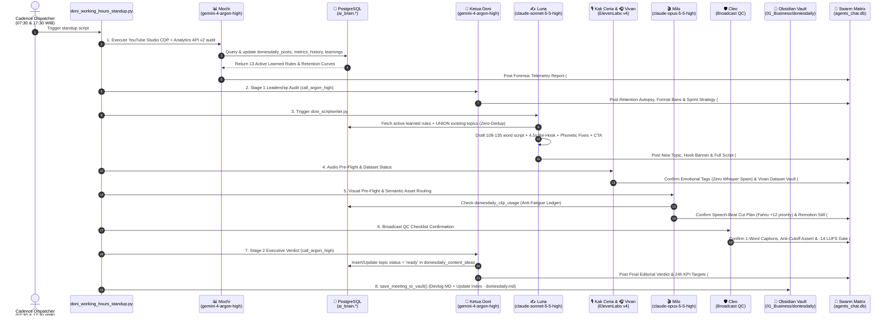
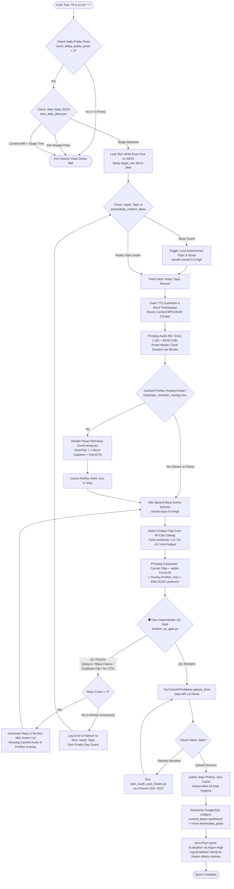
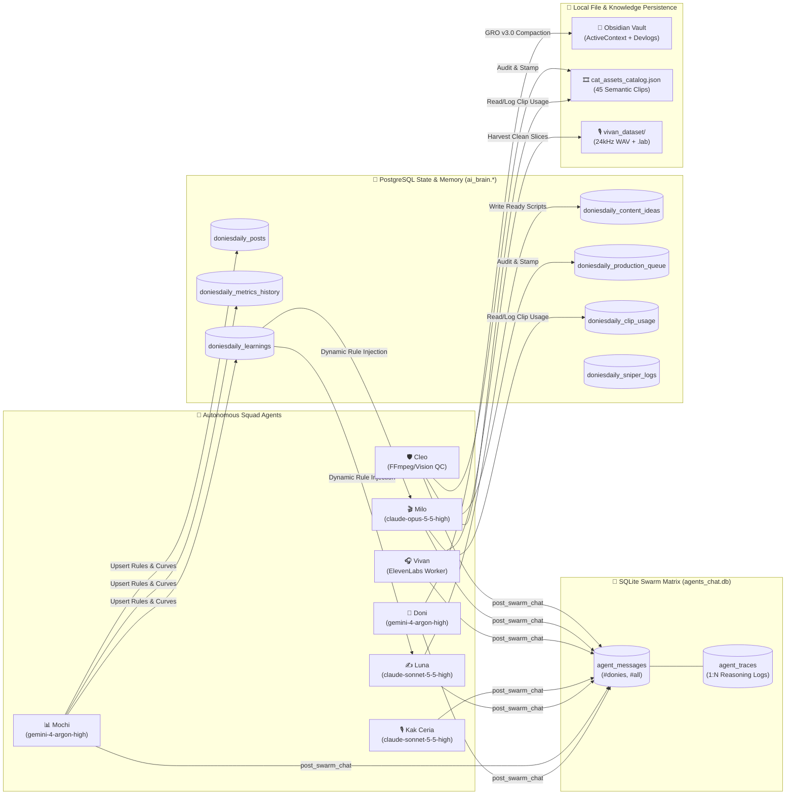

# 🏛️ DELIVERABLE 04: `04_ORCHESTRATION_ARCHITECTURE.md`
## PHASE 3: TEAM ORCHESTRATION & COMMUNICATION AUDIT

**Audit Target:** DoniesDaily Autonomous Multi-Agent Ecosystem (`@DoniesDaily` / `UCNPtjF2aB0wvWHI0q7hhcCg`)  
**Audit Classification:** Read-Only Evidence-Based Systems Architecture Audit  
**Canonical Workspace:** `/home/ubuntu/apps/ugc-lemonaru/` & `/home/ubuntu/tools/`  
**Audit Date:** November 2026  

---

## 1. Executive Orchestration Overview

### 1.1 Autonomous Collaboration Without Human Intervention
The `@DoniesDaily` production ecosystem operates as a zero-touch, autonomous media factory capable of ideating, scripting, synthesizing voiceovers, directing visual cuts, rendering broadcast-grade React animations, executing deterministic physical quality control, publishing to YouTube, and auditing its own retention telemetry without human-in-the-loop intervention.

Human involvement (by Owner **Fahru**, Telegram ID `1357517232`) is strictly asynchronous and strategic:
- **Asset Supply:** Dropping authentic cat footage via Telegram DM to Hermes or into `/home/ubuntu/apps/ugc-lemonaru/assets/cat_videos/fahru_clips/` for automated 10-frame multi-vision ingestion (`tools/ingest_fahru_footage.py`).
- **Executive Directives:** Issuing high-level architectural mandates (e.g., enforcing `claude-opus-5-5-high` for Milo's scene cuts or establishing the 3x/day cadence split).

### 1.2 Orchestration Paradigm: Hybrid Centralized-Leader & Database-Driven State Machine
Rather than relying on an unguided conversational agent swarm (which is prone to infinite loops, token bleed, and non-deterministic drift), the system implements a **Hybrid Centralized-Leader + Deterministic State Machine** paradigm:

| Architectural Layer | Paradigm | Governing Mechanism | Primary Actors |
| :--- | :--- | :--- | :--- |
| **Strategic & Editorial Layer** | **Centralized Leader-Follower** | Sequential Python orchestrator (`doni_working_hours_standup.py`) where `@Doni` acts as Lead Producer (`gemini-4-argon-high`), reviewing `@Mochi`'s telemetry and issuing binding directives to `@Luna`, `@Kak Ceria`, `@Milo`, and `@Cleo`. | `@Doni`, `@Mochi`, `@Luna` |
| **Execution & Rendering Layer** | **Deterministic Pipeline + LLM Tool Nodes** | Procedural execution (`doni_production_sprint.py` & `doni_remotion_flow_pipeline.py`) backed by PostgreSQL state persistence (`ai_brain.doniesdaily_content_ideas` & `ai_brain.doniesdaily_production_queue`). | `@Vivan`, `@Milo`, `@Cleo` |
| **Observability & Audit Layer** | **Broadcast Message Bus (DB-First)** | Every agent decision, LLM reasoning trace, and QC verdict is written synchronously to SQLite (`agents_chat.db`) and compacted into the Obsidian Vault (`/home/ubuntu/vault/01_Business/doniesdaily/`). | All Agents + Vault Archivist |

### 1.3 Heterogeneous Model Routing Matrix
The orchestration layer routes tasks across specialized foundation models via the local **CLIProxyAPI** endpoint (`http://127.0.0.1:8317/v1/chat/completions`, Auth: `Bearer cpa-secret-key-12345`) and external acoustic APIs:

| Agent / Sub-Unit | Designated Role | Assigned Engine / Model | Execution Script | Token Cost Profile |
| :--- | :--- | :--- | :--- | :--- |
| **🐱 Doni** | Lead Producer & Executive Evaluator | `gemini-4-argon-high` | `tools/doni_working_hours_standup.py`<br>`tools/doni_production_sprint.py` | High-reasoning evaluation |
| **📊 Mochi** | Head of Analytics & Retention Forensics | `gemini-4-argon-high` | `tools/doni_evaluator.py` | High-context telemetry analysis |
| **✍️ Luna** | Master Scriptwriter & Storyteller | `claude-sonnet-5-5-high` | `tools/doni_scriptwriter.py` | Creative Indonesian copywriting |
| **🎙️ Kak Ceria** | Senior Voice Director & Community Lead | `claude-sonnet-5-5-high` | `tools/doni_replier_runner.sh` | Empathetic community interaction |
| **🎧 Vivan** | Voice Synthesis & Dataset Sub-Unit | ElevenLabs v4 Turbo (`ZowYWFat3iypr7PwKMPb`) / Multilingual v2 (`d15jrIAARvF899pDoC6T`) | `src/elevenlabs_tts.py`<br>`src/vivan_dataset_harvester.py` | **0 LLM Tokens** (Deterministic Python + TTS API) |
| **🎬 Milo** | Visual Director & Remotion Editor | `claude-opus-5-5-high` + React Remotion (`DoniOverlay.tsx`) | `src/doni_hybrid_renderer.py`<br>`src/doni_visual_director.py` | High-intelligence speech-beat scene cutting |
| **🛡️ Cleo** | Broadcast QC Gatekeeper & Asset Vault | `gemini-3.8-flash-high` (Ingestion) + `ffprobe`/`ffmpeg` (QC) | `src/doni_qc_gate.py`<br>`tools/ingest_fahru_footage.py` | **0 LLM Tokens for QC** (100% deterministic physics) |

---

## 2. The Multi-Cadence Production Engines

The autonomous lifecycle is governed by `ai_brain.cadence_tasks`, which dispatches three primary operational engines across the 24-hour WIB (`Asia/Jakarta`) cycle.

### 2.1 Engine A: Daily Standup & Continuous Learning Loop
- **Script:** `/home/ubuntu/tools/doni_working_hours_standup.py` (21,240 bytes)
- **Cadence Task Key:** `business.doni_morning_standup`
- **Schedule:** `30 7,17 * * *` (Runs twice daily at **07:30 WIB** and **17:30 WIB**; note that internal docstrings reference `09:00 WIB` from earlier spec iterations, while the live DB cron triggers at `07:30` and `17:30`).
- **Objective:** Close the feedback loop between YouTube Shorts retention analytics and pre-production script/visual rules (`Hukum Besi #11` & `#12`).

#### The 9-Step Sequential Standup Workflow:
1. **Step 1 — Mochi Telemetry & Forensic Audit (`@Mochi`):**
   - Pulls YouTube Studio Advanced Mode metrics via Chrome CDP (`:9222`) (`stayed_to_watch_pct`, `engaged_views`, `avg_view_duration_sec`, `avg_view_pct`) and merges them with the 100-point `audienceWatchRatio` retention curve from the YouTube Analytics API v2 (`end_retention_pct`, `biggest_drop_sec`, `subs_gained`).
   - Classifies videos into outperformers vs. underperformers and upserts actionable directives into `ai_brain.doniesdaily_learnings` (currently holding 13 active rules with `confidence_score` between `0.80` and `1.00`).
2. **Step 2 — Ketua Doni Leadership Audit - Stage 1 (`@Doni`):**
   - Invokes `call_argon_high()` (`gemini-4-argon-high`, `temperature: 0.4`, timeout `45s`).
   - Performs an executive autopsy of prior video drop-offs (specifically targeting the 4.8s–8.4s swipe zone), establishes format bans (e.g., banning *"Kenapa Kucing..."* prefixes), and sets the strategic mandate for the upcoming sprint.
3. **Step 3 — Luna Concession & Script Drafting (`@Luna`):**
   - Invokes `tools/doni_scriptwriter.py` (`claude-sonnet-5-5-high`, `temperature: 0.65`, `max_tokens: 8192`).
   - Queries `fetch_active_learned_rules()` and `fetch_existing_topics()` (performing a `UNION` across `ai_brain.doniesdaily_content_ideas` and `ai_brain.doniesdaily_posts` to guarantee 100% topic novelty).
   - Generates a fresh Long-Form Short script (108–135 words, ~49–58s vocal duration) featuring a 0–3s imperative/curiosity hook, a 4.5s "Second Hook" open-loop bridge, ElevenLabs v4 emotional tags (`[curious]`, `[gasps]`, `[laughs]`, `[excited]`, `[sighs]`), phonetic replacements (`PHONETIC_DICTIONARY`), and a mandatory closing CTA (`Hukum Besi #15`).
4. **Step 4 — Kak Ceria & Vivan Audio Confirmation (`@Kak Ceria` & `@Vivan`):**
   - `@Kak Ceria` validates emotional tag diversity (enforcing `Hukum Besi #4`: Zero Whisper Monoton) and acoustic punctuation (`... ` and `—`).
   - `@Vivan` reports on voice synthesis readiness (`Speed 1.08x`, `Stability 0.40`, `Similarity Boost 0.75`) and logs the current progress of the local fine-tuning dataset vault (`assets/audio/vivan_dataset/`).
5. **Step 5 — Milo Visual & Semantic Planning (`@Milo`):**
   - Analyzes script speech beats via `claude-opus-5-5-high`.
   - Matches semantic tags against the 45-clip catalog (`data/cat_assets_catalog.json`), applying Gated Category Bias (`+12` priority to `fahru_sent` authentic clips, `-10` penalty to `google_flow_render` AI clips) and Anti-Fatigue Ledger penalties (`ai_brain.doniesdaily_clip_usage`).
   - Plans pattern interrupts at `4.5s` and `7.5s` and prepares the `<Still id="DoniThumbnail" />` Remotion cover.
6. **Step 6 — Cleo Broadcast QC Checklist (`@Cleo`):**
   - Confirms deterministic pre-flight and post-render verification gates: `SWITCH_CAPTIONS_EVERY_MS = 0` (single-word Hormozi captions), `dur_video >= dur_audio - 0.1` anti-cutoff assertion, EBU R128 loudness (`-14` to `-19 LUFS`), and 0 black frames.
7. **Step 7 — Ketua Doni Executive Verdict - Stage 2 (`@Doni`):**
   - Invokes `call_argon_high()` a second time to audit the complete package produced by Luna, Kak Ceria, Milo, and Cleo.
   - Issues the final editorial sign-off and sets the 24-hour performance targets, marking the topic as `status = 'ready'` in `ai_brain.doniesdaily_content_ideas`.
8. **Step 8 — Vault Archivist Persistence (`save_meeting_to_vault`):**
   - Compiles the full multi-agent transcript and both of Doni's Argon-High evaluations into a structured Markdown devlog (`/home/ubuntu/vault/01_Business/doniesdaily/YYYY-MM-DD - HH.MM - Rapat Standup & Kurasi Editorial Squad DoniesDaily.md`) using the GRO v3.0 Triad Compaction protocol.
   - Automatically prepends a new row to the workspace Sub-MOC table (`Index - doniesdaily.md`).
9. **Step 9 — Swarm Matrix Broadcast (`post_swarm_chat`):**
   - Synchronously commits every agent's message and underlying reasoning trace into SQLite `/home/ubuntu/vps-control-center/backend/data/agents_chat.db` under channel `#donies`.

---

### 2.2 Engine B: Autonomous Production & Release Sprint
- **Scripts:** `/home/ubuntu/tools/doni_production_sprint.py` (17,474 bytes) & `/home/ubuntu/apps/ugc-lemonaru/src/doni_remotion_flow_pipeline.py` (23,310 bytes)
- **Active Cadence Tasks (`ai_brain.cadence_tasks`):**
  1. **Morning Slot (`business.doni_morning_production`):** `*/5 8 * * *` (`--jitter-window --slot morning`, timeout `900s`).
  2. **Midday Serial Slot (`business.doni_midday_serial`):** `*/5 12 * * *` (`--slot midday_serial`, timeout `900s`) — Dedicated to multi-part series (e.g., *Spook the Kitten Training Part 1–4* isolated in `/home/ubuntu/apps/ugc-lemonaru/content_series/spook_kitten_training/`).
  3. **Evening Slot (`business.doni_afternoon_production`):** `*/5 18 * * *` (`--jitter-window --slot evening`, timeout `900s`).
  *(Note: Legacy task `business.doni_youtube_autopost` (`*/30 7-22 * * *`) is explicitly set to `status = 'paused'`).*

#### Core Mechanisms of the Production Sprint:
1. **Randomized Jitter Gatekeeper (`check_and_consume_jitter_window`):**
   - Every day on first invocation, `ensure_daily_jitter_state()` initializes `/home/ubuntu/apps/ugc-lemonaru/data/doni_daily_jitter.json`.
   - Pre-rolls randomized target timestamps to simulate human organic posting behavior:
     - `morning`: Hour `8`, Minute `random.randint(4, 55)`, Second `random.randint(7, 49)`.
     - `midday_serial`: Hour `12`, Minute `random.randint(4, 25)`, Second `random.randint(7, 49)`.
     - `evening`: Hour `18`, Minute `random.randint(4, 55)`, Second `random.randint(7, 49)`.
   - Cron polls every 5 minutes (`*/5`). If current WIB time `< target_time`, the script exits cleanly (`return False`).
   - Once matched, the script **immediately writes `"fired": True` and `"fired_at"` to disk before sleeping** (`time.sleep(target_sec)`) to prevent race-condition double-firing across overlapping 5-minute cron ticks.
2. **Audio & Caption Synthesis (`synthesize_audio_and_captions`):**
   - Enforces the spoken CTA regex check (`if not re.search(r'(follow|subscribe)', script, re.IGNORECASE):`).
   - Checks for cached audio (`public/{t_key}_master.mp3`) and word-level captions (`public/doni-{t_key}-captions.json`) to conserve ElevenLabs credits across retries.
   - Mixes raw voiceover (`volume=1.25,highpass=f=80,dynaudnorm`) with playful BGM (`cat_playful_bgm.mp3` at `volume=0.08`) via FFmpeg `amix=inputs=2:duration=first`.
   - Probes exact master audio duration via `ffprobe` to serve as the **Master Clock** (`Hukum Besi #3`).
3. **Remotion Overlay Caching & Hybrid Scene Assembly:**
   - Renders the transparent kinetic overlay (`DoniOverlay.tsx` with `HookTitle`, `StoryCoverCard`, `SubtitlePage` at `SWITCH_CAPTIONS_EVERY_MS = 0`, and `OutroCTA`) into an intermediate Apple ProRes 4444 file (`/tmp/{topic}_remotion_overlay.mov`, ~100–250 MB).
   - **ProRes Caching Optimization:** If a downstream footage slice or FFmpeg composite fails Cleo's QC gate, the cached `/tmp/{topic}_remotion_overlay.mov` is reused during in-place revisions, saving 2–4 minutes of Chromium/Remotion rendering time per retry.
   - **Emergency Force-Fit Guard:** If a selected video clip is slightly shorter than the speech-beat slice duration (`<1.5x`), FFmpeg applies a smooth `setpts` stretch rather than crashing or looping frames (`Hukum Besi #13`).
4. **In-Place Revision Loop & Self-Healing Failover:**
   - Cleo (`src/doni_qc_gate.py`) runs `inspect_video()`, `audit_script_and_outro()`, and `audit_footage_assembly()`.
   - If QC fails, the sprint executor performs an **in-place revision loop up to 3 retries** on the current topic.
   - If all 3 retries fail, the orchestrator logs the error to `ai_brain.doniesdaily_production_queue` (`retry_count`, `error_message`) and **automatically fails over to the next `'ready'` topic** in `ai_brain.doniesdaily_content_ideas` to guarantee a **Zero Empty-Day** publishing record.
5. **Publication, Ephemeral Purge & Post-Production Audit:**
   - Uploads the QC-passed MP4 via `YouTubeAPIPublisher.upload_short()` (`categoryId="15"`, `privacyStatus="public"`).
   - **Delayed Ephemeral Purge (`Hukum Besi #5`):** Unlinks `/tmp/{topic}_remotion_overlay.mov` immediately after YouTube API confirms publication.
   - Reconciles PostgreSQL (`doniesdaily_content_ideas.status = 'published'`, inserts row into `doniesdaily_posts`).
   - Triggers `evaluate_post_sprint_argon()` (`gemini-4-argon-high`) for `@Doni`'s mandatory post-production broadcast review in `#donies`.

---

### 2.3 Engine C: Community Engagement & Comment Sniper Engine
- **Cadence Task Key:** `business.doni_community_replier`
- **Schedule:** `0 8-22/2 * * *` (Runs every 2 hours between 08:00 and 22:00 WIB via `/home/ubuntu/tools/doni_replier_runner.sh`).
- **Component 1 — Studio Community Replier (`doni_studio_replier.py`):**
  - Supervised by `@Kak Ceria` using `claude-sonnet-5-5-high`.
  - Fetches viewer comments on `@DoniesDaily` Shorts and replies with warm, conversational Indonesian (*"pawrents"*, *"anabul"*, *"si oren"*) aligned with `/home/ubuntu/.claude/youtube/voice.md`.
- **Component 2 — Viral Comment Sniper (`doni_comment_sniper.py` & `ai_brain.doniesdaily_sniper_logs`):**
  - Identifies trending cat videos across YouTube and posts contextual, high-value comments from the `@DoniesDaily` channel to drive organic profile discovery.
  - Enforces strict anti-spam deduplication via PostgreSQL table `ai_brain.doniesdaily_sniper_logs`, which locks `video_id` with a `UNIQUE CONSTRAINT ("uq_sniper_video")` so the bot can never comment twice on the same external video.

---

## 3. Communication & Message Bus Architecture

In compliance with **Hukum Besi #9 (Full Transparency & Auditability — Grup & DB-First)**, dark execution is strictly prohibited. The ecosystem relies on two distinct database backbones: SQLite for real-time multi-agent chat/trace observability, and PostgreSQL for transactional production state management.

### 3.1 SQLite Swarm Matrix (`agents_chat.db`)
- **Database Path:** `/home/ubuntu/vps-control-center/backend/data/agents_chat.db`
- **Role:** Powers the VPS Control Center Swarm Matrix UI, recording all inter-agent standups, delegation handoffs, and underlying LLM/tool execution traces.

#### Verified SQLite Schema (`agent_messages` & `agent_traces`):
```sql
-- Table 1: Primary Inter-Agent Communication Bus
CREATE TABLE agent_messages (
    id TEXT PRIMARY KEY,           -- Format: "msg-{epoch_ms}-{uuid6}"
    sender_id TEXT,                -- e.g., "doni", "mochi", "luna", "ceria", "vivan", "milo", "cleo"
    sender_name TEXT,              -- Display name & model tag, e.g., "Milo (Opus Remotion Editor)"
    sender_avatar TEXT,            -- Emoji avatar, e.g., "👑", "📊", "✍️", "🎙️", "🎧", "🎬", "🛡️"
    sender_role TEXT,              -- Functional title
    recipient_id TEXT,             -- Default: 'all'
    recipient_name TEXT,           -- Default: 'All Agents'
    content TEXT,                  -- Markdown body of the agent's report or verdict
    timestamp TEXT,                -- "HH:MM" formatted local time
    channel TEXT,                  -- Channel routing key ("donies", "doniesdaily", "all", "bawang", "subtracker")
    status TEXT,                   -- Delivery state: 'delivered'
    created_at REAL                -- Unix epoch float (time.time())
);

-- Table 2: Granular Execution & Reasoning Traces (1:N Foreign Key to agent_messages)
CREATE TABLE agent_traces (
    id TEXT PRIMARY KEY,           -- Format: "tr-{uuid8}"
    message_id TEXT,               -- FK referencing agent_messages(id)
    type TEXT,                     -- Trace category (e.g., "reasoning", "tool_call", "qc_metric")
    title TEXT,                    -- Short trace header
    description TEXT,              -- Summary of action
    status TEXT,                   -- Execution status (e.g., "none", "success", "error")
    content TEXT,                  -- Raw payload, SQL query, or JSON output
    icon TEXT,                     -- UI icon identifier (e.g., "sparkles")
    timestamp TEXT,                -- "HH:MM"
    created_at REAL                -- Unix epoch float
);
```

#### Channel Segregation & Historical Traffic Audit (`agents_chat.db`):
Analysis of the verified SQLite stats reveals how multi-business holding agents are segregated by channel:
- **`#donies` (Primary Squad Room — 151+ messages):** Dedicated operational room for `@DoniesDaily` standups, Opus scene cut plans, Vivan dataset reports, and Cleo QC stamps.
- **`#doniesdaily` (Legacy / Milestone Room — 12 messages):** Used for high-level squad lead and QC gate summaries.
- **`#all` (Holding Executive Board — 67+ messages):** Cross-business broadcast channel linking **Owner Fahru** (`user`, 15 msgs), **Hermes Agent** (`hermes`, 9 msgs), **DoniesDaily** (`doniesdaily`, 44 msgs), **Juragan Bawang** (`juragan-bawang`, 5 msgs), and **SubTracker Guard** (`subtracker`, 3 msgs).
- **Identity Drift Finding:** The SQLite statistics show minor historical `sender_id` fragmentation across developmental iterations (e.g., Kak Ceria logged under `"ceria"`, `"kak_ceria"`, `"sub-ceria"`, and `"doniesdaily"`; Milo logged under `"milo"`, `"sub-milo"`, and `"doniesdaily"`). Current scripts (`doni_working_hours_standup.py` and `doni_scriptwriter.py`) standardize on canonical IDs (`doni`, `mochi`, `luna`, `ceria`, `vivan`, `milo`, `cleo`) in channel `#donies`.

---

### 3.2 PostgreSQL State Queue & Relational Ledger (`ai_brain`)
- **Database Container:** `supabase-db` (PostgreSQL accessed via `docker exec -i supabase-db psql -U postgres -d postgres`)
- **Schema:** `ai_brain`

#### State Machine Architecture (`ai_brain.doniesdaily_production_queue`):
The table `ai_brain.doniesdaily_production_queue` tracks granular artifact paths (`audio_path`, `caption_path`, `background_video_path`, `rendered_master_path`, `youtube_video_id`), QC telemetry (`qc_report` JSONB), and fault recovery (`error_message`, `retry_count`) indexed by `idx_doni_queue_stage` on `current_stage` (`ai_brain.production_stage`).

```
[IDEA_SELECTED / IDEA] 
   ──► [SCRIPT_READY] 
      ──► [AUDIO_READY] 
         ──► [VISUAL_READY] 
            ──► [RENDER_READY] 
               ──► [QC_PASSED] ──► [PUBLISHED]
               │               └─► [BLOCKED_QUOTA] (If YouTube >9/24h rolling limit hit)
               └─► [QC_FAILED] ──► (In-Place Retry 1..3 returning to VISUAL_READY / RENDER_READY)
```

*Architectural Note on Dual-Ledger State Management:* While `DONI_SOUL.md` and `ai_brain.doniesdaily_production_queue` define the 7-stage `ai_brain.production_stage` enum (`IDEA_SELECTED` through `PUBLISHED`), the streamlined Remotion orchestrator (`doni_remotion_flow_pipeline.py`) also uses file-existence idempotency checks (`if master_audio_path.exists()`, `if final_bg_path.exists()`) alongside the `status` column in `ai_brain.doniesdaily_content_ideas` (`'ready'` ➔ `'published'`) to avoid repeating paid API calls during retries.

---

## 4. Comprehensive Architecture Diagrams

### Diagram 1: Full Daily Standup & Continuous Learning Cycle
*(Sequence Diagram of `tools/doni_working_hours_standup.py`)*



---

### Diagram 2: Autonomous Production Sprint & Self-Healing Loop
*(Flowchart of `tools/doni_production_sprint.py` & `src/doni_remotion_flow_pipeline.py`)*



---

### Diagram 3: Multi-Agent Message Bus & Storage Topology



---

## 5. Conflict Resolution, Authority & Consensus

The `@DoniesDaily` squad does not use democratic voting. Instead, it enforces a strict **Constitutional Hierarchy of Authority** where specific agents hold absolute veto power over their designated domains, governed by the 15 Invariant Rules (*Hukum Besi*).

### 5.1 Domain Veto Matrix

| Authority Holder | Veto Domain | Enforcement Mechanism | Overridden Parties |
| :--- | :--- | :--- | :--- |
| **👑 Fahru (Owner)** | **Constitutional & Strategic** | Direct modification of PRD specs, `ai_brain.cadence_tasks`, and model routing mandates (e.g., mandating Opus for Milo). | All Agents (`@Hermes`, `@Doni`, Squad) |
| **🛡️ Cleo (QC Gate)** | **Physical Broadcast & Hukum Besi Compliance** | Hard boolean gate in `src/doni_qc_gate.py` (`report["passed"] = False`). No video can reach `YouTubeAPIPublisher` without Cleo's pass. | `@Milo` (Visuals), `@Luna` (Script CTA), `@Vivan` (Audio sync), `@Doni` (Schedule urgency) |
| **🐱 Doni (Lead Producer)** | **Editorial Packaging & Quota Governance** | Stage 1 & Stage 2 Argon-High verdicts (`doni_working_hours_standup.py`) and daily quota ceiling (`MAX_DAILY_POSTS = 3`). | `@Luna` (Topic/Hook framing), `@Mochi` (Raw angle selection) |
| **📊 Mochi (Analytics)** | **Empirical Rule Injection** | Automated upsert of active directives (`confidence_score >= 0.80`) into `ai_brain.doniesdaily_learnings`. | `@Luna` & `@Milo` (Personal creative preferences) |

### 5.2 Resolution of Specific Inter-Agent Conflicts

1. **Creative Aspirations (`@Luna` / `@Milo`) vs. Broadcast Physics (`@Cleo`):**
   - *Scenario A (Missing Outro CTA):* If `@Luna` writes an artistic open-ended conclusion that omits the subscribe/follow prompt (`Hukum Besi #15`), two defensive layers resolve the conflict:
     1. `DoniRemotionFlowPipeline.synthesize_audio_and_captions()` automatically appends `" Jangan lupa follow dan subscribe DoniesDaily ya!"` via regex check (`r'(follow|subscribe)'`) before TTS synthesis.
     2. `Cleo.audit_script_and_outro()` inspects the final script and blocks publication (`Hukum Besi #15 VIOLATION`) if `"subscribe"`/`"follow"` is absent.
   - *Scenario B (Clip Shorter Than Speech Beat):* If `@Milo` (`claude-opus-5-5-high`) selects an authentic Fahru clip that is 3.5s long for a 4.2s sentence beat, `@Cleo` forbids looping (`-stream_loop`, `Hukum Besi #13`) and forbids audio cutoffs (`Hukum Besi #3`). The renderer resolves this conflict deterministically via the **Emergency Force-Fit Guard**, applying an FFmpeg `setpts` time-stretch (`<1.5x`) so the clip fills the exact vocal beat without looping or cutting off Vivan's voice.
   - *Scenario C (Duplicate Clip Selection):* If `@Milo` selects the same file twice in one video, `Cleo.audit_footage_assembly()` detects `len(clip_strs) != len(unique_clips)`, rejects the build, and forces an in-place retry where `@Milo` must re-select from the 45-clip catalog while reusing the cached ProRes overlay.

2. **Schema & Rule Drift inside `ai_brain.doniesdaily_learnings` (Internal Policy Conflict):**
   - *Audit Finding:* Inspecting the 13 active rows in `ai_brain.doniesdaily_learnings` reveals conflicting duration directives accumulated across consecutive Mochi evaluations:
     - **Rule #2 (`ideal_duration_sweetspot`, conf `1.0`):** *"Targetkan durasi total video antara 48-55 detik"*
     - **Rule #5 (`imperative_prohibition_hook_60s_lock`, conf `0.98`):** *"memastikan pacing audio-visual ter-render pada durasi optimal 55-63 detik"* (Note: `>59.9s` will actually trigger a hard failure in `Cleo.inspect_video()`!).
     - **Rule #7 (`bridge_the_5sec_chasm_and_cap_38sec`, conf `0.96`) & Rule #9 (`anti_5to8sec_dropoff_and_35s_sweetspot`, conf `0.96`):** *"Kunci durasi naskah di sweet-spot 30-38 detik"*
     - **Rule #6 (`shock_curiosity_hook_with_5s_rehook_and_no_outro_drop`, conf `0.96`):** *"potong semua kalimat kesimpulan/outro di 5 detik terakhir"* — which directly contradicts **Hukum Besi #15** (Mandatory Follow & Subscribe Outro CTA).
   - *How the System Currently Resolves It:* In `tools/doni_scriptwriter.py`, `@Luna`'s system prompt injects `rules_text` at the top, followed immediately by a hard-coded `STANDAR NASKAH (LONG-FORM SHORTS 50-58 DETIK): 1. Panjang naskah: TEPAT 108 SAMPAI 124 KATA`, and `doni_remotion_flow_pipeline.py` hard-appends the spoken CTA in Python. Thus, hard-coded Python invariants override conflicting soft LLM directives in `doniesdaily_learnings`.

---

## 6. Fault Tolerance, Anti-Spam & Concurrency Protection

### 6.1 Concurrency & Anti-Spam Guards
1. **Atomic Pre-Sleep Jitter Locking (`doni_daily_jitter.json`):**
   - Cron executes `doni_production_sprint.py` every 5 minutes (`*/5 8,12,18 * * *`). Because a full Remotion + FFmpeg render takes 3–6 minutes, a naive script would be triggered a second time on the next 5-minute tick while the first render is still running.
   - `check_and_consume_jitter_window()` prevents this by writing `"fired": True` and `"fired_at"` to `/home/ubuntu/apps/ugc-lemonaru/data/doni_daily_jitter.json` **before** calling `time.sleep(target_sec)` and **before** starting the render pipeline. Subsequent cron ticks read `"fired": True` and exit within milliseconds.
2. **Database-Level Daily Quota Ceiling (`MAX_DAILY_POSTS = 3`):**
   - Before checking slot state, `count_today_public_posts()` queries `ai_brain.doniesdaily_posts` for videos posted on the current `Asia/Jakarta` date with `privacy_status = 'public'`. If `count >= 3`, execution halts immediately.
3. **YouTube API Rolling Quota Protection (`DONI_SOUL.md`):**
   - Protects against YouTube Data API's hard limit of 9 uploads per 24-hour rolling window by capping daily production at 3 videos (2 Daily + 1 Midday Serial) and transitioning to `BLOCKED_QUOTA` if `uploadLimitExceeded` is returned.
4. **Sniper Comment Anti-Spam Constraint (`uq_sniper_video`):**
   - `ai_brain.doniesdaily_sniper_logs` enforces a PostgreSQL `UNIQUE CONSTRAINT` on `video_id`, ensuring the sniper bot cannot spam multiple comments on the same external video.

### 6.2 Multi-Layer Fault Recovery & Self-Healing Mechanisms

| Failure Mode | Detection Mechanism | Autonomous Recovery Action |
| :--- | :--- | :--- |
| **YouTube OAuth Token Expiration / Revocation** | `YouTubeAPIPublisher._ensure_valid_token()` catches `creds.refresh(Request())` exception. | Automatically invokes `/home/ubuntu/tools/doni_oauth_auto_healer.py` via subprocess, which attaches to persistent Chrome CDP (`:9222`) on Xvfb (`:99`), re-authenticates the Google OAuth flow, writes the fresh token to `/home/ubuntu/.config/youtube/doniesdaily_oauth.json`, and reloads credentials in-memory without failing the upload. |
| **Google Flow CDP Video Generation Failure** | `DoniRemotionFlowPipeline.prepare_flow_scenes()` catches exceptions from `self.flow_operator.generate_scenes()`. | Logs warning and seamlessly falls back to the local curated asset catalog (`cat_assets_catalog.json` / local verified clips) so production never stalls on external browser automation. |
| **CLIProxyAPI / `gemini-4-argon-high` Timeout** | `call_argon_high()` sets `timeout=45` on `urllib.request.urlopen()`. | Catches timeout/HTTP errors and returns deterministic structured `fallback_text` so the daily standup and post-sprint logs complete uninterrupted. |
| **ElevenLabs Credit Exhaustion on Retries** | `synthesize_audio_and_captions()` checks `master_audio_path.exists()` and `captions_path.exists()` + `ffprobe` duration. | Reuses existing synthesized voiceover and word-timestamp JSON from disk during in-place visual retries, preventing duplicate TTS billing. |
| **Clip Duration Shorter Than Speech Beat** | `doni_hybrid_renderer.py` compares clip duration against vocal beat duration. | Applies **Emergency Force-Fit Guard** (`ffmpeg setpts` stretch `<1.5x`) to prevent Cleo's anti-cutoff assertion failure. |

---

## 7. Bottlenecks & Single Points of Failure (SPOF) Analysis

Based on code inspection and database verification, the following architectural bottlenecks and Single Points of Failure (SPOFs) exist in the current ecosystem:

| # | Component / Vector | Severity | Evidence & Root Cause | Operational Impact | Remediation Recommendation |
| :--- | :--- | :--- | :--- | :--- | :--- |
| **1** | **Contradictory Directives in `doniesdaily_learnings`** | **HIGH** | All 13 rows in `ai_brain.doniesdaily_learnings` have `status = 'active'`. Rules #2 (48–55s), #5 (55–63s), #7 (30–38s), and #9 (30–38s) give mutually exclusive duration targets, while Rule #6 ("cut all outro sentences in last 5s") violates `Hukum Besi #15` and Rule #5 (>60s) violates `Cleo`'s `<59.9s` Shorts gate. | Confuses `@Luna` (`claude-sonnet-5-5-high`) during prompt construction, increasing script generation variance and reliance on hard-coded regex patches. | Implement a **Rule Superseding & Pruning Gate** in `doni_evaluator.py`: when Mochi inserts a new rule in `script_structure` or `duration_pacing`, automatically set older conflicting rules in the same category to `status = 'superseded'`, and validate new rules against Cleo's hard physical bounds (`15s..58s`). |
| **2** | **Local CLIProxyAPI (`127.0.0.1:8317`) SPOF** | **HIGH** | `@Doni`, `@Mochi`, `@Luna`, `@Kak Ceria`, and `@Milo` all route LLM calls through `http://127.0.0.1:8317/v1/chat/completions`. While `@Doni` has a static fallback string in `call_argon_high()`, `doni_scriptwriter.py` (`requests.post(API_URL)`) has no fallback endpoint if `:8317` is down. | If CLIProxyAPI crashes or upstream provider keys expire, new script generation (`@Luna`) and Opus scene cutting (`@Milo`) will fail. | Add a secondary fallback provider route (e.g., direct OpenRouter/Anthropic/Gemini API fallback) when `127.0.0.1:8317` returns `5xx` or connection refused. |
| **3** | **Chrome CDP (`:9222`) & Xvfb (`:99`) Shared Dependency** | **MEDIUM** | Used by three critical subsystems: (1) `@Mochi` YouTube Studio Advanced Mode scraping, (2) `doni_oauth_auto_healer.py`, and (3) `FlowCDPOperator`. | If the persistent Chromium process at `/home/ubuntu/apps/ugc-lemonaru/data/chrome_persistent` hangs, freezes, or leaks memory, OAuth auto-healing and Studio Advanced Mode scraping will fail simultaneously. | Implement a pre-flight CDP health-check watchdog that verifies `http://127.0.0.1:9222/json/version` and gracefully restarts the Xvfb/Chromium systemd service if unresponsive. |
| **4** | **SQLite Concurrency Locking (`agents_chat.db`)** | **LOW-MED** | `post_swarm_chat()` opens a default `sqlite3.connect(str(DB_CHAT_PATH))` without explicit `timeout=30.0` or `PRAGMA journal_mode=WAL;`. | If multiple cadence tasks (`doni_morning_production` at `08:xx` and `doni_community_replier` at `08:00`) or the VPS Control Center backend write to `agents_chat.db` at the exact same millisecond, SQLite may raise `OperationalError: database is locked`. | Enable Write-Ahead Logging (`PRAGMA journal_mode=WAL;`) and set `sqlite3.connect(..., timeout=30.0)` across all swarm chat helpers. |
| **5** | **Subprocess `docker exec psql` Overhead** | **LOW** | Every database query in `doni_production_sprint.py`, `doni_scriptwriter.py`, and `doni_remotion_flow_pipeline.py` spawns a shell subprocess (`docker exec -i supabase-db psql ...`) and parses stdout via string splitting (`parts = line.split("|")`). | Fragile if a script or directive contains a literal pipe character (`|`) in `doni_scriptwriter.py`, and adds container exec overhead per query. | Migrate `psql` CLI calls to a native Python `psycopg2` / `asyncpg` connection pool or always query using `SELECT json_agg(t)` (as already done cleanly in `DoniRemotionFlowPipeline.fetch_next_topic()`). |