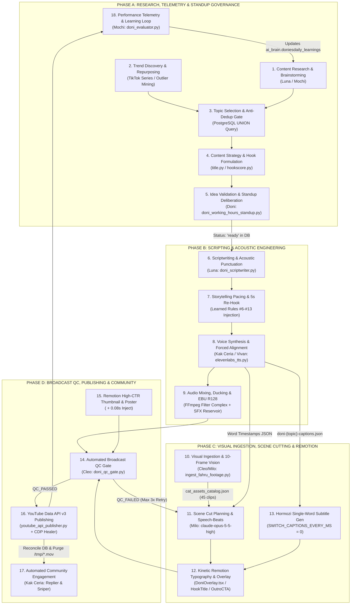

# 05_CONTENT_PIPELINE.md — YOUTUBE CONTENT PRODUCTION PIPELINE (END-TO-END LIFECYCLE AUDIT)

**Audit Document ID:** `DD-AUDIT-05-PIPELINE`  
**Target Ecosystem:** DoniesDaily (`@DoniesDaily`, Channel ID: `UCNPtjF2aB0wvWHI0q7hhcCg`)  
**Canonical Workspace:** `/home/ubuntu/apps/ugc-lemonaru`  
**Orchestration & Tooling Root:** `/home/ubuntu/tools`  
**Audit Status:** READ-ONLY VERIFIED  

---

## EXECUTIVE ARCHITECTURE OVERVIEW

The DoniesDaily content production pipeline is an autonomous, database-governed, multi-agent broadcast system that transforms raw feline behavioral psychology and authentic/AI video assets into vertical 9:16 YouTube Shorts. The system operates on a **3-Video Daily Cadence** (Morning Daily `#1` at ~08:00 WIB, Midday Serial at ~12:00 WIB, and Evening Daily `#2` at ~18:00 WIB) alongside a **2x Daily Working Hours Standup & Telemetry Loop** (`07:30` & `17:30` WIB).

Below is the end-to-end architectural flow across all 18 lifecycle stages:



---

## EXHAUSTIVE 18-STAGE LIFECYCLE ANALYSIS

---

### STAGE 1: Content Research & Brainstorming

* **Status:** `IMPLEMENTED`
* **Responsible Agent & Model:**
  * **Luna (`@Luna` — Master Scriptwriter):** `claude-sonnet-5-5-high` via CLIProxyAPI (`http://127.0.0.1:8317/v1/chat/completions`).
  * **Mochi (`@Mochi` — Head of Analytics):** `gemini-4-argon-high` (supplies psychological angles and retention hypotheses).
* **Required Inputs & Source:**
  * Active learned directives from PostgreSQL table `ai_brain.doniesdaily_learnings` (`WHERE status = 'active' ORDER BY confidence_score DESC`).
  * Exclusion list of all historical and queued topics from `ai_brain.doniesdaily_content_ideas` and `ai_brain.doniesdaily_posts`.
  * Persona & biological feline angle constraints defined in `/home/ubuntu/apps/ugc-lemonaru/souls/LUNA_SOUL.md` and `MOCHI_SOUL.md`.
* **Processing Logic & Algorithms:**
  1. `doni_scriptwriter.py::fetch_active_learned_rules()` executes a `psql` query inside the `supabase-db` Docker container to retrieve all active rules (currently 13 active rules with confidence scores `0.80` to `1.0`).
  2. `doni_scriptwriter.py::fetch_existing_topics()` pulls up to 35 existing `title (topic_key)` strings.
  3. `generate_autonomous_topic()` constructs a strict prompt instructing `claude-sonnet-5-5-high` (temperature `0.65`, `max_tokens: 8192`) to brainstorm 100% novel cat psychology, instinct, or domestic behavior topics.
  4. Hardcoded negative constraints inside the prompt explicitly forbid overused topics: belly rubs (`elus perut`), biting hands (`gigit/cakar tangan`), knocking objects over (`jatuhkan barang`), `zoomies`, kneading (`ngadon roti`), cow's milk (`susu sapi`), cardboard boxes (`kardus`), cucumbers (`timun`), slow blink (`kedip pelan`), staring at walls (`tatap tembok`), following to the toilet (`ikut ke toilet`), tail language (`ekor`), sleeping 16 hours (`tidur 16 jam`), purring (`dengkuran`), or `flehmen`.
  5. Mochi enforces target angles categorized into four buckets: `mitos_vs_fakta | perilaku_aneh | biologi_rahasia | ikatan_emosional`.
* **Tools, Libraries & Scripts Invoked:**
  * `/home/ubuntu/tools/doni_scriptwriter.py` (`generate_autonomous_topic`, `fetch_active_learned_rules`, `fetch_existing_topics`)
  * `docker exec -i supabase-db psql`
  * Python `requests`, `re`, `json`
* **Concrete Outputs & File Formats:**
  * In-memory Python dictionary parsed from strict LLM JSON output:
    ```json
    {
      "topic_key": "cat_unique_topic_slug",
      "title": "Judul Menarik Huruf Kapital #Shorts",
      "hook_banner": "BANNER PUNCHY",
      "hook_subtitle": "Subtitle Menarik Di Bawah Banner",
      "concept_why": "Alasan psikologi/biologis anabul di balik topik ini"
    }
    ```
* **Validation & Assertion Gates:**
  * Regex extraction `re.search(r"\{.*\}", raw, re.DOTALL)` and `json.loads(raw)` validation.
  * Prohibition of `"Kenapa Kucing..."` prefix enforced by Learned Rule #1 (`banned_hook_prefix_kenapa`) and Rule #5 (`imperative_prohibition_hook_60s_lock`).
* **Downstream Destination:**
  * Passed directly to Stage 3 (Anti-Duplication Gate) and Stage 6 (`generate_long_form_script()`), then persisted to `ai_brain.doniesdaily_content_ideas`.
* **Failure Modes & Fallback Procedures:**
  * If `fetch_active_learned_rules()` or `fetch_existing_topics()` fails due to DB container timeout, the functions catch `Exception`, print a warning to `stdout`, and return an empty list `[]` so generation does not crash.
  * If `json.loads()` fails on malformed LLM output, the caller catches the exception during standup/sprint execution and falls back to pre-curated `'ready'` rows in `ai_brain.doniesdaily_content_ideas`.

---

### STAGE 2: Trend Discovery & Telemetry Ingestion

* **Status:** `IMPLEMENTED` (Hybrid: Channel Outlier Mining + Dedicated Curated Serial Ingestion)
* **Responsible Agent & Model:**
  * **Mochi (`@Mochi`):** `gemini-4-argon-high` (Outlier mining & YouTube Studio Advanced Mode telemetry ingestion).
  * **Fahru (Owner) & Hermes Agent:** Curated viral narrative repurposing & episodic series ingestion (`@_worm.com_` Emma & Spook series; viral TikTok emotional story adaptations).
* **Required Inputs & Source:**
  * Live channel performance metrics via YouTube Data API v3, YouTube Analytics API v2 (`audienceWatchRatio`), and Chrome CDP `:9222` scraping of YouTube Studio Advanced Mode.
  * Curated local series folders: `/home/ubuntu/apps/ugc-lemonaru/content_series/spook_kitten_training/` (Parts 1–4) and owner-supplied viral videos.
* **Processing Logic & Algorithms:**
  1. **Internal Outlier Mining:** Mochi executes outlier detection (`swipe.py` reference in `MOCHI_SOUL.md` & `tools/doni_evaluator.py`) comparing individual video views against the channel median. Videos exceeding `>2.0x` channel median (e.g., *Ngadon Roti*, *Jago Lompat* `>1,500` views, or top winner at `5,029` views) are dissected to extract winning emotional hooks (such as the *"Bawa Bangkai"* / *"Tidur di Baju Kotor"* behavioral bonding phenomena).
  2. **Zero External Scraping Invariant (Hukum Besi #1):** Automated wild scraping of random third-party videos for general B-roll is strictly forbidden.
  3. **Episodic Series & Repurposed Master Track:** High-retention external narrative formats explicitly mandated by the Owner (e.g., *Spook the Kitten Training Parts 1–4* and *Kucing Membeku Melihat Kembaran Mendiang Majikan*) are ingested into isolated directories (`/content_series/spook_kitten_training/`), analyzed chronologically via 10-Frame Multi-Vision, and scheduled on a dedicated Midday Serial slot (`12:00 WIB`, cron `business.doni_midday_serial`) or Evening Repurposed Master slot.
* **Tools, Libraries & Scripts Invoked:**
  * `/home/ubuntu/tools/doni_evaluator.py`
  * `/home/ubuntu/tools/yt_agent_tools/swipe.py` (Referenced in `MOCHI_SOUL.md`)
  * Chrome CDP `:9222` (`/home/ubuntu/apps/ugc-lemonaru/data/chrome_persistent`)
* **Concrete Outputs & File Formats:**
  * Telemetry rows in `ai_brain.doniesdaily_posts` and `ai_brain.doniesdaily_metrics_history`.
  * Isolated series assets in `/home/ubuntu/apps/ugc-lemonaru/content_series/spook_kitten_training/`.
* **Validation & Assertion Gates:**
  * **Hukum Besi #1 Assertion:** General B-roll catalog (`cat_assets_catalog.json`) must never be polluted by external scraped TikTok series clips; series files are strictly isolated in `content_series/`.
* **Downstream Destination:**
  * Feeds Stage 18 (Learning Ledger updates) and Stage 3 (Topic Selection queue).
* **Failure Modes & Fallback Procedures:**
  * If a serialized trend (e.g., Spook Parts 1–4) finishes its run, `ActiveContext.md` specifies that the `12:00 WIB` slot automatically falls back to the next thematic serialized content or general `'ready'` queue.

---

### STAGE 3: Topic Selection & Anti-Duplication Gate

* **Status:** `IMPLEMENTED`
* **Responsible Agent & Model:**
  * **Mochi (`@Mochi`) & Doni (`@Doni`):** Deterministic PostgreSQL gatekeepers inside `doni_production_sprint.py`, `doni_remotion_flow_pipeline.py`, and `doni_scriptwriter.py`.
* **Required Inputs & Source:**
  * PostgreSQL tables:
    * `ai_brain.doniesdaily_content_ideas` (`id`, `topic_key`, `title`, `status`, `created_at`)
    * `ai_brain.doniesdaily_posts` (`id`, `video_id`, `title`, `posted_at`, `privacy_status`)
    * `ai_brain.doniesdaily_production_queue` (`topic_key`, `current_stage`, `retry_count`)
* **Processing Logic & Algorithms:**
  1. **Pre-Production Deduplication Gate (Hukum Besi #6):** Before generating any script, `fetch_existing_topics()` runs:
     ```sql
     SELECT DISTINCT title || ' (' || topic_key || ')' FROM ai_brain.doniesdaily_content_ideas
     UNION
     SELECT DISTINCT title FROM ai_brain.doniesdaily_posts;
     ```
  2. **Database-First Topic Fetching:** When a production sprint triggers, `check_ready_topic()` in `doni_production_sprint.py` checks:
     ```sql
     SELECT count(*) FROM ai_brain.doniesdaily_content_ideas WHERE status = 'ready';
     ```
  3. If `count > 0`, `DoniRemotionFlowPipeline.fetch_next_topic()` selects the oldest `'ready'` topic using FIFO ordering:
     ```sql
     SELECT topic_key, title, hook_banner, hook_subtitle, hook_vocal, full_script, flow_prompts, scene_breakdown, status
     FROM ai_brain.doniesdaily_content_ideas
     WHERE status = 'ready'
     ORDER BY created_at ASC LIMIT 1;
     ```
  4. **Schema-Level Uniqueness Enforcement:** Both `doniesdaily_content_ideas` and `doniesdaily_production_queue` enforce a PostgreSQL `UNIQUE CONSTRAINT` B-tree index on `topic_key` (`doniesdaily_content_ideas_topic_key_key` and `doniesdaily_production_queue_topic_key_key`).
* **Tools, Libraries & Scripts Invoked:**
  * `/home/ubuntu/tools/doni_production_sprint.py` (`check_ready_topic`)
  * `/home/ubuntu/apps/ugc-lemonaru/src/doni_remotion_flow_pipeline.py` (`fetch_next_topic`)
  * `/home/ubuntu/tools/doni_scriptwriter.py` (`fetch_existing_topics`)
* **Concrete Outputs & File Formats:**
  * Selected topic JSON dictionary containing `topic_key`, `title`, `hook_banner`, `hook_subtitle`, `hook_vocal`, `full_script`, `flow_prompts`, `scene_breakdown`, and `status`.
* **Validation & Assertion Gates:**
  * `if not raw or raw == "null": raise RuntimeError("No topics with status 'ready' found in ai_brain.doniesdaily_content_ideas!")`
  * B-Tree unique constraint prevents duplicate `topic_key` insertion at the database engine level.
* **Downstream Destination:**
  * Passed to Stage 8 (Audio Synthesis) if `full_script` is already populated, or triggers Stage 6 (`doni_scriptwriter.py`) if `check_ready_topic()` returns `False`.
* **Failure Modes & Fallback Procedures:**
  * **Empty Queue Fallback:** If `check_ready_topic()` returns `False` during a scheduled production sprint, `doni_production_sprint.py` dynamically invokes Luna (`doni_scriptwriter.py`) to synthesize and insert a fresh `'ready'` topic on the fly.
  * **In-Place Revision Loop Fallback:** If a topic fails QC 3 times during `doni_production_sprint.py`, the executor automatically skips to the next `'ready'` topic in the queue to guarantee **Zero Empty-Day**.

---

### STAGE 4: Content Strategy & Hook Formulation

* **Status:** `IMPLEMENTED`
* **Responsible Agent & Model:**
  * **Mochi (`@Mochi`):** Packaging & Title Linter (`gemini-4-argon-high` + deterministic CLI linters).
  * **Luna (`@Luna`):** Hook Engineering (`claude-sonnet-5-5-high`).
* **Required Inputs & Source:**
  * 21 Viral Hook Formulas catalog: `/home/ubuntu/tools/yt_agent_tools/hooks.json` (*The Counter-Intuitive, The Inevitable Comparison, The Cost of Inaction, The Direct Challenge, The Absurd Test, The Unanswered Question, The Unfair Advantage*).
  * Learned Rules in `ai_brain.doniesdaily_learnings`:
    * Rule #1 (`banned_hook_prefix_kenapa`, conf `1.0`): Forbids starting titles or first-sentence hooks with `"Kenapa Kucing..."`.
    * Rule #5 (`imperative_prohibition_hook_60s_lock`, conf `0.98`): Mandates imperative prohibition (`"JANGAN..."`) or high urgency (`"RAHASIA/BAHAYA..."`).
    * Rule #6 (`shock_curiosity_hook_with_5s_rehook_and_no_outro_drop`, conf `0.96`): Mandates emotional contrast or bizarre behavior in sentence #1 (modeled on the *"Bawa Bangkai"* `>45%` Stayed-to-Watch winner).
    * Rule #13 (`sec_5_to_8_rehook_and_49s_sub_magnet_protocol`, conf `0.97`): Positive curiosity phenomenon hooks (*"Ngadon Roti"* / *"Tidur di Baju Kotor"*).
* **Processing Logic & Algorithms:**
  1. **Complementary Packaging Rule:** Mochi and Luna formulate three distinct text elements per video:
     * `title`: YouTube metadata title (uppercase with emoji and `#Shorts`, max 60 chars desktop / 40 chars mobile feed).
     * `hook_banner`: Top visual card headline (2–4 punchy uppercase words). Must **never** duplicate the exact words of `title`.
     * `hook_subtitle`: Secondary explanatory line rendered inside `HookTitle.tsx` in amber (`#fcd34d`).
     * `hook_vocal`: The spoken 0–3 second opening line designed to open a curiosity gap without spoiling the answer.
  2. **Deterministic Linting & Scoring:**
     * `title.py` lints synergy and character length between `--title` and `--thumb` (`hook_banner`) (verified in `ActiveContext.md` as achieving `Title Linting 100/100` on release `mck2WF5psj8`).
     * `hookscore.py` benchmarks `--hook "<hook_vocal>"` for curiosity gap strength.
* **Tools, Libraries & Scripts Invoked:**
  * `/home/ubuntu/tools/yt_agent_tools/hooks.json`
  * `/home/ubuntu/tools/yt_agent_tools/title.py`
  * `/home/ubuntu/tools/yt_agent_tools/hookscore.py`
* **Concrete Outputs & File Formats:**
  * Validated `title`, `hook_banner`, `hook_subtitle`, and `hook_vocal` fields stored in `ai_brain.doniesdaily_content_ideas`.
* **Validation & Assertion Gates:**
  * Zero word-for-word duplication between `title` and `hook_banner`.
  * Hard ban on `"Kenapa..."` prefix.
  * Mandatory inclusion of `#Shorts` tag in `title`.
* **Downstream Destination:**
  * Evaluated by Chairman Doni in Stage 5 (Standup Deliberation) and rendered into React component `HookTitle.tsx` in Stage 12.
* **Failure Modes & Fallback Procedures:**
  * If a draft hook uses passive questioning (`"Kenapa..."`), Doni's Stage 5 review or Luna's prompt constraints reject/rewrite it into an imperative prohibition (`"JANGAN TEPIS DULU!..."` or `"STOP KASIH MAKAN..."`).

---

### STAGE 5: Idea Validation & Standup Deliberation

* **Status:** `IMPLEMENTED`
* **Responsible Agent & Model:**
  * **Doni (`@Doni` — Ketua Tim / Lead Producer):** `gemini-4-argon-high` via `call_argon_high()` (`http://127.0.0.1:8317/v1/chat/completions`, temperature `0.4`).
  * **Full Squad Participants:** Mochi (`@Mochi`), Luna (`@Luna`), Kak Ceria (`@Kak Ceria`), Vivan (`@Vivan`), Milo (`@Milo`), Cleo (`@Cleo`).
* **Required Inputs & Source:**
  * Triggered 2x daily at `07:30 WIB` and `17:30 WIB` (`cron_expr: 30 7,17 * * *`) via Unified Cadence Dispatcher task `business.doni_morning_standup` executing `/home/ubuntu/tools/doni_working_hours_standup.py`.
  * Telemetry forensic report from Mochi, draft script/topic from Luna, dataset status from Vivan, clip matching plan from Milo, and QC checklist from Cleo.
* **Processing Logic & Algorithms:**
  1. **Step 1 (Mochi):** Pulls YouTube Studio Advanced Mode + 100-Point Retention Curve metrics, runs forensic evaluation, and updates `ai_brain.doniesdaily_learnings`.
  2. **Step 2 (Doni — Evaluasi Tahap 1):** Doni executes `call_argon_high()` to deliver an executive leadership audit of prior retention leaks, enforces format bans, and sets the sprint strategy (Hukum Besi #12: *Zero Passive Delegator*).
  3. **Step 3 (Luna):** Drafts 1 fresh Long-Form Short script (`claude-sonnet-5-5-high`) obeying active learned rules.
  4. **Step 4 (Kak Ceria & Vivan):** Kak Ceria confirms vocal direction tags and community reply SOP; Vivan reports deterministic dataset harvesting progress (`assets/audio/vivan_dataset/`).
  5. **Step 5 (Milo):** Analyzes script keywords, previews semantic footage cuts (`claude-opus-5-5-high`), and confirms Remotion `<Still id="DoniThumbnail" />` readiness.
  6. **Step 6 (Cleo):** Confirms pre-render and broadcast QC gates (single-word Hormozi captions, anti-cutoff duration guard, EBU R128 `-14 LUFS`).
  7. **Step 7 (Doni — Evaluasi Tahap 2):** Doni runs a second `gemini-4-argon-high` pass (`doni_eval_2`) critiquing Luna's draft script and issuing the final executive verdict/sign-off.
  8. **Step 8 & 9 (Full Transparency Archiving — Hukum Besi #9):** Every agent message and reasoning trace is written to SQLite `agents_chat.db` (`agent_messages` & `agent_traces` in channel `donies`) via `post_swarm_chat()`, and compiled into an Obsidian Vault Devlog + `Index - doniesdaily.md` Sub-MOC table row via `save_meeting_to_vault()`.
* **Tools, Libraries & Scripts Invoked:**
  * `/home/ubuntu/tools/doni_working_hours_standup.py`
  * SQLite3 database `/home/ubuntu/vps-control-center/backend/data/agents_chat.db`
  * Obsidian Vault `/home/ubuntu/vault/01_Business/doniesdaily/`
* **Concrete Outputs & File Formats:**
  * SQLite records in `agent_messages` and `agent_traces` (`msg-{epoch_ms}-{uuid6}`, `tr-{uuid8}`).
  * Markdown Devlog file: `/home/ubuntu/vault/01_Business/doniesdaily/YYYY-MM-DD - HH.MM - Rapat Standup & Kurasi Editorial Squad DoniesDaily.md`.
  * Updated Sub-MOC table in `/home/ubuntu/vault/01_Business/doniesdaily/Index - doniesdaily.md`.
  * Approved content row in `ai_brain.doniesdaily_content_ideas` (`status = 'ready'`).
* **Validation & Assertion Gates:**
  * **Hukum Besi #9 (DB-First Transparency):** No dark execution allowed; every standup deliberation must be persisted to both `agents_chat.db` and the Obsidian Vault.
* **Downstream Destination:**
  * Ready topic awaits execution by `/home/ubuntu/tools/doni_production_sprint.py` during the randomized Morning (`08:04–08:56 WIB`) or Evening (`18:04–18:56 WIB`) production sprint.
* **Failure Modes & Fallback Procedures:**
  * If `call_argon_high()` times out (`timeout=45`s) or CLIProxyAPI `:8317` returns an error, `call_argon_high()` catches the exception and returns `fallback_text` so the standup pipeline completes and logs cleanly.

---

### STAGE 6: Scriptwriting & Acoustic Punctuation Engineering

* **Status:** `IMPLEMENTED`
* **Responsible Agent & Model:**
  * **Luna (`@Luna` — Master Scriptwriter):** `claude-sonnet-5-5-high` via `/home/ubuntu/tools/doni_scriptwriter.py`.
* **Required Inputs & Source:**
  * `topic_title`, `hook_banner`, `hook_subtitle` from Stage 3/4.
  * Active learned directives from `ai_brain.doniesdaily_learnings`.
  * Persona rules from `/home/ubuntu/apps/ugc-lemonaru/souls/LUNA_SOUL.md` and `/home/ubuntu/.claude/youtube/voice.md`.
  * `PHONETIC_DICTIONARY` in `doni_scriptwriter.py`.
* **Processing Logic & Algorithms:**
  1. **Acoustic Punctuation Engineering (ElevenLabs v4 Standard — Hukum Besi #4):**
     * Forbids monotonous `[whispers]` spamming.
     * Injects contextual emotional audio tags: `[curious]` (0–3s hook), `[gasps]` (shocking facts), `[laughs]` (cute feline behavior), `[excited]` (punchline delivery), `[sighs]` (relatable frustration with cats), and `[whispers]` (strictly reserved for rare secret reveals).
     * Inserts spaced ellipses (`... `) for natural 0.2–0.3s breathing pauses and em-dashes (`—`) before punchlines.
     * Avoids commas (`,`) where possible so visual subtitles remain clean.
  2. **Forbidden Corporate Clichés (`voice.md`):**
     * Strictly bans `"Tahukah kamu?"`, `"Pada dasarnya"`, `"Sebagai kesimpulan"`, `"Tentunya"`, `"Menarik untuk disimak"`, `"Sahabat sekalian"`.
     * Enforces warm Indonesian *pawrent/tongkrongan* vocabulary: `"Anabul"`, `"Si oren"`, `"Pawrents"`, `"Babu kucing"`, `"Slow blink"`, `"Ngadon roti"`, `"Pernah gak sih..."`, `"Eits!"`.
  3. **Deterministic Phonetic Regex Replacement (`apply_phonetic_fixes`):**
     * Automatically converts scientific/English terms so ElevenLabs TTS pronounces them accurately in Indonesian phonetics:
       * `\bFlehmen\b` ➔ `Fley-men`
       * `\bJacobson\b` ➔ `Jekob-sen`
       * `\bHES-7\b` ➔ `Hes Tujuh`
       * `\bFRAPs\b` ➔ `Freps`
       * `\bzoomies\b` ➔ `zuumis`
       * `\bUV\b` ➔ `Yu-Vi`
       * `\bHz\b` ➔ `Hertz`
       * `\bCatnip\b` ➔ `Ket-nip`
  4. **Mandatory Verbal CTA Closure (Hukum Besi #15):**
     * Every script must end with an explicit verbal call-to-action to follow and subscribe to DoniesDaily (e.g., *"dan jangan lupa follow dan subscribe DoniesDaily ya!"*).
* **Tools, Libraries & Scripts Invoked:**
  * `/home/ubuntu/tools/doni_scriptwriter.py` (`generate_long_form_script`, `apply_phonetic_fixes`)
* **Concrete Outputs & File Formats:**
  * `full_script` (string with `[tag]` markers and phonetic replacements) and `hook_vocal` persisted to `ai_brain.doniesdaily_content_ideas`.
* **Validation & Assertion Gates:**
  * **Pre-Synthesis Regex Gate (`doni_remotion_flow_pipeline.py`):**
    ```python
    if not re.search(r'(follow|subscribe)', script, re.IGNORECASE):
        script = f"{script} Jangan lupa follow dan subscribe DoniesDaily ya!"
    ```
  * **Cleo Script Audit (`doni_qc_gate.py::audit_script_and_outro`):** Verifies presence of `subscribe`/`subs` or `follow` plus brand name `doniesdaily`/`doni`.
* **Downstream Destination:**
  * Passed to Stage 7 (Pacing Validation) and Stage 8 (ElevenLabs Voice Synthesis).
* **Failure Modes & Fallback Procedures:**
  * If the LLM forgets to append the closing CTA, `DoniRemotionFlowPipeline.synthesize_audio_and_captions()` automatically appends `" Jangan lupa follow dan subscribe DoniesDaily ya!"` prior to TTS synthesis.

---

### STAGE 7: Storytelling Pacing & 5-Second Open-Loop Re-Hook

* **Status:** `IMPLEMENTED` (With documented rule tension in `ai_brain.doniesdaily_learnings`—see note below)
* **Responsible Agent & Model:**
  * **Luna (`@Luna`):** `claude-sonnet-5-5-high` (Narrative pacing & 5s bridge).
  * **Kak Ceria (`@Kak Ceria`):** Vocal pacing at seconds 4–8.
  * **Milo (`@Milo`):** `claude-opus-5-5-high` (Visual pattern-interrupt at 4.5s and 7.5s).
* **Required Inputs & Source:**
  * Learned Rules #2, #5, #6, #7, #8, #9, #10, #11, #12, #13 from `ai_brain.doniesdaily_learnings` (derived from Mochi's 100-Point Retention Curve forensics identifying a recurring drop-off chasm at `4.8s–8.4s`).
* **Processing Logic & Algorithms:**
  1. **4-Act Narrative Structure (`LUNA_SOUL.md` & `doni_scriptwriter.py`):**
     * **Act 1 (0–3s — The Shock/Curiosity Hook):** Imperative prohibition or emotional contrast without spoiling the core answer.
     * **Act 2 (4.5s–8.0s — The 5-Second Re-Hook / Open-Loop Bridge):** Directly addresses the `4.8s–8.4s` viewer swipe zone. Luna plants a second curiosity hook or mini-cliffhanger at `~4.5s` (e.g., *"Tapi alasan ketiganya paling jarang disadari..."*) while breaking the explanation into 3 progressive open-loop facts.
     * **Act 3 (8s–45s — Biological Logic & Plot Twist):** Relatable domestic cat behavior explained in casual street-smart biology, planting an emotional bonding fact around `20s` to drive subscriber conversion.
     * **Act 4 (45s–56s — Debate Trigger & CTA):** Interactive audience question plus mandatory Follow & Subscribe CTA.
  2. **Word Count & Duration Calibration:**
     * In `doni_scriptwriter.py`, `generate_long_form_script()` locks word count to **108–124 words** (producing `~49–56 seconds` of speech at Vivan's `1.08x` speed, including the closing CTA).
     * *Architectural Audit Note on Learned Rules Tension:* In `ai_brain.doniesdaily_learnings`, all 13 rules are currently marked `status = 'active'`, creating contradictory duration directives in the raw prompt injection (Rule #2 & #12 mandate `48–55s`; Rule #5 mandates `55–63s`; Rule #7 & #9 mandate `30–38s`; Rule #11 mandates `42–48s`; Rule #13 mandates `45–52s`; Rule #6 says *"potong semua kalimat kesimpulan/outro"* while Hukum Besi #15 mandates an explicit Follow/Subscribe outro CTA). In practice, the hardcoded system prompt in `doni_scriptwriter.py` (`TEPAT 108 SAMPAI 124 KATA (durasi vokal ~49-56 detik)`) and `doni_qc_gate.py` (`audit_script_and_outro`) override the conflicting rules.
* **Tools, Libraries & Scripts Invoked:**
  * `/home/ubuntu/tools/doni_scriptwriter.py`
* **Concrete Outputs & File Formats:**
  * Paced script segmented by sentence boundaries for downstream speech-beat synchronization.
* **Validation & Assertion Gates:**
  * Word count target (`108–124 words`) and total audio duration check (`10.0s <= duration <= 59.9s` in `doni_qc_gate.py`).
* **Downstream Destination:**
  * Sent to Stage 8 (Voice Synthesis) and Stage 11 (Speech-Beats Scene Director).
* **Failure Modes & Fallback Procedures:**
  * If a script renders slightly over `59.9s`, `doni_qc_gate.py` flags `Durasi video melebihi batas YouTube Shorts (>60s)` and triggers an in-place revision retry.

---

### STAGE 8: Voice Synthesis & Dynamic Parameter Tuning (ElevenLabs v4 Vivan)

* **Status:** `IMPLEMENTED`
* **Responsible Agent & Model:**
  * **Kak Ceria (`@Kak Ceria` — Senior Voice Director):** Supervises vocal direction and acoustic tags.
  * **Vivan (`@Vivan` — Deterministic Voice & Dataset Sub-Unit):** Zero-LLM-token Python worker executing TTS synthesis, forced alignment, and dataset harvesting.
* **Required Inputs & Source:**
  * `full_script` (with `[curious]`, `[gasps]`, `[laughs]`, `[excited]`, `[sighs]` tags and phonetic fixes) from `ai_brain.doniesdaily_content_ideas`.
  * ElevenLabs API credentials & Voice IDs:
    * Primary Profile: **Vivan** (`ZowYWFat3iypr7PwKMPb`) — Warm, expressive, articulated male tone.
    * Alternative Profile: **Kak Ceria** (`d15jrIAARvF899pDoC6T`) — Energetic Indonesian female tone.
* **Processing Logic & Algorithms:**
  1. **Idempotent Audio Cache Check:** `DoniRemotionFlowPipeline.synthesize_audio_and_captions()` first checks if `/home/ubuntu/apps/ugc-lemonaru/remotion/public/{topic_key}_master.mp3` and `doni-{topic_key}-captions.json` already exist. If both exist and `ffprobe` confirms valid duration, it reuses them immediately to preserve ElevenLabs credits.
  2. **TTS Synthesis & Forced Alignment (`generate_speech_with_timestamps`):**
     * Invokes ElevenLabs v4 Turbo / Multilingual v2 with parameters: `stability = 0.40`, `similarity_boost = 0.75`, `speed = 1.08x`.
     * Strips bracketed emotional tags (`[curious]`, `[gasps]`, etc.) from the visual character stream while converting character-level alignment arrays into word-level token timestamps (`text`, `startMs`, `endMs`, `timestampMs`).
  3. **Autonomous Dataset Harvesting (`src/vivan_dataset_harvester.py`):**
     * Whenever a new voiceover is synthesized while the ElevenLabs subscription is active, Vivan automatically slices clean 3–10 second sentences into `24kHz` mono `.wav` files paired with `.lab` transcripts inside `/home/ubuntu/apps/ugc-lemonaru/assets/audio/vivan_dataset/` toward the self-hosted fine-tuning target of 150–200 clips (~20 minutes).
* **Tools, Libraries & Scripts Invoked:**
  * `/home/ubuntu/apps/ugc-lemonaru/src/elevenlabs_tts.py` (`generate_speech_with_timestamps`)
  * `/home/ubuntu/apps/ugc-lemonaru/src/custom_vivan_tts.py`
  * `/home/ubuntu/apps/ugc-lemonaru/src/vivan_dataset_harvester.py`
* **Concrete Outputs & File Formats:**
  * Raw voice stem: `/home/ubuntu/apps/ugc-lemonaru/assets/audio/generated_voiceovers/{topic_key}_vivan.mp3` (permanent vault—**DONI_SOUL.md forbids deleting files in this directory**).
  * Word-level caption tokens: `/home/ubuntu/apps/ugc-lemonaru/remotion/public/doni-{topic_key}-captions.json`.
  * Fine-tuning dataset slices: `/home/ubuntu/apps/ugc-lemonaru/assets/audio/vivan_dataset/*.wav` & `*.lab`.
* **Validation & Assertion Gates:**
  * Verifies non-empty audio file and valid `ffprobe` duration.
  * Ensures zero `[tag]` strings leak into `doni-{topic_key}-captions.json`.
* **Downstream Destination:**
  * Raw voiceover (`{topic_key}_vivan.mp3`) feeds Stage 9 (Audio Engineering & BGM Mixing).
  * Word timestamps (`doni-{topic_key}-captions.json`) feed Stage 11 (Speech-Beats Scene Cutting) and Stage 13 (Hormozi Kinetic Subtitles).
* **Failure Modes & Fallback Procedures:**
  * If ElevenLabs API fails or quota is exhausted, `custom_vivan_tts.py` provides the local/custom voice synthesis fallback powered by the harvested `vivan_dataset`.

---

### STAGE 9: Audio Engineering, Ducking & LUFS Loudness Normalization

* **Status:** `IMPLEMENTED`
* **Responsible Agent & Model:**
  * **Kak Ceria (`@Kak Ceria`) & Milo (`@Milo`):** Automated FFmpeg audio engineering pipeline (`doni_remotion_flow_pipeline.py`, `doni_hybrid_renderer.py`, `doni_sfx_helper.py`).
* **Required Inputs & Source:**
  * Raw vocal stem: `/home/ubuntu/apps/ugc-lemonaru/assets/audio/generated_voiceovers/{topic_key}_vivan.mp3`.
  * Playful background music: `/home/ubuntu/apps/ugc-lemonaru/assets/audio/cat_playful_bgm.mp3`.
  * 10-Clip Viral SFX Reservoir in `/home/ubuntu/apps/ugc-lemonaru/assets/audio/sfx/` (mirrored to `/remotion/public/sfx/` and indexed in `sfx_catalog.json`):
    1. `sfx_taco_bell_bong.mp3` (`1.6s` — Epiphany/Hook)
    2. `sfx_vine_boom.mp3` (`1.85s` — Shock/Plot twist/Ngamuk)
    3. `sfx_yellow_undertale_chime.mp3` (`0.8s` — Undertale Text Chime / Trivia)
    4. `sfx_violin_screech_horror.mp3` (`2.7s` — Psycho Screech / Tension comedy)
    5. `sfx_correct_ding.mp3` (`0.8s` — Correct Chime / Trick succeeded)
    6. `sfx_anime_wow.mp3` (`1.35s` — Anime Wow / Cute amazement)
    7. `sfx_akh_groan_fail.mp3` (`1.5s` — Akhh Shout / Protest)
    8. `sfx_kaching_cash_register.mp3` (`1.0s` — Cash Register / Wet food reward)
    9. `sfx_tindeck_toy_squeak.mp3` (`0.8s` — Toy Squeak / Blep/Silly move)
    10. `sfx_dry_fart_meme.mp3` (`0.7s` — Dry Fart / Anticlimax)
* **Processing Logic & Algorithms:**
  1. **Voice Filtering & BGM Mixing (`doni_remotion_flow_pipeline.py`):**
     * Applies a high-pass filter at `80 Hz` (`highpass=f=80`) to remove low-end rumble from the vocal stem, boosts vocal gain (`volume=1.25`), and runs dynamic audio normalization (`dynaudnorm`).
     * Loops `cat_playful_bgm.mp3` infinitely (`-stream_loop -1`) attenuated to `8%` volume (`volume=0.08`)—or uses 3-layer mixing (`100%` Voice / `40%` Original Meow or Piano / `20%` BGM) on special series videos—locking total mix duration strictly to the vocal stem (`duration=first`):
       ```bash
       ffmpeg -y -i {raw_voice} -stream_loop -1 -i cat_playful_bgm.mp3 \
         -filter_complex "[0:a]volume=1.25,highpass=f=80,dynaudnorm[voice];[1:a]volume=0.08[bgm];[voice][bgm]amix=inputs=2:duration=first[aout]" \
         -map "[aout]" -c:a libmp3lame -q:a 2 {topic_key}_master.mp3
       ```
  2. **EBU R128 Broadcast Loudness Normalization:**
     * Final composite rendering applies `loudnorm` targeting **-14.0 to -16.6 LUFS** with True Peak `<= -1.0 dBFS` (verified in `ActiveContext.md` at `-14.6 LUFS`, `-14.5 LUFS`, and `-16.6 LUFS`).
  3. **Master Clock Audio Lock (Hukum Besi #3):**
     * `ffprobe -v error -show_entries format=duration` measures the exact floating-point duration of `{topic_key}_master.mp3`. This value becomes the immutable Master Clock for all visual cuts and Remotion overlays.
* **Tools, Libraries & Scripts Invoked:**
  * `ffmpeg`, `ffprobe`
  * `/home/ubuntu/apps/ugc-lemonaru/src/doni_sfx_helper.py`
  * `/home/ubuntu/apps/ugc-lemonaru/src/doni_remotion_flow_pipeline.py`
* **Concrete Outputs & File Formats:**
  * Master audio stem: `/home/ubuntu/apps/ugc-lemonaru/remotion/public/{topic_key}_master.mp3` (MP3 `libmp3lame -q:a 2`).
  * Exact float `duration` (seconds) rounded to 2 decimal places.
* **Validation & Assertion Gates:**
  * `subprocess.run(..., check=True)` on both `ffmpeg` mix and `ffprobe` duration extraction.
  * Downstream EBU R128 loudness audit in Stage 14 (`doni_qc_gate.py`).
* **Downstream Destination:**
  * `{topic_key}_master.mp3` and its exact `duration` drive Stage 11 (Visual Cut Assembly) and Stage 12 (Remotion Composition).
* **Failure Modes & Fallback Procedures:**
  * If custom SFX injection fails or `sound_fx` JSON is empty, the mixer falls back cleanly to the 2-stream Voice + BGM filter graph.

---

### STAGE 10: Visual Asset Ingestion, 10-Frame Multi-Vision & B-Roll Cataloging

* **Status:** `IMPLEMENTED`
* **Responsible Agent & Model:**
  * **Cleo (`@Cleo` — Asset Vault & Ingestion Lead) & Hermes Agent:** Execute `/home/ubuntu/tools/ingest_fahru_footage.py` powered by **`gemini-3.8-flash-high`** Vision.
  * **Milo (`@Milo` — Visual Director):** Operates `FlowCDPOperator` (`src/flow_cdp_operator.py`) via Chrome CDP `:9222` for Google Flow / Veo2 AI renders when needed.
* **Required Inputs & Source:**
  * **Source 1 (Primary — Authentic Owner Footage):** Videos sent by Mas Fahru via Telegram DM to Hermes (`--file <path_video>`) or dropped into `/home/ubuntu/apps/ugc-lemonaru/assets/cat_videos/fahru_clips/` (`--scan`).
  * **Source 2 (Secondary — Google Flow AI Renders):** Curated 9:16 vertical AI scenes in `/home/ubuntu/apps/ugc-lemonaru/assets/cat_videos/flow_renders/` following Milo's 5 Aesthetic Zones (Living Room, Modern Kitchen, Bookshelf Window, Cozy Bedroom, Sunlit Terrace).
* **Processing Logic & Algorithms:**
  1. **Hukum Besi #14 (10-Frame Temporal Arc Extraction):**
     * Evaluating or naming a video from a single static frame is strictly prohibited.
     * `ingest_fahru_footage.py` uses `ffmpeg` (`scale='min(720,iw)':-1`, `q:v 3`) to extract exactly **10 chronological JPEG frames** at intervals:
       $$ts = \text{duration} \times \left(\frac{i + 1}{11}\right) \quad \text{for } i \in \{0, 1, \dots, 9\}$$
       covering `9%` through `91%` of the clip's duration (Frames 1–2: initial posture; Frames 3–7: core movement/interaction; Frames 8–10: climax reaction/ending).
  2. **Parallel Multi-Frame Vision Analysis (`gemini-3.8-flash-high`):**
     * All 10 base64 frames are sent in parallel to `gemini-3.8-flash-high` to generate a structured metadata payload:
       * `slug`: Descriptive 6–12 word `snake_case` filename with mandatory prefix `asli_fahru_*` (or `ai_gen_{cluster}_*` for AI renders).
       * `title`: 4–7 word Title Case summary.
       * `description`: 2 narrative Indonesian sentences describing the chronological arc across all 10 frames.
       * `tags`: 12–18 bilingual semantic keywords (breed, coat color, body part, gesture, object interaction, emotion).
       * `emotion`: `{santai, penasaran, marah, takut, lucu, sedih, berburu, manja}`.
       * `action`: `{tidur, lari, lompat, makan, gigit, cakar, bengong, elus, kepo}`.
  3. **Automated File Renaming & Catalog Indexing:**
     * Renames and moves the video to `/home/ubuntu/apps/ugc-lemonaru/assets/cat_videos/fahru_clips/asli_fahru_{slug}.mp4`.
     * Prepends the metadata object to `/home/ubuntu/apps/ugc-lemonaru/data/cat_assets_catalog.json` with `category: "fahru_sent"` and `cluster: "fahru_clips"`.
     * Posts an ingestion verification notice to SQLite `agents_chat.db` (`#donies`).
* **Tools, Libraries & Scripts Invoked:**
  * `/home/ubuntu/tools/ingest_fahru_footage.py`
  * `/home/ubuntu/apps/ugc-lemonaru/src/flow_cdp_operator.py`
  * `ffmpeg`, `ffprobe`, `gemini-3.8-flash-high`
* **Concrete Outputs & File Formats:**
  * 45 cataloged `.mp4` video assets (20 authentic `asli_fahru_*` clips + 25 `ai_gen_*` clips).
  * Master catalog JSON: `/home/ubuntu/apps/ugc-lemonaru/data/cat_assets_catalog.json`.
* **Validation & Assertion Gates:**
  * **Hukum Besi #1, #2 & #14:** Zero external unverified scraping; mandatory 10-frame vision analysis; mandatory `asli_fahru_*` / `ai_gen_*` semantic naming.
* **Downstream Destination:**
  * Consumed by Milo's Scene Cut Planner in Stage 11 (`doni_hybrid_renderer.py`).
* **Failure Modes & Fallback Procedures:**
  * If Google Flow CDP generation (`flow_cdp_operator.py`) encounters a browser/session issue, `doni_remotion_flow_pipeline.py` logs a warning and falls back to the local verified catalog (`cat_assets_catalog.json`).

---

### STAGE 11: Scene Cut Planning & Speech-Beats Synchronized Alignment

* **Status:** `IMPLEMENTED`
* **Responsible Agent & Model:**
  * **Milo (`@Milo` — Visual Director & Opus Remotion Editor):** **`claude-opus-5-5-high`** (Mandatory per Owner directive: *"untuk edit remotion pakaikan opus wajib"*).
* **Required Inputs & Source:**
  * Master audio duration & word-level timestamps (`doni-{topic_key}-captions.json`).
  * Asset catalog `/home/ubuntu/apps/ugc-lemonaru/data/cat_assets_catalog.json` (45 clips).
  * Anti-Fatigue usage ledger in PostgreSQL `ai_brain.doniesdaily_clip_usage` (`clip_name`, `used_at`, `topic_key`, `video_id`).
* **Processing Logic & Algorithms:**
  1. **Speech-Beats & Natural Sentence-Boundary Segmentation (`select_footage_by_speech_beats` in `doni_hybrid_renderer.py`):**
     * Segments the script and word timestamps along natural spoken sentence/clause boundaries (`2.5s–4.5s` per cut for fast-paced cuts, or `8–18` unique cuts per 50–60s video).
     * Enforces **Learned Rules #6–#13**: Places hard visual pattern-interrupts (contrasting B-roll cut + zoom-in + transition SFX) right at the `4.5s` and `7.5s` drop-off thresholds.
  2. **Two-Pass Gated Category Bias & Anti-Fatigue Scoring:**
     * Queries `ai_brain.doniesdaily_clip_usage` to penalize recently used clips so viewers never experience visual fatigue (Hukum Besi #10).
     * Applies **Gated Category Bias**: Authentic clips (`category: "fahru_sent"`) receive a `+12` priority boost *only if semantically relevant* to the sentence keywords (preventing unrelated authentic clips from overriding specific action sentences), while AI renders (`google_flow_render`) receive a `-10` penalty as backup B-roll.
     * **Two-Pass Allocation:** Allocates clips to high-priority segments first—Hook sentences (indices `0, 1` with `1.5x` weight), Climax (`1.3x` weight), and longest-duration sentences—before filling shorter bridge sentences.
  3. **Hukum Besi #13 (Strict Zero In-Video Repetition & Zero Looping):**
     * **0% Duplicate Clips:** Never selects the same clip twice in one video.
     * **0% Cluster Duplication:** Never selects more than 1 scene from the same AI render folder cluster (e.g., cannot pick both `scene_1` and `scene_2` from `cat_belly_trap_scratch`).
     * **0% FFmpeg Looping:** Never uses `-stream_loop` on background video clips.
  4. **Emergency Force-Fit Guard (`setpts`):**
     * If a selected clip's raw duration is slightly shorter than the required speech beat slice (`< 1.5x` difference), FFmpeg applies a smooth `setpts` time-stretch rather than looping or throwing a hard cutoff error.
  5. **Swarm Matrix Audit Logging:**
     * Milo logs the complete `claude-opus-5-5-high` scene cut plan and *edit reason* per segment to `agents_chat.db` (`#donies`).
* **Tools, Libraries & Scripts Invoked:**
  * `/home/ubuntu/apps/ugc-lemonaru/src/doni_hybrid_renderer.py` (`select_footage_by_speech_beats`)
  * `/home/ubuntu/tools/doni_visual_director.py` (`generate_shotlist`)
  * `claude-opus-5-5-high`, `ffmpeg`, `ffprobe`
* **Concrete Outputs & File Formats:**
  * Compiled 1080x1920 30fps background video track `/home/ubuntu/apps/ugc-lemonaru/remotion/public/flow_{topic_key}_bg_concat.mp4` (or direct composite timeline).
  * Updated usage records in `ai_brain.doniesdaily_clip_usage`.
* **Validation & Assertion Gates:**
  * **Cleo Pre-Render Assertion (`doni_qc_gate.py::audit_footage_assembly`):**
    * Verifies `len(clip_strs) == len(unique_clips)` (0 duplicate clips).
    * Probes every chosen clip via `ffprobe` to verify `clip_duration >= target_slice_duration` (or within Force-Fit tolerance).
* **Downstream Destination:**
  * Composite assembly with Stage 12 Remotion Overlay.
* **Failure Modes & Fallback Procedures:**
  * If `claude-opus-5-5-high` returns an invalid clip ID or a duplicate cluster, deterministic Python post-filtering enforces uniqueness and swaps in the highest-scoring unused clip from `cat_assets_catalog.json`.

---

### STAGE 12: Kinetic Remotion Typography & Overlay Rendering

* **Status:** `IMPLEMENTED`
* **Responsible Agent & Model:**
  * **Milo (`@Milo` — Remotion Composition Lead):** React Remotion Engine (`/home/ubuntu/apps/ugc-lemonaru/remotion`).
* **Required Inputs & Source:**
  * Remotion Props validated by `doniOverlaySchema` (Zod schema in `/home/ubuntu/apps/ugc-lemonaru/remotion/src/DoniOverlay.tsx`):
    * `hookTitle`: string (`hook_banner`)
    * `hookSubtitle`: string (`hook_subtitle`)
    * `badgeText`: string (default `"🐱 FAKTA ANABUL VIRAL"`)
    * `captionsFile`: string (`"doni-{topic_key}-captions.json"`)
    * `durationInSeconds`: number (exact audio duration from Stage 9)
    * `showOutroCTA`: boolean (`true`)
    * `storyCardText`: optional string (for bilingual/TikTok text-box cover-up videos)
    * `storyCardDuration`: optional number
    * `subtitleBottom`: optional number
* **Processing Logic & Algorithms:**
  1. **Milo Remotion Mandate (Hukum Besi #15):** Rendering videos via plain FFmpeg/ASS subtitle filters is strictly prohibited. All kinetic graphics must be rendered through the React Remotion composition `DoniOverlay` (`30 fps`, `durationInFrames = Math.round(dur * 30)`).
  2. **Layer 1 — Glassmorphism Channel Watermark (`DoniOverlay.tsx`):**
     * Top-right pill (`top-12 right-8 bg-black/60 backdrop-blur-sm border border-white/20 px-4 py-1.5 rounded-full`) displaying `🐾 @DoniesDaily` in `TheBoldFont`, fading in smoothly over frames `0–20` (`opacity: 0 -> 0.85`).
  3. **Layer 2 — Spring-Physics Animated Hook Banner (`HookTitle.tsx`):**
     * Enters on frames `0–15` using `spring({ frame, fps, config: { damping: 12, mass: 0.8, stiffness: 140 } })` with a subtle sinusoidal floating wobble (`Math.sin(frame / 8) * 1.5`).
     * Renders an amber pill badge (`bg-amber-400 text-black border-2 border-black`) above a dark translucent card (`bg-black/85 backdrop-blur-md border-4 border-amber-300 rounded-3xl p-6`) containing the 5xl uppercase white `title` and 2xl amber `subtitle`.
     * Slides upward (`translateY: 0 -> -60px`) and fades out between frames `75–95` (`2.5s–3.17s`).
  4. **Layer 2.5 — Optional StoryCoverCard (`StoryCoverCard.tsx`):**
     * When repurposing videos with embedded English text boxes (e.g., `kucing_kembaran_majikan_master.mp4`), renders a solid white rounded card (`#FFFFFF`, `borderRadius: 28px`, `bottom: 430px`, `minHeight: 240px`, `zIndex: 40`) in bold Georgia serif (`36px`) that 100% masks the original English overlay while shifting kinetic subtitles down to `bottom: 210px`.
  5. **Layer 4 — Spring-Physics Outro CTA Card (`OutroCTA.tsx`):**
     * Triggers `4.5 seconds` (`135 frames`) before the end of the video (`outroStartFrame = Math.max(0, totalFrames - 4.5 * fps)`).
     * Dims the background (`bgOpacity: 0 -> 0.45`) and pops in a `border-4 border-amber-400` card with a gradient yellow CTA button encouraging viewers to Follow & Subscribe to `@DoniesDaily`.
  6. **ProRes 4444 Transparent Overlay Caching (`doni_hybrid_renderer.py` & `doni_production_sprint.py`):**
     * Remotion renders `DoniOverlay` as a transparent alpha-channel Apple ProRes 4444 `.mov` file (`/tmp/{topic_key}_remotion_overlay.mov`, ~100–250 MB) and composites it over the stitched background video via FFmpeg.
     * The `.mov` file is cached in `/tmp/` across in-place footage revision retries (saving 2–4 minutes per retry) and is unlinked immediately after YouTube publication (Hukum Besi #5).
* **Tools, Libraries & Scripts Invoked:**
  * `/home/ubuntu/apps/ugc-lemonaru/remotion/src/DoniOverlay.tsx`
  * `/home/ubuntu/apps/ugc-lemonaru/remotion/src/components/HookTitle.tsx`
  * `/home/ubuntu/apps/ugc-lemonaru/remotion/src/components/OutroCTA.tsx`
  * `/home/ubuntu/apps/ugc-lemonaru/remotion/src/components/StoryCoverCard.tsx`
  * `npx remotion render`, `ffmpeg`
* **Concrete Outputs & File Formats:**
  * Ephemeral alpha overlay: `/tmp/{topic_key}_remotion_overlay.mov` (ProRes 4444 with alpha).
  * Final composite master video: `/home/ubuntu/apps/ugc-lemonaru/output/{topic_key}_master.mp4` (H.264 MP4, 1080x1920, 30 FPS).
* **Validation & Assertion Gates:**
  * Zod runtime schema validation (`doniOverlaySchema`).
  * `useDelayRender()` / `continueRender()` ensures web fonts (`TheBoldFont` / `LilitaOne`) and `captionsFile` JSON are 100% loaded before frame 0 renders.
* **Downstream Destination:**
  * Sent to Stage 14 (Cleo Broadcast QC Gate).
* **Failure Modes & Fallback Procedures:**
  * If `fetch(staticFile(captionsFile))` fails inside `DoniOverlay.tsx`, the `.catch(() => setCaptions([]))` handler calls `continueRender(handle)` to prevent a headless Chromium deadlock.

---

### STAGE 13: Subtitle Generation (Hormozi Single-Word-by-Word Highlight)

* **Status:** `IMPLEMENTED`
* **Responsible Agent & Model:**
  * **Milo (`@Milo`) & Vivan (`@Vivan`):** `@remotion/captions` inside `DoniOverlay.tsx` + `SubtitlePage.tsx`.
* **Required Inputs & Source:**
  * Word-level forced-alignment JSON file `/home/ubuntu/apps/ugc-lemonaru/remotion/public/doni-{topic_key}-captions.json` generated in Stage 8.
* **Processing Logic & Algorithms:**
  1. **Strict Single-Word Pop-Up Standard (Hukum Besi #8 & #15):**
     * In `/home/ubuntu/apps/ugc-lemonaru/remotion/src/DoniOverlay.tsx`, the token grouping window is locked to `0 milliseconds`:
       ```tsx
       const SWITCH_CAPTIONS_EVERY_MS = 0; // 0ms = Strict Single-Word-by-Word Captioning (Alex Hormozi / MrBeast Style)
       ```
     * `createTikTokStyleCaptions({ combineTokensWithinMilliseconds: SWITCH_CAPTIONS_EVERY_MS, captions })` places exactly **1 spoken word per page/pop-up** (`pages.map(...)`), preventing multi-word sentence blocks.
  2. **Frame-Accurate Sequence Timing:**
     * Each word page calculates `subtitleStartFrame = (page.startMs / 1000) * fps` and caps maximum display duration at `2.5 * fps` frames (or until `nextPage.startMs`).
  3. **High-Contrast Kinetic Styling (`SubtitlePage.tsx`):**
     * Renders each active word with a spring pop animation, neon yellow highlight (`#FFE600`) / white fill, and thick `20px` black stroke outline so viewer eyes stay locked to the center-bottom focal zone (`bottom: 210px` to `350px`).
     * Commas (`,`) and vocal tags (`[curious]`) are stripped prior to rendering.
* **Tools, Libraries & Scripts Invoked:**
  * `@remotion/captions` (`createTikTokStyleCaptions`)
  * `/home/ubuntu/apps/ugc-lemonaru/remotion/src/DoniOverlay.tsx`
  * `/home/ubuntu/apps/ugc-lemonaru/remotion/src/CaptionedVideo/SubtitlePage.tsx`
* **Concrete Outputs & File Formats:**
  * Rendered directly into the `DoniOverlay` video stream.
* **Validation & Assertion Gates:**
  * `SWITCH_CAPTIONS_EVERY_MS === 0` constant enforcement in `DoniOverlay.tsx`.
* **Downstream Destination:**
  * Embedded in `/home/ubuntu/apps/ugc-lemonaru/output/{topic_key}_master.mp4`.
* **Failure Modes & Fallback Procedures:**
  * If a word token has an abnormally long silence gap after it, `maxDurationFrames = 2.5 * fps` automatically hides the caption after 2.5 seconds so the word does not freeze on screen.

---

### STAGE 14: Automated Broadcast Quality Control (Cleo QC Gate)

* **Status:** `IMPLEMENTED`
* **Responsible Agent & Model:**
  * **Cleo (`@Cleo` — Broadcast QC & Release Gatekeeper):** Deterministic Python & FFmpeg inspector (`/home/ubuntu/apps/ugc-lemonaru/src/doni_qc_gate.py`).
* **Required Inputs & Source:**
  * Rendered master MP4 (`video_path`), raw TTS audio stem (`audio_path`), script text (`script_text`), and selected footage clip list + slice durations (`footage_clips`, `slice_dur`).
* **Processing Logic & Algorithms:**
  Cleo executes three deterministic inspection functions in `src/doni_qc_gate.py`:
  1. **`audit_script_and_outro(script_text)` (Hukum Besi #15 Gate):**
     * Asserts that `script_text.lower()` contains `"subscribe"`/`"subs"` or `"follow"` and warns if `"doniesdaily"`/`"doni"` is omitted.
  2. **`audit_footage_assembly(footage_clips, slice_dur)` (Hukum Besi #13 Gate):**
     * Asserts `len(clip_strs) == len(set(clip_strs))` (0% duplicate footage in a single video).
     * Runs `ffprobe` on every clip to verify raw clip duration covers its target `slice_dur`.
  3. **`inspect_video(video_path, audio_path)` (Broadcast Technical Gate):**
     * **File Existence & Size:** Must exist and be `>= 1.0 MB`.
     * **Stream Integrity:** Must contain both `codec_type == "video"` and `codec_type == "audio"`.
     * **Vertical Resolution:** Checks `width == 1080` and `height == 1920` (fails if aspect ratio `round(width / height, 2) != 0.56`).
     * **Shorts Duration Window:** Asserts `10.0 <= duration <= 59.9` seconds.
     * **Audio-Video Sync Drift & Anti-Cutoff Guard (Hukum Besi #3 & Section 4):** Compares `ffprobe` duration of `video_path` against `audio_path`. In `doni_qc_gate.py`, rejects if `abs(duration - raw_a_duration) > 1.5s`; in the pipeline Iron Guard, asserts `dur_video >= dur_audio - 0.1`.
     * **Black Frame / Freeze Detection:** Runs `ffmpeg -i {v_file} -vf "blackdetect=d=0.5:pix_th=0.10" -f null -`. If `"black_start"` appears in `stderr`, `report["passed"] = False`.
     * **EBU R128 Integrated Loudness:** Runs `ffmpeg -i {v_file} -af ebur128 -f null -` and parses `Integrated loudness: I: -XX.X LUFS` via regex (targeting `-14` to `-20 LUFS`; flags warnings if `< -26.0` or `> -8.0 LUFS`).
* **Tools, Libraries & Scripts Invoked:**
  * `/home/ubuntu/apps/ugc-lemonaru/src/doni_qc_gate.py` (`inspect_video`, `audit_script_and_outro`, `audit_footage_assembly`)
  * `ffprobe`, `ffmpeg` (`blackdetect`, `ebur128`)
* **Concrete Outputs & File Formats:**
  * Structured QC Dictionary saved to `ai_brain.doniesdaily_production_queue.qc_report` (`jsonb`) and stamped into `agents_chat.db` (`[CLEO_QC_INSPECTION]`):
    ```json
    {
      "passed": true,
      "video_path": "/home/ubuntu/apps/ugc-lemonaru/output/..._master.mp4",
      "errors": [],
      "warnings": [],
      "metrics": {
        "file_size_mb": 29.69,
        "resolution": "1080x1920",
        "duration_seconds": 46.6,
        "audio_delta_seconds": 0.08,
        "black_frame_clean": true,
        "integrated_loudness_lufs": -14.6
      }
    }
    ```
* **Validation & Assertion Gates:**
  * **Zero Compromise Boundary (`CLEO_SOUL.md` & `DONI_SOUL.md`):** No video may proceed to Stage 16 (YouTube Upload) unless `report["passed"] is True`.
* **Downstream Destination:**
  * If `passed == True`: Stage 15/16 (Thumbnail & YouTube Upload).
  * If `passed == False`: Triggers Stage 11 In-Place Revision Loop.
* **Failure Modes & Fallback Procedures:**
  * **Self-Healing In-Place Revision Loop (`doni_production_sprint.py`):** If Cleo rejects a render, the sprint executor retries up to **3 times** per topic (reusing the cached `/tmp/{topic_key}_remotion_overlay.mov` ProRes overlay while re-cutting background footage). If all 3 retries fail, it updates `doniesdaily_production_queue.error_message` and automatically pivots to the next `'ready'` topic in PostgreSQL.

---

### STAGE 15: Remotion High-CTR Thumbnail & Cover Poster Injection

* **Status:** `IMPLEMENTED`
* **Responsible Agent & Model:**
  * **Milo (`@Milo` — Visual Director):** Remotion `<Still id="DoniThumbnail" />` renderer + FFmpeg cover poster injector + `YouTubeAPIPublisher.set_thumbnail()`.
* **Required Inputs & Source:**
  * High-drama feline frame from the primary clip, `hook_banner` text, category badge, and rendered master video.
* **Processing Logic & Algorithms:**
  1. **Remotion Still Render (Hukum Besi #10):**
     * Taking plain FFmpeg screenshots for thumbnails is strictly forbidden.
     * Milo renders a dedicated high-contrast thumbnail image via Remotion Still component (`<Still id="DoniThumbnail" />`) featuring bold typography, category badge, and a dramatic feline background frame.
  2. **0.08-Second Cover Poster Frame Injection (Hukum Besi #10):**
     * Injects the rendered Remotion thumbnail as a `0.08-second` opening poster frame (`2–3 frames` at 30fps) at the start of the composite MP4 so the YouTube Shorts mobile shelf automatically displays the high-CTR cover even if custom thumbnail API permissions encounter restrictions.
  3. **Official API Thumbnail Upload:**
     * Calls `YouTubeAPIPublisher.set_thumbnail(video_id, thumbnail_path)` via `youtube.thumbnails().set(videoId=video_id, media_body=MediaFileUpload(..., mimetype="image/jpeg"))`.
* **Tools, Libraries & Scripts Invoked:**
  * Remotion `<Still id="DoniThumbnail" />` (`npx remotion still`)
  * `/home/ubuntu/apps/ugc-lemonaru/src/youtube_api_publisher.py` (`set_thumbnail`)
* **Concrete Outputs & File Formats:**
  * JPEG thumbnail image (`image/jpeg`) + `0.08s` embedded cover frame inside `{topic_key}_master.mp4`.
* **Validation & Assertion Gates:**
  * Checks `thumb_file.exists()` before invoking `youtube.thumbnails().set()`.
* **Downstream Destination:**
  * Displayed on the `@DoniesDaily` YouTube Shorts shelf and mobile feed.
* **Failure Modes & Fallback Procedures:**
  * If `youtube.thumbnails().set()` returns an HTTP 403/permission error on Shorts, the `0.08s` Cover Poster Injection inside the MP4 stream guarantees the thumbnail still appears on the YouTube Shorts feed.

---

### STAGE 16: YouTube Publishing (Data API v3 with OAuth 2.0 Auto-Healing)

* **Status:** `IMPLEMENTED`
* **Responsible Agent & Model:**
  * **Doni (`@Doni` — Executive Producer & State Governor):** Controls cadence jitter windows, quota guards, and DB reconciliation via `doni_production_sprint.py` and `src/youtube_api_publisher.py`.
* **Required Inputs & Source:**
  * QC-passed MP4 file (`video_path`), `title`, `description`, `tags`, `privacy_status="public"`, `category_id="15"` (Pets & Animals).
  * OAuth 2.0 credentials JSON at `/home/ubuntu/.config/youtube/doniesdaily_oauth.json` (`token`, `refresh_token`, `client_id`, `client_secret`, `scopes`).
  * Daily Jitter State file at `/home/ubuntu/apps/ugc-lemonaru/data/doni_daily_jitter.json`.
* **Processing Logic & Algorithms:**
  1. **Organic Randomized Jitter Gatekeeper (`check_and_consume_jitter_window` in `doni_production_sprint.py`):**
     * Cron ticks every 5 minutes during the release hours (`*/5 8 * * *`, `*/5 12 * * *`, `*/5 18 * * *`).
     * On the first tick of a new day (`Asia/Jakarta`), `ensure_daily_jitter_state()` rolls randomized organic target timestamps for all 3 slots:
       * `morning`: `08:04:07` to `08:55:49 WIB`
       * `midday_serial`: `12:04:07` to `12:25:49 WIB`
       * `evening`: `18:04:07` to `18:55:49 WIB`
     * Checks `count_today_public_posts()` in `ai_brain.doniesdaily_posts` (`MAX_DAILY_POSTS = 3`).
     * Once the current clock matches `target_hour:target_minute`, it immediately writes `"fired": True` to `doni_daily_jitter.json` (preventing race conditions across 5-minute cron ticks) and sleeps `target_sec` (`7–49s`) for second-level organic jitter before executing.
  2. **Self-Healing OAuth 2.0 Token Refresh (`YouTubeAPIPublisher._ensure_valid_token`):**
     * If `self.creds.expired or not self.creds.valid`, attempts standard `self.creds.refresh(Request())` and saves the new token to `/home/ubuntu/.config/youtube/doniesdaily_oauth.json`.
     * **CDP Auto-Healer Fallback:** If standard refresh fails (e.g., `invalid_grant` or revoked refresh token), it automatically invokes `/home/ubuntu/tools/doni_oauth_auto_healer.py`, which uses the persistent Google Chrome session on Xvfb (`:99`, CDP port `9222`) to re-authorize OAuth consent headlessly, writes fresh credentials to `doniesdaily_oauth.json`, and reloads `self.creds`.
  3. **Resumable Chunked Upload (`upload_short`):**
     * Appends `#Shorts` to `title` if missing and truncates `title[:100]`.
     * Streams the MP4 in `2 MB` resumable chunks (`MediaFileUpload(..., chunksize=1024*1024*2, resumable=True)`) to `youtube.videos().insert(part="snippet,status")` with `selfDeclaredMadeForKids: False`.
  4. **Post-Publishing Ledger Reconcile & Ephemeral Purge (Hukum Besi #5 & #7):**
     * Updates `ai_brain.doniesdaily_content_ideas SET status = 'published'`.
     * Inserts the new release record (`video_id`, `title`, `hook`, `story_text`, `banner_title`, `tags`, `duration_sec`, `clips_used`, `privacy_status`, `short_url`, `posted_at`) into `ai_brain.doniesdaily_posts`.
     * Unlinks `/tmp/{topic_key}_remotion_overlay.mov` immediately to free `100–250 MB` of disk space.
  5. **Post-Production Executive Verdict (Hukum Besi #12):**
     * Doni runs `evaluate_post_sprint_argon()` (`gemini-4-argon-high`) to audit the live broadcast and posts the post-production verdict to `agents_chat.db` (`#donies`) and Telegram (`OWNER_CHAT_ID = "1357517232"`).
* **Tools, Libraries & Scripts Invoked:**
  * `/home/ubuntu/apps/ugc-lemonaru/src/youtube_api_publisher.py`
  * `/home/ubuntu/tools/doni_oauth_auto_healer.py`
  * `/home/ubuntu/tools/doni_production_sprint.py`
  * `google-api-python-client`, `google-auth`
* **Concrete Outputs & File Formats:**
  * Live YouTube Short at `https://www.youtube.com/shorts/{video_id}` (e.g., `G2XVkRuZoKg`, `PcZZeeOmhEA`, `mck2WF5psj8`, `LVqB2fp1jFY`).
  * Reconciled rows in `ai_brain.doniesdaily_posts` and `ai_brain.doniesdaily_content_ideas`.
* **Validation & Assertion Gates:**
  * Verifies `response.get("id")` is returned from YouTube Data API v3 before marking the database ledger `'published'` or deleting `/tmp/*.mov`.
* **Downstream Destination:**
  * Triggers Stage 17 (Community Engagement) and Stage 18 (Performance Telemetry).
* **Failure Modes & Fallback Procedures:**
  * **OAuth Revocation:** Auto-healed via `/home/ubuntu/tools/doni_oauth_auto_healer.py` over Chrome CDP `:9222`.
  * **YouTube Quota Exceeded (`uploadLimitExceeded`):** Per `DONI_SOUL.md`, Doni locks the queue state to `BLOCKED_QUOTA` (delays 24 hours) without marking the video as failed/corrupted.

---

### STAGE 17: Automated Community Engagement (Studio Replier & Comment Sniper)

* **Status:** `IMPLEMENTED`
* **Responsible Agent & Model:**
  * **Kak Ceria (`@Kak Ceria` — Community Lead):** Powered by **`claude-sonnet-5-5-high`** (per `KAK_CERIA_SOUL.md`).
* **Required Inputs & Source:**
  * **Cadence Task:** `business.doni_community_replier` (`cron_expr: 0 8-22/2 * * *` — runs every 2 hours between `08:00` and `22:00 WIB`) executing `/home/ubuntu/tools/doni_replier_runner.sh`.
  * Incoming viewer comments on `@DoniesDaily` Shorts and target niche videos.
  * Deduplication ledger in PostgreSQL `ai_brain.doniesdaily_sniper_logs` (`id`, `video_id`, `video_title`, `channel_title`, `comment_text`, `comment_id`, `created_at` with `UNIQUE CONSTRAINT "uq_sniper_video" btree (video_id)`).
* **Processing Logic & Algorithms:**
  1. **Autonomous Community Replier (`doni_replier_runner.sh`):**
     * Polls unanswered viewer comments on `@DoniesDaily` videos every 2 hours during waking hours.
     * Generates warm, contextual, non-robotic replies in Kak Ceria's voice profile (`claude-sonnet-5-5-high`), addressing the viewer's cat story or debate answer (from Luna's Act 4 Debate CTA).
  2. **Niche Comment Sniper (`ai_brain.doniesdaily_sniper_logs`):**
     * Identifies high-velocity cat videos, posts contextual value-add comments, and logs `video_id` and `comment_id` to `ai_brain.doniesdaily_sniper_logs`.
     * Enforces `uq_sniper_video` unique constraint on `video_id` so the bot never double-comments on the same video.
* **Tools, Libraries & Scripts Invoked:**
  * `/home/ubuntu/tools/doni_replier_runner.sh`
  * PostgreSQL `ai_brain.doniesdaily_sniper_logs`
  * `claude-sonnet-5-5-high`
* **Concrete Outputs & File Formats:**
  * Live YouTube comment replies & logged rows in `ai_brain.doniesdaily_sniper_logs`.
* **Validation & Assertion Gates:**
  * PostgreSQL unique index `uq_sniper_video` prevents duplicate comment sniping.
* **Downstream Destination:**
  * Drives comment velocity and `subs_gained` metrics captured in Stage 18.
* **Failure Modes & Fallback Procedures:**
  * If a `video_id` already exists in `doniesdaily_sniper_logs`, the insert is rejected/skipped cleanly by the unique constraint.

---

### STAGE 18: Performance Telemetry, Retention Autopsy & Continuous Learning Feedback

* **Status:** `IMPLEMENTED`
* **Responsible Agent & Model:**
  * **Mochi (`@Mochi` — Head of Advanced Analytics & Retention Forensics):** Powered by **`gemini-4-argon-high`** via `/home/ubuntu/tools/doni_evaluator.py`.
* **Required Inputs & Source:**
  * **Source 1 (YouTube Studio Advanced Mode via Chrome CDP `:9222`):** Scrapes `Stayed to watch %` (`stayed_to_watch_pct`), `Engaged views` (`engaged_views`), `Average View Duration` (`avg_view_duration_sec`), `Average Percentage Viewed %` (`avg_view_pct`), and `Subscribers Gained` (`subs_gained`).
  * **Source 2 (YouTube Analytics API v2):** Pulls the 100-Point Retention Curve (`audienceWatchRatio`) to compute `Hold 3s %`, `Midpoint 50%`, `End Retention %` (`end_retention_pct`), and `Biggest Drop-off Second` (`biggest_drop_sec`).
  * **Source 3 (YouTube Data API v3):** Pulls `views_count`, `likes_count`, `comments_count`.
* **Processing Logic & Algorithms:**
  1. **Hybrid Telemetry Extraction (`tools/doni_evaluator.py`):**
     * Updates live video records in `ai_brain.doniesdaily_posts` (including the full 100-point curve in `retention_curve_json`) and appends time-series snapshots (`snapshot_hours`) into `ai_brain.doniesdaily_metrics_history`.
  2. **Forensic Outperformer vs. Underperformer Autopsy (`gemini-4-argon-high`):**
     * Compares top performers (e.g., `5,029 views`, `>45% Stayed-to-Watch`) against underperformers.
     * Pinpoints exact second-level retention drops (`biggest_drop_sec` consistently identified around `4.8s–8.4s`).
  3. **Self-Improving Learning Ledger Mutation (Hukum Besi #11):**
     * Inserts or updates actionable directives in `ai_brain.doniesdaily_learnings` (`category`, `rule_name`, `directive`, `rationale`, `confidence_score`, `status = 'active'`).
     * Each rule explicitly assigns subagent responsibilities across **Luna** (script/hook timing), **Kak Ceria** (vocal tempo/intonation at seconds 4–8), and **Milo** (Opus Remotion hard visual cuts + zoom-in + SFX at `4.5s` and `7.5s`).
* **Tools, Libraries & Scripts Invoked:**
  * `/home/ubuntu/tools/doni_evaluator.py`
  * Chrome CDP `:9222` + `youtubeAnalytics` API v2 + `youtube` Data API v3
  * PostgreSQL tables: `ai_brain.doniesdaily_posts`, `ai_brain.doniesdaily_metrics_history`, `ai_brain.doniesdaily_learnings`
* **Concrete Outputs & File Formats:**
  * Time-series telemetry rows in `doniesdaily_metrics_history` and updated active directives in `doniesdaily_learnings`.
  * Forensic Markdown report posted to `agents_chat.db` (`#donies`) at the start of the `07:30` and `17:30 WIB` standups.
* **Validation & Assertion Gates:**
  * Unique constraint `doniesdaily_learnings_rule_name_key` prevents duplicate rule names (`ON CONFLICT (rule_name) DO UPDATE`).
* **Downstream Destination:**
  * Directly closes the loop back to **Stage 1** and **Stage 6** (`doni_scriptwriter.py::fetch_active_learned_rules()`), dynamically governing the next production sprint.
* **Failure Modes & Fallback Procedures:**
  * If Chrome CDP `:9222` is temporarily unavailable for Studio Advanced Mode scraping, `doni_evaluator.py` still captures core public metrics (`views_count`, `likes_count`, `comments_count`) and API v2 retention curves so the standup loop never halts.

---

## MASTER END-TO-END PIPELINE SUMMARY MATRIX

| Stage # | Stage Name | Status | Primary Agent & Model | Core Script / Tool | Primary Input | Concrete Output | Hard Gate / Invariant |
| :--- | :--- | :--- | :--- | :--- | :--- | :--- | :--- |
| **01** | Content Research & Brainstorming | `IMPLEMENTED` | **Luna** (`claude-sonnet-5-5-high`) | `tools/doni_scriptwriter.py` | `doniesdaily_learnings` + Exclusion list | Novel JSON topic concept | Bans overused cat tropes & `"Kenapa..."` prefix |
| **02** | Trend Discovery & Telemetry Ingestion | `IMPLEMENTED` | **Mochi** (`gemini-4-argon-high`) & **Fahru** | `tools/doni_evaluator.py`, `swipe.py` | YT Studio CDP + Curated series | Outlier hypotheses & `/content_series/` | **Hukum Besi #1:** Zero wild B-roll scraping |
| **03** | Topic Selection & Anti-Dedup Gate | `IMPLEMENTED` | **Mochi** & **Doni** (PostgreSQL) | `doni_production_sprint.py` | `doniesdaily_content_ideas` & `_posts` | Oldest `'ready'` topic JSON | **Hukum Besi #6:** DB `UNION` + `UNIQUE(topic_key)` |
| **04** | Content Strategy & Hook Formulation | `IMPLEMENTED` | **Mochi** & **Luna** | `title.py`, `hookscore.py`, `hooks.json` | 21 Viral Hook Formulas + Learned Rules | `title`, `hook_banner`, `hook_vocal` | Zero title/banner word duplication; <=60 chars |
| **05** | Idea Validation & Standup Deliberation | `IMPLEMENTED` | **Doni** (`gemini-4-argon-high`) + Squad | `tools/doni_working_hours_standup.py` | Mochi report + Luna draft + Squad status | `agents_chat.db` + Obsidian Vault Devlog | **Hukum Besi #9 & #12:** 2-stage Doni Verdict |
| **06** | Scriptwriting & Acoustic Punctuation | `IMPLEMENTED` | **Luna** (`claude-sonnet-5-5-high`) | `tools/doni_scriptwriter.py` | Approved topic + `PHONETIC_DICTIONARY` | `full_script` with v4 tags & phonetics | **Hukum Besi #4 & #15:** Zero whisper spam + CTA |
| **07** | Storytelling Pacing & 5s Re-Hook | `IMPLEMENTED` | **Luna**, **Kak Ceria**, **Milo** | `tools/doni_scriptwriter.py` | Learned Rules #6–#13 (`4.8s` drop-off) | 4-Act script (`108–124 words`, ~50–56s) | Mandatory `4.5s` Open-Loop Re-Hook bridge |
| **08** | Voice Synthesis & Forced Alignment | `IMPLEMENTED` | **Kak Ceria** & **Vivan** (0-Token Worker) | `src/elevenlabs_tts.py`, `vivan_dataset_harvester.py` | `full_script` + Voice ID `ZowYWFat3iypr7PwKMPb` | `{topic}_vivan.mp3`, `captions.json`, `.wav/.lab` | Speed `1.08x`, Stability `0.40`, Boost `0.75` |
| **09** | Audio Engineering, Ducking & LUFS | `IMPLEMENTED` | **Kak Ceria** & **Milo** | `doni_remotion_flow_pipeline.py`, `doni_sfx_helper.py` | Raw vocal + `cat_playful_bgm.mp3` + 10 SFX | `{topic}_master.mp3` (-14..-16.6 LUFS) | **Hukum Besi #3:** Master Clock = Vocal Duration |
| **10** | Visual Ingestion & 10-Frame Vision | `IMPLEMENTED` | **Cleo** & **Hermes** (`gemini-3.8-flash-high`) | `tools/ingest_fahru_footage.py`, `flow_cdp_operator.py` | Raw Fahru clips (`fahru_clips/`) & Flow AI | `cat_assets_catalog.json` (45 clips) | **Hukum Besi #14:** 10-Frame Vision (`9%–91%`) |
| **11** | Scene Cut Planning & Speech-Beats | `IMPLEMENTED` | **Milo** (`claude-opus-5-5-high`) | `src/doni_hybrid_renderer.py` | Captions JSON + Catalog + `clip_usage` DB | Stitched 9:16 timeline (`2.5s–4.5s` cuts) | **Hukum Besi #13:** 0% in-video clip/cluster repeat |
| **12** | Kinetic Remotion Typography & Overlay | `IMPLEMENTED` | **Milo** (React Remotion Engine) | `remotion/src/DoniOverlay.tsx` + subcomponents | Zod props + `captionsFile` + `duration` | `/tmp/{topic}_remotion_overlay.mov` ➔ `.mp4` | **Hukum Besi #15:** Mandatory React Remotion |
| **13** | Subtitle Generation (Hormozi Style) | `IMPLEMENTED` | **Milo** (`@remotion/captions`) | `DoniOverlay.tsx`, `SubtitlePage.tsx` | `doni-{topic}-captions.json` | 1-word pop-up (`#FFE600` + 20px stroke) | **Hukum Besi #8:** `SWITCH_CAPTIONS_EVERY_MS = 0` |
| **14** | Automated Broadcast QC Gate | `IMPLEMENTED` | **Cleo** (Deterministic FFmpeg/ffprobe) | `src/doni_qc_gate.py` | `{topic}_master.mp4` + raw audio + clip list | `qc_report` JSON (`QC_PASSED` / `QC_FAILED`) | 1080x1920, `<59.9s`, 0 black frames, EBU R128 |
| **15** | High-CTR Thumbnail & Poster Inject | `IMPLEMENTED` | **Milo** (Remotion `<Still />`) | `DoniThumbnail` + `youtube_api_publisher.py` | Best cat frame + `hook_banner` | JPEG thumbnail + `0.08s` opening poster frame | **Hukum Besi #10:** Zero plain FFmpeg screenshots |
| **16** | YouTube Publishing & OAuth Healing | `IMPLEMENTED` | **Doni** (State Governor) | `src/youtube_api_publisher.py`, `doni_oauth_auto_healer.py` | QC-passed MP4 + `doniesdaily_oauth.json` | Public Short URL + Reconciled DB + `/tmp` purge | **Hukum Besi #5 & #7:** Purge `.mov` & update DB |
| **17** | Automated Community Engagement | `IMPLEMENTED` | **Kak Ceria** (`claude-sonnet-5-5-high`) | `tools/doni_replier_runner.sh` | YT Comments + `doniesdaily_sniper_logs` | Contextual replies & sniper comments | `UNIQUE(video_id)` (`uq_sniper_video`) |
| **18** | Telemetry, Autopsy & Learning Loop | `IMPLEMENTED` | **Mochi** (`gemini-4-argon-high`) | `tools/doni_evaluator.py` | YT Studio CDP `:9222` + Analytics API v2 | Updated `doniesdaily_learnings` & `_metrics_history` | **Hukum Besi #11:** Continuous rule injection |

---

## DAILY AUTOMATED EXECUTION TIMELINE (ASIA/JAKARTA — WIB)

```mermaid
gantt
    title DoniesDaily 24-Hour Autonomous Broadcast & Feedback Cycle (WIB)
    dateFormat  HH:mm
    axisFormat  %H:%M

    section Standup & Telemetry
    Mochi Telemetry & Morning Standup (07:30)   :active, s1, 07:30, 15m
    Mochi Telemetry & Evening Standup (17:30)   :active, s2, 17:30, 15m

    section Production Sprints (3x/Day)
    Slot #1 Morning Daily Jitter Window (08:04-08:56) :crit, p1, 08:04, 52m
    Slot #2 Midday Serial Jitter Window (12:04-12:25) :crit, p2, 12:04, 21m
    Slot #3 Evening Daily Jitter Window (18:04-18:56) :crit, p3, 18:04, 52m

    section Community Engagement
    Auto Community Replier (Every 2h, 08:00-22:00)    :c1, 08:00, 14h
```

1. **`07:30 WIB` (`business.doni_morning_standup`):** Mochi extracts YouTube Studio Advanced Mode + 100-Point Retention Curves via `doni_evaluator.py`, updates `ai_brain.doniesdaily_learnings`, Doni issues his Stage 1 & Stage 2 `gemini-4-argon-high` leadership evaluations, Luna drafts the next `'ready'` script (`claude-sonnet-5-5-high`), and the full transcript is committed to `agents_chat.db` and the Obsidian Vault.
2. **`08:04–08:56 WIB` (`business.doni_morning_production`):** `doni_production_sprint.py --jitter-window --slot morning` matches the pre-rolled organic timestamp, synthesizes Vivan's voiceover + dataset slices, cuts unique footage via Milo (`claude-opus-5-5-high`), renders the Remotion ProRes 4444 overlay, passes Cleo's QC Gate (up to 3 in-place retries), publishes **Daily Video #1** to YouTube Shorts, purges `/tmp/*.mov`, and logs Doni's post-production evaluation.
3. **`08:00–22:00 WIB` Every 2 Hours (`business.doni_community_replier`):** `doni_replier_runner.sh` executes Kak Ceria's community engagement loop.
4. **`12:04–12:25 WIB` (`business.doni_midday_serial`):** `doni_production_sprint.py --slot midday_serial` publishes **Dedicated Midday Serial Video #2** (e.g., *Spook the Kitten Training Parts 1–4* or subsequent thematic series).
5. **`17:30 WIB` (`business.doni_morning_standup` Afternoon Run):** Second daily telemetry audit, learning ledger refinement, and editorial standup deliberation.
6. **`18:04–18:56 WIB` (`business.doni_afternoon_production`):** `doni_production_sprint.py --jitter-window --slot evening` executes and publishes **Evening Daily Video #3**, completing the 3-Shorts/day cadence.