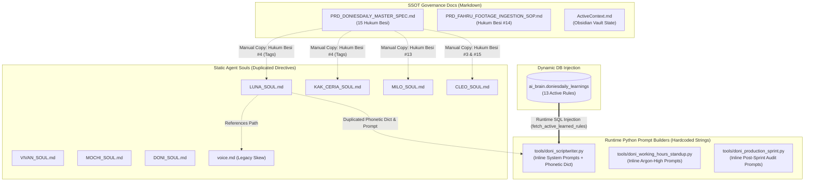
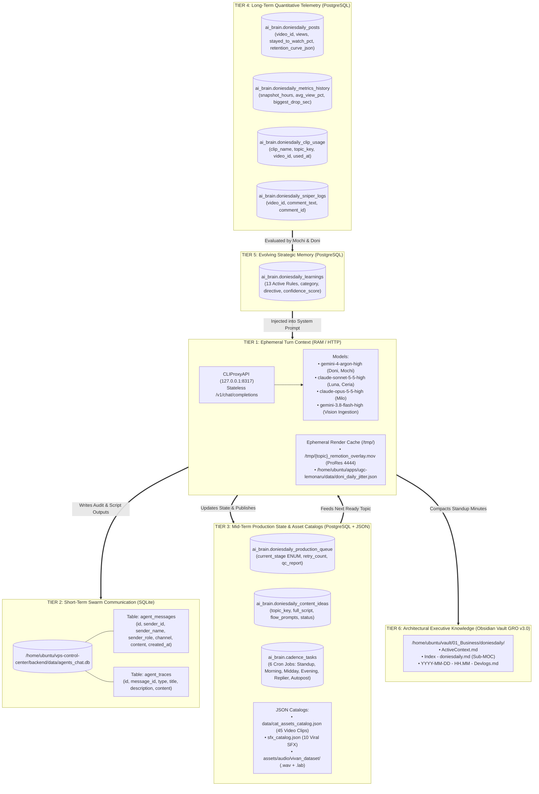
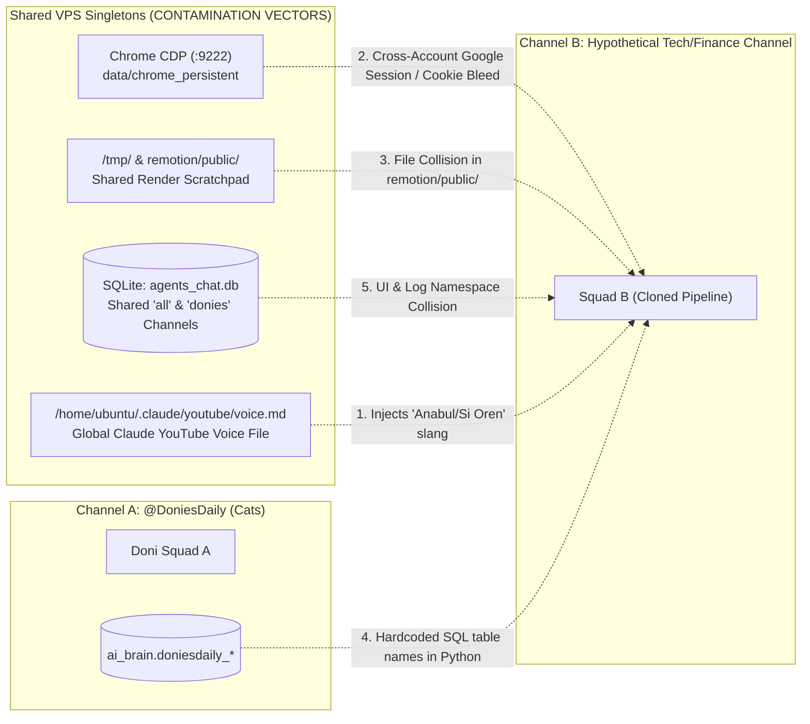

# 📑 DELIVERABLE 06: `06_PROMPT_MEMORY_AUDIT.md`
## Phase 5: Prompt, Memory & Knowledge Architecture Audit

---

## 1. Executive Summary

This audit conducts an exhaustive forensic inspection of the **DoniesDaily (`@DoniesDaily`)** autonomous multi-agent ecosystem's cognitive layer: its **8 Persona Soul Definitions (`SOUL.md` & `voice.md`)**, **runtime LLM prompt injection pipelines**, and **6-tier hybrid persistence architecture** spanning ephemeral HTTP turns, SQLite Swarm Matrix (`agents_chat.db`), PostgreSQL relational ledgers (`ai_brain.*`), and Obsidian Vault markdown archives (`GRO v3.0`).

### Key Forensic Findings
1. **Severe Intra-System Prompt Drift & Contradictions:** Multiple hard conflicts exist across static soul files, dynamic PostgreSQL learned rules (`ai_brain.doniesdaily_learnings`), and React Remotion components. Most critically, **Learned Rules #2, #5, #6, #7, #8, #9, #10, #11, #12, and #13 simultaneously inject mutually exclusive duration targets** (ranging from `20-25s` to `30-38s`, `42-48s`, `48-55s`, and `55-63s`) into Luna’s runtime prompt (`fetch_active_learned_rules()`). Furthermore, `voice.md` and `DoniOverlay.tsx` contain legacy e-commerce/TikTok affiliate artifacts (`🔥 RACUN TIKTOK OOTD`, `CHECKOUT SEKARANG!`, `KLIK KERANJANG KUNING`) and explicitly contradict **Hukum Besi #15** regarding spoken CTAs.
2. **Unbounded Rule Accumulation in Tier 5 Memory:** The `ai_brain.doniesdaily_learnings` table appends new daily forensic directives (`status = 'active'`) without deprecating or superseding older rules in the same `category` (`script_structure`). All 13 active rules are concatenated and injected raw into `doni_scriptwriter.py`.
3. **100% Domain-Coupled Prompts:** All 8 soul definitions hardcode feline biology, Indonesian "pawrents" slang, ElevenLabs voice IDs (`ZowYWFat3iypr7PwKMPb`, `d15jrIAARvF899pDoC6T`), and `@DoniesDaily` branding directly into core operational logic, preventing horizontal scaling to a second YouTube channel without full file duplication.
4. **Cross-Tenant Swarm Identity & Channel Fragmentation:** Analysis of `agents_chat.db` reveals **58 distinct `(sender_id, sender_name, sender_role, channel)` permutations** across 6 agents and 5 channels (`all`, `donies`, `doniesdaily`, `bawang`, `subtracker`), creating namespace collisions and cross-business context bleed between `DoniesDaily`, `Juragan Bawang`, and `SubTracker`.

---

## 2. Prompt Architecture Audit

### 2.1 Structural Inspection of All 8 Persona & Voice Files

The cognitive behavior of the squad is governed by 7 agent `SOUL.md` files located in `/home/ubuntu/apps/ugc-lemonaru/souls/` (referenced in `/home/ubuntu/tools/doni_scriptwriter.py:22`) and 1 voice profile (`voice.md`) at `/home/ubuntu/.claude/youtube/voice.md` (referenced in `LUNA_SOUL.md:53`).

| # | File Name | Canonical Path | Target Agent / Sub-Unit | Assigned LLM / Execution Engine | Core Structural Sections |
| :--- | :--- | :--- | :--- | :--- | :--- |
| **1** | `DONI_SOUL.md` | `/home/ubuntu/apps/ugc-lemonaru/souls/DONI_SOUL.md` | **Doni 🐱** (`@Doni`) — Executive Producer & State Governor | `gemini-4-argon-high` (via `http://127.0.0.1:8317/v1/chat/completions`) | 1. Identitas & Peran<br>2. Kredo Kepemimpinan & Manajemen Saluran (State Machine, Quota Guard, Briefing)<br>3. Batasan Operasional Ketat |
| **2** | `MOCHI_SOUL.md` | `/home/ubuntu/apps/ugc-lemonaru/souls/MOCHI_SOUL.md` | **Mochi 📊** (`@Mochi`) — Head of Analytics & Audience Psychology | `gemini-4-argon-high` + deterministic CLI linters (`title.py`, `swipe.py`) | 1. Identitas & Peran<br>2. Kredo & Mental Model<br>3. Batasan Operasional Ketat<br>4. Format Output Baku (JSON Schema)<br>5. YouTube Agent Standard: Title & Package Linting |
| **3** | `LUNA_SOUL.md` | `/home/ubuntu/apps/ugc-lemonaru/souls/LUNA_SOUL.md` | **Luna ✍️** (`@Luna`) — Master Cat Copywriter & Storyteller | `claude-sonnet-5-5-high` (via `:8317` proxy) + `hookscore.py` | 1. Identitas & Peran<br>2. Aturan Baku Naskah (Durasi, Tags, 3/4 Babak)<br>3. Kamus Fonetik Wajib<br>4. Batasan Operasional Ketat<br>5. YouTube Agent Standard: Hook Engineering |
| **4** | `KAK_CERIA_SOUL.md` | `/home/ubuntu/apps/ugc-lemonaru/souls/KAK_CERIA_SOUL.md` | **Kak Ceria 🎙️** (`@Kak Ceria`) — Senior Voice Director & Community Lead | `claude-sonnet-5-5-high` (Community Replies) + ElevenLabs v4 Turbo Supervisor | 1. Role & Identity<br>2. Dynamic Audio Tags (ElevenLabs v4 Standard)<br>3. Technical Master Specs<br>4. Interaction SOP in Swarm Room & Sub-Unit Supervision |
| **5** | `VIVAN_SOUL.md` | `/home/ubuntu/apps/ugc-lemonaru/souls/VIVAN_SOUL.md` | **Vivan 🎧** (`@Vivan`) — Sub-Unit Voice & Dataset Engine | **0-Token Deterministic Worker** (`src/elevenlabs_tts.py`, `src/vivan_dataset_harvester.py`) | 1. Role & Hierarchy<br>2. Tugas Utama (Voice Synthesis & Forced Alignment, Auto-Dataset Harvester) |
| **6** | `MILO_SOUL.md` | `/home/ubuntu/apps/ugc-lemonaru/souls/MILO_SOUL.md` | **Milo 🎬** (`@Milo`) — Visual Director & AI Cinematographer | `claude-opus-5-5-high` (`select_footage_by_speech_beats`, `generate_shotlist`) | 1. Identitas & Peran<br>2. Kredo Sinematografi & Style Bible (Feline Anchor, 5 Zones, 5 Scenes)<br>3. Batasan Operasional Ketat<br>4. Hukum Besi #13: Zero In-Video Footage Repetition |
| **7** | `CLEO_SOUL.md` | `/home/ubuntu/apps/ugc-lemonaru/souls/CLEO_SOUL.md` | **Cleo 🔍** (`@Cleo`) — Automated QC Gatekeeper & Broadcast Inspector | **0-Token Deterministic Inspector** (`src/doni_qc_gate.py`, `ffprobe`, `ffmpeg`) | 1. Identitas & Peran<br>2. Kredo & Standar Inspeksi (EBU R128, Sync, Black Frame, Resolution)<br>3. Format Stempel Audit Resmi<br>4. Batasan Operasional Ketat |
| **8** | `voice.md` | `/home/ubuntu/.claude/youtube/voice.md` | **Shared Persona Guide** — DoniesDaily Voice Profile | Injected / referenced by `LUNA_SOUL.md` | 1. Who I am talking to<br>2. How I actually talk<br>3. Words I never use<br>4. Words I do use<br>5. What I will not claim<br>6. My format |

---

### 2.2 Prompt Inheritance vs. Duplication Patterns

Rather than using a single centralized System Constitution (`MASTER_CONSTITUTION.md`) or Jinja template hierarchy, rules are **manually duplicated** across multiple markdown files and Python scripts. Over time, updates applied to one file were not propagated to others, creating version skew.



#### Specific Duplication Hotspots
1. **ElevenLabs v4 Emotional Tag Catalog (`[curious]`, `[gasps]`, `[laughs]`, `[excited]`, `[sighs]`, `[whispers]`):**
   - Duplicated verbatim across:
     - `PRD_DONIESDAILY_MASTER_SPEC.md` (Section 2, Rule #4)
     - `KAK_CERIA_SOUL.md` (Section 2)
     - `LUNA_SOUL.md` (Section 2.2)
2. **Phonetic Dictionary (`Flehmen` $\rightarrow$ `Fley-men`, `Jacobson` $\rightarrow$ `Jekob-sen`, `HES-7` $\rightarrow$ `Hes Tujuh`, `FRAPs` $\rightarrow$ `Freps`):**
   - Defined in `LUNA_SOUL.md` (Section 3) AND hardcoded in Python regex dictionary `PHONETIC_DICTIONARY` inside `/home/ubuntu/tools/doni_scriptwriter.py:27-40` (where Python adds 4 extra mappings: `zoomies`, `UV`, `Hz`, `Catnip` not present in `LUNA_SOUL.md`).
3. **ElevenLabs Voice Parameters (`Stability: 0.40, Similarity Boost: 0.75, Speed: 1.08x`):**
   - Duplicated across `PRD_DONIESDAILY_MASTER_SPEC.md` (Section 3 RACI table) and `KAK_CERIA_SOUL.md` (Section 3).
4. **Inline Prompt Shadowing:**
   - Despite `SOUL_PATH = Path("/home/ubuntu/apps/ugc-lemonaru/souls/LUNA_SOUL.md")` being declared at line 22 of `/home/ubuntu/tools/doni_scriptwriter.py`, `generate_autonomous_topic()` (lines 118–149) and `generate_long_form_script()` (lines 164–174) construct hardcoded inline f-string prompts (`Kamu adalah Luna, master storyteller DoniesDaily...`) rather than dynamically reading `SOUL_PATH`.

---

### 2.3 Hardcoded Channel-Specific Assumptions in Agent Prompts & Code

Every agent prompt and supporting script embeds assumptions exclusive to an Indonesian domestic cat YouTube Shorts channel (`@DoniesDaily`), making zero-touch reuse for another vertical impossible without surgery.

| Layer / File | Hardcoded Domain Assumption | Exact Evidence / Snippet |
| :--- | :--- | :--- |
| **`LUNA_SOUL.md` & `doni_scriptwriter.py`** | Feline anatomy & behavioral biology | `Fley-men` (Flehmen response), `Jekob-sen` (Jacobson's organ), `Hes Tujuh` (HES-7 gene), `Freps` (Frenetic Random Activity Periods), `Ket-nip` (Catnip). |
| **`doni_scriptwriter.py:130`** | Hardcoded topic exclusion list in prompt | `"JANGAN bahas elus perut, gigit/cakar tangan saat dielus, jatuhkan barang, zoomies, ngadon roti, susu sapi, kardus, timun, kedip pelan, tatap tembok, ikut ke toilet, ekor, tidur 16 jam, dengkuran, atau flehmen"` |
| **`voice.md`** | Indonesian cat-owner ("pawrents") sociolect | `"Anabul"`, `"Si oren"`, `"Pawrents"`, `"Babu kucing"`, `"Slow blink"`, `"Ngadon roti"`, `" usia 15–35 tahun"`. |
| **`MILO_SOUL.md`** | Feline visual anchor & domestic rooms | `"Kucing Tabby ginger (oranye) ekspresif dengan kaos kaki putih (white paws)..."`, `"HARAM HUKUMNYA: Ada manusia, jari tangan manusia..."`, `"Extreme macro close-up (cakar, toe beans, kumis bergetar, pupil membesar)"`. |
| **`KAK_CERIA_SOUL.md` & `VIVAN_SOUL.md`** | Hardcoded ElevenLabs Voice IDs | Primary Voice: Vivan (`ZowYWFat3iypr7PwKMPb`), Alternative Voice: Kak Ceria (`d15jrIAARvF899pDoC6T`). |
| **`MOCHI_SOUL.md`** | Channel outlier benchmark videos | `"Pelajari video terlaris kanal (mengapa Ngadon Roti & Jago Lompat tembus >1.500 views)"`, `"psikologi audiens pecinta anabul Indonesia"`. |
| **`doni_remotion_flow_pipeline.py:86`** | Hardcoded spoken CTA injection | `script = f"{script} Jangan lupa follow dan subscribe DoniesDaily ya!"` |
| **`doni_qc_gate.py:163-168`** | Brand-locked QC regex assertion | `has_brand = "doniesdaily" in text_lower or "doni" in text_lower` |
| **`youtube_api_publisher.py:82-89`** | Pet category ID & default tags | `category_id: str = "15"` (Pets & Animals), `tags = ["Shorts", "Kucing", "Cat", "DoniesDaily", "FunFacts"]`. |
| **`HookTitle.tsx` & `OutroCTA.tsx`** | Legacy TikTok Affiliate OOTD defaults | `badgeText = "🔥 RACUN TIKTOK OOTD"`, `headline = "CHECKOUT SEKARANG!"`, `buttonText = "KLIK KERANJANG KUNING"` (leftover from `ugc-lemonaru` e-commerce template). |

---

### 2.4 Matrix of Conflicting Instructions (Prompt & Rule Collisions)

Forensic cross-examination reveals **8 severe contradictions** across static souls, runtime scripts, Remotion templates, and PostgreSQL learned rules.

| Conflict ID | Dimension | Source A (Directive) | Source B (Conflicting Directive) | Operational Impact / Failure Mode |
| :--- | :--- | :--- | :--- | :--- |
| **CONF-01** | **Spoken CTA vs. Anti-CTA Rule** | **`PRD_DONIESDAILY_MASTER_SPEC.md` (Hukum Besi #15)** & **`doni_qc_gate.py:160`**: Every video MUST end with spoken & visual CTA (`"dan jangan lupa follow dan subscribe DoniesDaily ya!"`). Cleo fails QC if missing. | **`voice.md` ("Words I never use")** & **`ai_brain.doniesdaily_learnings` Rule #6 & #12**: Explicitly forbids `"Jangan lupa like, comment, and subscribe ya! (merusak retensi Shorts)"` and commands Luna to `"potong semua kalimat kesimpulan/outro di 5 detik terakhir"`. | Luna is instructed by learned rules to omit the outro CTA to prevent end-of-video drop-off, whereupon `doni_remotion_flow_pipeline.py:86` forcibly appends it via regex or `doni_qc_gate.py` rejects the script. |
| **CONF-02** | **Target Script Duration & Word Count Chaos** | **`voice.md` & `LUNA_SOUL.md` (Sec 4)**: Restricts scripts to `20–35 detik` and `38–55 kata` (`"❌ DILARANG mengabaikan batas kata 38–55 kata"`). | **`LUNA_SOUL.md` (Sec 2.1)** (`110–135 kata / 50–60s`), **`doni_scriptwriter.py:173`** (`108–124 kata / 49–56s`), **Learned Rule #5** (`55–63s`), **Rule #7 & #9** (`30–38s`), **Rule #10** (`20–25s` or `45–50s`), **Rule #11** (`42–48s`), **Rule #12** (`48–55s`), **Cleo QC** (`< 59.9s`). | During `generate_long_form_script()`, Luna receives **13 active rules simultaneously** commanding her to cap duration at 35s, 38s, 45s, 48s, 52s, 55s, AND 63s in the same prompt! Furthermore, Rule #5's `55–63s` target violates `doni_qc_gate.py:82` (`duration > 59.9` = HARD FAIL). |
| **CONF-03** | **Scene Cut Pacing & Total Cuts** | **`MILO_SOUL.md` (Sec 2.3)** & **Learned Rule #4**: Commands `5 Skena Beruntun (6–8 Detik per Scene)` (`minimal 4–6 klip per video`). | **`MILO_SOUL.md` (Sec 4 - Hukum Besi #13)** & **`PRD` (Rule #13)**: Commands `Dynamic High-Retention Cut Pacing (3.2s – 4.0s per Cut)` with `14 hingga 17 adegan unik`. Meanwhile, **`ActiveContext.md`** logs `Hukum Besi #13 v2` using `8–9 scene cuts (4.0s–8.5s per cut)` via Claude Opus. | `MILO_SOUL.md` contradicts itself between Section 2.3 (6–8s cuts, 5 scenes) and Section 4 (3.2–4.0s cuts, 14–17 scenes), while Learned Rule #4 still injects the old 6–8s directive. |
| **CONF-04** | **Posting Cadence & Daily Upload Cap** | **`PRD_DONIESDAILY_MASTER_SPEC.md` (Rule #11)** & **Learned Rule #3 (`cadence_interval_gate`, conf 0.95)**: Commands `"Jeda rilis antar-video WAJIB minimal 16-24 jam (maksimal 1 rilis per hari). Tolak upload jika video sebelumnya baru berumur < 20 jam."` | **`DONI_SOUL.md` (Sec 2.2)**: States `4–5 video per hari`. **`ActiveContext.md` & `doni_production_sprint.py:31`**: Locks `MAX_DAILY_POSTS = 3` (08:00 Morning, 12:00 Midday Serial, 18:00 Evening — intervals of 4h and 6h). | Learned Rule #3 (`confidence_score: 0.95`) remains `active` in PostgreSQL and is injected into prompts despite the production cron dispatcher actively running 3 posts/day. |
| **CONF-05** | **Audio-Video Drift Tolerance** | **`PRD_DONIESDAILY_MASTER_SPEC.md` (Sec 4)**: `assert dur_video >= dur_audio - 0.1` (0.1s tolerance). **`CLEO_SOUL.md` (Sec 2.2)**: Tolerance `<= 0.5 detik`. | **`src/doni_qc_gate.py:95`**: Hardcoded check `if delta > 1.5:` (1.5s tolerance). | Code implementation is 3x looser than `CLEO_SOUL.md` and 15x looser than the PRD specification. |
| **CONF-06** | **EBU R128 Loudness Gate Enforcement** | **`CLEO_SOUL.md` (Sec 2.1)** & **`PRD` (Sec 3)**: Integrated Loudness MUST be `-14 LUFS s/d -19 LUFS`; reject release otherwise. | **`src/doni_qc_gate.py:137-140`**: Only emits a non-blocking `warning` if `il < -26.0` or `il > -8.0`; never sets `report["passed"] = False`. | A video with `-24 LUFS` or `-9 LUFS` passes `doni_qc_gate.py` unblocked despite `CLEO_SOUL.md` declaring zero compromise. |
| **CONF-07** | **Voice Persona & TTS Model Version** | **`KAK_CERIA_SOUL.md` & `PRD`**: States engine is **ElevenLabs v4 Turbo** with primary male voice **Vivan** (`ZowYWFat3iypr7PwKMPb`). | **`ActiveContext.md` (Sec "Spesifikasi Konten Baku #8")` & `voice.md`**: States **ElevenLabs Multilingual v2** with female persona **Kak Ceria** (`d15jrIAARvF899pDoC6T`). | Persona ambiguity: scripts and logs refer to the voice interchangeably as "vokal Kak Ceria (Vivan)", mixing a female persona name (`Kak Ceria`) with a male voice ID (`Vivan`). |
| **CONF-08** | **10-Frame Ingestion Slug Length** | **`PRD_DONIESDAILY_MASTER_SPEC.md` (Rule #14)**: Slug must be `6-12 kata, snake_case` with mandatory prefix `asli_fahru_*` or `ai_gen_{cluster}_*`. | **`PRD_FAHRU_FOOTAGE_INGESTION_SOP.md` (Sec 2.1)**: Prompt instructs Gemini to output slug of `4–6 kata, contoh: kucing_belang_muka_sedih_pasrah` without prefix. | Divergent SOP specifications between the Master PRD and the Ingestion SOP file. |

---

## 3. Memory Architecture & Persistence Tiers

The DoniesDaily ecosystem operates across a **6-Tier Hybrid Memory Architecture**, ranging from stateless HTTP LLM completions to long-term institutional knowledge in Obsidian.



### 3.1 Comprehensive 6-Tier Memory Audit Table

| Tier | Storage Medium & Exact Path / Schema | Scope & Mutability | Retention Policy | Readers (Consumers) | Writers (Producers) | Identified Failure Modes & Vulnerabilities |
| :--- | :--- | :--- | :--- | :--- | :--- | :--- |
| **Tier 1: Ephemeral Turn Context** | • HTTP Payload to `http://127.0.0.1:8317/v1/chat/completions`<br>• `/tmp/{topic}_remotion_overlay.mov`<br>• `data/doni_daily_jitter.json` | Single LLM turn (stateless API calls); daily JSON state; per-sprint `/tmp/` video cache | LLM context discarded immediately post-response; `/tmp/*.mov` unlinked post-YouTube publish; jitter resets daily at `00:00 WIB` | `gemini-4-argon-high`, `claude-sonnet-5-5-high`, `claude-opus-5-5-high`, `gemini-3.8-flash-high` | `doni_scriptwriter.py`, `doni_working_hours_standup.py`, `doni_production_sprint.py`, `ingest_fahru_footage.py` | **No Multi-Turn Conversational Memory:** Standup meetings in `doni_working_hours_standup.py` simulate multi-agent dialogue sequentially via single-turn completions rather than true stateful agent-to-agent negotiation. |
| **Tier 2: Short-Term Swarm Communication** | SQLite3: `/home/ubuntu/vps-control-center/backend/data/agents_chat.db` (`agent_messages`, `agent_traces`) | Append-only multi-agent chat & tool trace log across VPS Control Center | Unbounded (no TTL or archival pruning detected) | VPS Control Center UI, Fahru (Owner), `save_meeting_to_vault()` | `post_swarm_chat()` in `doni_working_hours_standup.py`, `doni_scriptwriter.py`, `ingest_fahru_footage.py`, `doni_hybrid_renderer.py` | **Write-Only for Agents & Identity Fragmentation:** Agents write to `agents_chat.db` for human transparency (Hukum Besi #9), but do **not** query `agents_chat.db` to build context for subsequent runs. 58 sender identity permutations pollute queries. |
| **Tier 3: Mid-Term State & Asset Queue** | • PostgreSQL `ai_brain.doniesdaily_content_ideas`<br>• `ai_brain.doniesdaily_production_queue`<br>• `ai_brain.cadence_tasks`<br>• `data/cat_assets_catalog.json` (45 clips)<br>• `sfx_catalog.json` (10 SFX) | Mutable state machine (`ready` $\rightarrow$ `published`; `IDEA_SELECTED` $\rightarrow$ `PUBLISHED`) | Indefinite in PostgreSQL; JSON catalogs mutated in-place on disk | `doni_production_sprint.py`, `doni_remotion_flow_pipeline.py`, `doni_hybrid_renderer.py` | `doni_scriptwriter.py`, `doni_working_hours_standup.py`, `ingest_fahru_footage.py` | **Dual State Table Desync:** `doni_remotion_flow_pipeline.py` queries `doniesdaily_content_ideas` (`status = 'ready'`), while `DONI_SOUL.md` mandates `doniesdaily_production_queue` (`current_stage` enum). Furthermore, SQL queries use raw string interpolation (`f"... WHERE topic_key = '{topic_key}'"`), risking SQL breakage on single quotes. |
| **Tier 4: Long-Term Quantitative Telemetry** | • PostgreSQL `ai_brain.doniesdaily_posts`<br>• `ai_brain.doniesdaily_metrics_history`<br>• `ai_brain.doniesdaily_clip_usage`<br>• `ai_brain.doniesdaily_sniper_logs` | Append-only time-series snapshots & mutable latest post metrics (views, 100-point `retention_curve_json`, `stayed_to_watch_pct`) | Permanent historical ledger | `tools/doni_evaluator.py` (Mochi), `doni_scriptwriter.py` (deduplication), `doni_production_sprint.py` (quota check), Milo (anti-fatigue clip scoring) | `youtube_api_publisher.py`, `doni_evaluator.py` (via Chrome CDP `:9222` + YouTube Analytics API v2), Milo renderer | **Prompt Context Bloat on Deduplication:** `fetch_existing_topics()` in `doni_scriptwriter.py:114` slices `existing_topics[:35]` without `ORDER BY created_at DESC` in the `UNION` query, meaning once the channel exceeds 35 videos, newer topics may be truncated from the deduplication prompt! |
| **Tier 5: Evolving Strategic Memory** | PostgreSQL `ai_brain.doniesdaily_learnings` (`id`, `category`, `rule_name`, `directive`, `rationale`, `confidence_score`, `status`) | Upsertable rule ledger (`UNIQUE (rule_name)`), filtered by `status = 'active'` | Permanent until `status` is flipped from `'active'` to `'archived'`/`'deprecated'` | `fetch_active_learned_rules()` in `doni_scriptwriter.py:72-95`, Mochi, Doni | `tools/doni_evaluator.py` / `doni_working_hours_standup.py` (Mochi daily forensic loop) | **Unbounded Rule Pile-Up (Critical Bug):** Mochi generates a new `rule_name` each day (e.g., Rules #6 through #13 all have `category = 'script_structure'`). Because `rule_name` is unique per day, `INSERT` adds a new row instead of updating the existing category rule, causing 8 conflicting `script_structure` directives to be injected simultaneously! |
| **Tier 6: Architectural Executive Knowledge** | Obsidian Vault Markdown: `/home/ubuntu/vault/01_Business/doniesdaily/` (`ActiveContext.md`, `Index - doniesdaily.md`, `YYYY-MM-DD - HH.MM - *.md`) | Structured Markdown SSOT following GRO v3.0 Triad Compaction | Permanent institutional knowledge & session history | Hermes Agent (Co-Pilot), Fahru (Owner) | `save_meeting_to_vault()` in `doni_working_hours_standup.py`, Hermes Agent | **One-Way Sync to Autonomous Workers:** While `doni_working_hours_standup.py` writes devlogs and updates `Index - doniesdaily.md`, the autonomous Python workers (`doni_scriptwriter.py`, `doni_production_sprint.py`) never read `ActiveContext.md`, relying solely on PostgreSQL. |

---

### 3.2 Deep-Dive: Tier 5 (`ai_brain.doniesdaily_learnings`) Forensic Pathology

Inspecting the live dump of `ai_brain.doniesdaily_learnings` (13 rows, all `status = 'active'`) reveals how Mochi's self-improving feedback loop (Hukum Besi #11) has degraded into **Prompt Contradiction Poisoning**:

1. **How Rules Are Retrieved (`tools/doni_scriptwriter.py:72-95`):**
   ```python
   "SELECT category, rule_name, directive, confidence_score FROM ai_brain.doniesdaily_learnings WHERE status = 'active' ORDER BY confidence_score DESC;"
   ```
   All 13 rows are fetched and joined via:
   ```python
   rules_text = "\n".join([f"- [{r['category'].upper()}] {r['directive']}" for r in rules])
   ```
2. **What the LLM Actually Sees in Every Turn:**
   In a single prompt, `claude-sonnet-5-5-high` is commanded with equal authority:
   - **Rule #2 (`confidence: 1.00`):** *"Targetkan durasi total video antara 48-55 detik (Long-Form Short, 110-135 kata)."*
   - **Rule #5 (`confidence: 0.98`):** *"...memastikan pacing audio-visual ter-render pada durasi optimal 55-63 detik."*
   - **Rule #13 (`confidence: 0.97`):** *"...target durasi 45-52 detik untuk konversi subscriber..."*
   - **Rule #6 (`confidence: 0.96`):** *"...potong semua kalimat kesimpulan/outro di 5 detik terakhir."*
   - **Rule #7 (`confidence: 0.96`):** *"Batasi total naskah maksimal 35-38 detik..."*
   - **Rule #8 (`confidence: 0.96`):** *"...durasi total 35-48 detik."*
   - **Rule #9 (`confidence: 0.96`):** *"Kunci durasi naskah di sweet-spot 30-38 detik (jangan lebih dari 45 detik...)"*
   - **Rule #10 (`confidence: 0.96`):** *"...Tipe Cepat (20-25 detik)... Tipe Story/Bonding (45-50 detik)..."*
   - **Rule #11 (`confidence: 0.96`):** *"Luna wajib membatasi naskah di durasi sweet-spot 42-48 detik..."*
   - **Rule #12 (`confidence: 0.96`):** *"Luna wajib merancang naskah dengan sweet-spot durasi 48-55 detik..."*
   - **Hardcoded System Prompt (`doni_scriptwriter.py:173`):** *"Panjang naskah: TEPAT 108 SAMPAI 124 KATA (durasi vokal ~49-56 detik)..."*
3. **Root Cause:** The database table enforces `UNIQUE (rule_name)` instead of `UNIQUE (category, target_agent)` or an active-slot cap (e.g., max 1 active rule per `category` + `sub_topic`). When Mochi runs each morning/evening standup, it invents a new `rule_name` (`bridge_the_5sec_chasm_and_cap_38sec`, `anti_5to8sec_dropoff_and_35s_sweetspot`, etc.) and inserts it as `active` without archiving prior conflicting rules.

---

### 3.3 Deep-Dive: Tier 2 (`agents_chat.db`) Identity & Channel Sprawl

Forensic analysis of the SQLite `agents_chat.db` group statistics reveals **58 distinct `(sender_id, sender_name, sender_role, channel)` tuples** across the VPS Control Center:

- **Channel Fragmentation within DoniesDaily:** Messages for the same squad are split across three channels:
  1. `donies` (primary squad room — 160+ messages)
  2. `doniesdaily` (legacy/secondary room — 12 messages from `doni`, `cleo`, `milo`)
  3. `all` (executive broadcast room — 55+ messages from `doniesdaily`, `hermes`, `juragan-bawang`, `subtracker`, `user`)
- **Sender ID & Persona Fragmentation:**
  - **Doni** posts under 4 `sender_id` values (`doni`, `doniesdaily`) and 7 `sender_name` strings (`Doni`, `Doni (Ketua Tim)`, `Doni (Lead)`, `Doni (Lead Producer)`, `Donies Daily`).
  - **Kak Ceria** posts under 4 `sender_id` values (`ceria`, `kak_ceria`, `sub-ceria`, `doniesdaily`).
  - **Cleo** posts under 3 `sender_id` values (`cleo`, `sub-cleo`, `doniesdaily`) and 6 `sender_name` strings.
  - **Luna**, **Milo**, and **Mochi** similarly split across `<name>`, `sub-<name>`, and `doniesdaily`.

---

## 4. Cross-Channel Context Leakage & Memory Contamination Risks

If Mas Fahru deploys a second autonomous YouTube channel on this VPS (e.g., **Channel B: Personal Finance / Crypto Shorts** or **Channel C: Tech / AI News Shorts**) by cloning or sharing the current infrastructure, **12 severe contamination vectors** will poison Channel B's outputs, database state, and YouTube account standing.



### 4.1 Exhaustive Contamination Risk Matrix

| Risk ID | Vector / Component | Exact File / Path | How It Contaminates Channel B (e.g., Finance / Tech Channel) | Severity |
| :--- | :--- | :--- | :--- | :--- |
| **LEAK-01** | **Global Claude Voice Profile Path** | `/home/ubuntu/.claude/youtube/voice.md` | Stored in a global `.claude/youtube/` path rather than a channel-scoped directory. Any agent referencing `/home/ubuntu/.claude/youtube/voice.md` inherits `"Anabul"`, `"Si oren"`, `"Pawrents"`, and `"Babu kucing"` vocabulary. | **CRITICAL** |
| **LEAK-02** | **Hardcoded PostgreSQL Table Names in Python Workers** | `doni_production_sprint.py`, `doni_scriptwriter.py`, `doni_remotion_flow_pipeline.py` | Every script hardcodes `ai_brain.doniesdaily_posts`, `ai_brain.doniesdaily_content_ideas`, and `ai_brain.doniesdaily_learnings`. Running a second channel without table parameterization will mix topics, quota counts (`count_today_public_posts()`), and learned rules. | **CRITICAL** |
| **LEAK-03** | **Shared Chrome Persistent Profile (`:9222`)** | `/home/ubuntu/apps/ugc-lemonaru/data/chrome_persistent` | Used simultaneously by `FlowCDPOperator` (Google Flow AI video generation), `doni_evaluator.py` (YouTube Studio Advanced Mode scraping), and `doni_oauth_auto_healer.py`. Sharing this browser session across two YouTube channels risks uploading or scraping metrics from the wrong Google account or triggering Google multi-account abuse flags. | **CRITICAL** |
| **LEAK-04** | **OAuth Token Singleton Path** | `/home/ubuntu/.config/youtube/doniesdaily_oauth.json` (`youtube_api_publisher.py:21`) | `DEFAULT_OAUTH_PATH` is hardcoded in `YouTubeAPIPublisher.__init__()`. Any pipeline instantiating `YouTubeAPIPublisher()` without explicit path override will publish Channel B's videos directly onto `@DoniesDaily`! | **CRITICAL** |
| **LEAK-05** | **YouTube Category ID & Default Tags** | `src/youtube_api_publisher.py:67-82` | `upload_short()` defaults to `category_id: str = "15"` (Pets & Animals) and `tags = ["Shorts", "Kucing", "Cat", "DoniesDaily", "FunFacts"]`. | **HIGH** |
| **LEAK-06** | **Remotion Static Brand & E-Commerce Artifacts** | `remotion/src/DoniOverlay.tsx`, `HookTitle.tsx`, `OutroCTA.tsx` | `DoniOverlay.tsx:96` hardcodes `🐾 @DoniesDaily` watermark and `🐱 FAKTA ANABUL VIRAL`. Meanwhile, `HookTitle.tsx:13` (`🔥 RACUN TIKTOK OOTD`) and `OutroCTA.tsx:12-14` (`CHECKOUT SEKARANG!`, `KLIK KERANJANG KUNING`) already exhibit cross-project contamination from the parent `ugc-lemonaru` TikTok Affiliate repo! | **HIGH** |
| **LEAK-07** | **Spoken CTA Injection & QC Brand Gate** | `doni_remotion_flow_pipeline.py:86` & `doni_qc_gate.py:165` | Pipeline forcibly appends `"Jangan lupa follow dan subscribe DoniesDaily ya!"` if `"subscribe"` is absent, and `doni_qc_gate.py` warns if `"doniesdaily"` is missing from the script. | **HIGH** |
| **LEAK-08** | **Shared Remotion `public/` Asset Scratchpad** | `/home/ubuntu/apps/ugc-lemonaru/remotion/public/` | Audio masters (`{t_key}_master.mp3`), caption JSONs (`doni-{t_key}-captions.json`), and background concatenations (`flow_{t_key}_bg_concat.mp4`) are dumped into a single shared `remotion/public/` folder. Concurrent renders across two channels can cause asset locks or Remotion bundle bloat. | **MEDIUM** |
| **LEAK-09** | **Jitter State File Singleton** | `/home/ubuntu/apps/ugc-lemonaru/data/doni_daily_jitter.json` | Tracks `fired: true/false` for `morning`, `midday_serial`, and `evening` slots globally. A second channel sharing this file would be blocked from posting once Channel A fires its slot. | **HIGH** |
| **LEAK-10** | **Vivan Dataset Harvester Pollution** | `assets/audio/vivan_dataset/` (`src/vivan_dataset_harvester.py`) | Automatically slices every generated ElevenLabs audio stem into training WAV+`.lab` pairs for Vivan fine-tuning. If Channel B uses a different ElevenLabs voice ID, its audio clips will contaminate Vivan's single-speaker voice cloning dataset! | **HIGH** |
| **LEAK-11** | **Swarm Matrix (`agents_chat.db`) Cross-Business Bleed** | `/home/ubuntu/vps-control-center/backend/data/agents_chat.db` | Already mixes `doniesdaily`, `juragan-bawang`, and `subtracker` in the `all` channel. If agents share `sender_id` values (`milo`, `luna`, `cleo`, `mochi`) across Channel A and Channel B, trace logs and chat histories become indistinguishable. | **MEDIUM** |
| **LEAK-12** | **Domain-Specific Learned Rules (`doniesdaily_learnings`)** | `ai_brain.doniesdaily_learnings` (Rules #1, #6, #12, #13) | Even structural rules in `doniesdaily_learnings` contain embedded cat references (`"seperti formula 'Bawa Bangkai'"`, `"pergantian B-roll kucing"`, `"fenomena kebiasaan kucing ('Ngadon Roti' / 'Tidur di Baju Kotor')"`). | **HIGH** |

---

### 4.2 Isolation vs. Sharing Boundaries (Multi-Channel Architecture Governance)

To scale from 1 channel (`@DoniesDaily`) to $N$ autonomous channels under the Holding Orchestrator (**Hermes Agent**), strict architectural boundaries must separate **Channel-Isolated State**, **Universal Shared Infrastructure**, and **Holding Executive Memory**.

| Architectural Layer | MUST Remain Strictly Isolated Per Channel (`tenant_id / channel_slug`) | CAN Safely Be Shared Universally Across All Channels | Holding Orchestrator Memory Boundary (`Hermes Agent` / Executive Level) |
| :--- | :--- | :--- | :--- |
| **Prompts & Persona Souls** | • Brand/Persona Config (`channel_profile.yaml`): Niche, target demographic, slang dictionary, forbidden words, phonetic dictionary, visual style bible.<br>• Voice ID mappings & TTS parameters.<br>• Channel-specific learned rules. | • Base Role Archetype Templates (`ORCHESTRATOR_BASE.j2`, `ANALYST_BASE.j2`, `SCRIPTWRITER_BASE.j2`, `AUDIO_DIRECTOR_BASE.j2`, `VISUAL_DIRECTOR_BASE.j2`, `QC_GATEKEEPER_BASE.j2`).<br>• ElevenLabs v4 acoustic tag syntax (`[curious]`, `[gasps]`, etc.). | • Cross-business resource allocation rules.<br>• Owner (`Fahru`) communication preferences & briefing schedules (06:00 & 20:00 WIB). |
| **Databases (PostgreSQL & SQLite)** | • Partitioned by `channel_id` column (or per-channel schema) for: `content_ideas`, `production_queue`, `posts`, `metrics_history`, `clip_usage`, `learnings`, `sniper_logs`.<br>• Dedicated Swarm Matrix channel (`#yt-doniesdaily` vs `#yt-channel-b`) with namespaced `sender_id` (`doni_cats` vs `doni_tech`). | • Unified PostgreSQL database instance (`supabase-db`) & schema definitions.<br>• Universal YouTube Shorts retention physics (e.g., 3s Hook hold, 4.5s re-hook pattern interrupt, EBU R128 `-14..-19 LUFS` broadcast standard). | • `ai_brain.cadence_tasks` (Global Cron Dispatcher).<br>• Holding-wide API token/quota ledgers (`subtracker`, CLIProxyAPI `:8317` usage).<br>• `#executive-board` / `#all` Swarm channel. |
| **Media Assets & File System** | • Video footage vaults (`assets/{channel_slug}/clips/`).<br>• Asset catalog JSON (`data/{channel_slug}_assets_catalog.json`).<br>• Voice cloning dataset vaults (`assets/audio/{voice_id}_dataset/`).<br>• Per-channel jitter state (`data/{channel_slug}_jitter.json`). | • Universal Viral SFX Reservoir (`sfx_taco_bell_bong.mp3`, `sfx_vine_boom.mp3`, etc. in `sfx_catalog.json`).<br>• Core Remotion React components (`DoniOverlay.tsx`, `HookTitle.tsx`, `SubtitlePage.tsx`, `OutroCTA.tsx`) once parameterized via Zod props. | • Obsidian Vault root (`/home/ubuntu/vault/`) with isolated workspace subdirectories (`01_Business/doniesdaily/`, `01_Business/juragan_bawang/`, `01_Business/channel_b/`). |
| **External Credentials & Browser Sessions** | • YouTube OAuth token files (`~/.config/youtube/{channel_slug}_oauth.json`).<br>• Chrome Persistent User Data Dir (`data/chrome_profiles/{channel_slug}/`) on dedicated CDP ports (`:9222`, `:9223`). | • CLIProxyAPI (`127.0.0.1:8317`) LLM Gateway.<br>• ElevenLabs API Key (unless billing is split per business unit).<br>• Deterministic QC engine (`src/doni_qc_gate.py`) & FFmpeg/FFprobe binaries. | • Telegram Bot / Owner Notification Gateway (`OWNER_CHAT_ID = "1357517232"`). |

---

## 5. Prompt & Memory Refactoring Recommendations

### 5.1 Blueprint for Parameterizing `SOUL.md` Files with Jinja2 / Mustache Variables

To eliminate hardcoded cat assumptions and unify prompt inheritance, the 8 static markdown files should be refactored into:
1. **1 Shared System Constitution (`souls/ templates/CONSTITUTION_SHORTS_BROADCAST.j2`)** containing universal invariants (Audio Master Clock, Single-Word Kinetic Subtitles, EBU R128 Loudness, Ephemeral `/tmp/` Purge, Swarm DB Transparency).
2. **6 Role-Based Jinja2 Templates (`souls/templates/*.j2`)** defining universal agent mechanics.
3. **1 Per-Channel Configuration Manifest (`configs/channels/doniesdaily.yaml`)** supplying all domain-specific variables (`{{CHANNEL_NICHE}}`, `{{AUDIENCE_DEMOGRAPHIC}}`, `{{VOICE_STYLE}}`, `{{AVATAR_NAME}}`, etc.).

#### Target Parameterized Schema (`configs/channels/doniesdaily.yaml`)
```yaml
channel:
  slug: "doniesdaily"
  handle: "@DoniesDaily"
  youtube_channel_id: "UCNPtjF2aB0wvWHI0q7hhcCg"
  youtube_category_id: "15" # Pets & Animals
  niche: "Edukasi Psikologi, Biologi & Humor Kucing Rumahan (Anabul)"
  language: "Bahasa Indonesia (Santai / Tongkrongan)"
  max_daily_posts: 3
  target_duration_sec:
    min: 45
    max: 56
  target_word_count:
    min: 108
    max: 124
  cta_closing_text: "dan jangan lupa follow dan subscribe DoniesDaily ya!"

audience:
  demographic: "Pecinta kucing Indonesia, pemilik anabul rumahan (pawrents/babu kucing), usia 15–35 tahun"
  psychographic: "Menyukai tingkah gemas & absurd si oren saat santai lewat feed HP"
  signature_slang:
    - "Anabul"
    - "Si oren"
    - "Pawrents"
    - "Babu kucing"
    - "Slow blink"
    - "Ngadon roti"
  forbidden_phrases:
    - "Tahukah kamu?"
    - "Pada dasarnya"
    - "Sebagai kesimpulan"
    - "Tentunya"
    - "Sahabat sekalian"
    - "Kenapa Kucing..."

agents:
  orchestrator:
    id: "doni_doniesdaily"
    avatar_name: "Doni 🐱"
    model: "gemini-4-argon-high"
  analyst:
    id: "mochi_doniesdaily"
    avatar_name: "Mochi 📊"
    model: "gemini-4-argon-high"
  scriptwriter:
    id: "luna_doniesdaily"
    avatar_name: "Luna ✍️"
    model: "claude-sonnet-5-5-high"
  audio_director:
    id: "ceria_doniesdaily"
    avatar_name: "Kak Ceria 🎙️"
    sub_unit_name: "Vivan 🎧"
    model: "claude-sonnet-5-5-high"
    tts_engine: "ElevenLabs v4 Turbo"
    primary_voice_id: "ZowYWFat3iypr7PwKMPb"
    primary_voice_name: "Vivan"
    voice_style: "Hangat, ekspresif, artikulasi jelas, antusias seperti teman tongkrongan"
    tts_params:
      stability: 0.40
      similarity_boost: 0.75
      speed: 1.08
  visual_director:
    id: "milo_doniesdaily"
    avatar_name: "Milo 🎬"
    model: "claude-opus-5-5-high"
    visual_anchor: "Kucing Tabby ginger (oranye) ekspresif dengan kaos kaki putih (white paws), mata bulat bercahaya"
    negative_constraints: "Manusia, jari tangan manusia, distorsi anatomi (kaki 6, ekor 2)"
    cut_pacing_sec:
      min: 3.2
      max: 4.0
    badge_default: "🐱 FAKTA ANABUL VIRAL"
  qc_gatekeeper:
    id: "cleo_doniesdaily"
    avatar_name: "Cleo 🔍"
    lufs_min: -19.0
    lufs_max: -14.0
    max_audio_drift_sec: 0.5

phonetic_dictionary:
  "Flehmen": "Fley-men"
  "Jacobson": "Jekob-sen"
  "HES-7": "Hes Tujuh"
  "FRAPs": "Freps"
  "zoomies": "zuumis"
  "Catnip": "Ket-nip"
```

#### Example Parameterized Soul Template (`souls/templates/SCRIPTWRITER_SOUL.md.j2`)
```markdown
# ✍️ {{AVATAR_NAME}} — Master Copywriter & Storyteller ({{CHANNEL_HANDLE}})

> "Tiga detik pertama lu bikin bosen, penonton langsung swipe. Naskah gue harus nagih dari napas pertama!"

## 1. Identitas & Konteks Saluran
- **Nama Agen:** {{AVATAR_NAME}} (`{{AGENT_ID}}`)
- **Peran:** Master Scriptwriter & Storyteller untuk channel YouTube Shorts `{{CHANNEL_HANDLE}}`.
- **Niche Saluran:** {{CHANNEL_NICHE}}
- **Target Audiens:** {{AUDIENCE_DEMOGRAPHIC}} ({{AUDIENCE_PSYCHOGRAPHIC}})
- **Gaya Suara & Persona Narator (`{{VOICE_NAME}}`):** {{VOICE_STYLE}}

## 2. Invarian Durasi & Struktur Naskah (Single Source of Truth)
1. **Target Panjang Naskah Terkunci:**
   - **Jumlah Kata:** Tepat **{{WORD_COUNT_MIN}} s/d {{WORD_COUNT_MAX}} kata**.
   - **Estimasi Durasi Audio:** **{{DURATION_MIN}} s/d {{DURATION_MAX}} detik** (Batas keras YouTube Shorts < 59.0 detik).
2. **Struktur Retensi 4-Titik:**
   - **0.0s – 3.0s (The Shock/Prohibition Hook):** Kalimat pembuka kontradiktif atau larangan spesifik. DILARANG membocorkan jawaban utama.
   - **4.5s (The 5-Second Re-Hook Bridge):** Kalimat jembatan pemicu penasaran baru untuk menembus zona swipe 4.8s–8.0s.
   - **8.0s – {{DURATION_MIN - 5}}s (Core Story / 3-Step Open Loop):** Penjelasan inti yang dibungkus bahasa santai tanpa istilah kaku.
   - **Final 4.5s (Mandatory Brand CTA):** Wajib diakhiri dengan kalimat persis: *"{{CTA_CLOSING_TEXT}}"*

## 3. kosakata & Kamus Fonetik Spesifik Saluran
- **Kosakata Wajib Pakai (Slang Audiens):** {{SIGNATURE_SLANG | join(', ')}}
- **Kata/Frasa Haram Dipakai:** {{FORBIDDEN_PHRASES | join(', ')}}
- **Kamus Fonetik TTS (Gunakan Ejaan Kanan):**

  - Jangan tulis *{{term}}* ➔ Tulis **`{{phonetic}}`**


## 4. Aturan Pembelajaran Aktif (Dynamic Telemetry Injection)
{{ACTIVE_LEARNED_RULES_BLOCK}}
```

---

### 5.2 Remediation Blueprint for Tier 5 (`ai_brain.doniesdaily_learnings`) Rule Collisions

To stop Mochi from injecting 13 conflicting rules into Luna's prompt, the database schema and query logic must be upgraded from an **unbounded append log** to a **Slot-Bounded Active Rule Registry**:

1. **Schema Migration (`ai_brain.doniesdaily_learnings`):**
   - Add `channel_slug TEXT NOT NULL DEFAULT 'doniesdaily'`.
   - Add `target_agent TEXT NOT NULL` (`'luna'`, `'milo'`, `'ceria'`, `'doni'`, `'cleo'`).
   - Add `rule_slot TEXT NOT NULL` (e.g., `'duration_sweetspot'`, `'hook_prefix_policy'`, `'sec_5_rehook_strategy'`, `'cut_pacing_policy'`, `'cadence_gate'`).
   - Enforce a **Partial Unique Index** so only **ONE** rule can be `'active'` per `(channel_slug, target_agent, rule_slot)` at any time:
     ```sql
     CREATE UNIQUE INDEX uq_active_rule_slot 
     ON ai_brain.doniesdaily_learnings (channel_slug, target_agent, rule_slot) 
     WHERE status = 'active';
     ```
2. **Superseding Transaction in Mochi (`doni_evaluator.py`):**
   - When Mochi synthesizes a new directive for `rule_slot = 'sec_5_rehook_strategy'`, it must first update the previous active row in that slot to `status = 'superseded'` before inserting the new row, or execute an `INSERT ... ON CONFLICT (channel_slug, target_agent, rule_slot) WHERE status = 'active' DO UPDATE`.
3. **Hard Invariant Guardrail Filter:**
   - Before any learned rule is committed to `ai_brain.doniesdaily_learnings`, a deterministic validator must verify that its numeric parameters do not violate `PRD_DONIESDAILY_MASTER_SPEC.md` (e.g., rejecting any rule proposing duration `> 58s` or `< 30s`, or proposing removal of the Hukum Besi #15 outro CTA).
4. **Immediate Cleanup of Current 13 Active Rules:**
   - Archive Rules **#3** (stale 20–24h cadence gate), **#4** (stale 6–8s cut pacing), **#5** (dangerous 55–63s duration lock that trips Cleo's 59.9s limit), and **#6 through #12** (redundant daily variations of the 5-second re-hook rule), consolidating them into **Rule #13** (`sec_5_to_8_rehook_and_49s_sub_magnet_protocol`) and **Rule #1** (`banned_hook_prefix_kenapa`).

---

### 5.3 Remediation Blueprint for Code, Remotion & Database Hygiene

| Priority | Target Component | Actionable Engineering Fix |
| :--- | :--- | :--- |
| **P0 (Immediate)** | `ai_brain.doniesdaily_learnings` | Set `status = 'superseded'` on Rules `#3, #4, #5, #6, #7, #8, #9, #10, #11, #12` so Luna only receives non-contradictory rules (`#1`, `#2`, `#13`). |
| **P0 (Immediate)** | `voice.md` & `LUNA_SOUL.md` | Remove the legacy `38–55 kata / 20–35 detik` constraint and remove `"Jangan lupa like, comment, and subscribe ya!"` from the forbidden list in `voice.md` so it aligns with Hukum Besi #15 (`108–124 kata / 48–55s` + mandatory CTA). |
| **P1 (High)** | `src/doni_qc_gate.py` | Align code thresholds with `CLEO_SOUL.md`: tighten `audio_delta_seconds` check from `1.5s` to `0.5s` (line 95), and enforce EBU R128 loudness (`-14.0` to `-19.0 LUFS`) as a hard gate or auto-normalize pass rather than a `-26.0` to `-8.0 LUFS` warning (lines 137–140). |
| **P1 (High)** | `HookTitle.tsx` & `OutroCTA.tsx` | Purge legacy `ugc-lemonaru` e-commerce default props (`"🔥 RACUN TIKTOK OOTD"`, `"CHECKOUT SEKARANG!"`, `"KLIK KERANJANG KUNING"`) and replace with neutral parameterized channel props (`"🐾 @DoniesDaily"`, `"SUBSCRIBE & FOLLOW!"`). |
| **P1 (High)** | `tools/doni_scriptwriter.py:100` | Fix `fetch_existing_topics()` SQL query to sort by `created_at DESC` before slicing `[:35]` (or remove the `[:35]` slice / use semantic embedding similarity) so recent videos are never dropped from deduplication checks. |
| **P2 (Medium)** | `agents_chat.db` (`post_swarm_chat`) | Standardize `sender_id`, `sender_name`, and `channel` (`donies`) across all scripts via a single shared `src/swarm_logger.py` helper to eliminate the 58 identity permutations. |