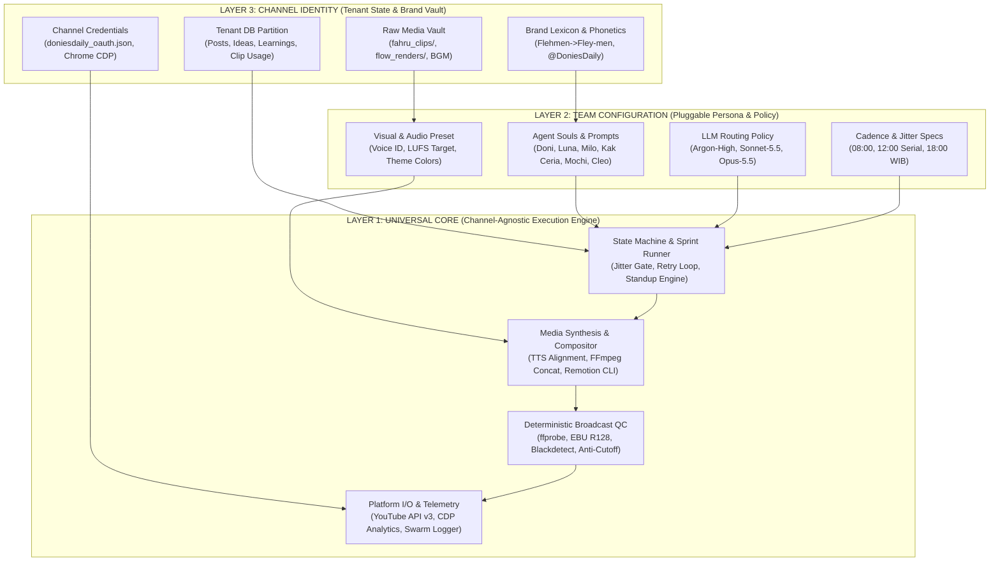

# 📦 DELIVERABLE 09: `09_UNIVERSALIZATION_MATRIX.md`
## PHASE 8: UNIVERSALIZATION ANALYSIS & 3-LAYER CLASSIFICATION MATRIX

**System Under Audit:** `DoniesDaily` (`@DoniesDaily` / `UCNPtjF2aB0wvWHI0q7hhcCg`)  
**Canonical Workspace:** `/home/ubuntu/apps/ugc-lemonaru/` & `/home/ubuntu/tools/`  
**Audit Date:** 2026-11-06  
**Auditor Role:** Principal AI Systems Architect & Reverse Engineering Specialist  
**Audit Status:** READ-ONLY FORENSIC CLASSIFICATION (EVIDENCE-GROUNDED)

---

## 1. THEORETICAL FRAMEWORK: THE 3-LAYER MULTI-TENANT ARCHITECTURE

Currently, the `@DoniesDaily` autonomous production engine operates as a highly effective but **monolithic single-tenant vertical stack**. Domain-specific rules (feline biology, cat phonetic dictionaries, "Mas Fahru" authentic clip biases, `@DoniesDaily` watermarks, and table names prefixed with `doniesdaily_`) are hardcoded directly into core Python execution loops, SQL strings, and React/Remotion TSX components. Additionally, remnants of an earlier e-commerce affiliate system ("Velora AI" / TikTok OOTD) still coexist inside the Remotion default props (`"🔥 RACUN TIKTOK OOTD"`, `"KLIK KERANJANG KUNING"`).

To scale this architecture into a **Multi-Channel Autonomous Media Holding** capable of running $N$ autonomous content teams (e.g., Cat Edutainment, Tech/Gadget Shorts, Personal Finance, Culinary/B2B Storytelling) on the same VPS infrastructure without code duplication, the entire system must be refactored into three strict architectural layers.



### 1.1 Layer Definitions & Boundaries

#### LAYER 1: UNIVERSAL CORE (Channel-Agnostic Engine — 100% Reusable)
* **Definition:** The deterministic software machinery, execution pipelines, media processing wrappers, quality gates, API clients, and React UI primitives that have **zero awareness** of "cats", "Doni", or `@DoniesDaily`.
* **Responsibilities:**
  * Executing cron/jitter scheduling and state transitions (`IDEA_SELECTED` $\rightarrow$ `PUBLISHED`).
  * Calling LLM endpoints (`http://127.0.0.1:8317/v1/chat/completions`) with injected system prompts and parsing structured JSON outputs.
  * Synthesizing TTS audio via ElevenLabs API, extracting character-to-word forced alignments (`startMs`, `endMs`), and slicing clean audio segments for dataset harvesting.
  * Executing multi-frame video ingestion (`ffmpeg` 10-frame extraction at $ts = \text{duration} \times \frac{i+1}{11}$) and passing base64 frames to a Vision LLM.
  * Rendering React Remotion compositions (`DoniOverlay` $\rightarrow$ `UniversalShortOverlay`) via parameterized JSON input props.
  * Enforcing broadcast QC invariants (`ffprobe` stream validation, aspect ratio `0.5625`, `dur_video >= dur_audio - 0.1`, `blackdetect`, and `ebur128` loudness).
  * Uploading via YouTube Data API v3, auto-healing OAuth tokens via CDP, scraping YouTube Studio Advanced Mode retention curves, and writing traces to `agents_chat.db` and Obsidian Vaults.
* **Invariants:** Must never contain hardcoded channel names, niche keywords, hardcoded SQL table prefixes without a `channel_id` filter, or persona names.

#### LAYER 2: TEAM CONFIGURATION (Pluggable Settings, Personas, Models & Schedules)
* **Definition:** The declarative configuration layer that defines *how* a specific autonomous squad operates, thinks, critiques, and styles its output. A new content vertical (e.g., a Tech Shorts squad) is instantiated by creating a new Layer 2 configuration bundle on top of Layer 1.
* **Responsibilities:**
  * **Agent Personas (`SOUL.md`):** Role definitions, interaction protocols, and editorial boundaries for the Lead Producer, Analyst, Scriptwriter, Audio Director, Visual Director, and QC Inspector.
  * **Model Routing Policy:** Binding specific cognitive tasks to specific models (e.g., Analytics & Leadership $\rightarrow$ `gemini-4-argon-high`, Scriptwriting $\rightarrow$ `claude-sonnet-5-5-high`, Scene Editing $\rightarrow$ `claude-opus-5-5-high`, Vision Ingestion $\rightarrow$ `gemini-3.8-flash-high`).
  * **Cadence & Quota Rules:** Cron schedules (`ai_brain.cadence_tasks`), daily upload caps (`MAX_DAILY_POSTS = 3`), jitter windows (`08:04–08:55`, `12:04–12:25`, `18:04–18:55` WIB), and minimum release intervals.
  * **Production & QC Thresholds:** Target word counts (35–45 vs. 108–135 words), cut pacing intervals (`3.2s–4.0s`), EBU R128 loudness bounds (`-14` to `-19 LUFS`), and ElevenLabs voice synthesis parameters (`stability: 0.40`, `similarity_boost: 0.75`, `speed: 1.08x`).
  * **Visual Design Tokens:** Remotion typography (`TheBoldFont` / `LilitaOne`), subtitle highlight hex (`#FFE600`), stroke width (`20px`), and component layout coordinates.

#### LAYER 3: CHANNEL IDENTITY (Isolated Brand, Niche, Voice, Content History & Audience Assets)
* **Definition:** The stateful, non-shareable intellectual property, credentials, historical ledgers, and raw media assets belonging exclusively to one specific YouTube channel (`@DoniesDaily`).
* **Responsibilities:**
  * **Platform Identity & Auth:** YouTube Channel ID (`UCNPtjF2aB0wvWHI0q7hhcCg`), OAuth token file (`/home/ubuntu/.config/youtube/doniesdaily_oauth.json`), persistent Chrome profile (`/home/ubuntu/apps/ugc-lemonaru/data/chrome_persistent`), and watermark string (`🐾 @DoniesDaily`).
  * **Niche Domain Knowledge & Lexicon:** The feline phonetic dictionary (`Flehmen` $\rightarrow$ `Fley-men`, `FRAPs` $\rightarrow$ `Freps`), banned/allowed vocabulary (`voice.md`), and the 5 feline aesthetic zones in `MILO_SOUL.md`.
  * **Proprietary Media Vaults:** Authentic owner footage (`assets/cat_videos/fahru_clips/`), AI renders (`assets/cat_videos/flow_renders/`), serialized content (`content_series/spook_kitten_training/`), `cat_assets_catalog.json`, `cat_playful_bgm.mp3`, and the harvested voice cloning dataset (`assets/audio/vivan_dataset/`).
  * **Historical State & Memory:** The rows inside PostgreSQL (`doniesdaily_posts`, `doniesdaily_content_ideas`, `doniesdaily_learnings`, `doniesdaily_clip_usage`, `doniesdaily_metrics_history`) and the Obsidian workspace (`/home/ubuntu/vault/01_Business/doniesdaily/`).

---

## 2. COMPREHENSIVE COMPONENT CLASSIFICATION MATRIX

Every verified script, tool, database table, React component, soul file, and media asset in the system is classified below. Where a single file currently mixes multiple layers (e.g., a Layer 1 execution script containing hardcoded Layer 3 SQL strings or cat prompts), its **Target Primary Layer** is assigned alongside the exact **Extraction / Decoupling Effort** required to purify it.

### 2.1 Orchestration, Standup & Scheduling Scripts

| Component Name | Type | Path | Current Role in Donies Daily | Assigned Layer | Technical Justification | Extraction / Decoupling Effort |
| :--- | :--- | :--- | :--- | :--- | :--- | :--- |
| `doni_production_sprint.py` | Python Orchestrator | `/home/ubuntu/tools/doni_production_sprint.py` | Master 3x daily cron runner (`morning`, `midday_serial`, `evening`). Manages randomized jitter state (`doni_daily_jitter.json`), checks `ready` topics, runs up to 3x in-place QC retries, triggers upload, and runs Doni's post-production Argon-High evaluation. | **Layer 1** *(Core Engine)* + **Layer 2** *(Config)* | The jitter state machine, retry loop, subprocess pipeline invocation, and post-sprint LLM audit are 100% channel-agnostic workflow primitives. Currently polluted by hardcoded `ai_brain.doniesdaily_posts` SQL queries, `OWNER_CHAT_ID = "1357517232"`, and Indonesian prompt strings for Ketua Doni. | **Medium** (Extract SQL table names, slot windows, and Doni evaluation prompts into a team config YAML/JSON). |
| `doni_working_hours_standup.py` | Python Orchestrator | `/home/ubuntu/tools/doni_working_hours_standup.py` | Autonomous 2x daily (07:30 & 17:30 WIB) multi-agent standup orchestrator. Sequences Mochi $\rightarrow$ Doni Eval 1 $\rightarrow$ Luna $\rightarrow$ Kak Ceria $\rightarrow$ Milo $\rightarrow$ Cleo $\rightarrow$ Doni Eval 2, logs to `agents_chat.db`, and compacts devlogs into Obsidian Vault. | **Layer 1** *(Core Engine)* + **Layer 2** *(Personas)* | The multi-agent turn-taking state machine, SQLite `agent_messages`/`agent_traces` logger (`post_swarm_chat`), and Obsidian GRO Triad Compaction archiver (`save_meeting_to_vault`) are universal Swarm infrastructure. Currently embeds hardcoded agent names (`Mochi`, `Luna`, `Kak Ceria`) and vault path `/home/ubuntu/vault/01_Business/doniesdaily`. | **Medium** (Parameterize roster list, vault workspace path, and Swarm channel `#donies`). |
| `doni_smart_scheduler.py` | Python Scheduler | `/home/ubuntu/tools/doni_smart_scheduler.py` *(Referenced in Orchestration Layer)* | Cadence interval guard and slot dispatcher enforcing the 16–24h release spacing or 3x daily slot distribution and YouTube API rolling 24h quota protection (`BLOCKED_QUOTA`). | **Layer 1** *(Core Engine)* | Rate-limiting, rolling-window quota calculation, and cadence gating are universal platform safety mechanisms applicable to any YouTube channel. | **Low** (Pass `channel_id` and `max_daily_posts` as runtime arguments). |
| `doni.py` / `doni_engine.py` | Python CLI / Daemon | `/home/ubuntu/tools/doni.py` & `/home/ubuntu/apps/ugc-lemonaru/src/doni_engine.py` | Entrypoint wrapper and legacy/core state machine governor binding `ai_brain.doniesdaily_production_queue` stages (`IDEA` $\rightarrow$ `PUBLISHED`). | **Layer 1** *(Core Engine)* | Finite state machine governance with idempotent stage resumption is pure Layer 1 infrastructure. | **Low** (Decouple hardcoded `doniesdaily_production_queue` table identifier). |
| `doni_runner.sh` / `doni_replier_runner.sh` | Bash Wrappers | `/home/ubuntu/tools/doni_runner.sh` & `/home/ubuntu/tools/doni_replier_runner.sh` | Cron shell wrappers activating `/home/ubuntu/apps/ugc-lemonaru/.venv/bin/python` and invoking Python workers. | **Layer 1** *(Core Engine)* | Generic virtualenv and environment variable bootstrap scripts. | **Low** (Parameterize target script and tenant config flag `--team`). |

---

### 2.2 Content Generation, Analytics & Linting Tools

| Component Name | Type | Path | Current Role in Donies Daily | Assigned Layer | Technical Justification | Extraction / Decoupling Effort |
| :--- | :--- | :--- | :--- | :--- | :--- | :--- |
| `doni_scriptwriter.py` | Python Module (Luna) | `/home/ubuntu/tools/doni_scriptwriter.py` | Queries active rules from `ai_brain.doniesdaily_learnings` and existing topics from `doniesdaily_posts`, calls `claude-sonnet-5-5-high` to generate novel topics & 108–135 word scripts with ElevenLabs v4 tags, and applies regex phonetic replacements. | **Layer 1** *(Generator Engine)* + **Layer 3** *(Phonetics & Prompts)* | The dynamic learning-rule injection loop (`fetch_active_learned_rules`), deduplication query (`fetch_existing_topics`), and regex phonetic normalizer (`apply_phonetic_fixes`) are universal Layer 1 mechanics. However, `PHONETIC_DICTIONARY` (`Flehmen` $\rightarrow$ `Fley-men`, `Catnip` $\rightarrow$ `Ket-nip`) and the cat-specific prompt instructions are strictly Layer 3. | **High** (Must split into a generic `scriptwriter_engine.py` [Layer 1], a prompt template [Layer 2], and a `phonetics_dictionary.json` [Layer 3]). |
| `doni_evaluator.py` | Python Telemetry (Mochi) | `/home/ubuntu/tools/doni_evaluator.py` | Hybrid analytics extractor. Pulls YouTube Studio Advanced Mode table via Chrome CDP (`:9222`) + 100-point `audienceWatchRatio` curve via `youtubeAnalytics` API v2, runs `gemini-4-argon-high` retention forensics, and writes directives to `ai_brain.doniesdaily_learnings`. | **Layer 1** *(Core Engine)* | Scraping YouTube Studio Advanced Mode via CDP, querying `youtubeAnalytics` v2 for 3s hold / 50% midpoint / drop-off second, and synthesizing retention rules via LLM is 100% reusable across any YouTube Shorts channel. | **Medium** (Abstract table names and inject niche context into the Argon-High forensic prompt). |
| `doni_content_strategist.py` | Python Module (Mochi) | `/home/ubuntu/tools/doni_content_strategist.py` *(or integrated Mochi ideation logic)* | Evaluates topic candidates against historical retention scores and enforces JSON schema (`topic_key`, `title`, `hook_banner`, `target_angle`, `estimated_retention_score`). | **Layer 1** *(Engine)* + **Layer 2** *(Schema/Angles)* | The JSON validation and DB anti-duplication gate are Layer 1; the `target_angle` enum (`mitos_vs_fakta`, `perilaku_aneh`, `biologi_rahasia`, `ikatan_emosional`) is Layer 2/3. | **Low** (Move `target_angle` enum to team config). |
| `title.py` | Python CLI Linter | `/home/ubuntu/tools/yt_agent_tools/title.py` | Enforces YouTube packaging standards: max 60 chars desktop / 40 chars mobile feed, and checks zero lexical duplication between `title` and `hook_banner`. | **Layer 1** *(Universal Core)* | Pure deterministic string/packaging linter governed by YouTube platform UI constraints, completely independent of channel niche. | **Low** (Zero changes needed; 100% Universal Core as-is). |
| `hookscore.py` & `hooks.json` | Python CLI Benchmark | `/home/ubuntu/tools/yt_agent_tools/hookscore.py` & `hooks.json` | Evaluates opening vocal hooks against 21 viral hook formulas (*Counter-Intuitive, Direct Challenge, Unanswered Question*, etc.) for open curiosity gaps. | **Layer 1** *(Universal Core)* | Short-form psychological hook structures are universal across all edutainment/storytelling verticals. | **Low** (Zero changes needed; 100% Universal Core as-is). |
| `swipe.py` | Python CLI Miner | `/home/ubuntu/tools/yt_agent_tools/swipe.py` | Outlier detection tool identifying channel videos performing at $>2.0\times$ channel median views. | **Layer 1** *(Universal Core)* | Statistical outlier detection ($>2.0\times$ median) is a pure mathematical utility. | **Low** (Zero changes needed; 100% Universal Core as-is). |

---

### 2.3 Voice Synthesis, Audio Engineering & SFX

| Component Name | Type | Path | Current Role in Donies Daily | Assigned Layer | Technical Justification | Extraction / Decoupling Effort |
| :--- | :--- | :--- | :--- | :--- | :--- | :--- |
| `elevenlabs_tts.py` | Python Audio Module | `/home/ubuntu/apps/ugc-lemonaru/src/elevenlabs_tts.py` | Calls ElevenLabs v4 Turbo / Multilingual v2 API (`generate_speech_with_timestamps`), strips `[tag]` markers from visual tokens while keeping them for vocal synthesis, and outputs `.mp3` + Remotion `captions.json` (`startMs`, `endMs`). | **Layer 1** *(Universal Core)* | Forced alignment character-to-word token conversion and regex stripping of emotional direction brackets (`[curious]`, `[gasps]`) are universal TTS-to-Remotion bridge primitives. | **Low** (Pass `voice_id`, `stability`, `similarity_boost`, and `speed` via Layer 2 config instead of defaults). |
| `custom_vivan_tts.py` | Python Audio Worker | `/home/ubuntu/apps/ugc-lemonaru/src/custom_vivan_tts.py` | Zero-token deterministic synthesis wrapper specifically bound to the Vivan voice profile (`ZowYWFat3iypr7PwKMPb`) and fallback TTS routing. | **Layer 2** *(Team Config)* / **Layer 1** *(Adapter)* | The code logic is a generic TTS adapter (Layer 1), but its hardcoded binding to Vivan's voice profile makes it a Layer 2 persona configuration artifact. | **Low** (Merge into `elevenlabs_tts.py` as a configurable voice profile). |
| `vivan_dataset_harvester.py` | Python Audio Harvester | `/home/ubuntu/apps/ugc-lemonaru/src/vivan_dataset_harvester.py` | Automatically slices clean 3–10s 24kHz mono WAV segments + `.lab` transcripts from every newly generated ElevenLabs voiceover into `assets/audio/vivan_dataset/` until reaching 150–200 clips (~20 mins) for local RVC/XTTS/F5 fine-tuning. | **Layer 1** *(Universal Core)* | Automated TTS output harvesting (slicing by sentence timestamps, resampling to 24kHz mono WAV, writing `.lab` files) is a brilliant, 100% channel-agnostic cost-reduction engine. | **Low** (Parameterize output directory `assets/audio/{voice_profile}_dataset/`). |
| `doni_sfx_helper.py` & `sfx_catalog.json` | Python Audio Helper | `/home/ubuntu/apps/ugc-lemonaru/src/doni_sfx_helper.py` & `sfx_catalog.json` | Maps narrative/emotional beats to the 10 pre-sliced viral sound effects (`sfx_vine_boom.mp3`, `sfx_taco_bell_bong.mp3`, `sfx_anime_wow.mp3`, etc.) with micro-fades. | **Layer 1** *(Helper)* + **Layer 2** *(SFX Palette)* | The audio mixing/timing injection logic in `doni_sfx_helper.py` is Layer 1; the specific 10 meme SFX files (`assets/audio/sfx/`) represent a Layer 2 comedic/edutainment sound palette reusable by any lively Shorts team. | **Low** (Allow team config to specify custom `sfx_catalog.json` path). |

---

### 2.4 Visual Direction, Video Rendering & Asset Ingestion

| Component Name | Type | Path | Current Role in Donies Daily | Assigned Layer | Technical Justification | Extraction / Decoupling Effort |
| :--- | :--- | :--- | :--- | :--- | :--- | :--- |
| `ingest_fahru_footage.py` | Python Vision Ingestor | `/home/ubuntu/tools/ingest_fahru_footage.py` | Implements Hukum Besi #14: extracts 10 chronological frames ($9\%$ to $91\%$ duration) via `ffmpeg`, sends to `gemini-3.8-flash-high` for behavior analysis, renames file to `{slug}.mp4`, prepends to `cat_assets_catalog.json`, and logs to `#donies`. | **Layer 1** *(10-Frame Vision Engine)* + **Layer 3** *(Cat Prompt)* | The 10-frame temporal extraction math (`duration * ((i + 1) / 11)`), base64 encoding, file renaming, JSON catalog prepending, and SQLite notification are 100% universal media DAM (Digital Asset Management) features. Only the LLM prompt asking for cat emotions/actions (`Santai, penasaran...`, `Tidur, lari, cakar...`) is Layer 3. | **Medium** (Extract the Vision LLM prompt and taxonomy enums into a Layer 2/3 JSON schema per channel). |
| `doni_remotion_flow_pipeline.py` | Python Master Pipeline | `/home/ubuntu/apps/ugc-lemonaru/src/doni_remotion_flow_pipeline.py` | Orchestrates DB topic fetch, TTS + BGM `dynaudnorm` mixing, Google Flow scene generation fallback, Remotion composition rendering, YouTube upload, and DB status reconciliation. | **Layer 1** *(Core Pipeline)* + **Layer 3** *(Hardcoded Defaults)* | The end-to-end orchestration flow is universal, but the script contains hardcoded cat defaults: `BGM_PATH = "cat_playful_bgm.mp3"`, CTA injection `"Jangan lupa follow dan subscribe DoniesDaily ya!"`, and stock fallback names (`"clip1_fight.mp4"`). | **Medium** (Inject channel config object into `DoniRemotionFlowPipeline.__init__()`). |
| `doni_hybrid_renderer.py` | Python Renderer (Milo) | `/home/ubuntu/apps/ugc-lemonaru/src/doni_hybrid_renderer.py` | Implements Hukum Besi #13 & #15: uses `claude-opus-5-5-high` (`select_footage_by_speech_beats`) to align unique clips from `cat_assets_catalog.json` to speech sentences, applies Two-Pass Allocation (+12 bias for `fahru_sent`, -10 penalty for AI, anti-fatigue query on `doniesdaily_clip_usage`), renders Remotion ProRes 4444 overlay (`/tmp/{topic}_remotion_overlay.mov`), composites via `ffmpeg` (`setpts` stretch guard), and unlinks `/tmp/` cache after upload. | **Layer 1** *(Core Compositor)* | Speech-beat scene cutting via Opus, anti-fatigue scoring, ProRes 4444 transparent overlay caching, `setpts` force-fit stretch guard, and `/tmp/` hygiene are high-value Universal Core engineering patterns. Only the catalog path and category names (`fahru_sent`) are channel-specific. | **Medium** (Generalize `fahru_sent` to `authentic_priority` and pass catalog/table names via config). |
| `doni_visual_director.py` | Python Module (Milo) | `/home/ubuntu/apps/ugc-lemonaru/src/doni_visual_director.py` | Uses `claude-opus-5-5-high` (`generate_shotlist`) to design 9:16 vertical camera prompts and scene breakdowns enforcing Milo's Style Bible (Orange tabby anchor, 5 aesthetic zones). | **Layer 1** *(Shotlist Generator)* + **Layer 3** *(Feline Style Bible)* | The structured shotlist generation pipeline is Layer 1, while the "Feline Anchor" (ginger tabby with white paws, zero humans) and 5 domestic zones are strictly Layer 3 channel identity. | **Medium** (Load the Style Bible from `MILO_SOUL.md` or a Layer 3 `visual_style_bible.md` file dynamically). |
| `flow_cdp_operator.py` | Python Browser Operator | `/home/ubuntu/apps/ugc-lemonaru/src/flow_cdp_operator.py` | Connects to persistent Google Chrome on Xvfb (`:99`) via CDP port `9222` to automate Google Flow / Veo2 video generation and download rendered `.mp4` clips. | **Layer 1** *(Universal Core)* | Browser automation against Google Flow via CDP is 100% agnostic of what the prompt describes. | **Low** (Zero niche coupling; reusable as-is). |

---

### 2.5 Quality Control, Publishing & Audience Engagement

| Component Name | Type | Path | Current Role in Donies Daily | Assigned Layer | Technical Justification | Extraction / Decoupling Effort |
| :--- | :--- | :--- | :--- | :--- | :--- | :--- |
| `doni_qc_gate.py` | Python QC Inspector (Cleo) | `/home/ubuntu/apps/ugc-lemonaru/src/doni_qc_gate.py` | Deterministic broadcast inspector: `inspect_video()` checks file size ($>1\text{MB}$), streams, 9:16 resolution (`1080x1920`), duration ($10\text{s}–59.9\text{s}$), audio-video delta ($\le 1.5\text{s}$), `blackdetect` ($\ge 0.5\text{s}$), and `ebur128` LUFS. `audit_footage_assembly()` verifies Hukum Besi #13 (zero duplicate clips). `audit_script_and_outro()` verifies Hukum Besi #15 (CTA presence). | **Layer 1** *(Universal Core)* | 95% of this file (`inspect_video` and `audit_footage_assembly`) is pure, deterministic broadcast engineering applicable to every vertical video ever rendered. Only `audit_script_and_outro()` has a minor hardcoded check for `"doniesdaily" in text_lower or "doni" in text_lower`. | **Low** (Pass `brand_keywords: List[str]` into `audit_script_and_outro()`). |
| `youtube_api_publisher.py` | Python API Client | `/home/ubuntu/apps/ugc-lemonaru/src/youtube_api_publisher.py` | Official YouTube Data API v3 uploader (`upload_short`, `set_thumbnail`) with resumable 2MB chunking, automatic OAuth token refresh, and fallback invocation of `doni_oauth_auto_healer.py`. | **Layer 1** *(Universal Core)* | Standard OAuth 2.0 + Google API v3 client. Only the default constants (`DEFAULT_OAUTH_PATH = ".../doniesdaily_oauth.json"`, `category_id = "15"` [Pets & Animals], and default cat tags) are Layer 3 defaults that can already be overridden via function arguments! | **Low** (Already supports parameter overrides; just remove cat defaults from class fallback). |
| `doni_oauth_auto_healer.py` | Python Auth Healer | `/home/ubuntu/tools/doni_oauth_auto_healer.py` | Uses persistent Chrome CDP (`:9222`) to automatically re-authorize Google OAuth consent and write fresh `refresh_token` credentials when revoked/expired. | **Layer 1** *(Universal Core)* | Automated OAuth token recovery via persistent browser session is pure infrastructure. | **Low** (Parameterize OAuth JSON path and Google account selector). |
| `doni_studio_replier.py` | Python Community Bot (Kak Ceria) | `/home/ubuntu/tools/doni_studio_replier.py` *(Invoked by `doni_replier_runner.sh`)* | Runs every 2 hours (`0 8-22/2 * * *`) to fetch unanswered viewer comments on `@DoniesDaily` and post warm, persona-aligned replies using `claude-sonnet-5-5-high`. | **Layer 1** *(Engine)* + **Layer 2** *(Persona)* | Fetching comments and posting replies via API/CDP is Layer 1; the Kak Ceria persona prompt ("pawrents/babu kucing") is Layer 2/3. | **Low** (Inject persona prompt and OAuth config). |
| `doni_comment_sniper.py` | Python Growth Bot | `/home/ubuntu/tools/doni_comment_sniper.py` *(Backed by `doniesdaily_sniper_logs`)* | Identifies trending niche videos, posts contextual value-add comments, and logs `video_id` + `comment_id` to PostgreSQL with a `UNIQUE (video_id)` constraint to prevent spam. | **Layer 1** *(Engine)* + **Layer 3** *(Niche Targets)* | The deduplicated comment-sniping state machine is Layer 1; search keywords and comment persona are Layer 3. | **Low** (Parameterize target keywords, persona, and log table). |

---

### 2.6 Remotion React Components (`/home/ubuntu/apps/ugc-lemonaru/remotion/src/`)

| Component Name | Type | Path | Current Role in Donies Daily | Assigned Layer | Technical Justification | Extraction / Decoupling Effort |
| :--- | :--- | :--- | :--- | :--- | :--- | :--- |
| `DoniOverlay.tsx` | Remotion Composition | `remotion/src/DoniOverlay.tsx` | Master transparent overlay composition combining Watermark, `HookTitle`, optional `StoryCoverCard`, `@remotion/captions` single-word pages (`SWITCH_CAPTIONS_EVERY_MS = 0`), and `OutroCTA`. | **Layer 1** *(UI Primitive)* + **Layer 3** *(Hardcoded Watermark)* | The composition structure, Zod schema validation (`doniOverlaySchema`), font loading, and `createTikTokStyleCaptions` integration are 100% reusable Layer 1 code. However, line 88 hardcodes `<span>🐾</span><span>@DoniesDaily</span>` directly in JSX instead of reading a prop, and default Zod props reference cat strings. | **Low** (Add `watermarkText` and `watermarkIcon` to `doniOverlaySchema` props). |
| `HookTitle.tsx` | Remotion Component | `remotion/src/components/HookTitle.tsx` | Animated top banner (`0–3.2s`) with spring entrance (`damping: 12, stiffness: 140`), floating sinusoidal wobble, and slide-up exit. Accepts `title`, `subtitle`, `badgeText`. | **Layer 1** *(Universal Core)* | 100% prop-driven React animation component. (Note: Default fallback `badgeText = "🔥 RACUN TIKTOK OOTD"` is a harmless legacy remnant that is always overridden by `DoniOverlay`). | **Low** (Change default fallback string; component is already universal). |
| `SubtitlePage.tsx` | Remotion Component | `remotion/src/CaptionedVideo/SubtitlePage.tsx` | Renders single-word kinetic captions (`SWITCH_CAPTIONS_EVERY_MS = 0`) with neon yellow highlight (`#FFE600`) and thick 20px black stroke. | **Layer 1** *(Engine)* + **Layer 2** *(Theme Tokens)* | Kinetic word-by-word rendering is universal Layer 1; color hex `#FFE600` and font `TheBoldFont` can be exposed as optional Layer 2 theme props. | **Low** (Expose color/font props with current values as defaults). |
| `OutroCTA.tsx` | Remotion Component | `remotion/src/components/OutroCTA.tsx` | End-of-video spring pop-up card dimming the background (`bgOpacity: 0.45`) and displaying `headline`, `subheadline`, and `buttonText`. | **Layer 1** *(Universal Core)* | Fully parameterized via props (`OutroCTAProps`). Default props (`"CHECKOUT SEKARANG!"`, `"KLIK KERANJANG KUNING"`) are legacy TikTok Shop defaults overridden at render time. | **Low** (Update default prop strings to generic follow/subscribe text). |
| `StoryCoverCard.tsx` | Remotion Component | `remotion/src/components/StoryCoverCard.tsx` | Solid white rounded card (`#FFFFFF`, `bottom: 430px`) created to mask burned-in English text boxes on repurposed TikTok videos (e.g., `G2XVkRuZoKg`) while displaying translated Indonesian narrative text. | **Layer 1** *(Universal Core)* | 100% parameterized (`text`, `bottom`, `left`, `right`, `minHeight`, `durationInSeconds`). Useful for any channel repurposing foreign-language viral clips. | **Low** (Zero changes needed; 100% Universal Core as-is). |
| `<Still id="DoniThumbnail" />` | Remotion Still | `remotion/src/Root.tsx` *(Registered Still)* | Renders high-CTR custom thumbnails and 0.08s opening cover posters with bold typography, category badge, and dramatic background frame (Hukum Besi #10). | **Layer 1** *(Template)* + **Layer 2** *(Styling)* | Automated Remotion `<Still>` thumbnail + 0.08s poster frame injection is a universal YouTube Shorts growth pattern. | **Low** (Parameterize brand badge and color scheme). |

---

### 2.7 Database Schemas (PostgreSQL `ai_brain` & SQLite `agents_chat.db`)

| Component Name | Type | Path / Schema | Current Role in Donies Daily | Assigned Layer | Technical Justification | Extraction / Decoupling Effort |
| :--- | :--- | :--- | :--- | :--- | :--- | :--- |
| `agents_chat.db` (`agent_messages`, `agent_traces`) | SQLite Database | `/home/ubuntu/vps-control-center/backend/data/agents_chat.db` | Multi-agent Swarm Matrix communication bus and tool-execution trace ledger across all holding squads (`#donies`, `#all`, `#bawang`, `#subtracker`). | **Layer 1** *(Universal Core)* + **Layer 3** *(Row Data)* | The schema (`sender_id`, `channel`, `content`, `agent_traces`) is already multi-tenant by design! It already hosts `juragan-bawang`, `subtracker`, `hermes`, and `donies`. | **Low** (Already multi-tenant; only requires standardizing `sender_id` naming conventions). |
| `ai_brain.cadence_tasks` | PostgreSQL Table | `supabase-db` $\rightarrow$ `ai_brain.cadence_tasks` | Unified cron dispatcher table storing `task_key`, `cron_expr`, `action_type`, `action_payload`, and `status`. | **Layer 1** *(Schema)* + **Layer 2** *(Task Rows)* | The table schema is already universal (`task_key` uses namespace prefix `business.doni_*`). The 6 specific rows for Doni represent Layer 2 team schedule configuration. | **Low** (Zero schema changes needed; add new rows per team `business.{team}_*`). |
| `ai_brain.doniesdaily_content_ideas` | PostgreSQL Table | `supabase-db` $\rightarrow$ `ai_brain.doniesdaily_content_ideas` | Stores backlog & active scripts (`topic_key`, `title`, `hook_banner`, `hook_vocal`, `full_script`, `scene_breakdown`, `flow_prompts`, `sound_fx`, `status`). | **Layer 1** *(DDL Structure)* + **Layer 3** *(Table Instance & Data)* | None of the columns are cat-specific! Every column (`hook_banner`, `full_script`, `scene_breakdown`, `sound_fx`) applies to any short-form video channel. Only the table name `doniesdaily_content_ideas` and its row contents are tied to Donies Daily. | **Medium** (Add `channel_id TEXT NOT NULL DEFAULT 'doniesdaily'` to a unified table or instantiate via schema template). |
| `ai_brain.doniesdaily_production_queue` | PostgreSQL Table | `supabase-db` $\rightarrow$ `ai_brain.doniesdaily_production_queue` | Tracks state machine execution (`current_stage` enum `ai_brain.production_stage`, `audio_path`, `caption_path`, `rendered_master_path`, `qc_report`, `retry_count`). | **Layer 1** *(DDL Structure)* + **Layer 3** *(Table Instance & Data)* | 100% generic video production state machine schema. | **Medium** (Add `channel_id` column or use per-tenant table factory). |
| `ai_brain.doniesdaily_posts` | PostgreSQL Table | `supabase-db` $\rightarrow$ `ai_brain.doniesdaily_posts` | Published ledger and telemetry store (`video_id`, `title`, `clips_used`, `views_count`, `stayed_to_watch_pct`, `avg_view_pct`, `biggest_drop_sec`, `retention_curve_json`). | **Layer 1** *(DDL Structure)* + **Layer 3** *(Table Instance & Data)* | Every column maps directly to YouTube Data API v3 and YouTube Analytics API v2 metrics. Completely vertical-agnostic. | **Medium** (Add `channel_id` column). |
| `ai_brain.doniesdaily_metrics_history` | PostgreSQL Table | `supabase-db` $\rightarrow$ `ai_brain.doniesdaily_metrics_history` | Time-series snapshot ledger (`snapshot_hours`, `views_count`, `stayed_to_watch_pct`, `subs_gained`, `captured_at`). | **Layer 1** *(DDL Structure)* + **Layer 3** *(Table Instance & Data)* | Universal time-series YouTube telemetry schema. | **Medium** (Add `channel_id` column). |
| `ai_brain.doniesdaily_learnings` | PostgreSQL Table | `supabase-db` $\rightarrow$ `ai_brain.doniesdaily_learnings` | Self-improving rule ledger (`category`, `rule_name`, `directive`, `rationale`, `confidence_score`, `status`). | **Layer 1** *(DDL Structure)* + **Layer 3** *(Learned Rules)* | The schema is a universal reinforcement-learning memory store. However, the **13 active rows** inside it (e.g., Rule #1 banning `"Kenapa Kucing..."`, Rule #6 referencing `'Bawa Bangkai'`, Rule #13 referencing `'Ngadon Roti'`) are deeply tied to `@DoniesDaily`'s specific audience psychology (Layer 3). | **Medium** (Scope queries by `channel_id` so a Finance or Tech team learns its own rules independently). |
| `ai_brain.doniesdaily_clip_usage` | PostgreSQL Table | `supabase-db` $\rightarrow$ `ai_brain.doniesdaily_clip_usage` | Anti-Fatigue Ledger (`clip_name`, `clip_path`, `topic_key`, `video_id`, `used_at`) preventing B-roll repetition across videos. | **Layer 1** *(DDL Structure)* + **Layer 3** *(Asset History)* | Universal B-roll deduplication ledger. | **Low** (Add `channel_id` column). |
| `ai_brain.doniesdaily_sniper_logs` | PostgreSQL Table | `supabase-db` $\rightarrow$ `ai_brain.doniesdaily_sniper_logs` | Deduplication log for outbound community comment sniping (`video_id` UNIQUE, `comment_text`, `comment_id`). | **Layer 1** *(DDL Structure)* + **Layer 3** *(Log Data)* | Universal outbound engagement ledger. | **Low** (Add `channel_id` column). |

---

### 2.8 Agent Souls, Specifications & Legacy Artifacts

| Component Name | Type | Path | Current Role in Donies Daily | Assigned Layer | Technical Justification | Extraction / Decoupling Effort |
| :--- | :--- | :--- | :--- | :--- | :--- | :--- |
| `DONI_SOUL.md`, `CLEO_SOUL.md`, `VIVAN_SOUL.md` | Agent Soul Markdown | `/home/ubuntu/apps/ugc-lemonaru/souls/` | Define the Executive Producer state machine, Broadcast QC inspection standards (`-14..-19 LUFS`, `blackdetect`, `<=0.5s` drift), and 0-token voice dataset harvester roles. | **Layer 2** *(Team Configuration)* | Almost entirely functional/operational role definitions with minimal cat-specific logic. Can be templated for any new squad lead, QC inspector, and TTS sub-unit in <15 minutes. | **Low** (Replace `@DoniesDaily` with `{{channel_handle}}`). |
| `MOCHI_SOUL.md`, `KAK_CERIA_SOUL.md` | Agent Soul Markdown | `/home/ubuntu/apps/ugc-lemonaru/souls/` | Define the Analytics/Retention strategist (Curiosity Gap, Title linting) and Audio Director (ElevenLabs v4 emotional tags `[curious]`, `[gasps]`, `[laughs]`, non-monotonous delivery). | **Layer 2** *(Role & Audio Spec)* + **Layer 3** *(Niche Examples)* | 80% of these files define reusable short-form retention psychology and ElevenLabs v4 acoustic engineering; 20% reference cat examples (*Ngadon Roti*, *kelakuan anabul*). | **Low** (Parameterize niche examples while preserving the analytical and acoustic rules). |
| `LUNA_SOUL.md`, `MILO_SOUL.md`, `voice.md` | Agent Soul & Voice Bible | `/home/ubuntu/apps/ugc-lemonaru/souls/` & `/home/ubuntu/.claude/youtube/voice.md` | Define feline storytelling, Indonesian cat-lover slang (*Anabul, Si oren, Pawrents, Babu kucing*), phonetic dictionary (`Fley-men`), and the Ginger Tabby visual Style Bible. | **Layer 3** *(Channel Identity)* | Deeply coupled to the Indonesian cat-lover demographic and feline visual aesthetics. Every new channel requires its own unique Scriptwriter Soul, Visual Style Bible, and `voice.md`. | **High** (Must be authored fresh per channel vertical, using the structural sections of Luna/Milo as a boilerplate template). |
| Legacy Velora AI / TikTok Affiliate Files | Legacy Python / TSX Artifacts | `/home/ubuntu/apps/ugc-lemonaru/` (`affiliate_pipeline.py`, `scoring.py`, & default props in `HookTitle.tsx` / `OutroCTA.tsx`) | Dormant remnants from when the `ugc-lemonaru` repository was built for TikTok Shop OOTD affiliate video generation ("RACUN TIKTOK OOTD", "KLIK KERANJANG KUNING"). | **Deprecated / Legacy Quarantine** | Not used by the active `@DoniesDaily` YouTube Shorts pipeline (`doni_production_sprint.py`), except as overridden default string fallbacks in `HookTitle.tsx` and `OutroCTA.tsx`. | **Low** (Quarantine to `/archive/legacy_affiliate/` and scrub e-commerce default strings from Remotion TSX). |

---

## 3. ANALYSIS OF NON-GENERALIZABLE ELEMENTS (STRICT LAYER 3 ISOLATION)

Certain components within `@DoniesDaily` are so tightly coupled to feline behavioral edutainment, Indonesian "pawrent" culture, or Mas Fahru's personal assets that **attempting to abstract them into Layer 1 would corrupt the Universal Core**. These elements must be strictly isolated into Layer 3 tenant directories and never imported globally:

### 3.1 Feline Phonetic & Slang Lexicon (`PHONETIC_DICTIONARY` & `voice.md`)
* **Evidence:** `doni_scriptwriter.py` (lines 27–40) hardcodes regex replacements for feline biological terms (`Flehmen` $\rightarrow$ `Fley-men`, `Jacobson` $\rightarrow$ `Jekob-sen`, `HES-7` $\rightarrow$ `Hes Tujuh`, `FRAPs` $\rightarrow$ `Freps`, `Zoomies` $\rightarrow$ `Zuumis`, `Catnip` $\rightarrow$ `Ket-nip`), while `voice.md` mandates terms like `"Anabul"`, `"Si oren"`, `"Babu kucing"`, and `"Ngadon roti"`.
* **Why It Cannot Be Abstracted:** A B2B Finance channel or Tech Gadget channel has its own pronunciation traps (e.g., `SaaS` $\rightarrow$ `Sas`, `NVMe` $\rightarrow$ `En-Vi-Em-I`, `CUDA` $\rightarrow$ `Ku-da`) and its own demographic slang.
* **Isolation Strategy:** Keep the regex engine `apply_phonetic_fixes(text, dictionary_path)` in **Layer 1**, but move the dictionary itself into `/channels/doniesdaily/lexicon.json` (**Layer 3**).

### 3.2 The "Ginger Tabby" Style Bible & 5 Domestic Aesthetic Zones (`MILO_SOUL.md`)
* **Evidence:** `MILO_SOUL.md` locks the visual anchor to an expressive ginger tabby with white paws, strictly bans human hands/faces ("HARAM HUKUMNYA: Ada manusia, jari tangan manusia"), and rotates across 5 specific domestic cat environments (Living Room carpet, Kitchen marble, Bookshelf rainy window, Cozy Bedroom linen, Sunlit Monstera Terrace).
* **Why It Cannot Be Abstracted:** Other channels may *require* human hands (e.g., gadget unboxing, culinary prep) or outdoor/cyberpunk/studio environments.
* **Isolation Strategy:** Isolate `MILO_SOUL.md`'s Section 2 ("Kredo Sinematografi & Style Bible") into `/channels/doniesdaily/style_bible.md` (**Layer 3**), while keeping Section 4 ("Hukum Besi #13: Zero In-Video Footage Repetition & 3.2s–4.0s Cut Pacing") in **Layer 2/1** as a universal high-retention editing rule.

### 3.3 The `fahru_clips` Authentic Footage Pool & `spook_kitten_training` Series
* **Evidence:** `cat_assets_catalog.json` (45 clips total, 20 `asli_fahru_*` authentic clips and 25 `ai_gen_*` clips) and `/home/ubuntu/apps/ugc-lemonaru/content_series/spook_kitten_training/` (4 repurposed TikTok parts from `@_worm.com_` with custom `StoryCoverCard` masks).
* **Why It Cannot Be Abstracted:** These video files, their 10-frame Gemini Vision descriptions, and the custom `StoryCoverCard` text overlays for the "Spook the Kitten" midday serial are proprietary content assets of `@DoniesDaily`.
* **Isolation Strategy:** However, the **mechanism** of interleaving high-priority authentic footage (`+12` score bias) with fallback AI renders (`-10` penalty) in `doni_hybrid_renderer.py` **IS universal**. By renaming the internal category check from `category == "fahru_sent"` to `category == "authentic_priority"`, any future channel owner can drop their own authentic clips into their channel's folder and get the exact same Two-Pass Allocation behavior.

### 3.4 Channel-Specific Learned Directives (`ai_brain.doniesdaily_learnings`)
* **Evidence:** Active rules #6 through #13 in `ai_brain.doniesdaily_learnings` contain hyper-specific empirical findings from `@DoniesDaily`'s audience watch curves (e.g., referencing the `'Bawa Bangkai'` outlier video at >45% Stayed-to-Watch, `'Ngadon Roti'`, `'Tidur di Baju Kotor'`, and patching the exact `4.8s–8.4s` drop-off chasm).
* **Why It Cannot Be Abstracted:** While the **5-second Re-Hook / Open-Loop Bridge** is a great cross-channel pattern, the specific topic references and duration sweet-spots (`45–52s` vs `30–38s`) are empirical artifacts of `@DoniesDaily`'s specific viewer cohort. Furthermore, Rules #6–#13 currently exhibit **directive accumulation bloat** (8 overlapping `script_structure` rules with confidence `0.96–0.97` all injected simultaneously into Luna's prompt, prescribing slightly conflicting duration caps: `55-63s` in Rule #5, `35-38s` in Rule #7, `42-48s` in Rule #11, and `48-55s` in Rule #12).
* **Isolation Strategy:** Each channel must maintain its own isolated `learnings` partition, and Layer 1's Mochi evaluator must consolidate/supersede older rules in the same `category` rather than appending conflicting duration caps indefinitely.

---

## 4. DECOUPLING ACTION ITEMS: EXTRACTING LAYER 1 WITHOUT BREAKING LIVE PRODUCTION

Because `@DoniesDaily` is an active, revenue/growth-critical production channel executing **3 live sprints per day** (`08:00`, `12:00`, `18:00` WIB) and **2 daily standups** (`07:30`, `17:30` WIB), a destructive "big-bang" rewrite is strictly forbidden. Decoupling must follow a **Strangler Fig / Zero-Downtime Backward-Compatible Pattern**:

### Phase A: Introduce `ChannelContext` Configuration Loader (Zero Behavior Change)
1. **Create a declarative manifest `/home/ubuntu/apps/ugc-lemonaru/configs/doniesdaily.json`** (combining Layer 2 & Layer 3 parameters):
   ```json
   {
     "channel_id": "doniesdaily",
     "youtube_channel_id": "UCNPtjF2aB0wvWHI0q7hhcCg",
     "watermark_text": "@DoniesDaily",
     "watermark_icon": "🐾",
     "swarm_channel": "donies",
     "vault_workspace": "/home/ubuntu/vault/01_Business/doniesdaily",
     "oauth_path": "/home/ubuntu/.config/youtube/doniesdaily_oauth.json",
     "youtube_category_id": "15",
     "db_prefix": "ai_brain.doniesdaily",
     "models": {
       "executive_and_analytics": "gemini-4-argon-high",
       "scriptwriter": "claude-sonnet-5-5-high",
       "scene_director": "claude-opus-5-5-high",
       "vision_ingestor": "gemini-3.8-flash-high"
     },
     "voice": {
       "primary_voice_id": "ZowYWFat3iypr7PwKMPb",
       "stability": 0.40,
       "similarity_boost": 0.75,
       "speed": 1.08,
       "bgm_path": "assets/audio/cat_playful_bgm.mp3"
     }
   }
   ```
2. **Default Fallback Guarantee:** Update `doni_production_sprint.py`, `doni_working_hours_standup.py`, `doni_scriptwriter.py`, and `doni_remotion_flow_pipeline.py` to accept `--channel-config /path/to/config.json`, **defaulting to `configs/doniesdaily.json` if omitted**. This guarantees that all existing cron jobs in `ai_brain.cadence_tasks` continue running with zero interruption.

### Phase B: Purify Remotion TSX Props & Quarantine Legacy Velora AI Code
1. **Parameterize `DoniOverlay.tsx` Watermark:** Add `watermarkText: z.string().default("@DoniesDaily")` and `watermarkIcon: z.string().default("🐾")` to `doniOverlaySchema` so the React component no longer hardcodes the channel handle in JSX.
2. **Scrub Legacy E-Commerce Defaults:** Replace `"🔥 RACUN TIKTOK OOTD"` in `HookTitle.tsx` and `"CHECKOUT SEKARANG!"` / `"KLIK KERANJANG KUNING"` in `OutroCTA.tsx` with clean generic defaults (`"🐾 FAKTA ANABUL VIRAL"`, `"FOLLOW & SUBSCRIBE!"`, `"@DoniesDaily"`).
3. **Quarantine Unused Affiliate Scripts:** Move dormant Velora AI / TikTok affiliate scripts (`affiliate_pipeline.py`, `scoring.py`, etc.) into `/home/ubuntu/apps/ugc-lemonaru/archive/legacy_velora/` so the active workspace reflects pure YouTube Shorts architecture.

### Phase C: Standardize Multi-Agent Identity Registry in `agents_chat.db`
1. **Evidence of Identity Fragmentation:** The SQLite query on `agents_chat.db` revealed **58 distinct `(sender_id, sender_name, sender_role, channel)` permutations** across the holding (e.g., Doni appears under `sender_id = "doni"` AND `sender_id = "doniesdaily"` with 7 different `sender_name`/`sender_role` strings; Cleo appears under `"cleo"`, `"doniesdaily"`, and `"sub-cleo"`).
2. **Action:** Centralize `post_swarm_chat()` into a shared Layer 1 utility (`/home/ubuntu/tools/core/swarm_logger.py`) that reads canonical agent IDs, names, avatars, and roles from the team's Layer 2 config file (`configs/doniesdaily.json`).

### Phase D: Database Multi-Tenancy & Learning Rule Compaction
1. **Table Routing:** Short-term, resolve table names dynamically via `f"{cfg.db_prefix}_posts"`, `f"{cfg.db_prefix}_content_ideas"`, etc. Long-term, migrate the 7 `ai_brain.doniesdaily_*` tables into unified `ai_brain.channel_*` tables partitioned by `channel_id`.
2. **Learning Rule Deduplication Guard:** In `doni_evaluator.py` (Mochi), add a consolidation step so that when a new `script_structure` or `duration_pacing` rule is inserted into `doniesdaily_learnings`, older conflicting rules in the same category are marked `status = 'superseded'`, keeping Luna's context window sharp and conflict-free.