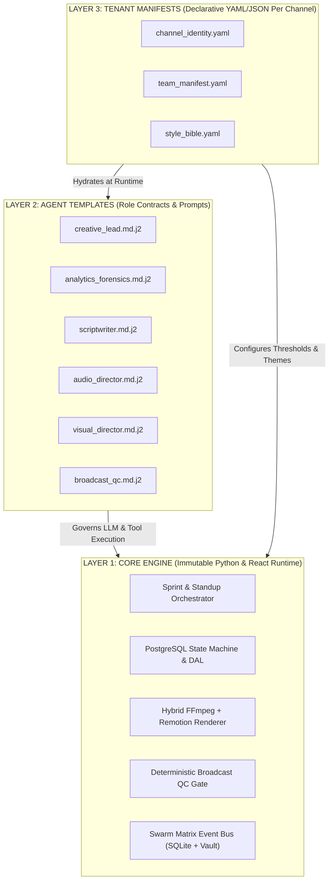

# 🏛️ DELIVERABLE 10: `10_VIRGIN_MASTER_BLUEPRINT.md`
## PHASE 9: VIRGIN MASTER TEMPLATE DESIGN (`OMNI_CHANNEL_AI_STUDIO`)

**Document Classification:** Principal AI Systems Architecture & Multi-Tenant Framework Blueprint  
**Source Baseline Audited:** DoniesDaily Autonomous Squad v2.0 (`/home/ubuntu/apps/ugc-lemonaru` & `/home/ubuntu/tools/doni_*.py`)  
**Target Architecture:** `OMNI_CHANNEL_AI_STUDIO` (v1.0 Virgin Master Template)  
**Audit Date:** 2026-11-06  

---

## 📋 EXECUTIVE SUMMARY

The audited **DoniesDaily (`@DoniesDaily`)** production system represents a mature, battle-tested autonomous media factory. It successfully integrates multi-agent standup deliberation (`doni_working_hours_standup.py`), continuous telemetry forensics (`ai_brain.doniesdaily_learnings`), speech-synced visual directing (`claude-opus-5-5-high`), word-level acoustic alignment (`ElevenLabs v4` + `Vivan` dataset harvesting), parametric React motion graphics (`Remotion DoniOverlay.tsx`), deterministic broadcast QC (`ffprobe` / `ebur128` / `blackdetect` in `doni_qc_gate.py`), and self-healing YouTube Data API v3 publishing (`youtube_api_publisher.py`).

However, the current implementation suffers from **monolithic niche coupling**:
1. **Hardcoded Domain Semantics:** Feline terminology (*"anabul"*, *"pawrents"*, *"si oren"*), phonetic dictionaries (`Flehmen` $\rightarrow$ `Fley-men`), and cat-specific prompt constraints are embedded directly inside Python executables (`tools/doni_scriptwriter.py`) and React components (`HookTitle.tsx`, `DoniOverlay.tsx`).
2. **Hardcoded Infrastructure & Identity Pointers:** Channel IDs (`UCNPtjF2aB0wvWHI0q7hhcCg`), Telegram Owner Chat IDs (`1357517232`), ElevenLabs Voice IDs (`ZowYWFat3iypr7PwKMPb`), and file prefixes (`doni-*-captions.json`, `asli_fahru_*`) are scattered across `/home/ubuntu/tools/` and `/home/ubuntu/apps/ugc-lemonaru/src/`.
3. **Single-Tenant Database Tables:** PostgreSQL tables (`ai_brain.doniesdaily_posts`, `ai_brain.doniesdaily_content_ideas`, etc.) are hardcoded into raw `docker exec -i supabase-db psql` subprocess strings.

This blueprint defines **`OMNI_CHANNEL_AI_STUDIO`**—a 100% decoupled, multi-tenant, white-label Virgin Master Template. It preserves every single "Iron Law" (*Hukum Besi #1–#15*) and self-healing mechanism of DoniesDaily while abstracting channel identity, agent personas, visual themes, and database state into declarative configuration schemas. Spinning up a new autonomous channel (e.g., Tech News, Personal Finance, Culinary Shorts, Automotive) requires **zero code changes**—only a new tenant manifest directory.

---

## 1. ARCHITECTURAL CORE PRINCIPLES

### 1.1 Zero Hardcoded Assumptions (The Clean-Room Mandate)
Every domain-specific artifact identified in the DoniesDaily audit is stripped from source code and moved to tenant-level configuration:

| Audited DoniesDaily Hardcoding | Current Location (Evidence) | Virgin Master Abstraction (`OMNI_CHANNEL_AI_STUDIO`) |
| :--- | :--- | :--- |
| Channel ID `UCNPtjF2aB0wvWHI0q7hhcCg` | `PRD_DONIESDAILY_MASTER_SPEC.md`, `ActiveContext.md` | `channel_identity.yaml` $\rightarrow$ `platform.youtube.channel_id` |
| Persona Names (`Doni`, `Mochi`, `Luna`, `Kak Ceria`, `Milo`, `Cleo`, `Vivan`) | `doni_working_hours_standup.py`, `agents_chat.db` | `team_manifest.yaml` $\rightarrow$ `agents.<role_id>.persona_name` |
| Niche Lexicon (*"anabul"*, *"pawrents"*) & Phonetics (`Flehmen` $\rightarrow$ `Fley-men`) | `tools/doni_scriptwriter.py` (`PHONETIC_DICTIONARY`), `voice.md` | `channel_identity.yaml` $\rightarrow$ `lexicon.phonetic_map` & `lexicon.banned_phrases` |
| ElevenLabs Voice ID `ZowYWFat3iypr7PwKMPb` / `d15jrIAARvF899pDoC6T` | `KAK_CERIA_SOUL.md`, `doni_remotion_flow_pipeline.py` | `channel_identity.yaml` $\rightarrow$ `audio.tts_profile.voice_id` |
| Remotion Defaults (`"🐱 FAKTA ANABUL VIRAL"`, `"@DoniesDaily"`, `"#FFE600"`) | `remotion/src/DoniOverlay.tsx`, `HookTitle.tsx` | `style_bible.yaml` $\rightarrow$ Injected via JSON props into `UniversalOverlay.tsx` |
| DB Table Names (`ai_brain.doniesdaily_*`) | `doni_production_sprint.py`, `doni_scriptwriter.py` | Parameterized SQL DAL with `tenant_id` & schema isolation (`omni_studio.*`) |
| Asset Prefixes (`asli_fahru_*`, `ai_gen_*`, `fahru_sent`) | `PRD_FAHRU_FOOTAGE_INGESTION_SOP.md`, `cat_assets_catalog.json` | `authentic_owner_*` vs `ai_synth_*` (`category: owner_authentic` vs `ai_generated`) |

### 1.2 Strict Separation of Concerns (The 3-Layer Triad)
The system is partitioned into three strictly isolated architectural layers:



1. **Core Orchestration Layer (`CORE/`):** Pure deterministic mechanics. Handles jitter scheduling (`check_and_consume_jitter_window`), PostgreSQL state transitions, FFmpeg filtergraphs, EBU R128 loudness normalization, 10-frame video ingestion, ProRes 4444 overlay caching, and OAuth token auto-healing. Knows **nothing** about the content niche.
2. **Team Manifest Layer (`team_manifest.yaml` + `AGENT_TEMPLATES/`):** Defines the organizational topology, RACI boundaries, LLM model assignments (e.g., `gemini-4-argon-high` for executive evaluation, `claude-sonnet-5-5-high` for scripting, `claude-opus-5-5-high` for Remotion scene cuts), temperature settings, and cron cadences.
3. **Channel Identity & Style Bible Layer (`channel_identity.yaml` + `style_bible.yaml`):** Defines the brand voice, target audience demographics, phonetic replacement dictionary, visual aesthetic zones, Remotion typography/color tokens, SFX reservoir mappings, and YouTube OAuth credential pointers.

### 1.3 Pluggable Engine Architecture (Adapter Pattern)
All external AI and media services are abstracted behind strict Python Protocol interfaces (`CORE/interfaces/`):

* **`LLMProviderInterface`:** Standardizes OpenAI-compatible chat completions (`CLIProxyAPI :8317`, OpenRouter, Anthropic Direct, Google Vertex) with structured JSON schema enforcement and automatic fallback routing.
* **`TTSProviderInterface`:** Standardizes voice synthesis + forced character/word timestamp extraction (`startMs`, `endMs`).
  * *Adapters:* `ElevenLabsV4Adapter` (with acoustic tag parsing `[curious]`, `[gasps]`), `CustomF5TTSAdapter` (using harvested `.wav` + `.lab` datasets from the Vivan Harvester), `CartesiaSonicAdapter`, `OpenAIAudioAdapter`.
* **`VisualSourceInterface`:** Standardizes B-roll acquisition and semantic matching.
  * *Adapters:* `LocalSemanticCatalogAdapter` (10-Frame Multi-Vision indexed pool with anti-fatigue scoring), `GoogleFlowCDPAdapter` (persistent Chrome CDP `:9222` Veo2 generation), `RunwayGen3Adapter`, `KlingAIAdapter`.
* **`PublisherInterface`:** Standardizes vertical video distribution and telemetry scraping.
  * *Adapters:* `YouTubeDataAPIv3Adapter` (with CDP OAuth Auto-Healer & Studio Advanced Mode scraper), `TikTokContentPostingAdapter`, `InstagramGraphAdapter`.

---

## 2. PROPOSED DIRECTORY & FILE ARCHITECTURE

Below is the complete, production-grade ASCII directory tree for `OMNI_CHANNEL_AI_STUDIO`:

```text
/opt/omni-channel-studio/                        # Canonical Root of Virgin Master Framework
├── pyproject.toml                               # Poetry/uv dependency lock (google-api-python-client, pydantic, jinja2, etc.)
├── .env.example                                 # Global infrastructure secrets template (DB_URL, CPA_API_KEY, etc.)
│
├── CORE/                                        # [LAYER 1] IMMUTABLE RUNTIME ENGINE (Zero Niche Coupling)
│   ├── __init__.py
│   ├── config_loader.py                         # Pydantic validator loading YAML manifests + Jinja2 soul renderer
│   ├── database/
│   │   ├── __init__.py
│   │   ├── connection.py                        # Asyncpg / psycopg3 connection pool (replaces raw docker exec psql)
│   │   ├── dal.py                               # Multi-tenant Data Access Layer (enforces tenant_id isolation)
│   │   └── state_machine.py                     # Enforces IDEA -> SCRIPT_READY -> AUDIO_READY -> VISUAL_READY -> QC_PASSED -> PUBLISHED
│   │
│   ├── orchestrators/
│   │   ├── __init__.py
│   │   ├── standup_orchestrator.py              # Generalized doni_working_hours_standup.py (2x daily learning & planning loop)
│   │   ├── sprint_orchestrator.py               # Generalized doni_production_sprint.py (jitter gate, 3x self-healing retry loop)
│   │   ├── jitter_scheduler.py                  # Organic timestamp pre-roller & daily quota guard
│   │   └── community_replier.py                 # Autonomous comment responder & engagement sniper
│   │
│   ├── interfaces/                              # Pluggable Engine Protocols (ABCs)
│   │   ├── llm_provider.py
│   │   ├── tts_provider.py
│   │   ├── visual_provider.py
│   │   └── publisher_provider.py
│   │
│   ├── adapters/                                # Concrete Pluggable Implementations
│   │   ├── llm/
│   │   │   └── cliproxy_openai_adapter.py       # Connects to CLIProxyAPI (:8317) supporting Argon-High, Opus-5.5, Sonnet-5.5
│   │   ├── tts/
│   │   │   ├── elevenlabs_v4_adapter.py         # Acoustic tag stripping, word-level forced alignment, speed/stability control
│   │   │   ├── local_voice_clone_adapter.py     # Zero-cost local inference using harvested fine-tuned voice datasets
│   │   │   └── dataset_harvester.py             # Generalized Vivan Harvester: slices 3-10s 24kHz mono WAV + .lab transcripts
│   │   ├── visual/
│   │   │   ├── semantic_catalog_matcher.py      # Opus-driven speech-beat scene director + gated category bias + anti-fatigue
│   │   │   ├── ten_frame_vision_ingestor.py     # Generalized Hukum Besi #14: 10-frame FFmpeg extractor + Gemini Vision tagger
│   │   │   └── google_flow_cdp_adapter.py       # Headless Xvfb Chrome CDP (:9222) generative video operator
│   │   └── publisher/
│   │       ├── youtube_api_v3_adapter.py        # Resumable upload, cover poster injection, custom thumbnail setter
│   │       ├── youtube_oauth_healer.py          # Automated CDP refresh token recovery
│   │       └── youtube_studio_telemetry.py      # Hybrid API v2 100-point retention curve + CDP Studio Advanced Mode scraper
│   │
│   ├── media/
│   │   ├── __init__.py
│   │   ├── hybrid_renderer.py                   # ProRes 4444 overlay caching, setpts force-fit guard, 3-layer audio ducking
│   │   ├── sfx_injection_engine.py              # Reads tenant sfx_catalog.json & injects micro-faded event audio
│   │   └── broadcast_qc_gate.py                 # Generalized Cleo QC: EBU R128 LUFS, blackdetect, duration drift, zero-loop assert
│   │
│   └── observability/
│       ├── __init__.py
│       ├── swarm_event_bus.py                   # Logs agent_messages & agent_traces to SQLite (agents_chat.db)
│       ├── vault_archivist.py                   # GRO v3.0 Obsidian Devlog, ActiveContext, & Sub-MOC markdown generator
│       └── notifier.py                          # Telegram / Matrix / Webhook executive briefing dispatcher
│
├── AGENT_TEMPLATES/                             # [LAYER 2] PARAMETERIZED JINJA2 AGENT SOULS & PROMPTS
│   ├── creative_lead.soul.md.j2                 # Generalized Doni: Executive Producer, State Governor, Verdict Judge
│   ├── analytics_forensics.soul.md.j2           # Generalized Mochi: Retention Curve Auditor, Learning Ledger Maintainer
│   ├── scriptwriter.soul.md.j2                  # Generalized Luna: Hook Engineer, Acoustic Punctuation Storyteller
│   ├── audio_director.soul.md.j2                # Generalized Kak Ceria: Vocal Dynamics Supervisor & Community Lead
│   ├── voice_synthesizer.soul.md.j2             # Generalized Vivan: Deterministic 0-Token Audio & Dataset Worker
│   ├── visual_director.soul.md.j2               # Generalized Milo: Cinematographer, Style Bible Guardian, Opus Cut Editor
│   └── broadcast_qc.soul.md.j2                  # Generalized Cleo: Zero-Compromise Broadcast Inspector
│
├── CONFIG_SCHEMAS/                              # [VALIDATION] JSON SCHEMAS FOR TENANT MANIFESTS
│   ├── team_manifest.schema.json                # Validates agent topology, LLM models, temperatures, & cron schedules
│   ├── channel_identity.schema.json             # Validates niche, voice profile, lexicon, rules, & platform credentials
│   └── style_bible.schema.json                  # Validates Remotion theme tokens, aesthetic zones, & pacing constraints
│
├── REMOTION_MASTER/                             # [VISUAL ENGINE] UNIVERSAL PARAMETRIC REACT REMOTION STUDIO
│   ├── package.json
│   ├── tsconfig.json
│   ├── remotion.config.ts
│   ├── public/                                  # Ephemeral render symlink pool (managed per-tenant at runtime)
│   └── src/
│       ├── index.ts
│       ├── Root.tsx                             # Registers UniversalOverlay, UniversalShort, & UniversalThumbnail (<Still />)
│       ├── schemas/
│       │   └── universalProps.schema.ts         # Zod schema accepting full Theme & Layout tokens dynamically
│       ├── utils/
│       │   └── dynamic-font-loader.ts           # Loads Google Fonts or local TTF specified in style_bible.yaml
│       ├── UniversalOverlay.tsx                 # Refactored DoniOverlay: 100% theme-driven transparent ProRes 4444 compositor
│       ├── UniversalThumbnail.tsx               # High-CTR Remotion <Still /> generator with dynamic badges & contrast strokes
│       └── components/
│           ├── ParametricHookBanner.tsx         # Spring-physics hook card with configurable colors, borders, & exit frame
│           ├── KineticWordCaptions.tsx          # Hormozi 1-word pop-up engine (combineTokensWithinMilliseconds: 0)
│           ├── ParametricWatermark.tsx          # Glassmorphism pill badge with configurable position & handle
│           ├── ParametricStoryCoverCard.tsx     # Configurable occlusion mask for repurposed video localization
│           └── ParametricOutroCTA.tsx           # Dynamic end-screen subscribe/follow modal
│
├── DATABASE/                                    # [PERSISTENCE] MULTI-TENANT POSTGRESQL & SQLITE MIGRATIONS
│   ├── migrations/
│   │   ├── 001_init_omni_studio_schema.sql      # Creates omni_studio schema, enums, & multi-tenant tables
│   │   ├── 002_row_level_tenant_isolation.sql   # RLS policies & composite indexes on (tenant_id, ...)
│   │   └── 003_seed_default_iron_laws.sql       # Seeds universal broadcast invariants into channel_learnings
│   └── sqlite/
│       └── init_swarm_chat.sql                  # Schema for agent_messages & agent_traces (VPS Control Center compatible)
│
├── SCRIPTS/                                     # [CLI TOOLING] LIFECYCLE & OPERATIONS UTILITIES
│   ├── clone_channel.py                         # Scaffolds a new tenant directory, DB tenant row, & Vault workspace in 5s
│   ├── team_generator.py                        # Compiles Jinja2 AGENT_TEMPLATES + tenant YAML into previewable Soul MDs
│   ├── ingest_footage.py                        # CLI wrapper for ten_frame_vision_ingestor.py (--tenant <id> --scan)
│   ├── hook_and_title_linter.py                 # Generalized hookscore.py & title.py packaging validator
│   └── audit_runner.py                          # Runs pre-flight diagnostic checks on OAuth, CDP, FFmpeg, & DB health
│
└── TENANTS/                                     # [LAYER 3] ISOLATED CHANNEL INSTANCES (Data & Config Only)
    ├── _template_virgin/                        # Clean starter template copied by clone_channel.py
    │   ├── channel_identity.yaml
    │   ├── team_manifest.yaml
    │   └── style_bible.yaml
    │
    ├── ch_doniesdaily/                          # Example Tenant 1: Migrated @DoniesDaily Cat Education Channel
    │   ├── channel_identity.yaml
    │   ├── team_manifest.yaml
    │   ├── style_bible.yaml
    │   ├── credentials/
    │   │   └── youtube_oauth.json
    │   └── assets/
    │       ├── video_catalog.json
    │       ├── sfx_catalog.json
    │       ├──clips_authentic/
    │       ├── clips_ai_renders/
    │       ├── audio_bgm/
    │       └── voice_dataset_harvest/
    │
    └── ch_techpulse_id/                         # Example Tenant 2: Indonesian AI & Gadget Shorts Channel
        ├── channel_identity.yaml
        ├── team_manifest.yaml
        ├── style_bible.yaml
        └── ...
```

---

## 3. UNIVERSAL CONFIGURATION SCHEMA SPECIFICATIONS

To eliminate hardcoded variables across Python scripts and React components, every tenant channel is governed by three strictly validated YAML configuration files (`team_manifest.yaml`, `channel_identity.yaml`, and `style_bible.yaml`).

### 3.1 `team_manifest.yaml` Specification & Schema
Defines the multi-agent squad hierarchy, model routing via `CLIProxyAPI`, temperature controls, and execution cadences.

```yaml
# TENANTS/<tenant_id>/team_manifest.yaml
schema_version: "1.0.0"
tenant_id: "ch_doniesdaily"
swarm_matrix:
  sqlite_db_path: "/home/ubuntu/vps-control-center/backend/data/agents_chat.db"
  primary_channel: "donies"
  executive_channel: "executive-board"
  obsidian_vault_workspace: "01_Business/doniesdaily"

llm_gateway:
  provider: "cliproxy_openai"
  base_url_env: "CPA_BASE_URL"          # Default: http://127.0.0.1:8317/v1/chat/completions
  api_key_env: "CPA_API_KEY"

cadence_schedule:
  timezone: "Asia/Jakarta"
  max_daily_posts: 3
  min_inter_post_hours: 4
  standup_meetings:
    - cron: "30 7,17 * * *"
      slot_name: "bi_daily_standup"
      timeout_seconds: 600
  production_sprints:
    - cron: "*/5 8 * * *"
      slot_name: "morning"
      mode: "standard_daily"
      jitter_window: { start_minute: 4, end_minute: 55, min_sec: 7, max_sec: 49 }
      timeout_seconds: 900
    - cron: "*/5 12 * * *"
      slot_name: "midday_serial"
      mode: "thematic_series"
      jitter_window: { start_minute: 4, end_minute: 25, min_sec: 7, max_sec: 49 }
      timeout_seconds: 900
    - cron: "*/5 18 * * *"
      slot_name: "evening"
      mode: "standard_daily"
      jitter_window: { start_minute: 4, end_minute: 55, min_sec: 7, max_sec: 49 }
      timeout_seconds: 900
  community_engagement:
    - cron: "0 8-22/2 * * *"
      slot_name: "comment_replier"
      timeout_seconds: 300

agents:
  creative_lead:
    agent_id: "lead_producer"
    persona_name: "Doni"
    avatar: "👑"
    role_title: "Executive Producer & State Governor"
    template_file: "creative_lead.soul.md.j2"
    llm_config:
      primary_model: "gemini-4-argon-high"
      fallback_model: "claude-opus-5-5-high"
      temperature: 0.40
      max_tokens: 4096
    duties:
      - "Audit Mochi telemetry forensics and issue executive format bans"
      - "Enforce state machine idempotency and YouTube API daily quota buffers"
      - "Deliver post-production broadcast verdict and 24h retention targets"

  analytics_forensics:
    agent_id: "analytics_head"
    persona_name: "Mochi"
    avatar: "📊"
    role_title: "Head of Advanced Analytics & Retention Forensics"
    template_file: "analytics_forensics.soul.md.j2"
    llm_config:
      primary_model: "gemini-4-argon-high"
      fallback_model: "claude-sonnet-5-5-high"
      temperature: 0.25
      max_tokens: 4096
    duties:
      - "Extract YouTube Studio Advanced Mode metrics + 100-point retention curves"
      - "Identify drop-off chasms (e.g. 4.8s-8.4s) and update channel_learnings table"

  scriptwriter:
    agent_id: "copywriter"
    persona_name: "Luna"
    avatar: "✍️"
    role_title: "Master Scriptwriter & Storyteller"
    template_file: "scriptwriter.soul.md.j2"
    llm_config:
      primary_model: "claude-sonnet-5-5-high"
      fallback_model: "gemini-4-argon-high"
      temperature: 0.65
      max_tokens: 8192
    duties:
      - "Draft 100% deduplicated scripts adhering to active database learnings"
      - "Embed acoustic emotion tags and 5-second re-hook bridges"

  audio_director:
    agent_id: "audio_lead"
    persona_name: "Kak Ceria"
    avatar: "🎙️"
    role_title: "Senior Voice Director & Community Lead"
    template_file: "audio_director.soul.md.j2"
    llm_config:
      primary_model: "claude-sonnet-5-5-high"
      fallback_model: "gemini-3.8-flash-high"
      temperature: 0.55
      max_tokens: 2048
    duties:
      - "Validate emotional tag diversity (zero whisper monotony)"
      - "Supervise voice_synthesizer sub-unit and lead viewer comment replies"

  voice_synthesizer:
    agent_id: "voice_worker"
    persona_name: "Vivan"
    avatar: "🎧"
    role_title: "Sub-Unit Voice Synthesis & Dataset Harvester"
    template_file: "voice_synthesizer.soul.md.j2"
    llm_config:
      primary_model: "deterministic_zero_token"
      temperature: 0.0
      max_tokens: 0
    duties:
      - "Synthesize TTS audio stem and word-level forced alignment JSON"
      - "Harvest clean 3-10s 24kHz mono WAV + .lab training pairs automatically"

  visual_director:
    agent_id: "visual_lead"
    persona_name: "Milo"
    avatar: "🎬"
    role_title: "Visual Director & Opus Remotion Editor"
    template_file: "visual_director.soul.md.j2"
    llm_config:
      primary_model: "claude-opus-5-5-high"
      vision_ingestion_model: "gemini-3.8-flash-high"
      temperature: 0.35
      max_tokens: 8192
    duties:
      - "Execute Speech-Beat Scene Cut Plan via Claude Opus with zero clip repetition"
      - "Render Remotion UniversalOverlay ProRes 4444 & Still Thumbnail"

  broadcast_qc:
    agent_id: "qc_gatekeeper"
    persona_name: "Cleo"
    avatar: "🛡️"
    role_title: "Automated Broadcast QC Inspector"
    template_file: "broadcast_qc.soul.md.j2"
    llm_config:
      primary_model: "deterministic_zero_token"
      temperature: 0.0
      max_tokens: 0
    duties:
      - "Enforce Iron Guard duration assert, EBU R128 LUFS, 0 black frames, and CTA presence"
```

### 3.2 `channel_identity.yaml` Specification & Schema
Encapsulates all domain knowledge, audience psychology, voice synthesis parameters, and publishing credentials.

```yaml
# TENANTS/<tenant_id>/channel_identity.yaml
schema_version: "1.0.0"
tenant_id: "ch_doniesdaily"

brand:
  display_name: "DoniesDaily"
  handle: "@DoniesDaily"
  niche_category: "Feline Psychology, Humor & Pet Education"
  primary_language: "id-ID"
  secondary_tag_language: "en-US"
  owner_name: "Fahru"
  owner_telegram_chat_id: "1357517232"

platform:
  youtube:
    channel_id: "UCNPtjF2aB0wvWHI0q7hhcCg"
    category_id: "15"                   # 15 = Pets & Animals, 28 = Science & Tech, 27 = Education
    oauth_credentials_path: "credentials/youtube_oauth.json"
    chrome_cdp_url: "http://127.0.0.1:9222"
    default_privacy: "public"
    made_for_kids: false
    default_tags:
      - "Shorts"
      - "Kucing"
      - "Cat"
      - "DoniesDaily"
      - "FaktaKucing"
      - "Anabul"
    mandatory_title_suffix: "#Shorts"

audience_persona:
  demographics: "Indonesian cat lovers, home pet owners (pawrents/babu kucing), age 15-35"
  tone_of_voice: "Warm, expressive, casual hangout friend (bahasa tongkrongan santai), curious, playful"
  scientific_rigor: "Evidence-based feline biology explained simply without clinical jargon; zero unverified medical claims"

script_constraints:
  modes:
    quick_fact:
      min_words: 35
      max_words: 45
      target_duration_sec: [18, 25]
    long_story:
      min_words: 108
      max_words: 130
      target_duration_sec: [45, 58]
  default_mode: "long_story"
  mandatory_structure:
    - phase: "hook"
      window_sec: [0.0, 3.5]
      directive: "Imperative prohibition ('JANGAN...') or shocking curiosity gap. Never start with passive 'Kenapa...'."
    - phase: "second_hook_bridge"
      window_sec: [4.0, 8.0]
      directive: "Insert a twist or open-loop mini-cliffhanger at 4.5s to bridge the 4.8s-8.4s swipe chasm."
    - phase: "core_value_payload"
      window_sec: [8.0, 44.0]
      directive: "Unpack 2-3 layered biological/psychological facts with relatable daily examples."
    - phase: "debate_and_cta"
      window_sec: [44.0, 56.0]
      directive: "Spark viewer comment debate followed immediately by mandatory spoken brand CTA."
  mandatory_spoken_cta:
    required_keywords: ["follow", "subscribe", "doniesdaily"]
    fallback_append_text: "Jangan lupa follow dan subscribe DoniesDaily ya!"

lexicon:
  signature_terms:
    - "Anabul"
    - "Si oren"
    - "Pawrents"
    - "Babu kucing"
    - "Ngadon roti"
    - "Slow blink"
    - "Pernah gak sih..."
    - "Eits!"
  banned_phrases:
    - "Tahukah kamu?"
    - "Pada dasarnya"
    - "Sebagai kesimpulan"
    - "Tentunya"
    - "Menarik untuk disimak"
    - "Sahabat sekalian"
    - "Kenapa kucing"
  strip_characters_from_captions:
    - ","
  phonetic_map:
    "\\bFlehmen\\b": "Fley-men"
    "\\bflehmen\\b": "fley-men"
    "\\bJacobson\\b": "Jekob-sen"
    "\\bjacobson\\b": "jekob-sen"
    "\\bHES-7\\b": "Hes Tujuh"
    "\\bFRAPs\\b": "Freps"
    "\\bzoomies\\b": "zuumis"
    "\\bZoomies\\b": "Zuumis"
    "\\bUV\\b": "Yu-Vi"
    "\\bHz\\b": "Hertz"
    "\\bCatnip\\b": "Ket-nip"

audio:
  tts_provider: "elevenlabs_v4"
  tts_profile:
    primary_voice_id: "ZowYWFat3iypr7PwKMPb"     # Vivan
    alternate_voice_id: "d15jrIAARvF899pDoC6T"   # Kak Ceria
    model_id: "eleven_turbo_v2_5"
    stability: 0.40
    similarity_boost: 0.75
    speed: 1.08
  allowed_emotion_tags:
    - "[curious]"
    - "[gasps]"
    - "[laughs]"
    - "[excited]"
    - "[sighs]"
    - "[whispers]"
  max_whisper_tag_count: 1
  dataset_harvester:
    enabled: true
    target_clip_count: 200
    min_clip_sec: 3.0
    max_clip_sec: 10.0
    sample_rate_hz: 24000
  mixing:
    bgm_file: "assets/audio_bgm/cat_playful_bgm.mp3"
    voice_volume_gain: 1.25
    voice_highpass_hz: 80
    bgm_volume_gain: 0.08
    original_clip_audio_gain: 0.0                # Overridden to 0.20-0.40 in series mode
  broadcast_qc_limits:
    target_lufs_min: -19.0
    target_lufs_max: -14.0
    true_peak_max_dbfs: -1.0
    max_audio_video_drift_sec: 0.5
    max_black_frame_duration_sec: 0.5
```

### 3.3 `style_bible.yaml` Specification & Schema
Governs visual cinematography, 10-frame ingestion taxonomy, pacing physics, and Remotion React overlay styling.

```yaml
# TENANTS/<tenant_id>/style_bible.yaml
schema_version: "1.0.0"
tenant_id: "ch_doniesdaily"

video_format:
  width: 1080
  height: 1920
  aspect_ratio: "9:16"
  fps: 30
  min_duration_sec: 15.0
  max_duration_sec: 59.5

editing_physics:
  zero_in_video_clip_repetition: true            # Hukum Besi #13
  zero_ffmpeg_stream_loop: true                  # Hukum Besi #13
  interleave_authentic_and_ai: true
  cut_pacing_sec:
    min_cut_sec: 2.5
    target_cut_sec: 3.6
    max_cut_sec: 4.5
  pattern_interrupt_mandatory_timestamps_sec: [4.5, 7.5]
  emergency_force_fit_max_stretch_ratio: 1.45    # setpts stretch guard if slice slightly > clip
  scoring_weights:
    owner_authentic_bonus: 12.0                  # Prioritizes authentic clips when semantically relevant
    ai_generated_penalty: -10.0                  # Relegates AI clips to fallback
    hook_segment_multiplier: 1.5
    climax_segment_multiplier: 1.3
    fatigue_recent_use_penalty: -15.0

vision_ingestion:
  frames_to_extract: 10                          # Hukum Besi #14 (9% to 91% duration)
  authentic_prefix: "asli_owner_"
  ai_prefix: "ai_gen_"
  allowed_emotions: ["santai", "penasaran", "marah", "takut", "lucu", "sedih", "berburu", "manja"]
  allowed_actions: ["tidur", "lari", "lompat", "makan", "gigit", "cakar", "bengong", "elus", "kepo"]

generative_visual_anchor:
  subject_anchor: "Expressive ginger tabby cat with white paws, big glowing eyes, soft glossy fur, 9:16 vertical."
  negative_constraints: "NO humans, NO human hands/fingers, NO extra limbs, NO anatomical distortion."
  aesthetic_zones:
    - id: "zone_a"
      name: "Living Room"
      prompt_suffix: "Thick cream plush carpet, modern sofa, warm golden hour sunlight."
    - id: "zone_b"
      name: "Modern Kitchen"
      prompt_suffix: "Clean marble kitchen counter, bright morning light reflections, glass cup."
    - id: "zone_c"
      name: "Bookshelf Window"
      prompt_suffix: "Aesthetic wooden bookshelf, window sill with soft raindrops outside."
    - id: "zone_d"
      name: "Cozy Bedroom"
      prompt_suffix: "Thick linen blanket, soft pastel pillows, warm ambient bedside lamp."
    - id: "zone_e"
      name: "Sunlit Terrace"
      prompt_suffix: "Semi-outdoor wooden deck, green monstera pot, natural sunlight."

remotion_theme:
  typography:
    primary_font_family: "TheBoldFont"           # Or Google Font e.g. "Lilita One", "Montserrat"
    font_url: "static/fonts/TheBoldFont.ttf"
    story_card_font_family: "Georgia, serif"
  watermark:
    enabled: true
    icon: "🐾"
    text: "@DoniesDaily"
    position: "top-right"                        # top-right | top-left | bottom-right
    top_px: 48
    right_px: 32
    opacity: 0.85
  hook_banner:
    enabled: true
    default_badge_text: "🐱 FAKTA ANABUL VIRAL"
    badge_bg_color: "#FBBF24"                    # Amber-400
    badge_text_color: "#000000"
    card_bg_color: "rgba(0, 0, 0, 0.85)"
    card_border_color: "#FCD34D"                 # Amber-300
    title_text_color: "#FFFFFF"
    subtitle_text_color: "#FCD34D"
    enter_spring: { damping: 12, mass: 0.8, stiffness: 140 }
    exit_start_frame: 75                         # 2.5s at 30fps
    exit_end_frame: 95                           # 3.16s at 30fps
  kinetic_captions:
    combine_tokens_ms: 0                         # Hukum Besi #8 & #15: 0ms = Strict 1-Word Pop-Up
    active_word_color: "#FFE600"                 # Neon Yellow
    inactive_word_color: "#FFFFFF"
    stroke_color: "#000000"
    stroke_width_px: 20
    font_size_px: 72
    default_bottom_px: 340
    story_mode_bottom_px: 210
  outro_cta:
    enabled: true
    duration_Before_end_sec: 4.5
    subheadline_text: "🐾 JANGAN SAMPAI KETINGGALAN!"
    subheadline_color: "#EF4444"
    headline_text: "FOLLOW & SUBSCRIBE!"
    button_text: "@DONIESDAILY"
    button_emoji: "👇"
    accent_border_color: "#FBBF24"
  thumbnail_still:
    inject_as_opening_poster_sec: 0.08
```

---

## 4. PARAMETRIC REMOTION REACT ENGINE BLUEPRINT

In the audited codebase, `remotion/src/DoniOverlay.tsx`, `HookTitle.tsx`, and `OutroCTA.tsx` contain hardcoded strings (`"🔥 RACUN TIKTOK OOTD"`, `"CHECKOUT SEKARANG!"`, `"🐾 @DoniesDaily"`, `"🐱 FAKTA ANABUL VIRAL"`) and static Tailwind classes (`border-amber-300`, `top-28`).

Below is the refactored, 100% parametric **`UniversalOverlay.tsx`** and its Zod schema contract (`universalProps.schema.ts`), enabling any tenant channel to inject its complete visual identity at render time via `--props`.

### 4.1 `REMOTION_MASTER/src/schemas/universalProps.schema.ts`

```typescript
import { z } from "zod";

export const themeConfigSchema = z.object({
  fontFamily: z.string().default("TheBoldFont"),
  watermark: z.object({
    enabled: z.boolean().default(true),
    icon: z.string().default("🐾"),
    text: z.string().default("@ChannelHandle"),
    topPx: z.number().default(48),
    rightPx: z.number().default(32),
    targetOpacity: z.number().default(0.85),
  }),
  hookBanner: z.object({
    enabled: z.boolean().default(true),
    badgeText: z.string().default("🔥 VIRAL FACT"),
    badgeBgColor: z.string().default("#FBBF24"),
    badgeTextColor: z.string().default("#000000"),
    cardBgColor: z.string().default("rgba(0, 0, 0, 0.85)"),
    cardBorderColor: z.string().default("#FCD34D"),
    titleColor: z.string().default("#FFFFFF"),
    subtitleColor: z.string().default("#FCD34D"),
    exitStartFrame: z.number().default(75),
    exitEndFrame: z.number().default(95),
  }),
  captions: z.object({
    combineTokensMs: z.number().default(0), // 0 = Strict 1-word Hormozi kinetic pop-up
    activeWordColor: z.string().default("#FFE600"),
    inactiveWordColor: z.string().default("#FFFFFF"),
    strokeColor: z.string().default("#000000"),
    strokeWidthPx: z.number().default(20),
    fontSizePx: z.number().default(72),
    bottomPx: z.number().default(340),
  }),
  outroCTA: z.object({
    enabled: z.boolean().default(true),
    durationSec: z.number().default(4.5),
    subheadline: z.string().default("⚡ DONT MISS OUT"),
    subheadlineColor: z.string().default("#EF4444"),
    headline: z.string().default("FOLLOW & SUBSCRIBE!"),
    buttonText: z.string().default("SUBSCRIBE NOW"),
    buttonEmoji: z.string().default("👇"),
    accentColor: z.string().default("#FBBF24"),
  }),
});

export const universalOverlaySchema = z.object({
  hookTitle: z.string(),
  hookSubtitle: z.string().optional(),
  captionsFile: z.string(),
  durationInSeconds: z.number().default(50.0),
  storyCard: z
    .object({
      text: z.string(),
      durationInSeconds: z.number(),
      bottomPx: z.number().default(430),
      backgroundColor: z.string().default("#FFFFFF"),
      textColor: z.string().default("#0F172A"),
    })
    .optional(),
  sfxEvents: z
    .array(
      z.object({
        file: z.string(),
        triggerMs: z.number(),
        volume: z.number().default(0.6),
      })
    )
    .default([]),
  theme: themeConfigSchema.default({}),
});

export type UniversalOverlayProps = z.infer<typeof universalOverlaySchema>;
```

### 4.2 `REMOTION_MASTER/src/UniversalOverlay.tsx`

```tsx
import { Caption, createTikTokStyleCaptions } from "@remotion/captions";
import React, { useEffect, useMemo, useState } from "react";
import {
  AbsoluteFill,
  Audio,
  CalculateMetadataFunction,
  interpolate,
  Sequence,
  staticFile,
  useCurrentFrame,
  useDelayRender,
  useVideoConfig,
} from "remotion";
import { UniversalOverlayProps } from "./schemas/universalProps.schema";
import { loadDynamicFont } from "./utils/dynamic-font-loader";
import { ParametricHookBanner } from "./components/ParametricHookBanner";
import { KineticWordCaptions } from "./components/KineticWordCaptions";
import { ParametricOutroCTA } from "./components/ParametricOutroCTA";
import { ParametricStoryCoverCard } from "./components/ParametricStoryCoverCard";

export const calculateUniversalOverlayMetadata: CalculateMetadataFunction<
  UniversalOverlayProps
> = async ({ props }) => {
  const fps = 30;
  return {
    fps,
    durationInFrames: Math.round((props.durationInSeconds ?? 50.0) * fps),
  };
};

export const UniversalOverlay: React.FC<UniversalOverlayProps> = ({
  hookTitle,
  hookSubtitle,
  captionsFile,
  durationInSeconds,
  storyCard,
  sfxEvents,
  theme,
}) => {
  const { delayRender, continueRender } = useDelayRender();
  const [handle] = useState(() => delayRender());
  const [captions, setCaptions] = useState<Caption[]>([]);
  const { fps } = useVideoConfig();
  const frame = useCurrentFrame();

  useEffect(() => {
    Promise.all([
      loadDynamicFont(theme.fontFamily),
      fetch(staticFile(captionsFile))
        .then((res) => res.json())
        .then((data) => setCaptions(data))
        .catch(() => setCaptions([])),
    ])
      .then(() => continueRender(handle))
      .catch(() => continueRender(handle));
  }, [captionsFile, theme.fontFamily, continueRender, handle]);

  const { pages } = useMemo(() => {
    return createTikTokStyleCaptions({
      combineTokensWithinMilliseconds: theme.captions.combineTokensMs,
      captions: captions ?? [],
    });
  }, [captions, theme.captions.combineTokensMs]);

  const watermarkOpacity = interpolate(
    frame,
    [0, 20],
    [0, theme.watermark.targetOpacity],
    { extrapolateRight: "clamp" }
  );

  const totalFrames = Math.round(durationInSeconds * fps);
  const outroStartFramesFromEnd = Math.round(theme.outroCTA.durationSec * fps);

  return (
    <AbsoluteFill
      className="overflow-hidden select-none"
      style={{ backgroundColor: "transparent" }}
    >
      {/* 1. PARAMETRIC CHANNEL WATERMARK */}
      {theme.watermark.enabled && (
        <div
          style={{
            fontFamily: theme.fontFamily,
            opacity: watermarkOpacity,
            top: `${theme.watermark.topPx}px`,
            right: `${theme.watermark.rightPx}px`,
          }}
          className="absolute bg-black/60 backdrop-blur-sm border border-white/20 px-4 py-1.5 rounded-full text-white text-lg tracking-wider flex items-center gap-2 pointer-events-none"
        >
          <span>{theme.watermark.icon}</span>
          <span>{theme.watermark.text}</span>
        </div>
      )}

      {/* 2. PARAMETRIC HOOK BANNER */}
      {theme.hookBanner.enabled && (
        <ParametricHookBanner
          title={hookTitle}
          subtitle={hookSubtitle}
          fontFamily={theme.fontFamily}
          config={theme.hookBanner}
        />
      )}

      {/* 3. OPTIONAL REPURPOSED VIDEO STORY OCCLUSION CARD */}
      {storyCard && (
        <ParametricStoryCoverCard
          text={storyCard.text}
          durationInSeconds={storyCard.durationInSeconds}
          bottom={storyCard.bottomPx}
          backgroundColor={storyCard.backgroundColor}
          textColor={storyCard.textColor}
        />
      )}

      {/* 4. SINGLE-WORD KINETIC CAPTIONS */}
      {pages.map((page, index) => {
        const nextPage = pages[index + 1] ?? null;
        const startFrame = (page.startMs / 1000) * fps;
        const endFrame = nextPage
          ? Math.min((nextPage.startMs / 1000) * fps, startFrame + 2.5 * fps)
          : startFrame + 2.5 * fps;
        const durationInFrames = Math.max(1, Math.round(endFrame - startFrame));

        return (
          <Sequence
            key={index}
            from={Math.round(startFrame)}
            durationInFrames={durationInFrames}
          >
            <KineticWordCaptions
              page={page}
              fontFamily={theme.fontFamily}
              config={theme.captions}
            />
          </Sequence>
        );
      })}

      {/* 5. FRAME-ACCURATE SFX AUDIO TRIGGERS */}
      {sfxEvents.map((sfx, idx) => (
        <Sequence
          key={`sfx-${idx}`}
          from={Math.round((sfx.triggerMs / 1000) * fps)}
        >
          <Audio src={staticFile(sfx.file)} volume={sfx.volume} />
        </Sequence>
      ))}

      {/* 6. MANDATORY OUTRO CTA MODAL */}
      {theme.outroCTA.enabled && (
        <ParametricOutroCTA
          fontFamily={theme.fontFamily}
          startFromEndFrames={outroStartFramesFromEnd}
          config={theme.outroCTA}
        />
      )}
    </AbsoluteFill>
  );
};
```

---

## 5. DATABASE UNIVERSALIZATION SCHEMA

### 5.1 Multi-Tenant Isolation Strategy
In the audited DoniesDaily system, tables were prefixed per channel inside the `ai_brain` schema (`ai_brain.doniesdaily_posts`, `ai_brain.doniesdaily_content_ideas`, etc.). Scaling to 10+ channels under that pattern causes severe schema bloat and requires dynamic table-name string interpolation in SQL queries.

**The Virgin Master Solution (`Hybrid Tenant-ID + RLS Isolation`):**
1. **Dedicated Schema (`omni_studio`):** All studio tables reside in a clean `omni_studio` schema.
2. **Central Registry (`omni_studio.tenants`):** Every channel is registered with a unique `tenant_id` (e.g., `'ch_doniesdaily'`, `'ch_techpulse'`, `'ch_finance'`).
3. **Composite Unique Constraints & B-Tree Indexing:** Every operational table includes `tenant_id TEXT NOT NULL REFERENCES omni_studio.tenants(tenant_id)` as the leading column in composite indexes and unique constraints (e.g., `UNIQUE (tenant_id, topic_key)`).
4. **PostgreSQL Row-Level Security (RLS):** Connections initialized for a specific tenant worker execute `SET app.current_tenant = 'ch_doniesdaily';`, guaranteeing at the database kernel level that Tenant A can never read, mutate, or collide with Tenant B's topics, learnings, or clip usage ledgers.

### 5.2 Complete SQL Migration (`001_init_omni_studio_schema.sql`)

```sql
-- ============================================================================
-- OMNI_CHANNEL_AI_STUDIO : UNIVERSAL MULTI-TENANT DATABASE SCHEMA
-- Replaces single-tenant ai_brain.doniesdaily_* tables
-- ============================================================================

CREATE SCHEMA IF NOT EXISTS omni_studio;

-- 1. Production Stage Enum
DO $$ BEGIN
    CREATE TYPE omni_studio.production_stage AS ENUM (
        'IDEA_SELECTED',
        'SCRIPT_READY',
        'AUDIO_READY',
        'VISUAL_READY',
        'RENDER_READY',
        'QC_PASSED',
        'QC_FAILED',
        'BLOCKED_QUOTA',
        'PUBLISHED'
    );
EXCEPTION
    WHEN duplicate_object THEN null;
END $$;

-- 2. Master Tenant Registry
CREATE TABLE IF NOT EXISTS omni_studio.tenants (
    tenant_id           TEXT PRIMARY KEY,               -- e.g. 'ch_doniesdaily', 'ch_techpulse'
    display_name        TEXT NOT NULL,
    youtube_channel_id  TEXT UNIQUE,
    manifest_dir_path   TEXT NOT NULL,
    status              TEXT NOT NULL DEFAULT 'active', -- 'active', 'paused', 'archived'
    created_at          TIMESTAMPTZ NOT NULL DEFAULT now(),
    updated_at          TIMESTAMPTZ NOT NULL DEFAULT now()
);

-- 3. Universal Content Ideas Backlog (Replaces doniesdaily_content_ideas)
CREATE TABLE IF NOT EXISTS omni_studio.channel_content_ideas (
    id                  UUID PRIMARY KEY DEFAULT gen_random_uuid(),
    tenant_id           TEXT NOT NULL REFERENCES omni_studio.tenants(tenant_id) ON DELETE CASCADE,
    topic_key           TEXT NOT NULL,
    series_key          TEXT DEFAULT NULL,              -- NULL for standard daily, 'spook_part_1' for midday serial
    title               TEXT NOT NULL,
    hook_banner         TEXT NOT NULL,
    hook_subtitle       TEXT DEFAULT '',
    hook_vocal          TEXT NOT NULL,
    full_script         TEXT NOT NULL,
    scene_breakdown     JSONB DEFAULT '[]'::jsonb,
    flow_prompts        JSONB DEFAULT '[]'::jsonb,
    sound_fx            JSONB DEFAULT '[]'::jsonb,
    status              TEXT NOT NULL DEFAULT 'ready',  -- 'ready', 'in_progress', 'published', 'rejected'
    created_at          TIMESTAMPTZ NOT NULL DEFAULT now(),
    updated_at          TIMESTAMPTZ NOT NULL DEFAULT now(),
    CONSTRAINT uq_tenant_topic_key UNIQUE (tenant_id, topic_key)
);
CREATE INDEX idx_ideas_tenant_status ON omni_studio.channel_content_ideas(tenant_id, status, created_at ASC);

-- 4. Universal Production Queue & State Machine (Replaces doniesdaily_production_queue)
CREATE TABLE IF NOT EXISTS omni_studio.channel_production_queue (
    id                      UUID PRIMARY KEY DEFAULT gen_random_uuid(),
    tenant_id               TEXT NOT NULL REFERENCES omni_studio.tenants(tenant_id) ON DELETE CASCADE,
    topic_key               TEXT NOT NULL,
    title                   TEXT NOT NULL,
    current_stage           omni_studio.production_stage NOT NULL DEFAULT 'IDEA_SELECTED',
    audio_path              TEXT,
    caption_path            TEXT,
    background_video_path   TEXT,
    remotion_overlay_cache  TEXT,                       -- Cached /tmp/{tenant}_{topic}_overlay.mov
    rendered_master_path    TEXT,
    youtube_video_id        TEXT,
    qc_report               JSONB NOT NULL DEFAULT '{}'::jsonb,
    error_message           TEXT,
    retry_count             INTEGER NOT NULL DEFAULT 0,
    created_at              TIMESTAMPTZ NOT NULL DEFAULT now(),
    updated_at              TIMESTAMPTZ NOT NULL DEFAULT now(),
    CONSTRAINT uq_queue_tenant_topic UNIQUE (tenant_id, topic_key)
);
CREATE INDEX idx_queue_tenant_stage ON omni_studio.channel_production_queue(tenant_id, current_stage);

-- 5. Universal Published Posts & Retention Telemetry (Replaces doniesdaily_posts)
CREATE TABLE IF NOT EXISTS omni_studio.channel_posts (
    id                      UUID PRIMARY KEY DEFAULT gen_random_uuid(),
    tenant_id               TEXT NOT NULL REFERENCES omni_studio.tenants(tenant_id) ON DELETE CASCADE,
    video_id                TEXT NOT NULL,
    topic_key               TEXT,
    title                   TEXT NOT NULL,
    hook                    TEXT,
    story_text              TEXT,
    banner_title            TEXT,
    tags                    TEXT[],
    duration_sec            NUMERIC(6,2),
    clips_used              TEXT[],
    privacy_status          TEXT NOT NULL DEFAULT 'public',
    short_url               TEXT NOT NULL,
    posted_at               TIMESTAMPTZ NOT NULL DEFAULT now(),
    views_count             INTEGER NOT NULL DEFAULT 0,
    likes_count             INTEGER NOT NULL DEFAULT 0,
    stayed_to_watch_pct     NUMERIC(5,2),
    engaged_views           INTEGER,
    avg_view_duration_sec   NUMERIC(6,2),
    avg_view_pct            NUMERIC(6,2),
    subs_gained             INTEGER NOT NULL DEFAULT 0,
    end_retention_pct       NUMERIC(5,2),
    biggest_drop_sec        NUMERIC(6,2),
    retention_curve_json    JSONB,
    created_at              TIMESTAMPTZ NOT NULL DEFAULT now(),
    CONSTRAINT uq_posts_tenant_video UNIQUE (tenant_id, video_id)
);
CREATE INDEX idx_posts_tenant_posted_at ON omni_studio.channel_posts(tenant_id, posted_at DESC);

-- 6. Universal Telemetry Snapshot History (Replaces doniesdaily_metrics_history)
CREATE TABLE IF NOT EXISTS omni_studio.channel_metrics_history (
    id                      BIGSERIAL PRIMARY KEY,
    tenant_id               TEXT NOT NULL REFERENCES omni_studio.tenants(tenant_id) ON DELETE CASCADE,
    video_id                TEXT NOT NULL,
    title                   TEXT NOT NULL,
    snapshot_hours          INTEGER NOT NULL,
    views_count             INTEGER NOT NULL DEFAULT 0,
    likes_count             INTEGER NOT NULL DEFAULT 0,
    comments_count          INTEGER NOT NULL DEFAULT 0,
    duration_sec            NUMERIC(6,2),
    stayed_to_watch_pct     NUMERIC(5,2),
    engaged_views           INTEGER,
    avg_view_duration_sec   NUMERIC(6,2),
    avg_view_pct            NUMERIC(6,2),
    subs_gained             INTEGER NOT NULL DEFAULT 0,
    end_retention_pct       NUMERIC(5,2),
    biggest_drop_sec        NUMERIC(6,2),
    captured_at             TIMESTAMPTZ NOT NULL DEFAULT now()
);
CREATE INDEX idx_metrics_tenant_video ON omni_studio.channel_metrics_history(tenant_id, video_id, captured_at DESC);

-- 7. Universal Self-Improving Learning Ledger (Replaces doniesdaily_learnings)
CREATE TABLE IF NOT EXISTS omni_studio.channel_learnings (
    id                  BIGSERIAL PRIMARY KEY,
    tenant_id           TEXT NOT NULL REFERENCES omni_studio.tenants(tenant_id) ON DELETE CASCADE,
    category            TEXT NOT NULL,                  -- 'title_hook', 'script_structure', 'visual_footage', 'cadence_interval'
    rule_name           TEXT NOT NULL,
    directive           TEXT NOT NULL,
    rationale           TEXT NOT NULL,
    confidence_score    NUMERIC(4,2) NOT NULL DEFAULT 0.50,
    status              TEXT NOT NULL DEFAULT 'active', -- 'active', 'superseded', 'disabled'
    created_at          TIMESTAMPTZ NOT NULL DEFAULT now(),
    updated_at          TIMESTAMPTZ NOT NULL DEFAULT now(),
    CONSTRAINT uq_learnings_tenant_rule UNIQUE (tenant_id, rule_name)
);
CREATE INDEX idx_learnings_tenant_active ON omni_studio.channel_learnings(tenant_id, status, confidence_score DESC);

-- 8. Universal Anti-Fatigue Clip Usage Ledger (Replaces doniesdaily_clip_usage)
CREATE TABLE IF NOT EXISTS omni_studio.channel_clip_usage (
    id                  BIGSERIAL PRIMARY KEY,
    tenant_id           TEXT NOT NULL REFERENCES omni_studio.tenants(tenant_id) ON DELETE CASCADE,
    clip_name           TEXT NOT NULL,
    clip_path           TEXT NOT NULL,
    topic_key           TEXT NOT NULL,
    video_id            TEXT,
    used_at             TIMESTAMPTZ NOT NULL DEFAULT now()
);
CREATE INDEX idx_clip_usage_tenant_clip ON omni_studio.channel_clip_usage(tenant_id, clip_name, used_at DESC);

-- 9. Universal Community Sniper & Engagement Ledger (Replaces doniesdaily_sniper_logs)
CREATE TABLE IF NOT EXISTS omni_studio.channel_sniper_logs (
    id                  UUID PRIMARY KEY DEFAULT gen_random_uuid(),
    tenant_id           TEXT NOT NULL REFERENCES omni_studio.tenants(tenant_id) ON DELETE CASCADE,
    video_id            TEXT NOT NULL,
    video_title         TEXT,
    channel_title       TEXT,
    comment_text        TEXT NOT NULL,
    comment_id          TEXT,
    created_at          TIMESTAMPTZ NOT NULL DEFAULT now(),
    CONSTRAINT uq_sniper_tenant_video UNIQUE (tenant_id, video_id)
);

-- 10. Row-Level Security (RLS) Tenant Isolation Policy
ALTER TABLE omni_studio.channel_content_ideas ENABLE ROW LEVEL SECURITY;
ALTER TABLE omni_studio.channel_production_queue ENABLE ROW LEVEL SECURITY;
ALTER TABLE omni_studio.channel_posts ENABLE ROW LEVEL SECURITY;
ALTER TABLE omni_studio.channel_metrics_history ENABLE ROW LEVEL SECURITY;
ALTER TABLE omni_studio.channel_learnings ENABLE ROW LEVEL SECURITY;
ALTER TABLE omni_studio.channel_clip_usage ENABLE ROW LEVEL SECURITY;
ALTER TABLE omni_studio.channel_sniper_logs ENABLE ROW LEVEL SECURITY;

CREATE POLICY tenant_isolation_policy ON omni_studio.channel_content_ideas
    USING (tenant_id = current_setting('app.current_tenant', true));
CREATE POLICY tenant_isolation_policy ON omni_studio.channel_production_queue
    USING (tenant_id = current_setting('app.current_tenant', true));
CREATE POLICY tenant_isolation_policy ON omni_studio.channel_posts
    USING (tenant_id = current_setting('app.current_tenant', true));
CREATE POLICY tenant_isolation_policy ON omni_studio.channel_metrics_history
    USING (tenant_id = current_setting('app.current_tenant', true));
CREATE POLICY tenant_isolation_policy ON omni_studio.channel_learnings
    USING (tenant_id = current_setting('app.current_tenant', true));
CREATE POLICY tenant_isolation_policy ON omni_studio.channel_clip_usage
    USING (tenant_id = current_setting('app.current_tenant', true));
CREATE POLICY tenant_isolation_policy ON omni_studio.channel_sniper_logs
    USING (tenant_id = current_setting('app.current_tenant', true));
```

---

## 6. RAPID CHANNEL CLONING WORKFLOW (`SCRIPTS/clone_channel.py`)

With the `OMNI_CHANNEL_AI_STUDIO` Virgin Master architecture in place, launching a brand-new autonomous YouTube Shorts vertical requires **zero code copying** and executes in 4 deterministic steps:

```bash
# Step 1: Scaffold a new tenant from the Virgin Master template
python3 /opt/omni-channel-studio/SCRIPTS/clone_channel.py \
  --tenant-id "ch_techpulse_id" \
  --display-name "TechPulse Indonesia" \
  --niche "AI Gadgets, Cybersecurity & Future Tech" \
  --swarm-channel "techpulse" \
  --vault-workspace "01_Business/techpulse"
```

What `clone_channel.py` performs automatically:
1. **Creates Tenant Directory:** Copies `TENANTS/_template_virgin/` $\rightarrow$ `TENANTS/ch_techpulse_id/` and populates `channel_identity.yaml`, `team_manifest.yaml`, and `style_bible.yaml`.
2. **Registers Database Tenant & Seeds Core Invariants:** Inserts `'ch_techpulse_id'` into `omni_studio.tenants` and seeds universal retention rules (e.g., *5-Second Open-Loop Rehook*, *Zero In-Video Clip Repetition*, *1-Word Kinetic Captions*) into `omni_studio.channel_learnings`.
3. **Compiles Agent Souls:** Runs `SCRIPTS/team_generator.py --tenant ch_techpulse_id` to hydrate the Jinja2 templates in `AGENT_TEMPLATES/` with the new squad's personas and niche boundaries.
4. **Registers Unified Cadence Tasks:** Appends the tenant's standup (`30 7,17 * * *`) and randomized jitter sprint jobs (`--tenant ch_techpulse_id --slot morning|midday_serial|evening`) into `ai_brain.cadence_tasks`.

---

## 7. AUDIT VERIFICATION MATRIX: IRON LAWS PRESERVED

| Iron Law (*Hukum Besi*) | Audited DoniesDaily Implementation | Virgin Master (`OMNI_CHANNEL_AI_STUDIO`) Equivalent |
| :--- | :--- | :--- |
| **#1 Zero External Scraping** | Only `/fahru_clips/` or Google Flow AI | Enforced by `semantic_catalog_matcher.py` reading tenant's `assets/clips_authentic/` & `clips_ai_renders/` |
| **#2 Semantic Asset Naming** | `{slug}.mp4` snake_case | Enforced by `ten_frame_vision_ingestor.py` with configurable `authentic_prefix` & `ai_prefix` |
| **#3 Master Clock Audio** | `dur_video >= dur_audio - 0.1` | Enforced in `CORE/media/broadcast_qc_gate.py` + `setpts` force-fit stretch guard |
| **#4 Zero Whisper Monoton** | Max 1 `[whispers]`, dynamic v4 tags | Enforced via `channel_identity.yaml` $\rightarrow$ `audio.allowed_emotion_tags` & `max_whisper_tag_count` |
| **#5 Disk Hygiene (ProRes Purge)** | Cached during retry, unlinked post-upload | Managed by `CORE/media/hybrid_renderer.py` tracking `remotion_overlay_cache` in DB |
| **#6 & #7 DB Deduplication & Reconcile** | `doniesdaily_content_ideas` & `posts` | Enforced via `omni_studio.channel_content_ideas` & `channel_posts` with composite `(tenant_id, topic_key)` |
| **#8 & #15 Single-Word Kinetic & CTA** | `SWITCH_CAPTIONS_EVERY_MS = 0` + Outro | Parameterized in `UniversalOverlay.tsx` (`combineTokensMs: 0`) & `broadcast_qc_gate.py` (`audit_script_and_outro`) |
| **#9 Full Swarm & Vault Transparency** | `agents_chat.db` + Obsidian Vault | Built into `CORE/observability/swarm_event_bus.py` & `vault_archivist.py` |
| **#10 Remotion Still & Cover Injection** | `<Still id="DoniThumbnail" />` + 0.08s | Standardized in `UniversalThumbnail.tsx` + `inject_as_opening_poster_sec: 0.08` |
| **#11 Continuous Learning Loop** | Mochi Studio Advanced Mode + API v2 | Standardized in `youtube_studio_telemetry.py` writing to `omni_studio.channel_learnings` |
| **#12 Executive Leadership Verdict** | Doni `gemini-4-argon-high` 2-stage audit | Standardized in `CORE/orchestrators/standup_orchestrator.py` & `sprint_orchestrator.py` |
| **#13 Zero In-Video Repetition & Opus Cuts** | `claude-opus-5-5-high` Speech-Beat Director | Standardized in `CORE/adapters/visual/semantic_catalog_matcher.py` |
| **#14 10-Frame Multi-Vision Ingestion** | `tools/ingest_fahru_footage.py` | Standardized in `CORE/adapters/visual/ten_frame_vision_ingestor.py` |