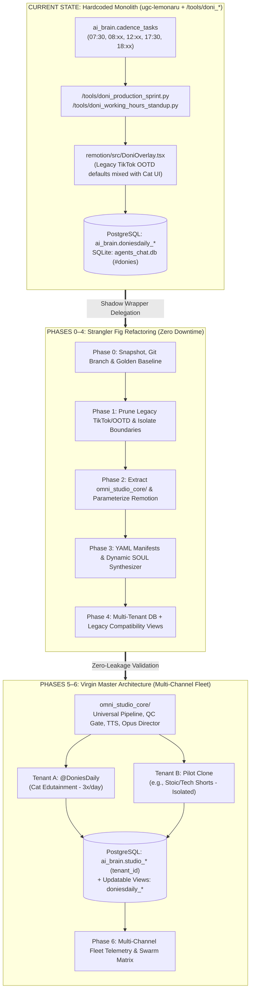
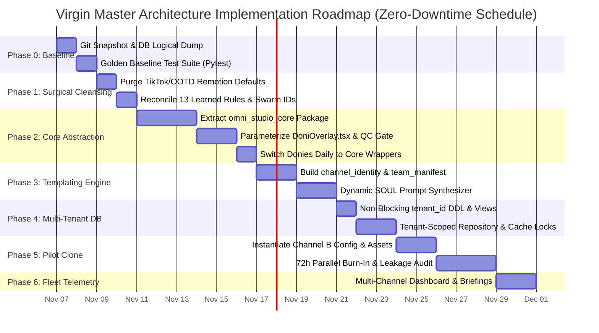

# 🗺️ DELIVERABLE 13: `13_IMPLEMENTATION_ROADMAP.md`
## RECOMMENDED IMPLEMENTATION PHASES & DEPENDENCY BLUEPRINT

---

### 📋 DOCUMENT METADATA & AUDIT CLASSIFICATION
| Field | Value |
| :--- | :--- |
| **Document ID** | `DELIVERABLE-13-IMPLEMENTATION-ROADMAP` |
| **Target System** | Donies Daily (`@DoniesDaily` / `UCNPtjF2aB0wvWHI0q7hhcCg`) ➔ **Virgin Master Architecture (`omni_studio_core`)** |
| **Canonical Root** | `/home/ubuntu/apps/ugc-lemonaru/` & `/home/ubuntu/tools/` |
| **Database Engine** | PostgreSQL (`supabase-db` Docker container, schema `ai_brain`) + SQLite (`agents_chat.db`) |
| **Operational Axiom** | **ZERO DOWNTIME FOR LIVE DONIES DAILY (3 Shorts/Day Uninterrupted)** |
| **Audit Basis** | Evidence-grounded reverse engineering of `PRD_DONIESDAILY_MASTER_SPEC.md`, `ActiveContext.md`, PostgreSQL `ai_brain.*` schemas, Remotion TSX components, and Python orchestration scripts. |

---

## 1. GUIDING AXIOM: ZERO DOWNTIME FOR LIVE DONIES DAILY

### 1.1 The Live Production Reality (Verified Baseline)
Based on `ai_brain.cadence_tasks`, `ActiveContext.md`, and `/home/ubuntu/tools/doni_production_sprint.py`, the live Donies Daily ecosystem executes a strict, high-frequency autonomous schedule on the VPS:

1. **07:30 WIB & 17:30 WIB (`30 7,17 * * *`) — Standup & Telemetry Loop:**
   - Task: `business.doni_morning_standup` (`/home/ubuntu/tools/doni_working_hours_standup.py`)
   - Action: Mochi extracts YouTube Studio Advanced Mode + API v2 100-point retention curves via `gemini-4-argon-high`, updates `ai_brain.doniesdaily_learnings`, Doni issues executive verdicts, Luna drafts scripts (`claude-sonnet-5-5-high`), and Vault Archivist commits Markdown devlogs to `/home/ubuntu/vault/01_Business/doniesdaily/`.
2. **08:04–08:56 WIB (`*/5 8 * * *`) — Daily Release Slot #1 (Morning):**
   - Task: `business.doni_morning_production` (`doni_production_sprint.py --jitter-window --slot morning`)
   - Action: Consumes `data/doni_daily_jitter.json`, synthesizes ElevenLabs v4 Vivan audio, harvests dataset clips (`vivan_dataset/`), renders Remotion overlay (`DoniOverlay.tsx`) + Milo Opus scene cuts (`claude-opus-5-5-high`), runs Cleo QC (`src/doni_qc_gate.py`), and publishes via `src/youtube_api_publisher.py`.
3. **12:04–12:25 WIB (`*/5 12 * * *`) — Dedicated Midday Serial Slot #2:**
   - Task: `business.doni_midday_serial` (`doni_production_sprint.py --slot midday_serial`)
   - Action: Dedicated serial pipeline (currently *Spook the Kitten Training Part 1–4* isolated in `/home/ubuntu/apps/ugc-lemonaru/content_series/spook_kitten_training/`).
4. **18:04–18:56 WIB (`*/5 18 * * *`) — Daily Release Slot #3 (Evening):**
   - Task: `business.doni_afternoon_production` (`doni_production_sprint.py --jitter-window --slot evening`)
   - Action: Second daily general anabul fact/story release.
5. **08:00–22:00 WIB (`0 8-22/2 * * *`) — Community Engagement Loop:**
   - Task: `business.doni_community_replier` (`/home/ubuntu/tools/doni_replier_runner.sh`)

### 1.2 Architectural Refactoring Rules of Engagement
To guarantee that **not a single daily slot is missed or corrupted** during the evolution from a hardcoded single-channel setup (`ugc-lemonaru` / `doni_*`) into the multi-tenant **Virgin Master Architecture (`omni_studio_core`)**, all engineering work must obey the **Strangler Fig & Shadow Execution Pattern**:

1. **Maintenance Window Alignment:**
   - Heavy file moves, PostgreSQL DDL migrations, or Remotion bundle recompilations **MUST ONLY** occur during the safe operational windows:
     - **Window A (Morning Gap):** `09:15 WIB – 11:45 WIB` (After Morning Sprint & Standup, before Midday Serial).
     - **Window B (Afternoon Gap):** `13:00 WIB – 17:15 WIB` (After Midday Serial, before Evening Standup).
     - **Window C (Overnight Deep Window):** `19:30 WIB – 07:00 WIB` (After Evening Sprint completes).
2. **Immutable Entrypoint Contracts:**
   - Until Phase 5 sign-off, the exact CLI paths invoked by `ai_brain.cadence_tasks` (`/home/ubuntu/tools/doni_production_sprint.py` and `/home/ubuntu/tools/doni_working_hours_standup.py`) must remain intact at their exact filesystem paths. When internals are moved to `omni_studio_core/`, these files become thin compatibility wrappers delegating to the core engine with `--tenant doniesdaily`.
3. **Backwards-Compatible Database Views:**
   - When migrating hardcoded tables (`ai_brain.doniesdaily_posts`, `ai_brain.doniesdaily_content_ideas`, etc.) to multi-tenant tables in Phase 4, PostgreSQL updatable `VIEW`s or `INSTEAD OF` triggers with the exact legacy `doniesdaily_*` names must be maintained so legacy queries never fail.
4. **Ephemeral & Persistent Lock Separation:**
   - Chrome CDP (`:9222` on Xvfb `:99` using `/home/ubuntu/apps/ugc-lemonaru/data/chrome_persistent`) and `/tmp/{topic}_remotion_overlay.mov` caches must never be contended by two simultaneous render jobs.

---

## 2. ARCHITECTURE EVOLUTION TOPOLOGY (MERMAID BLUEPRINT)



---

## 3. DETAILED PHASE-BY-PHASE IMPLEMENTATION BREAKDOWN

---

### 🛡️ PHASE 0: FREEZE, SNAPSHOT & BASELINE VERIFICATION
**Objective:** Establish an immutable recovery anchor, codify current live performance/compliance checks into a deterministic Golden Test Suite, and verify every dependency before modifying a single line of code.

#### 3.1 Evidence-Grounded Rationale
- Currently, code spans two directories: `/home/ubuntu/apps/ugc-lemonaru/` (Remotion, `src/`, `assets/`, `souls/`, `data/`) and `/home/ubuntu/tools/` (`doni_production_sprint.py`, `doni_working_hours_standup.py`, `doni_scriptwriter.py`, `doni_evaluator.py`, `ingest_fahru_footage.py`, `doni_oauth_auto_healer.py`).
- Furthermore, PostgreSQL (`supabase-db`) holds 7 active `ai_brain.doniesdaily_*` tables and `ai_brain.cadence_tasks`, while `/home/ubuntu/vps-control-center/backend/data/agents_chat.db` holds the SQLite Swarm Matrix.

#### 3.2 Step-by-Step Execution Actions
1. **Filesystem & Git Snapshot:**
   - Initialize or verify Git tracking inside `/home/ubuntu/apps/ugc-lemonaru/` and create a dedicated synchronization mirror for `/home/ubuntu/tools/doni*` and `/home/ubuntu/tools/ingest_fahru_footage.py`.
   - Create tag `v2.0-live-golden-baseline` and branch `feat/virgin-master-architecture`.
2. **Database Logical Backup (PostgreSQL & SQLite):**
   - Execute full schema + data dump of `ai_brain`:
     ```bash
     docker exec -i supabase-db pg_dump -U postgres -d postgres -n ai_brain -F c -f /tmp/ai_brain_phase0.dump
     docker cp supabase-db:/tmp/ai_brain_phase0.dump /home/ubuntu/backups/phase0_ai_brain_$(date +%Y%m%d_%H%M).dump
     sqlite3 /home/ubuntu/vps-control-center/backend/data/agents_chat.db ".backup '/home/ubuntu/backups/phase0_agents_chat.db'"
     ```
3. **Golden Test Suite Construction (`tests/golden_baseline_suite.py`):**
   - Build a read-only verification runner that asserts:
     - **DB Connectivity & Schema Integrity:** All 7 `ai_brain.doniesdaily_*` tables and 13 active rules in `ai_brain.doniesdaily_learnings` exist.
     - **Asset Catalog Verification:** All 45 clips registered in `/home/ubuntu/apps/ugc-lemonaru/data/cat_assets_catalog.json` (including 20 `fahru_sent` clips) exist on disk and pass `ffprobe` duration checks.
     - **SFX Reservoir Integrity:** All 10 viral SFX files in `/home/ubuntu/apps/ugc-lemonaru/assets/audio/sfx/` and `/remotion/public/sfx/` match `sfx_catalog.json`.
     - **Cleo QC Regression Test:** Run `src/doni_qc_gate.py` (`inspect_video`, `audit_script_and_outro`, `audit_footage_assembly`) against the latest known-good master `/home/ubuntu/apps/ugc-lemonaru/output/kucing_kembaran_majikan_master.mp4` (46.6s, 1080x1920, -14.6 LUFS, 0 black frames) and verify `passed == True`.
     - **OAuth & API Health Check:** Validate `/home/ubuntu/.config/youtube/doniesdaily_oauth.json` token validity without triggering an upload.

#### 3.3 Deliverables & Exit Criteria
- **Deliverables:**
  - `/home/ubuntu/backups/phase0_ai_brain_*.dump` & `phase0_agents_chat.db`
  - `/home/ubuntu/apps/ugc-lemonaru/tests/golden_baseline_suite.py`
  - Baseline checksum manifest (`phase0_manifest.sha256`) covering all Python, TSX, and JSON catalog files.
- **Success Criteria:** `pytest tests/golden_baseline_suite.py` passes 100% in <15 seconds with zero side effects on live queues.

---

### 🧹 PHASE 1: SURGICAL CLEANSING & DECOUPLING OF LEGACY VELORA AI / TIKTOK SHOP ARTIFACTS
**Objective:** Purge dormant e-commerce / TikTok Shop / UGC affiliate defaults left over from the original `ugc-lemonaru` repository, unify scattered scripts under clean module boundaries, and normalize Swarm Matrix agent identities.

#### 3.1 Evidence-Grounded Technical Debt Identified in Raw Context
1. **Remotion E-Commerce Contamination:**
   - In `/home/ubuntu/apps/ugc-lemonaru/remotion/src/components/HookTitle.tsx` (line 14):
     ```tsx
     badgeText = "🔥 RACUN TIKTOK OOTD"
     ```
   - In `/home/ubuntu/apps/ugc-lemonaru/remotion/src/components/OutroCTA.tsx` (lines 12–15):
     ```tsx
     headline = "CHECKOUT SEKARANG!",
     subheadline = "⚡ Diskon Terbatas Hari Ini Saja",
     buttonText = "KLIK KERANJANG KUNING",
     ```
   - In `/home/ubuntu/apps/ugc-lemonaru/remotion/src/DoniOverlay.tsx` (line 21):
     ```tsx
     hookTitle: z.string().default("KENAPA KUCING SUKA DUDUK GINI?"),
     ```
     *(Violates Learned Rule #1 `banned_hook_prefix_kenapa` in `ai_brain.doniesdaily_learnings` if fallback props are ever triggered!).*
2. **Legacy Stock Clip Fallbacks in Pipeline:**
   - In `/home/ubuntu/apps/ugc-lemonaru/src/doni_remotion_flow_pipeline.py` (line 158):
     ```python
     stock_names = ["clip8_stock.mp4", "clip6_stock.mp4", "clip1_fight.mp4", "clip2_ball.mp4", "clip14_yawning.mp4"]
     ```
     *(Violates Hukum Besi #2 & #14 which require semantic `asli_fahru_*` and `ai_gen_{cluster}_*` naming from `cat_assets_catalog.json`).*
3. **Fragmented Swarm Matrix Sender Identities:**
   - Evidence from `[SWARM MATRIX SQLITE CHAT STATS]` shows fragmented `sender_id` and `channel` strings across scripts:
     - `ceria`, `kak_ceria`, `sub-ceria`, `doniesdaily` (for Kak Ceria)
     - `doni`, `doniesdaily` (for Doni)
     - `cleo`, `sub-cleo`, `doniesdaily` (for Cleo)
     - Channels split between `donies`, `doniesdaily`, and `all`.
4. **Contradictory Learned Rules in `ai_brain.doniesdaily_learnings`:**
   - The database currently has **13 active rules simultaneously**, many contradicting each other on target duration and outro structure:
     - Rule #2: `48-55 detik`
     - Rule #5: `55-63 detik` (Note: >59.9s fails Cleo QC `duration > 59.9`!)
     - Rule #7: `cap_38sec (35-38 detik)`
     - Rule #9: `30-38 detik (jangan lebih dari 45 detik)`
     - Rule #11: `42-48 detik`
     - Rule #12: `48-55 detik`
     - Rule #6 & #13: *"potong semua kalimat kesimpulan/outro di 5 detik terakhir"* vs Hukum Besi #15 (`audit_script_and_outro` in `doni_qc_gate.py`): *"WAJIB menyertakan CTA penutup Follow/Subscribe DoniesDaily!"*

#### 3.2 Step-by-Step Execution Actions
1. **Quarantine & Remove Legacy UGC/TikTok Shop Code:**
   - Move any unused e-commerce scripts in `/home/ubuntu/apps/ugc-lemonaru/` to `/home/ubuntu/backups/legacy_ugc_lemonaru_archive/`.
   - Replace hardcoded `"🔥 RACUN TIKTOK OOTD"` in `HookTitle.tsx` and `"CHECKOUT SEKARANG!"` / `"KLIK KERANJANG KUNING"` in `OutroCTA.tsx` with neutral, schema-enforced props (`headline = "JANGAN LUPA SUBSCRIBE!"`, `subheadline = "🐾 Fakta Anabul Setiap Hari"`, `buttonText = "FOLLOW @DONIESDAILY"`).
   - Replace the default `hookTitle` in `DoniOverlay.tsx` (`"KENAPA KUCING SUKA DUDUK GINI?"`) with a Rule #1-compliant default (`"JANGAN USIR KUCING YANG SUKA DUDUK GINI!"`).
2. **Eliminate Unindexed Stock Fallbacks:**
   - Remove hardcoded `clip8_stock.mp4` fallback arrays in `src/doni_remotion_flow_pipeline.py` and route all fallback queries through the semantic catalog (`data/cat_assets_catalog.json`) filtered by `category == "fahru_sent"`.
3. **Reconcile Contradictory Learned Rules in `ai_brain.doniesdaily_learnings`:**
   - Archive superseded rules (`status = 'superseded'`) so that only non-contradictory rules remain `active`, and add a rule-conflict resolver in `doni_evaluator.py` so new rules in the same `category` (`duration_pacing`, `script_structure`) supersede older rules instead of stacking 8 conflicting duration targets in Luna's prompt.
   - Ensure Rule #5's upper bound is clamped to `58.0s` (respecting `doni_qc_gate.py`'s `duration > 59.9` hard fail) and reconcile Rule #6/#13 with Hukum Besi #15 (verbal + visual CTA integrated briskly in the final 3.5 seconds without a slow vocal drop).
4. **Standardize Swarm Matrix Registry (`src/swarm_logger.py`):**
   - Extract the duplicated `post_swarm_chat()` function (currently copy-pasted across `doni_working_hours_standup.py`, `doni_scriptwriter.py`, `ingest_fahru_footage.py`, etc.) into a single shared module with canonical `sender_id`s (`doni`, `mochi`, `luna`, `kak_ceria`, `vivan`, `milo`, `cleo`) and canonical channel routing (`donies`).

#### 3.3 Deliverables & Exit Criteria
- **Deliverables:**
  - Clean `HookTitle.tsx`, `OutroCTA.tsx`, `DoniOverlay.tsx` with zero TikTok Shop/OOTD strings.
  - Shared `src/swarm_logger.py` replacing inline SQLite boilerplate.
  - Deduped `ai_brain.doniesdaily_learnings` table with strict category-slot uniqueness.
- **Success Criteria:** `grep -rn "KERANJANG KUNING\|RACUN TIKTOK\|clip8_stock" /home/ubuntu/apps/ugc-lemonaru/` returns 0 matches; `golden_baseline_suite.py` passes 100%.

---

### ⚙️ PHASE 2: CORE ABSTRACTION & PARAMETERIZATION (`omni_studio_core/`)
**Objective:** Extract the domain-agnostic broadcast engine (orchestration, LLM gateway, TTS synthesis, dataset harvesting, Opus scene cutting, Remotion rendering, EBU R128 QC gate, and OAuth YouTube publishing) into `/home/ubuntu/apps/omni_studio_core/` while keeping Donies Daily running via thin adapters.

#### 2.1 Architecture Mapping: Hardcoded Source ➔ Parameterized Core Module

| Legacy File (Hardcoded Donies Daily) | Target Universal Core Module (`omni_studio_core/`) | Parameterized Abstractions Introduced |
| :--- | :--- | :--- |
| `/home/ubuntu/tools/doni_production_sprint.py` | `omni_studio_core/orchestrator/sprint_runner.py` | Accepts `TenantContext` (`tenant_id`, `jitter_state_path`, `max_daily_posts`, `slots_config`, `owner_chat_id`, `timezone`). |
| `/home/ubuntu/tools/doni_working_hours_standup.py` | `omni_studio_core/orchestrator/standup_runner.py` | Parameterizes standup participants, LLM evaluator model (`gemini-4-argon-high`), Obsidian Vault target path, and Swarm Matrix channel. |
| `/home/ubuntu/tools/doni_scriptwriter.py` | `omni_studio_core/agents/scriptwriter.py` | Replaces hardcoded `PHONETIC_DICTIONARY` and cat prompts with tenant-loaded `phonetic_map.json`, `banned_words`, `word_count_range`, and dynamic DB learnings. |
| `src/elevenlabs_tts.py` & `src/vivan_dataset_harvester.py` | `omni_studio_core/audio/tts_engine.py` & `dataset_harvester.py` | Parameterizes `voice_id`, `model_id` (ElevenLabs v4 Turbo / Multilingual v2), `stability`, `similarity_boost`, `speed`, BGM path, and ducking filter graph. |
| `src/doni_hybrid_renderer.py` & `src/doni_visual_director.py` | `omni_studio_core/visual/scene_director.py` & `hybrid_compositor.py` | Parameterizes `claude-opus-5-5-high` speech-beat prompt, asset catalog path, authentic vs. AI category weights (`+12` vs `-10`), and ProRes 4444 `/tmp/` cache lifecycle. |
| `/home/ubuntu/tools/ingest_fahru_footage.py` | `omni_studio_core/visual/multi_vision_ingestor.py` | Parameterizes the 10-Frame (`9%..91%`) Gemini Vision (`gemini-3.8-flash-high`) ingestion pipeline for any niche's raw footage drop folder. |
| `src/doni_qc_gate.py` | `omni_studio_core/qc/broadcast_inspector.py` | Configurable EBU R128 LUFS window (`-14` to `-19` LUFS), blackdetect threshold (`0.5s`), aspect ratio (`9:16`), duration bounds (`15s..58s`), and brand CTA tokens. |
| `src/youtube_api_publisher.py` & `doni_oauth_auto_healer.py` | `omni_studio_core/publisher/youtube_client.py` | Accepts tenant-specific OAuth JSON path (`/home/ubuntu/.config/youtube/{tenant_id}_oauth.json`), `categoryId`, and default tags. |
| `remotion/src/DoniOverlay.tsx` | `remotion/src/UniversalShortOverlay.tsx` (aliased as `DoniOverlay`) | Parameterizes `watermarkText`, `watermarkIcon`, `accentColorHex` (`#FFE600`), `fontFamily`, `switchCaptionsEveryMs` (`0`), and `outroConfig`. |

#### 2.2 Step-by-Step Execution Actions
1. **Create Package Structure:**
   - Create `/home/ubuntu/apps/omni_studio_core/` and install it in editable mode (`pip install -e /home/ubuntu/apps/omni_studio_core`) inside `/home/ubuntu/apps/ugc-lemonaru/.venv/`.
2. **Parameterize Remotion Composition (`DoniOverlay.tsx`):**
   - Extend `doniOverlaySchema` in `remotion/src/DoniOverlay.tsx` with backwards-compatible defaults for `@DoniesDaily`:
     ```tsx
     export const doniOverlaySchema = z.object({
       watermarkIcon: z.string().default("🐾"),
       watermarkHandle: z.string().default("@DoniesDaily"),
       accentColor: z.string().default("#FFE600"),
       hookTitle: z.string().default("JANGAN USIR KUCING YANG SUKA DUDUK GINI!"),
       hookSubtitle: z.string().default("Duduk Sila Kayak Bapak-Bapak!"),
       badgeText: z.string().default("🐱 FAKTA ANABUL VIRAL"),
       captionsFile: z.string(),
       durationInSeconds: z.number().default(15.0),
       showOutroCTA: z.boolean().default(true),
       outroHeadline: z.string().default("FOLLOW & SUBSCRIBE!"),
       outroSubheadline: z.string().default("🐾 Fakta Anabul Tiap Hari"),
       outroButtonText: z.string().default("SUBSCRIBE @DONIESDAILY"),
       storyCardText: z.string().optional(),
       storyCardDuration: z.number().optional(),
       subtitleBottom: z.number().optional(),
     });
     ```
3. **Convert Legacy Scripts to Thin Compatibility Shims:**
   - Keep `/home/ubuntu/tools/doni_production_sprint.py` and `/home/ubuntu/tools/doni_working_hours_standup.py` at their exact paths so `ai_brain.cadence_tasks` requires zero cron edits during Phase 2. Inside those scripts, import and invoke `omni_studio_core` with the `doniesdaily` configuration object.

#### 2.3 Deliverables & Exit Criteria
- **Deliverables:**
  - `/home/ubuntu/apps/omni_studio_core/` Python package.
  - Parameterized `DoniOverlay.tsx` + `OutroCTA.tsx` + `HookTitle.tsx`.
  - Thin wrapper scripts in `/home/ubuntu/tools/doni_*.py`.
- **Success Criteria:** Live Donies Daily completes at least 3 consecutive scheduled releases (Morning, Midday Serial, Evening) through the `omni_studio_core` wrappers with 0 errors and Cleo `QC_PASSED`.

---

### 🧬 PHASE 3: TEAM CONFIGURATION & TEMPLATING ENGINE
**Objective:** Externalize all channel identity, agent personas (`SOUL.md`), LLM model routing, voice parameters, phonetic dictionaries, and invariant rules into declarative YAML manifests (`channel_identity.yaml` and `team_manifest.yaml`) and build a dynamic SOUL prompt synthesizer.

#### 3.1 Declarative Configuration Architecture
Create `/home/ubuntu/apps/omni_studio_core/tenants/doniesdaily/` containing:

1. **`channel_identity.yaml`:**
   - **Channel Metadata:** `tenant_id: "doniesdaily"`, `youtube_channel_id: "UCNPtjF2aB0wvWHI0q7hhcCg"`, `handle: "@DoniesDaily"`, `category_id: "15"`, `oauth_path: "/home/ubuntu/.config/youtube/doniesdaily_oauth.json"`.
   - **Cadence & Quota Rules:** `max_daily_posts: 3`, `slots: {morning: "08:04-08:55", midday_serial: "12:04-12:25", evening: "18:04-18:55"}`, `youtube_rolling_24h_limit: 9`.
   - **Audio & Voice Profile:** Primary voice `Vivan` (`ZowYWFat3iypr7PwKMPb`), Alternative `Kak Ceria` (`d15jrIAARvF899pDoC6T`), `engine: "elevenlabs_v4_turbo"`, `stability: 0.40`, `similarity_boost: 0.75`, `speed: 1.08`, `target_lufs_range: [-19.0, -14.0]`, `bgm_path: "assets/audio/cat_playful_bgm.mp3"`.
   - **Visual & Pacing Invariants (Hukum Besi #13, #14, #15):**
     - `resolution: [1080, 1920]`, `fps: 30`
     - `cut_pacing_sec: [3.2, 4.0]`, `zero_in_video_repetition: true`, `interleave_authentic_and_ai: true`
     - `caption_switch_ms: 0` (1-word Hormozi kinetic pop-up)
     - `mandatory_outro_cta_tokens: ["follow", "subscribe", "doniesdaily"]`
   - **Lexicon & Phonetics:** Maps `PHONETIC_DICTIONARY` (`Flehmen -> Fley-men`, `Jacobson -> Jekob-sen`, `FRAPs -> Freps`, etc.) and `voice.md` forbidden corporate phrases (`"Tahukah kamu?"`, `"Pada dasarnya"`, etc.).

2. **`team_manifest.yaml`:**
   - Defines the 7-agent RACI topology, their exact LLM engines via CLIProxyAPI (`http://127.0.0.1:8317/v1/chat/completions`), and their SOUL templates:
     - `lead_producer` (**Doni 🐱**): Model `gemini-4-argon-high`, Role: Executive Producer & State Governor.
     - `analytics_head` (**Mochi 📊**): Model `gemini-4-argon-high`, Role: Retention Forensics & Studio Advanced Mode Auditor.
     - `scriptwriter` (**Luna ✍️**): Model `claude-sonnet-5-5-high`, Role: Master Copywriter & Acoustic Punctuation Engineer.
     - `audio_director` (**Kak Ceria 🎙️**): Model `claude-sonnet-5-5-high` (Community) / Deterministic TTS Supervisor.
     - `voice_worker` (**Vivan 🎧**): Model `none` (0-Token Deterministic Worker & Dataset Harvester).
     - `visual_director` (**Milo 🎬**): Model `claude-opus-5-5-high`, Role: Remotion Scene Cut Director & Cinematographer.
     - `qc_gatekeeper` (**Cleo 🛡️**): Model `none` (Deterministic `ffprobe`/`ffmpeg` EBU R128 & Blackframe Gatekeeper).

#### 3.2 Dynamic SOUL Synthesizer (`omni_studio_core/config/soul_loader.py`)
- Reads the markdown templates in `/home/ubuntu/apps/ugc-lemonaru/souls/*.md` (or tenant-specific overrides), injects the active learned rules from PostgreSQL and constraints from `channel_identity.yaml`, and compiles the system prompt at runtime.
- Validates that every agent's output adheres to its strict JSON schema before passing state to the next stage.

#### 3.3 Deliverables & Exit Criteria
- **Deliverables:**
  - `tenants/doniesdaily/channel_identity.yaml` & `team_manifest.yaml`
  - `omni_studio_core/config/manifest_loader.py` (Pydantic/Zod validated)
  - `omni_studio_core/config/soul_loader.py`
- **Success Criteria:** Diffing the dynamically synthesized system prompts for Doni, Mochi, Luna, and Milo against the Phase 0 baseline prompts confirms 100% semantic equivalence for `@DoniesDaily`, while allowing a new tenant directory to instantiate a completely different niche without touching Python code.

---

### 🗄️ PHASE 4: MULTI-TENANT DATABASE & STATE ISOLATION
**Objective:** Migrate PostgreSQL (`ai_brain`) and SQLite (`agents_chat.db`) from single-channel hardcoded tables to a multi-tenant schema with **100% backwards-compatible updatable views** so live Donies Daily experiences zero disruption.

#### 4.1 Evidence-Grounded Database Migration Design
Currently, `ai_brain` contains 7 hardcoded tables for Donies Daily:
1. `ai_brain.doniesdaily_content_ideas`
2. `ai_brain.doniesdaily_production_queue`
3. `ai_brain.doniesdaily_posts`
4. `ai_brain.doniesdaily_metrics_history`
5. `ai_brain.doniesdaily_learnings`
6. `ai_brain.doniesdaily_clip_usage`
7. `ai_brain.doniesdaily_sniper_logs`

#### 4.2 Zero-Downtime Expand-and-Contract Migration Strategy
Instead of renaming tables and breaking live queries, we apply an **In-Place Column Addition + Partitioned Tenant Indexing + Generic Alias View** strategy:

1. **Step 1 — Add `tenant_id` with Default `'doniesdaily'` (Non-Blocking Metadata-Only Operation in PostgreSQL 11+):**
   ```sql
   BEGIN;

   ALTER TABLE ai_brain.doniesdaily_content_ideas
     ADD COLUMN IF NOT EXISTS tenant_id text NOT NULL DEFAULT 'doniesdaily';

   ALTER TABLE ai_brain.doniesdaily_production_queue
     ADD COLUMN IF NOT EXISTS tenant_id text NOT NULL DEFAULT 'doniesdaily';

   ALTER TABLE ai_brain.doniesdaily_posts
     ADD COLUMN IF NOT EXISTS tenant_id text NOT NULL DEFAULT 'doniesdaily';

   ALTER TABLE ai_brain.doniesdaily_metrics_history
     ADD COLUMN IF NOT EXISTS tenant_id text NOT NULL DEFAULT 'doniesdaily';

   ALTER TABLE ai_brain.doniesdaily_learnings
     ADD COLUMN IF NOT EXISTS tenant_id text NOT NULL DEFAULT 'doniesdaily';

   ALTER TABLE ai_brain.doniesdaily_clip_usage
     ADD COLUMN IF NOT EXISTS tenant_id text NOT NULL DEFAULT 'doniesdaily';

   ALTER TABLE ai_brain.doniesdaily_sniper_logs
     ADD COLUMN IF NOT EXISTS tenant_id text NOT NULL DEFAULT 'doniesdaily';

   COMMIT;
   ```
   *Why this is 100% safe for live Donies Daily:* Existing `INSERT` and `SELECT` queries in legacy scripts that do not specify `tenant_id` automatically write `'doniesdaily'`.

2. **Step 2 — Scope Unique Constraints by `(tenant_id, ...)`:**
   - Drop single-tenant unique constraints (`doniesdaily_content_ideas_topic_key_key`, `doniesdaily_learnings_rule_name_key`, `doniesdaily_production_queue_topic_key_key`) and replace them with composite unique indexes:
     ```sql
     BEGIN;
     ALTER TABLE ai_brain.doniesdaily_content_ideas DROP CONSTRAINT IF EXISTS doniesdaily_content_ideas_topic_key_key;
     ALTER TABLE ai_brain.doniesdaily_content_ideas ADD CONSTRAINT uq_tenant_topic_key UNIQUE (tenant_id, topic_key);

     ALTER TABLE ai_brain.doniesdaily_production_queue DROP CONSTRAINT IF EXISTS doniesdaily_production_queue_topic_key_key;
     ALTER TABLE ai_brain.doniesdaily_production_queue ADD CONSTRAINT uq_queue_tenant_topic_key UNIQUE (tenant_id, topic_key);

     ALTER TABLE ai_brain.doniesdaily_learnings DROP CONSTRAINT IF EXISTS doniesdaily_learnings_rule_name_key;
     ALTER TABLE ai_brain.doniesdaily_learnings ADD CONSTRAINT uq_learnings_tenant_rule UNIQUE (tenant_id, rule_name);
     COMMIT;
     ```

3. **Step 3 — Create Canonical Multi-Tenant Views (`ai_brain.studio_*`):**
   - Create clean multi-tenant views (`ai_brain.studio_content_ideas`, `ai_brain.studio_production_queue`, `ai_brain.studio_posts`, `ai_brain.studio_metrics_history`, `ai_brain.studio_learnings`, `ai_brain.studio_clip_usage`, `ai_brain.studio_sniper_logs`) pointing to the underlying tables, or vice versa, so `omni_studio_core` queries `ai_brain.studio_* WHERE tenant_id = :tenant_id`, while any legacy query to `ai_brain.doniesdaily_*` continues to work seamlessly.

4. **Step 4 — Filesystem & Ephemeral Cache Namespace Isolation:**
   - **Jitter State:** `/home/ubuntu/apps/ugc-lemonaru/data/{tenant_id}_daily_jitter.json` (preserving `doni_daily_jitter.json` symlinked for `doniesdaily`).
   - **Remotion ProRes 4444 Overlay Cache:** `/tmp/{tenant_id}_{topic_key}_remotion_overlay.mov` (prevents cross-tenant `/tmp/` collisions).
   - **Obsidian Vault:** `/home/ubuntu/vault/01_Business/{tenant_id}/` (`ActiveContext.md`, `Index - {tenant_id}.md`, devlogs).
   - **Swarm Matrix Channel:** Each tenant logs to its dedicated `channel` in `agents_chat.db` (`donies` for Donies Daily, `{tenant_id}` for new clones).

#### 4.3 Deliverables & Exit Criteria
- **Deliverables:**
  - `migrations/001_multi_tenant_ai_brain.sql` & `migrations/001_rollback.sql`
  - Tenant-scoped query layer in `omni_studio_core/db/repository.py`
- **Success Criteria:**
  - All existing `doniesdaily` queries return identical row counts before and after migration.
  - Inserting a test record with `tenant_id = 'test_clone'` is completely invisible to `doniesdaily` deduplication, learning rules, and clip usage queries.

---

### 🚀 PHASE 5: PILOT CLONE DEPLOYMENT (CHANNEL B INSTANTIATION & VALIDATION)
**Objective:** Instantiate a live second tenant (**Channel B** — e.g., `stoic_daily` or `tech_pulse_id`) using **only** YAML configuration files, SOUL templates, and an isolated asset catalog to prove zero-code-change multi-tenancy and zero cross-channel contamination.

#### 5.1 Pilot Clone Architecture & Isolation Boundaries
1. **Tenant Directory Creation:**
   - `/home/ubuntu/apps/omni_studio_core/tenants/pilot_channel_b/`
     - `channel_identity.yaml` (Distinct voice profile, distinct color palette, distinct pacing rules, distinct CTA).
     - `team_manifest.yaml` (Distinct squad personas: e.g., Marcus [Lead], Seneca [Copywriter], Atlas [Visuals], Vera [QC]).
2. **Asset & Storage Isolation:**
   - Dedicated asset catalog: `/home/ubuntu/apps/omni_studio_core/tenants/pilot_channel_b/data/assets_catalog.json`.
   - Dedicated OAuth credential path: `/home/ubuntu/.config/youtube/pilot_channel_b_oauth.json` (Initially configured with `privacy_status: "unlisted"` or `"private"` for safe dry-run burn-in).
   - Dedicated Obsidian Vault workspace: `/home/ubuntu/vault/01_Business/pilot_channel_b/`.
3. **Resource Contention Guard (Render Mutex):**
   - Implement a system-wide file lock (`/tmp/omni_studio_render.lock`) in `omni_studio_core` so that if Channel B's sprint ever overlaps with Donies Daily's render window, Donies Daily (`priority: 1`) always acquires the Remotion/FFmpeg CPU lock first, and Channel B waits gracefully.
   - Offset Channel B's cron schedule in `ai_brain.cadence_tasks` (e.g., Standup at `06:30 WIB`, Morning Sprint at `10:00 WIB`, Evening Sprint at `20:00 WIB`) to avoid any overlap with Donies Daily's `07:30`, `08:xx`, `12:xx`, `17:30`, `18:xx` windows.

#### 5.2 Validation Protocol (The Zero-Leakage Audit)
Execute a 72-hour shadow & unlisted burn-in for Channel B alongside live Donies Daily:
- **Test 1 (Prompt & Lexicon Isolation):** Verify Channel B scripts contain 0 cat terms (`anabul`, `meong`, `pawrents`, `DoniesDaily`) and Donies Daily scripts contain 0 Channel B terms.
- **Test 2 (Visual & Audio Isolation):** Verify Channel B never selects a clip from `cat_assets_catalog.json` or uses `cat_playful_bgm.mp3`.
- **Test 3 (Database & Learning Isolation):** Verify `ai_brain.studio_learnings` updates for Channel B do not alter Donies Daily's active rules.
- **Test 4 (Broadcast QC Compliance):** Verify Cleo QC gate enforces Channel B's LUFS, resolution (`1080x1920`), blackframe (`0`), and audio-sync (`<=0.5s`) assertions.

#### 5.3 Deliverables & Exit Criteria
- **Deliverables:**
  - `/home/ubuntu/apps/omni_studio_core/tenants/pilot_channel_b/` complete configuration package.
  - 3 end-to-end rendered and QC-passed MP4 Shorts for Channel B.
  - Cross-Tenant Leakage Audit Report confirming 0% data/asset bleed.
- **Success Criteria:** Donies Daily publishes 9/9 scheduled PUBLIC Shorts across the 3-day test window with 0 failures, while Channel B produces 6/6 valid Shorts in parallel.

---

### 📊 PHASE 6: TELEMETRY AGGREGATION & MULTI-CHANNEL FLEET DASHBOARD
**Objective:** Unify observability, quota governance, retention forensics, and Swarm Matrix supervision across all active channels in the VPS Control Center and Telegram Executive Briefings.

#### 6.1 Fleet Telemetry & Governance Features
1. **Cross-Tenant Executive Briefing (06:00 WIB & 20:00 WIB to Mas Fahru):**
   - Upgrade Doni's briefing script to aggregate per-tenant health cards:
     - Daily publish count vs. target (`3/3` for `@DoniesDaily`, `2/2` for `@PilotChannelB`).
     - Rolling 24h YouTube API quota consumption per OAuth project.
     - Top performer & retention curve summary (`Stayed to watch %`, `Hold 3s %`, `End Retention %`, `Subscribers Gained`).
     - Vivan Dataset Harvester progress across voice profiles.
2. **VPS Control Center Swarm Matrix Multi-Channel View:**
   - Ensure `agents_chat.db` cleanly partitions channels (`#donies`, `#pilot_channel_b`, `#executive-board`) while recording structured `agent_traces` (`reasoning`, `scene_cut_plan`, `qc_inspection`) with full tenant metadata.
3. **Automated Disk & Ephemeral Hygiene Daemon:**
   - Enforce Hukum Besi #5 across all tenants: verify `/tmp/*_remotion_overlay.mov` files older than 2 hours (or post-upload) are purged, and archive old master MP4s in `output/` older than 14 days to cold storage if disk usage exceeds 75%.

#### 6.2 Deliverables & Exit Criteria
- **Deliverables:**
  - `omni_studio_core/telemetry/fleet_dashboard.py` & Executive Telegram Reporter.
  - Multi-tenant disk & `/tmp/` hygiene watchdog.
- **Success Criteria:** Mas Fahru receives unified fleet telemetry with 100% trace auditability in `agents_chat.db` and Obsidian Vault.

---

## 4. MASTER GANTT / TIMELINE MATRIX & DEPENDENCY BLUEPRINT



### 4.1 Phase Dependency, Deliverable & Success Matrix

| Phase | Duration | Hard Prerequisites | Safe Execution Window | Primary Deliverables | Quantitative Success / Exit Criteria |
| :--- | :--- | :--- | :--- | :--- | :--- |
| **Phase 0: Freeze & Baseline** | Days 1–2 | None | Any (Read-Only) | `phase0_ai_brain.dump`, `phase0_agents_chat.db`, `tests/golden_baseline_suite.py` | 100% pass rate on `golden_baseline_suite.py`; verified checksums of 45 video clips & 10 SFX files. |
| **Phase 1: Surgical Cleansing** | Days 3–4 | Phase 0 Complete | `09:15–11:45 WIB` or `13:00–17:15 WIB` | Cleaned `HookTitle.tsx`, `OutroCTA.tsx`, `DoniOverlay.tsx`; `src/swarm_logger.py`; reconciled `doniesdaily_learnings` | 0 occurrences of legacy TikTok Shop strings; 0 conflicting duration rules in DB; Evening Sprint at `18:xx WIB` passes QC. |
| **Phase 2: Core Abstraction** | Days 5–10 | Phase 1 Complete | `19:30–07:00 WIB` (Wrapper cutover) | `/home/ubuntu/apps/omni_studio_core/`, parameterized Remotion props, thin CLI wrappers in `/home/ubuntu/tools/doni_*.py` | 3 consecutive live Donies Daily slots (Morning, Midday Serial, Evening) execute via `omni_studio_core` with 0 errors. |
| **Phase 3: Team Templating** | Days 11–14 | Phase 2 Complete | `09:15–11:45 WIB` | `channel_identity.yaml`, `team_manifest.yaml`, `soul_loader.py` | Synthesized prompts match Donies Daily golden baseline; schema validation catches malformed YAML before runtime. |
| **Phase 4: Multi-Tenant DB** | Days 15–17 | Phase 3 Complete | `13:00–17:00 WIB` | `001_multi_tenant_ai_brain.sql`, composite `(tenant_id, ...)` indexes, `ai_brain.studio_*` views | 0ms downtime on `supabase-db`; legacy `doniesdaily_*` queries work unchanged; tenant isolation test passes 100%. |
| **Phase 5: Pilot Clone** | Days 18–22 | Phase 4 Complete | Offset Cron (`10:00` & `20:00 WIB`) | `tenants/pilot_channel_b/`, `/tmp/omni_studio_render.lock` mutex, 72h Burn-In Audit | 9/9 live Donies Daily Shorts published + 6/6 Pilot Clone Shorts rendered with 0% cross-tenant leakage. |
| **Phase 6: Fleet Telemetry** | Days 23–24 | Phase 5 Complete | `09:15–11:45 WIB` | `fleet_dashboard.py`, Multi-Channel Telegram Briefing, `/tmp/` Hygiene Watchdog | Unified telemetry active at 06:00/20:00 WIB; `/tmp/` disk usage strictly bounded. |

---

## 5. PRE-FLIGHT CHECKLIST & EMERGENCY ROLLBACK PLAYBOOK

### 5.1 Pre-Flight Checklist (Mandatory Before Every Phase Cutover)
Before applying any code or database change in Phases 1–6, the engineer **MUST** run this 7-point verification:

- [ ] **1. Clock & Cadence Buffer Check:** Confirm current time in `Asia/Jakarta` (`WIB`) is at least **45 minutes away** from the next scheduled cron window (`07:30`, `08:00–08:56`, `12:00–12:30`, `17:30`, `18:00–18:56`).
- [ ] **2. Active Render Process Check:** Verify no active FFmpeg, Remotion, or Sprint process is currently running:
  ```bash
  ps aux | grep -E "doni_production_sprint|doni_remotion|remotion|ffmpeg" | grep -v grep
  ```
  *(Must return empty before proceeding).*
- [ ] **3. Daily Jitter State Preservation:** Inspect `/home/ubuntu/apps/ugc-lemonaru/data/doni_daily_jitter.json` and back it up to `/tmp/doni_daily_jitter.bak.json` so today's `fired: true/false` flags are never accidentally reset mid-day.
- [ ] **4. Ready Queue Buffer Check:** Confirm `ai_brain.doniesdaily_content_ideas` has at least 2 topics with `status = 'ready'` so the next sprint has immediate material:
  ```bash
  docker exec -i supabase-db psql -U postgres -d postgres -t -A -c "SELECT count(*) FROM ai_brain.doniesdaily_content_ideas WHERE status = 'ready';"
  ```
- [ ] **5. Chrome CDP & Xvfb Health Check:** Verify Xvfb `:99` and Chrome CDP `:9222` are responsive:
  ```bash
  curl -s http://127.0.0.1:9222/json/version
  ```
- [ ] **6. CLIProxyAPI Gateway Check:** Verify local LLM router on `:8317` is alive for `gemini-4-argon-high`, `claude-sonnet-5-5-high`, and `claude-opus-5-5-high`.
- [ ] **7. Golden Test Suite Dry-Run:** Execute `pytest /home/ubuntu/apps/ugc-lemonaru/tests/golden_baseline_suite.py` and confirm `0 failed`.

---

### 5.2 Emergency Rollback Playbook (Target MTTR: < 90 Seconds)

If any phase cutover causes a pre-flight failure, a Remotion render crash, or a Cleo QC rejection during a live sprint window, execute the deterministic rollback procedure for that layer immediately:

#### Scenario A: Python Orchestrator / Wrapper Failure (Phases 2, 3, 5)
1. **Symptom:** `doni_production_sprint.py` or `doni_working_hours_standup.py` throws an `ImportError`, `ValidationError`, or fails to resolve `omni_studio_core`.
2. **Immediate Action (< 30 seconds):**
   ```bash
   # Restore exact Phase 0 standalone scripts to /home/ubuntu/tools/ and /home/ubuntu/apps/ugc-lemonaru/
   cp -f /home/ubuntu/backups/phase0_tools/doni_*.py /home/ubuntu/tools/
   cp -f /home/ubuntu/backups/phase0_tools/ingest_fahru_footage.py /home/ubuntu/tools/
   cd /home/ubuntu/apps/ugc-lemonaru && git checkout v2.0-live-golden-baseline -- src/
   # Restore today's jitter state so already-published slots do not double-fire
   cp -f /tmp/doni_daily_jitter.bak.json /home/ubuntu/apps/ugc-lemonaru/data/doni_daily_jitter.json
   ```
3. **Verification:** Run `python3 /home/ubuntu/apps/ugc-lemonaru/tests/golden_baseline_suite.py`.

#### Scenario B: Remotion TSX Component / Bundle Failure (Phases 1, 2)
1. **Symptom:** Remotion fails to bundle `DoniOverlay.tsx` or produces transparent/corrupt ProRes 4444 `.mov` overlays in `/tmp/`.
2. **Immediate Action (< 45 seconds):**
   ```bash
   # Purge corrupt cached overlay in /tmp/
   rm -f /tmp/*_remotion_overlay.mov
   # Revert remotion/src/ to Golden Baseline tag
   cd /home/ubuntu/apps/ugc-lemonaru && git checkout v2.0-live-golden-baseline -- remotion/src/
   ```
3. **Verification:** Render a 3-second test still via `npx remotion still src/index.ts DoniThumbnail /tmp/test_thumb.jpg` inside `/home/ubuntu/apps/ugc-lemonaru/remotion/`.

#### Scenario C: PostgreSQL Schema / Constraint Failure (Phase 4)
1. **Symptom:** A query in `ai_brain.doniesdaily_*` fails due to a constraint mismatch or view permission issue.
2. **Immediate Action (< 60 seconds):**
   - Because Phase 4 uses additive `tenant_id DEFAULT 'doniesdaily'` columns on the existing `ai_brain.doniesdaily_*` tables rather than destructive table drops, legacy queries never lose their underlying tables.
   - To revert composite constraints back to single-tenant constraints immediately:
     ```sql
     BEGIN;
     DROP VIEW IF EXISTS ai_brain.studio_content_ideas, ai_brain.studio_production_queue, ai_brain.studio_posts, ai_brain.studio_metrics_history, ai_brain.studio_learnings, ai_brain.studio_clip_usage, ai_brain.studio_sniper_logs;
     DELETE FROM ai_brain.doniesdaily_content_ideas WHERE tenant_id != 'doniesdaily';
     DELETE FROM ai_brain.doniesdaily_production_queue WHERE tenant_id != 'doniesdaily';
     DELETE FROM ai_brain.doniesdaily_learnings WHERE tenant_id != 'doniesdaily';
     ALTER TABLE ai_brain.doniesdaily_content_ideas DROP CONSTRAINT IF EXISTS uq_tenant_topic_key;
     ALTER TABLE ai_brain.doniesdaily_content_ideas ADD CONSTRAINT doniesdaily_content_ideas_topic_key_key UNIQUE (topic_key);
     COMMIT;
     ```
   - If a full point-in-time restore of `ai_brain` is ever required:
     ```bash
     docker cp /home/ubuntu/backups/phase0_ai_brain_latest.dump supabase-db:/tmp/restore.dump
     docker exec -i supabase-db pg_restore -U postgres -d postgres --clean --if-exists /tmp/restore.dump
     ```

#### Scenario D: Pilot Clone Resource Contention (Phase 5)
1. **Symptom:** Channel B's render job spikes CPU/RAM or blocks Chrome CDP `:9222` while Donies Daily is entering its release window.
2. **Immediate Action (< 15 seconds):**
   ```bash
   # Pause Channel B cadence tasks in PostgreSQL immediately
   docker exec -i supabase-db psql -U postgres -d postgres -c "UPDATE ai_brain.cadence_tasks SET status = 'paused' WHERE task_key LIKE 'business.pilot_channel_b%';"
   # Kill any running Channel B worker processes and release the render lock
   pkill -f "tenant pilot_channel_b" || true
   rm -f /tmp/omni_studio_render.lock
   ```
   Donies Daily proceeds with 100% dedicated VPS resources.